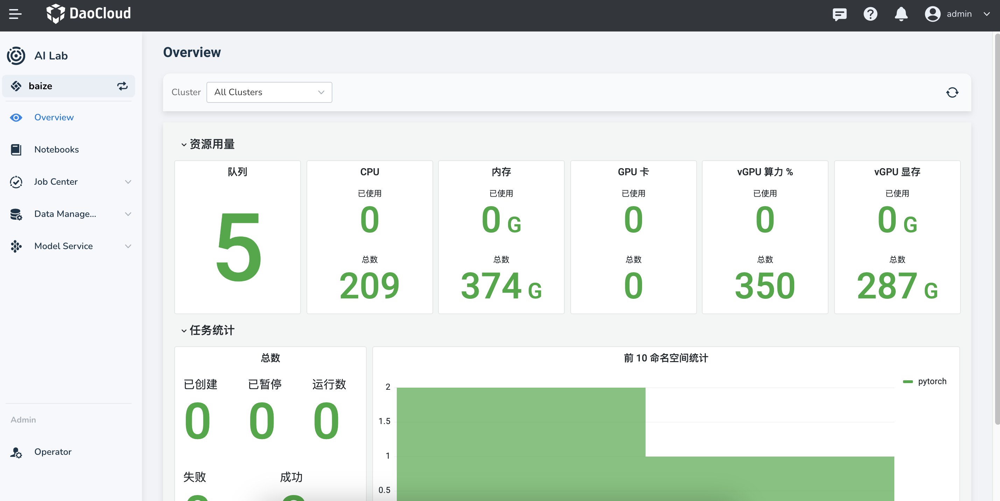

---
hide:
  - toc
---

# Developer Console

The Developer Console is where developers run daily tasks such as AI inference and large language model training.

The overview provides a quick snapshot of the current workspace’s resources and usage,
including details on GPU resources, notebooks, tasks, and datasets.

[Download Center](https://docs.daocloud.io/en/download/){ .md-button .md-button--primary }
[Learn about d.run Token Factory](https://docs.daocloud.io/en/tf/){ .md-button .md-button--primary }
[Learn about d.run AI OS](https://docs.daocloud.io/en/drun/){ .md-button .md-button--primary }
