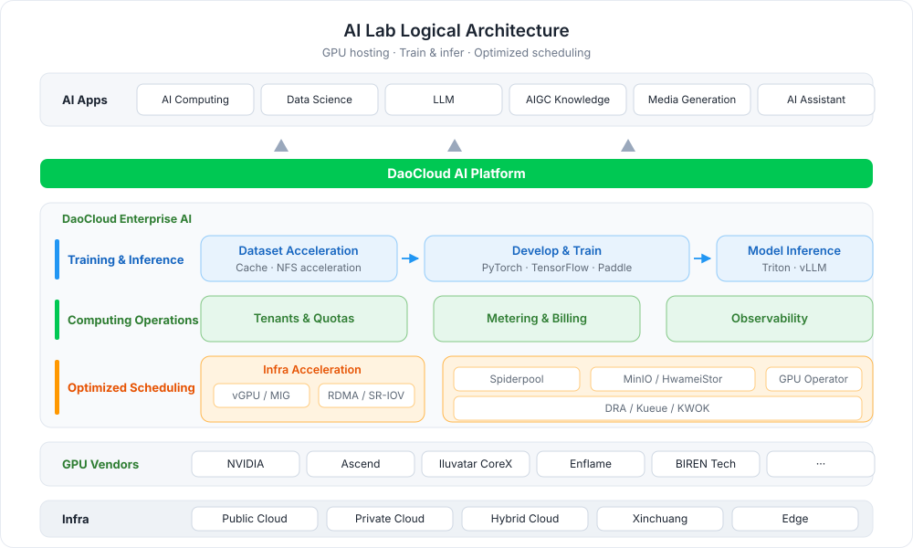
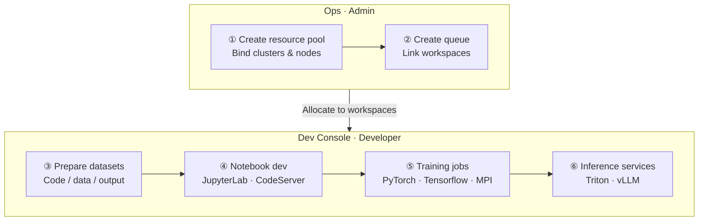

# What is AI Lab

AI Lab (formerly known as Intelligent Computing) is an AI computing platform built on a cloud native
operating system, delivering an integrated software-hardware AI experience.
Leveraging DCE, it consolidates heterogeneous computing power, optimizes GPU performance, and enables
unified scheduling and operation of computing resources to maximize efficiency and reduce costs.
It also provides optimized AI development frameworks covering the complete workflow — Notebook
development, training jobs, data management, and model serving — simplifying AI development and
deployment while accelerating AI adoption across industries.

## Key Capabilities

- :material-server-network:{ .lg .middle } __Fully Managed Computing Resources__

    ---

    Powered by DCE's robust infrastructure, AI Lab supports large-scale computing clusters and
    one-stop management of heterogeneous GPUs, with software-hardware acceleration options such as
    vGPU, pooling CPU, memory, and GPU resources.

    [:arrow_forward: Create a resource pool](../oam/resource/create.md)

- :material-database-outline:{ .lg .middle } __Data Orchestration & Management__

    ---

    Data management for the entire model development process, including dataset management,
    multi-source data access, dataset preheating, and data labeling — optimized from the underlying
    container storage engine for efficient and stable data access.

    [:arrow_forward: Manage datasets](../developer/dataset/index.md)

- :material-notebook-outline:{ .lg .middle } __Development Environment Management__

    ---

    Built for MLOps and LLMOps engineers, offering development environments such as JupyterLab and
    CodeServer, with support for custom images and one-click mounting of GPUs, datasets, and other
    resources.

    [:arrow_forward: Create a Notebook](../developer/notebooks/index.md)

- :material-run-fast:{ .lg .middle } __Training Job Management__

    ---

    Full lifecycle management of training jobs, supporting mainstream frameworks such as PyTorch,
    TensorFlow, PaddlePaddle, and MPI, with native scheduling for single-node, distributed,
    multi-node, and multi-GPU workloads.

    [:arrow_forward: Create a training job](../developer/jobs/index.md)

- :material-expansion-card:{ .lg .middle } __Model Inference Services__

    ---

    With built-in mainstream inference engines such as Triton and vLLM, create inference services
    from trained models in one click, accelerating the final step from training to production.

    [:arrow_forward: Deploy an inference service](../developer/inference/index.md)

- :material-view-dashboard-outline:{ .lg .middle } __Queue & GPU Governance__

    ---

    Associate queues with workspaces to coordinate and isolate queue resources across clusters;
    aggregate GPU resources and usage globally, with current and historical job views for GPU
    stress assessment.

    [:arrow_forward: View GPU information](../oam/gpu.md)

## Workflow

Using AI Lab involves two stages — **operations preparation** and **development**: the administrator
first creates resource pools and queues to allocate computing power to workspaces; developers then
complete the closed loop of data preparation, Notebook development, training jobs, and model serving
in the developer console.

| Step | Role | Description |
| ---- | ---- | ----------- |
| [① Create a resource pool](../oam/resource/create.md) | Admin | Define available CPU, memory, GPU, and other computing resources in the cluster; bind workloads and node types |
| [② Create a queue](../oam/queue/create.md) | Admin | Create queues and associate them with workspaces to coordinate and isolate queue resources across clusters |
| [③ Prepare datasets](../developer/dataset/index.md) | Developer | Create code, data, and output datasets, with multi-source access and preheating support |
| [④ Notebook development](../developer/notebooks/index.md) | Developer | Develop and debug in JupyterLab / CodeServer, with SSH access and custom images |
| [⑤ Submit training jobs](../developer/jobs/index.md) | Developer | Submit single-node or distributed training jobs and analyze them with Tensorboard |
| [⑥ Deploy inference services](../developer/inference/index.md) | Developer | Serve trained models as inference services through Triton / vLLM |

## Quick Start

=== ":material-shield-account: Admin: Prepare the environment"

    

      <a class="baize-path-step" style="--path-c:#2196f3" href="install/">
        1
        Install components
        Deploy the required AI Lab components
        Go →
      </a>
      <a class="baize-path-step" style="--path-c:#00acc1" href="first/">
        2
        First-time use
        Select a workspace and cluster
        Go →
      </a>
      <a class="baize-path-step" style="--path-c:#43a047" href="../oam/resource/create/">
        3
        Create a resource pool
        Plan CPU, memory, and GPU
        Go →
      </a>
      <a class="baize-path-step" style="--path-c:#fb8c00" href="../oam/queue/create/">
        4
        Create a queue
        Associate workspaces and quotas
        Go →
      </a>
      <a class="baize-path-step" style="--path-c:#8e24aa" href="../oam/gpu/">
        5
        View GPUs
        Monitor load, power, and temperature
        Go →
      </a>
    

=== ":material-account: Developer: From training to inference"

    

      <a class="baize-path-step" style="--path-c:#2196f3" href="../developer/quick-start/">
        1
        Quick start
        Full workflow from dataset to training
        Go →
      </a>
      <a class="baize-path-step" style="--path-c:#00acc1" href="../developer/notebooks/">
        2
        Create a Notebook
        Mount GPUs and datasets in one click
        Go →
      </a>
      <a class="baize-path-step" style="--path-c:#43a047" href="../developer/jobs/">
        3
        Submit a training job
        PyTorch / Tensorflow / MPI
        Go →
      </a>
      <a class="baize-path-step" style="--path-c:#fb8c00" href="../developer/dataset/">
        4
        Manage datasets
        Multi-source access and labeling
        Go →
      </a>
      <a class="baize-path-step" style="--path-c:#8e24aa" href="../developer/inference/">
        5
        Deploy an inference service
        Triton / vLLM serving
        Go →
      </a>
    

## Best Practices & Troubleshooting

- :material-book-open-page-variant:{ .lg .middle } __Best Practices__

    ---

    Hands-on experience including fine-tuning ChatGLM3, submitting DeepSpeed training jobs,
    topology-aware scheduling, the checkpoint mechanism, NFS dataset preheating, and deploying
    Label Studio.

    [:arrow_forward: View best practices](../best-practice/index.md)

- :material-format-list-bulleted:{ .lg .middle } __Troubleshooting__

    ---

    Diagnosis and solutions for common issues, such as clusters missing from the dropdown list,
    Notebooks not controlled by queue quotas, and local queue initialization failures.

    [:arrow_forward: View troubleshooting](../troubleshoot/index.md)

[Download Center](https://docs.daocloud.io/en/download/){ .md-button .md-button--primary }
[Learn about d.run Token Factory](https://docs.daocloud.io/en/tf/){ .md-button .md-button--primary }
[Learn about d.run AI OS](https://docs.daocloud.io/en/drun/){ .md-button .md-button--primary }
[View the AI Lab User Manual](https://harbor-test2.cn-sh2.ufileos.com/docs/download/ai-lab.pdf){ .md-button .md-button--primary }
