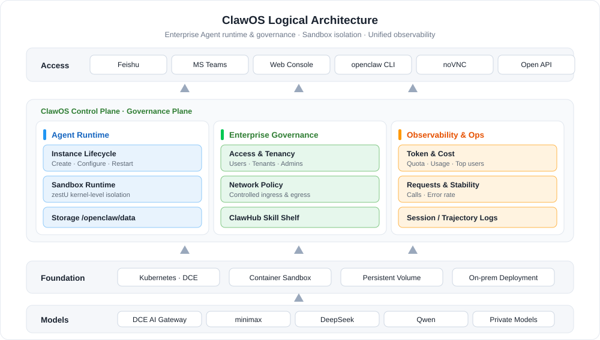
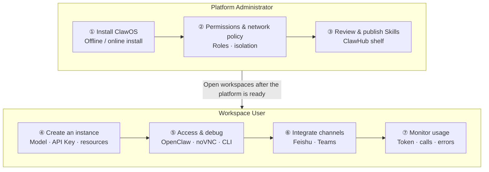

---
hide:
  - toc
---

# What Is ClawOS

ClawOS is an enterprise-grade Agent runtime and governance platform for creating, managing, integrating, observing, and operating AI Agents within an organization. In the current release, the primary type of Agent managed by ClawOS is the OpenClaw instance. In the future, the platform can be extended to support more types of enterprise Agents.

In simple terms, ClawOS is the **control plane** and **governance plane** for running AI Agents within an enterprise. It is not merely an Agent inventory management platform, but integrates Agents into existing enterprise systems for permissions, networking, collaboration, auditing, and operations, making Agent capabilities **manageable, auditable, integrable, and scalable** in enterprise environments.

## Key Capabilities

- :material-cube-outline:{ .lg .middle } __Instance Lifecycle Management__

    ---

    Create, view, edit, and delete Agent instances in the console. Each instance corresponds to actual service resources running on cloud-native infrastructure such as Kubernetes. Operational impacts of modifying key configurations (images, resource specifications, models, API Keys) are clearly presented to users.

    [:arrow_forward: Manage OpenClaw instances](../workspace/openclaw.md)

- :material-shield-account:{ .lg .middle } __Permissions and Multi-Tenant Isolation__

    ---

    Capability boundaries follow the enterprise organizational structure: regular users can manage only their own instances, tenant administrators can view instance status within their workspaces, and platform administrators can manage global resources, policies, and configurations.

    [:arrow_forward: View ClawOS permissions](../../ghippo/permissions/clawos/)

- :material-lan-connect:{ .lg .middle } __Network Policy Governance__

    ---

    Centrally manage Agent network access boundaries: which instances can access internal services, which can only access designated APIs, which policies are enforced by default, and which are left to users.

    [:arrow_forward: Configure network policies](../admin/network-manage/)

- :material-package-variant-closed:{ .lg .middle } __Skill Management and Distribution__

    ---

    ClawHub works as an enterprise capability shelf: Skills are reviewed, published, distributed, authorized, tracked, and retired, so organizations can accumulate valuable Skills and distribute them to teams and instances by permission.

    [:arrow_forward: Browse the Skill marketplace](../workspace/skill/)

- :material-forum-outline:{ .lg .middle } __Messaging Channel Integration__

    ---

    Integrate enterprise messaging platforms such as Feishu and Microsoft Teams, enabling OpenClaw instances to send and receive messages, process files, and respond to tasks in group chats, private chats, and channels — from "an instance on a platform" to "a digital employee in a collaboration system."

    [:arrow_forward: Integrate Feishu](../workspace/feishu/)

- :material-chart-line:{ .lg .middle } __Observability and Operations__

    ---

    Provides instance status, Token usage, request counts, error rates, top users, and model distribution, along with session transcripts and trajectory logs, so administrators know whether Agents are healthy, whether costs are under control, and what exactly happened during a task.

    [:arrow_forward: View the workspace overview](../workspace/)

## Workflow

Using ClawOS involves two stages: **platform preparation** and **workspace usage**. Administrators first complete the installation, plan permissions and network policies, and publish reviewed Skills to ClawHub;
workspace users then create OpenClaw instances, access and debug them through the OpenClaw page or noVNC, integrate messaging channels such as Feishu and Teams as needed, and continuously monitor usage and cost on the overview page.

| Step | Role | Description |
| ---- | ---- | ----------- |
| [① Install ClawOS](install.md) | Platform Administrator | Install ClawOS components from offline packages or Helm, and integrate with d.run or similar environments |
| [② Permissions and network policy](../admin/network-manage.md) | Platform Administrator | Plan role boundaries and define internal services and external APIs that instances can access |
| [③ Review and publish Skills](../admin/skillmanage-admin.md) | Platform Administrator | Review Skill content, publish to ClawHub, and distribute to teams by permission |
| [④ Create an instance](quickstart.md) | Workspace User | Select cluster, namespace, image, and resources; configure models, API Keys, and messaging channels |
| [⑤ Access and debug](quickstart.md) | Workspace User | Operate instances through the OpenClaw page, the noVNC remote desktop, or the CLI |
| [⑥ Integrate messaging channels](../workspace/feishu.md) | Workspace User | Configure a Feishu custom app or Teams to bring Agents into daily collaboration |
| [⑦ Monitor usage](../workspace/index.md) | Tenant Administrator | Review Token quotas and consumption, request trends, error rates, and model distribution |

## Quick Start

=== ":material-shield-account: Administrator: Platform Setup"

    

      <a class="clawos-path-step" style="--path-c:#2196f3" href="install/">
        1
        Install ClawOS
        Offline package / Helm
        Go →
      </a>
      <a class="clawos-path-step" style="--path-c:#00acc1" href="../../ghippo/permissions/clawos/">
        2
        Permission planning
        Users · tenants · admins
        Go →
      </a>
      <a class="clawos-path-step" style="--path-c:#43a047" href="../admin/network-manage/">
        3
        Network policies
        Define ingress & egress
        Go →
      </a>
      <a class="clawos-path-step" style="--path-c:#fb8c00" href="../admin/skillmanage-admin/">
        4
        Publish Skills
        Review and publish to ClawHub
        Go →
      </a>
      <a class="clawos-path-step" style="--path-c:#8e24aa" href="../admin/">
        5
        Global overview
        Platform-wide usage & risks
        Go →
      </a>
    

=== ":material-account: Workspace User: Create & Use Agents"

    

      <a class="clawos-path-step" style="--path-c:#2196f3" href="quickstart/">
        1
        Quick start
        Create and access your first instance
        Go →
      </a>
      <a class="clawos-path-step" style="--path-c:#00acc1" href="../workspace/openclaw/">
        2
        Instance management
        View · edit · delete instances
        Go →
      </a>
      <a class="clawos-path-step" style="--path-c:#43a047" href="../workspace/feishu/">
        3
        Feishu integration
        Bring Agents into chats
        Go →
      </a>
      <a class="clawos-path-step" style="--path-c:#fb8c00" href="../workspace/teams-info/">
        4
        Teams configuration
        Integrate Microsoft Teams
        Go →
      </a>
      <a class="clawos-path-step" style="--path-c:#8e24aa" href="../workspace/">
        5
        Usage monitoring
        Tokens · calls · error rate
        Go →
      </a>
    

## OpenClaw vs. ClawOS

**OpenClaw** is a new-generation open-source AI Agent runtime designed to evolve AI from "passively answering questions" to "actively planning and executing tasks": it combines model capabilities with tool calling, file systems, terminal commands, browser automation, APIs, Skills, and multi-Agent collaboration to accomplish complex end-to-end tasks.

| Capability Dimension | Traditional AI Assistants | OpenClaw Agents |
| -------------------- | ------------------------- | --------------- |
| Interaction Model | Passive Q&A and single-turn responses | Active planning and autonomous multi-step execution |
| Capability Boundary | Text generation only | Calls tools, interacts with operating systems, executes code |
| Typical Scenarios | Information retrieval and simple generation | End-to-end automated workflows |

| Object | Positioning |
| ------ | ----------- |
| OpenClaw | The runtime object that provides task execution capabilities for Agents |
| ClawOS | The runtime and governance platform that enables Agents to run in a controlled manner within enterprises |

If each OpenClaw instance is configured, maintained, and integrated with models and tools independently by individuals, enterprises will quickly encounter uncontrolled permissions, invisible costs, inaccessible logs, and unreusable Skills. The value of ClawOS is to make distributed Agents **runnable, manageable, observable, and auditable**, transforming Agents from **personal tools** into **enterprise operational assets**.

## Typical Use Cases

### HR Resume Screening at Scale

When dealing with dozens of PDF resumes in different formats, OpenClaw can automatically read them, extract key technology stacks, rank candidates according to job requirements, and generate structured evaluation reports. What previously required half a day of manual work can now be completed in minutes.

!!! note

    Resumes contain personally identifiable information (PII). d.run private deployment ensures that data never leaves the internal network and prevents resumes from being sent to external public cloud APIs.

### Software Development Assistant

By integrating with GitHub and configuring a multi-Agent architecture (Main Agent + Research + Reviewer + Codex), OpenClaw can analyze source code, locate bugs, create pull requests, and execute CI standards, creating a fully customized automated development orchestrator.

### Batch Document Review

Package the entire workflow—"read documents → extract key data → validate rules → generate review comments"—into a reusable custom Skill (`createSkill`) and process dozens of reports with one click while generating a consolidated CSV output, eliminating repetitive work.

## Why ClawOS

| Advantage | Description |
| --------- | ----------- |
| One-Click Creation, Ready to Use | No manual environment configuration, model integration, or permission setup is required. The system automatically creates sandboxes and injects Tokens, allowing business users to start immediately without IT involvement. |
| Secure Sandbox Isolation | Each OpenClaw instance runs in an isolated container sandbox powered by DaoCloud's **zestU** kernel-level isolation technology. Even if compromised, the impact is strictly confined to the sandbox and cannot penetrate the internal network or tamper with host files. |
| Persistent Data | `/openclaw/data` is stored on a persistent volume, so OpenClaw work files and FileBrowser uploads are retained when the Pod restarts or is recreated. Files saved in noVNC under `/home/node` or other directories are not guaranteed to persist. See the [FAQ](../faq.md). |
| Secure and Controlled Model Access | All model requests are routed through the AI Gateway and governed by security policies, without exposing public endpoints. Data and conversations remain protected within the platform. |
| Full Backend Access | Provides both [SSH access and noVNC web access](quickstart.md#backend-debugging-for-openclaw), supporting full CLI operations and meeting advanced debugging and customization requirements. |

## More Resources

- :material-format-list-bulleted:{ .lg .middle } __FAQ__

    ---

    Answers to common questions about instance creation and access, data persistence directories, Token quotas, and more.

    [:arrow_forward: View the FAQ](../faq.md)

- :material-book-open-page-variant:{ .lg .middle } __Upgrade and Compatibility__

    ---

    Upgrade notes and version compatibility details. Read them carefully before upgrading.

    [:arrow_forward: View upgrade notes](upgrade-notes.md)

- :material-console:{ .lg .middle } __Gateway API Access__

    ---

    Reference configuration for accessing OpenClaw instances through Gateway API.

    [:arrow_forward: View the reference](../reference/gateway-access.md)

[Download Center](https://docs.daocloud.io/en/download/){ .md-button .md-button--primary }
[Learn about d.run Token Factory](https://docs.daocloud.io/en/tf/){ .md-button .md-button--primary }
[Learn about d.run AI OS](https://docs.daocloud.io/en/drun/){ .md-button .md-button--primary }
[View or Download the ClawOS User Manual](https://harbor-test2.cn-sh2.ufileos.com/docs/download/ClawOS.pdf){ .md-button .md-button--primary }
