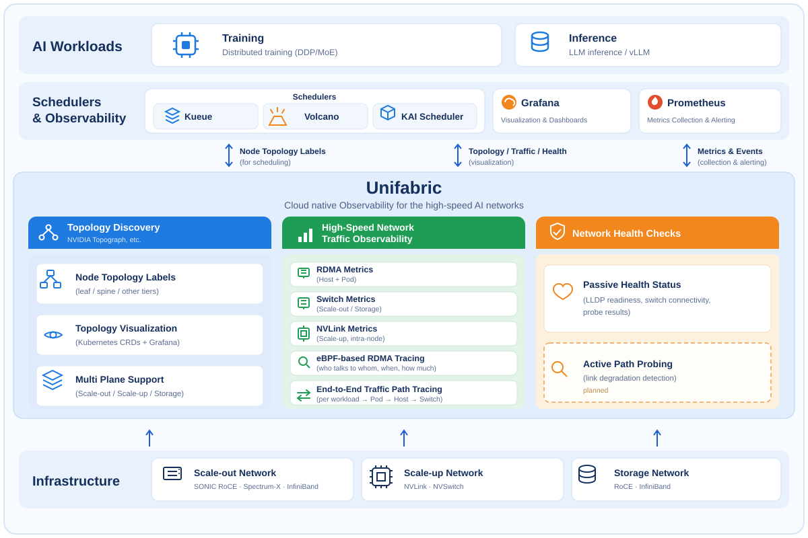
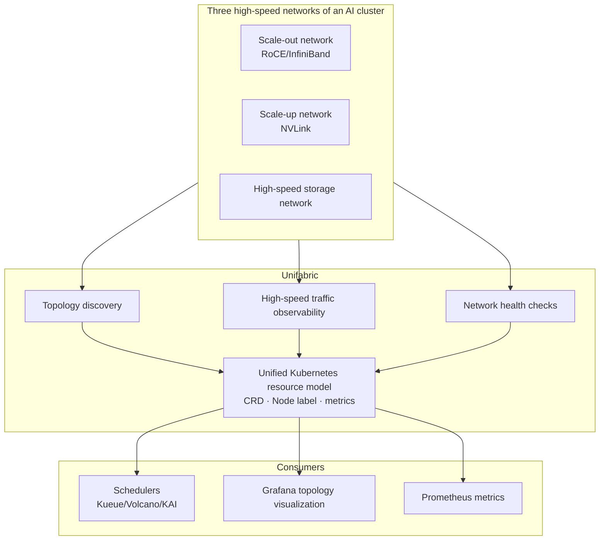

# Unifabric

Unifabric is an open source **cloud native observability platform for high-speed AI networks**, developed and incubated by DaoCloud.

Modern AI clusters rely on three high-speed networks — the scale-out network for cross-node GPU communication (RoCE/InfiniBand), the scale-up network for intra-node GPU interconnects (NVLink/NVSwitch), and high-speed storage networks. Training and inference performance depends heavily on all three: congestion or degradation on a single link can slow down an entire job, or even interrupt training.

> **Unifabric fills the "last mile" of AI workload observability in a cloud native way.**
>
> It automatically discovers the topology of the three networks, observes RDMA traffic with attribution to workloads, and passively collects network health status; NVLink traffic metrics and active path probing are planned.

Unifabric is written in Go and released under the [Apache License 2.0](https://github.com/unifabric-io/unifabric/blob/main/LICENSE).
The project was created by DaoCloud on 2026-04-19 and is under active incubation.

## Why Unifabric

To the cloud native ecosystem, the three high-speed networks are almost a black box:

| Typical pain point | Description |
| --- | --- |
| Hardware observability tools are siloed | The three networks consist of switches, routers, and NICs from multiple vendors, whose monitoring tools are isolated from one another and disconnected from the Kubernetes resource model and monitoring stack |
| Existing solutions do not cover high-speed networks | Current cloud native observability solutions are built around TCP/IP and do not cover RDMA or NVLink |
| Anomalies cannot be attributed to workloads | Network anomalies cannot be attributed to specific Pods or training jobs, so troubleshooting means manually inspecting devices one by one |
| Observability is disconnected from scheduling | Network topology information never reaches scheduling decisions, so communication-heavy tasks may be placed on nodes across remote switch domains |

Regardless of the underlying hardware vendor, Unifabric presents observability results through a unified Kubernetes resource model (CRDs, Node labels, metrics).
And observability does not stop at dashboards — topology labels are consumed directly by schedulers such as Kueue and Volcano, improving training and inference efficiency across the AI cluster.

## Architecture

Unifabric is built on top of the scale-out, scale-up, and storage networks: it either discovers these networks directly or imports topologies from NVIDIA Topograph and NetQ,
then exposes three core capabilities through a unified Kubernetes resource model, consumed by schedulers, Grafana, and Prometheus.

## Core features

### Topology discovery

Real-time discovery of the connections between hosts, switches, and other devices across the three networks,
turning physical topology scattered across individual network devices into standard Kubernetes resources ready for consumption.

- **Layered Node label publication**: node positions in the network hierarchy (leaf, spine, and so on) are automatically written to Node labels,
  ready to be consumed by schedulers such as Kueue TAS, Volcano, and KAI Scheduler, so communication-intensive tasks are consolidated
  within the same switch domain — shortening communication paths and improving training and inference efficiency.
- **Topology visualization**: publishes `Topology` resources and renders the full-fabric topology interactively in Grafana,
  so operators can grasp global connectivity without logging into switches, and quickly confirm affected nodes and links during troubleshooting.
- **Environment coverage**: supports generic SONiC RoCE switches (via LLDP discovery), NVIDIA Spectrum-X, and
  InfiniBand (imported from NVIDIA Topograph); works on both bare metal and cloud environments.

### High-speed traffic observability

Traffic data is collected by reading NIC counters, scraping switch metrics, and attaching eBPF probes,
then uniformly attributed to Pods, namespaces, workloads, and hosts — turning device-perspective traffic into business-perspective observability.

- **RDMA metrics for host and Pod NICs**: throughput, congestion, and error counters provide endpoint data for performance analysis and troubleshooting.
- **Pod identity association for switch traffic**: RDMA traffic on switches in the scale-out and storage networks is associated with specific Pods,
  closing the gap between "device traffic" and "business identity".
- **eBPF-based RDMA flow observability**: RDMA communication bypasses the kernel protocol stack, so packet capture and connection tracking are both ineffective.
  For CPU-initiated RDMA communication, Unifabric attaches eBPF probes along the commit path of the verbs library and reconstructs Pod-level RDMA flows
  without modifying applications — who is talking to whom, when, and how much per message — making RDMA communication as observable as TCP connections.
- **NVLink traffic metrics (planned)**: collects NVLink metrics for GPU-to-GPU communication within the scale-up network,
  making the traditionally invisible intra-node GPU interconnects observable.

### Network health checks

Continuous inspection of links and configurations across the three networks to surface problems proactively,
instead of troubleshooting after workloads report failures.

- **Passive health state collection**: continuously gathers LLDP readiness, switch connectivity, and probe results, reflecting the health of network infrastructure in real time.
- **Active path probing and link degradation detection (planned)**: actively injects traffic to probe network paths and detect link degradation before alerts fire.

## Typical use cases

- **When training/inference jobs slow down**: correlate RDMA metrics across switches, Pod NICs, and other hops at the AI workload level
  to locate communication hotspots and identify bandwidth-heavy applications.
- **During performance analysis and tuning**: examine the timing, peers, and message sizes of Pod RDMA communication to verify whether communication patterns match expectations.
- **When troubleshooting congestion or anomalies**: use prebuilt Grafana dashboards to quickly answer "whose traffic affected whom" and determine the blast radius.
- **During routine inspection of large clusters**: keep a continuous view of link and switch health without manually checking devices one by one.
- **Before launching long-running training jobs**: verify network path health in advance to avoid jobs being interrupted or slowed down by link degradation or misconfiguration.

## Quick start

Follow the [deployment guide](https://github.com/unifabric-io/unifabric/blob/main/docs/getting-started.md) to install Unifabric.
It covers the default SONiC RoCE network as well as InfiniBand and NVIDIA Spectrum-X environments.

After installation, refer to the usage docs for each capability:

- Topology discovery and visualization: [topology visualization](https://github.com/unifabric-io/unifabric/blob/main/docs/usage/topology-visualization.md)
- Topology-aware scheduling: [Kueue/Volcano/KAI scheduler integration](https://github.com/unifabric-io/unifabric/blob/main/docs/usage/workload-tas.md)
- RDMA metrics: [RDMA metrics](https://github.com/unifabric-io/unifabric/blob/main/docs/usage/rdma-metrics.md)
- RDMA flow attribution: [RDMA flow attribution](https://github.com/unifabric-io/unifabric/blob/main/docs/usage/rdma-flow.md)
- Switch traffic observability: [Switch Agent deployment (host proc)](https://github.com/unifabric-io/unifabric/blob/main/docs/usage/switch-agent-host-proc.md) and
  [Switch Agent deployment (systemd)](https://github.com/unifabric-io/unifabric/blob/main/docs/usage/switch-agent-systemd.md)

## Roadmap

Planned features and future directions (including NVLink traffic metrics and active path probing) are described in the
[roadmap](https://github.com/unifabric-io/unifabric/blob/main/docs/roadmap.md).

## Community and contributing

Contributions are welcome:

- Report bugs or suggest features via [GitHub issues](https://github.com/unifabric-io/unifabric/issues).
- Set up a development environment with the [NVAIR development guide](https://github.com/unifabric-io/unifabric/blob/main/docs/development/dev-with-nvair.md).
- Before submitting a pull request, run `make build`, `make test-unit`, and `make check-license`.
- Sign off commits with `git commit -s` per the [Developer Certificate of Origin](https://developercertificate.org/).

[Join the Unifabric GitHub community](https://github.com/unifabric-io/unifabric){ .md-button }
