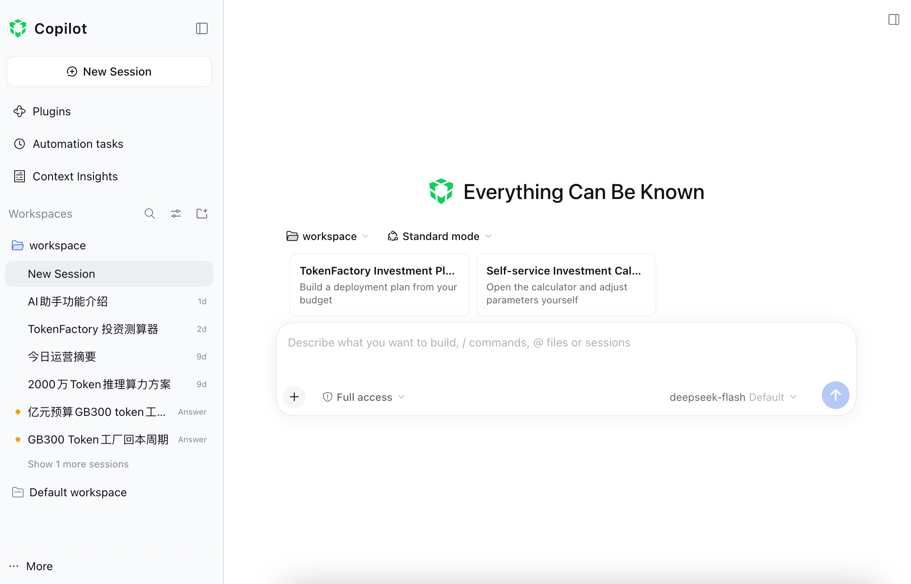

# DCE Assistant

DCE Assistant is designed for platform administrators, operations engineers, and GPU resource administrators. It supports querying platform information, checking cluster health, troubleshooting Pod failures, and analyzing GPU resource bottlenecks through natural language, helping users understand running conditions, locate problems, and develop handling plans.

DCE Assistant is built on DeepSeek Harness and completes tasks by combining the model API, Skills, and platform tools. Skills define the processing methods for specific tasks, tools access platform and running data, and analysis results can be presented as text, tables, and charts.

## Core Capabilities

### Platform Information Query

Queries platform resources and related information based on user needs, providing a basis for status assessment and problem analysis.

- **Resource query**: Queries clusters, namespaces, workloads, and other resources to understand resource configuration and current status.
- **Multi-module access**: Accesses the module APIs already integrated by DCE CLI, including Global Management, Container Management, Observability, AI Lab, LLM Studio, Application Workbench, Billing Management, and more.

The information available for query depends on the modules installed in the target environment, API versions, and access permissions. CLI access to a module indicates the corresponding data access capability; specialized diagnosis or business analysis of that module still requires the support of the corresponding Skills.

### Cluster Health Check and Diagnosis

Checks the running status of clusters, nodes, and Pods, and identifies anomalies and their impact based on events.

- **Cluster status check**: Checks whether a cluster is accessible and running normally.
- **Node and Pod anomaly detection**: Identifies nodes that are not ready, cordoned, or under resource pressure, and summarizes abnormal Pods and their namespaces.
- **Correlation analysis**: Analyzes possible causes by combining node conditions, Pod status, and events, and provides problem priorities and handling suggestions.

### Pod Failure Diagnosis

Collects the status, events, container logs, and related configurations of a specified Pod, and analyzes the causes of startup failures or running anomalies.

- **Common failure troubleshooting**: Covers anomalies such as Pending, CrashLoopBackOff, OOMKilled, ImagePullBackOff, and Evicted.
- **Related resource check**: Checks the owning workload, the node where the Pod runs, resource limits, node selectors, affinity and toleration configurations, and more.
- **Diagnosis explanation**: Lists the events, exit codes, container statuses, or key logs that support the judgment, and provides follow-up handling suggestions.

### GPU Capacity and Bottleneck Analysis

Analyzes the resource capacity, allocation, and actual usage of one or more GPU clusters, and estimates the resource pressure after workload growth.

- **Capacity and headroom analysis**: Views the number of GPUs, allocated resources, core utilization, and memory usage, distinguishing scheduling headroom from actual computing headroom.
- **Workload growth estimation**: Combines the current load, GPU workloads, and HPA configurations to analyze possible computing, scheduling, or memory bottlenecks after traffic growth.
- **Solution comparison**: Based on resource headroom and bottleneck types, proposes suggestions such as scaling out, rate limiting, routing adjustment, or resource reconfiguration, with the basis and assumptions explained.

GPU bottleneck analysis requires actual capacity and utilization data. When QPS data is unavailable, utilization-based estimation can be performed with explicit assumptions; when necessary resource or utilization data is missing, the data needs to be supplemented first. Estimation results are for planning assistance only; actual carrying capacity still needs to be verified with business workloads and performance tests.

## How It Works

DCE Assistant is built on DeepSeek Harness to organize conversations and analysis tasks. The model API handles requirement understanding and reasoning, Skills provide analysis methods, and the CLI and data plugins handle data access and result presentation.

| Component | Main Responsibility |
| --- | --- |
| Conversation interface | Receives user questions and presents answers and analysis results |
| DeepSeek Harness | Manages conversation context, loads Skills, and organizes model interactions and tool calls |
| Model API | Understands requirements, reasons over the data returned by tools, and generates answers |
| Skills | Define the check steps, analysis methods, output requirements, and capability boundaries of a task |
| CLI tools | Query platform and running data through DCE CLI and other tools |
| Data plugins | Retrieve and normalize data, and prepare display information for charts and tables |

## UI and Result Presentation

DCE Assistant provides a standard conversation UI and a scenario-based visual UI. In both UIs, you can ask questions, view analysis results, and continue follow-up questions around the results.

### Standard Conversation UI

The standard conversation UI centers on the conversation list and chat content, making it easy to start conversations, view history, and conduct continuous Q&A in the workspace. It suits daily queries, problem troubleshooting, and in-depth analysis.

### Scenario-Based Visual UI

The scenario-based visual UI adopts a 3D scenario layout that presents different topics and recommended questions together. You can select a recommended question or directly enter your request to talk with the assistant in the current UI. It suits scenario browsing and demonstration.

<!--  -->

## Skills and Capability Extension

The main capabilities of DCE Assistant rely on the Skills provided by [daocloud-skills](https://github.com/DaoCloud/daocloud-skills). These Skills define the methods for platform queries, failure diagnosis, and resource analysis, and determine which problems the assistant can handle. The following table lists the current main capabilities and corresponding Skills. The actual capability scope is subject to the loaded Skills and their versions:

| Skill | Capability Scope |
| --- | --- |
| [dce](https://github.com/DaoCloud/daocloud-skills/blob/main/skills/dce/SKILL.md) | Supports platform information queries and data retrieval |
| [container-management:cluster-diagnosis](https://github.com/DaoCloud/daocloud-skills/blob/main/skills/container-management-cluster-diagnosis/SKILL.md) | Cluster health check and anomaly diagnosis |
| [container-management:pod-diagnosis](https://github.com/DaoCloud/daocloud-skills/blob/main/skills/container-management-pod-diagnosis/SKILL.md) | Pod failure diagnosis |
| [container-management:gpu-bottleneck-analysis](https://github.com/DaoCloud/daocloud-skills/blob/main/skills/container-management-gpu-bottleneck-analysis/SKILL.md) | GPU capacity and bottleneck analysis |

Extending or updating Skills can add analysis methods and applicable scenarios. New capabilities also require corresponding query tools, platform APIs, data sources, and access permissions. Data plugins provide presentation capabilities and do not replace the business methods and data required for specialized analysis.

[Install DCE Assistant](./install.md){ .md-button }
[Learn about daocloud-skills](https://github.com/DaoCloud/daocloud-skills){ .md-button }
[View compatibility notes](../compatibility.md){ .md-button }
