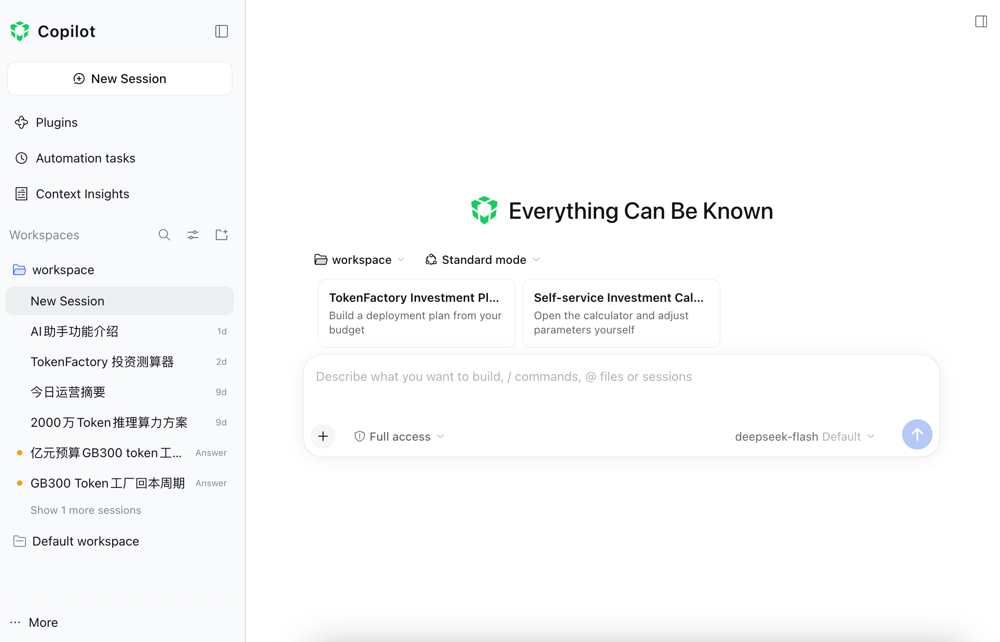

# Installation

This page describes how to install DCE Assistant offline and online. DCE Assistant uses [the same architecture](../index.md) and the same Helm Chart as Copilot. The Chart name is `copilot`, and it is published in the Helm repository `https://release.daocloud.io/chartrepo/agentclaw`.

!!! info

    Installer v0.45.0 and later can install this Chart, including a GitOps install and ExistingSecret. The steps below install this Helm Chart on its own. For supported Kubernetes versions, see [Compatibility](../compatibility.md).

## Installation Parameters {#parameters}

| Item | Value |
| -- | -- |
| Chart | `copilot` |
| Helm repository | `https://release.daocloud.io/chartrepo/agentclaw` |
| Release name | `tokenfactory-copilot` |
| Namespace | `copilot-system` |
| Deployment / Service | `tokenfactory-copilot` |
| Example Chart version | `0.3.0-rc2` |

Install this Chart once in a cluster. The release name, namespace, and access path use the same values as Copilot. When release `tokenfactory-copilot` is already present, enable the DCE CLI credential on that release. See [Copilot is already installed](#existing).

## Prerequisites {#prerequisites}

1. See [Compatibility](../compatibility.md) for Kubernetes versions.

2. The default install publishes the entry through the platform subpath, so the cluster needs ghippo. `global.gproduct.positionType` defaults to `header-action`, which requires ghippo v0.48.1 or later. For an older ghippo, set it to `normal`:

    ```yaml
    global:
      gproduct:
        positionType: normal
    ```

3. Prepare a model API key. Put it in a Secret before installing the Chart, and keep it out of Helm values:

    ```shell
    kubectl create namespace copilot-system
    kubectl -n copilot-system create secret generic tokenfactory-copilot-credentials \
      --from-literal=OPENAI_API_KEY='<api-key>'
    ```

    The default model endpoint is `https://api.deepseek.com` and the model ID is `deepseek-flash`. With that endpoint, web search reuses the same `OPENAI_API_KEY`. If you point the model at another endpoint, web search still calls the official DeepSeek API and needs `DEEPSEEK_API_KEY` in the same Secret.

4. Prepare DCE CLI credentials. Platform queries, cluster health checks, Pod failure diagnosis, and GPU bottleneck analysis all use this credential to reach the platform. Use an account that can only query. Open **Personal Center** -> **Access Keys** from the menu in the upper-right corner, create a key by following [Access key](../../ghippo/user-guide/personal-center/accesstoken.md), then store the existing local `hosts.yml` in a Secret:

    ```shell
    kubectl -n copilot-system create secret generic tokenfactory-dce-hosts \
      --from-file=hosts.yml="$HOME/.config/dce/hosts.yml"
    ```

    When the machine has no `hosts.yml`, the Chart can render one from the platform address and access key. The rendered file uses `user: admin` and `insecure: true`. The access key is then stored in Helm values, so prefer the Secret above. See [CLI Credentials](#cli) for both forms.

5. Set `dsh.entrypoint` to the address browsers use to open the platform. Include only the scheme and host, with no path, for example `https://platform.example.com`. After it is set, the proxy accepts browser requests only from that origin and returns 403 for any other origin. When it is left empty, the request `Origin` must match `Host`.

Set these values during installation:

| Parameter | Example | Description |
| -- | -- | -- |
| `dsh.model.existingSecretRef` | `tokenfactory-copilot-credentials` | Secret that contains `OPENAI_API_KEY`. It takes precedence over an inline key |
| `dceAuth.enabled` | `true` | Enable the DCE CLI credential |
| `dceAuth.existingSecretRef` | `tokenfactory-dce-hosts` | Secret that contains `hosts.yml`. It takes precedence over an inline access key |
| `dsh.entrypoint` | `https://platform.example.com` | Platform address, scheme plus host |

Setting `dsh.model.apiKey` directly also starts the assistant. The key is then stored in the Helm release, so this is not recommended.

The install commands below use an existing Secret. To let the Chart render the credential from the platform address and access key, remove `--set-string dceAuth.existingSecretRef=tokenfactory-dce-hosts` and set `--set-string dceAuth.host='<platform-address-or-ip>' --set-string dceAuth.oauthToken='<access-key>'` instead.

New sessions open in operations mode. `dsh.opsMode` defaults to `primary`. Platform queries and diagnosis run in that mode.

## Online Installation

!!! info

    Online installation uses the [prerequisites](#prerequisites) above.

### Install with Helm

```bash
helm repo add agentclaw https://release.daocloud.io/chartrepo/agentclaw
helm repo update
helm search repo agentclaw/copilot --versions --devel

helm upgrade --install tokenfactory-copilot agentclaw/copilot \
  --namespace copilot-system \
  --version 0.3.0-rc2 \
  --set-string dsh.entrypoint='https://<platform-address>' \
  --set-string dsh.model.existingSecretRef=tokenfactory-copilot-credentials \
  --set dceAuth.enabled=true \
  --set-string dceAuth.existingSecretRef=tokenfactory-dce-hosts
```

Replace `0.3.0-rc2` with the version you select from `helm search`.

### Install Through the Kpanda UI

In **Helm Apps** -> **Helm Repositories**, add `https://release.daocloud.io/chartrepo/agentclaw`. Then open **Helm Templates**, find the `copilot` Chart, and install it. Set the release name to `tokenfactory-copilot`, the namespace to `copilot-system`, and set `dsh.entrypoint`, `dsh.model.existingSecretRef`, `dceAuth.enabled`, and `dceAuth.existingSecretRef`.

## Offline Installation

Online installation uses the Chart repository `https://release.daocloud.io/chartrepo/agentclaw`, which can be read without logging in. The download center does not yet publish an offline package for this Chart. On a machine that can reach this repository, export a bundle with charts-syncer and copy it to the target environment. After the download center publishes an offline package, use that package. The loading steps below stay the same.

### Export the Offline Bundle

The `agentclaw` repository also contains other Charts. Select only `copilot` so unrelated images are not packed into the bundle.

1. Create `save-bundles.yaml`.

    ```yaml title="save-bundles.yaml"
    relocateContainerImages: true
    source:
      repo:
        kind: HARBOR
        url: https://release.daocloud.io/chartrepo/agentclaw
    target:
      intermediateBundlesPath: copilot-offline
    charts:
      - name: copilot
        versions:
          - 0.3.0-rc2
    ```

    If pulling images requires a login, set the registry, username, and password under `source.containers.auth`. Replace `0.3.0-rc2` with the Chart version to export.

2. Export the bundle.

    ```shell
    charts-syncer sync --config save-bundles.yaml
    ```

    Copy the bundle from the `copilot-offline` directory to the target environment. Use it as the input of the next step. Do not run `helm install` on it directly.

### Load Images and the Chart from the Bundle

When the environment has an image registry, sync with charts-syncer. When there is no Chart repository and the package contains `images.tar`, load the images on the nodes with Docker or containerd.

#### Sync to an Image Registry with charts-syncer

1. Create `load-image.yaml`.

    !!! note

        Replace the addresses, username, and password with those of the target registry. `intermediateBundlesPath` is relative to the directory where you run charts-syncer.

    === "Chart repository already installed"

        ```yaml title="load-image.yaml"
        source:
          intermediateBundlesPath: copilot-offline # (1)!
        target:
          containerRegistry: 10.16.10.111 # (2)!
          containerRepository: release.daocloud.io/agentclaw # (3)!
          repo:
            kind: HARBOR
            url: http://10.16.10.111/chartrepo/release.daocloud.io # (4)!
            auth:
              username: "admin" # (5)!
              password: "Harbor12345" # (6)!
          containers:
            auth:
              username: "admin" # (7)!
              password: "Harbor12345" # (8)!
        ```

        1. Path relative to the charts-syncer command
        2. Target image registry
        3. Project path in the target image registry
        4. Target Chart repository URL
        5. Chart repository username
        6. Chart repository password
        7. Image registry username
        8. Image registry password

    === "No Chart repository"

        ```yaml title="load-image.yaml"
        source:
          intermediateBundlesPath: copilot-offline # (1)!
        target:
          containerRegistry: 10.16.10.111 # (2)!
          containerRepository: release.daocloud.io/agentclaw # (3)!
          repo:
            kind: LOCAL
            path: ./local-repo # (4)!
          containers:
            auth:
              username: "admin" # (5)!
              password: "Harbor12345" # (6)!
        ```

        1. Path relative to the charts-syncer command
        2. Target image registry
        3. Project path in the target image registry
        4. Directory for the Chart package
        5. Image registry username
        6. Image registry password

2. Sync the images and the Chart.

    ```shell
    charts-syncer sync --config load-image.yaml
    ```

    charts-syncer rewrites the image addresses in the Chart. When installing that rewritten Chart, do not override the image registry parameters.

#### Load Directly with Docker or containerd

If the extracted package contains `images.tar` (usually together with `hints.yaml` and `original-chart`), load it on every node. Sync the intermediate bundle exported by charts-syncer into a registry with the previous section instead of loading it here.

1. Extract the package.

    ```shell
    tar xvf <offline-package>.tar
    ```

2. Load the images.

    === "Docker"

        ```shell
        docker load -i images.tar
        ```

    === "containerd"

        ```shell
        ctr -n k8s.io image import images.tar
        ```

!!! note

    Load the images on every node, then tag them to the registry address used at install time. When you tag them yourself, `image.registry`, `copilotArtifacts.skillsImage.registry`, and `copilotArtifacts.bigscreenImage.registry` must match the tagged address. The default is `release.daocloud.io/agentclaw`, which already includes the registry project path.

### Offline Installation Steps

Create the Secrets from [Prerequisites](#prerequisites), then install the Chart.

#### Install Through the Kpanda UI

In **Helm Apps**, refresh the offline repository and open the `copilot` Chart. Set the release name to `tokenfactory-copilot`, the namespace to `copilot-system`, and set `dsh.entrypoint`, `dsh.model.existingSecretRef`, `dceAuth.enabled`, and `dceAuth.existingSecretRef`.

#### Install with Helm

Replace `<chart>` with `copilot` from the private repository, or with the Chart package in the output directory when the target kind is LOCAL. Include `--version` when installing from a repository. You can omit it when installing a local Chart package.

```bash
helm upgrade --install tokenfactory-copilot <chart> \
  --namespace copilot-system \
  --version 0.3.0-rc2 \
  --set-string dsh.entrypoint='https://<platform-address>' \
  --set-string dsh.model.existingSecretRef=tokenfactory-copilot-credentials \
  --set dceAuth.enabled=true \
  --set-string dceAuth.existingSecretRef=tokenfactory-dce-hosts
```

## Copilot Is Already Installed {#existing}

Copilot and DCE Assistant use the same release. When `tokenfactory-copilot` is already installed, add the DCE CLI credential. Set `--version` to that release's current Chart version. `--reuse-values` keeps the current image tags and the rest of the configuration:

```bash
helm upgrade tokenfactory-copilot agentclaw/copilot \
  --namespace copilot-system \
  --reuse-values \
  --version 0.3.0-rc2 \
  --set dceAuth.enabled=true \
  --set-string dceAuth.existingSecretRef=tokenfactory-dce-hosts
```

Without `--version`, Helm selects the latest stable chart. To upgrade the Chart version, use the complete values file in [Upgrade](#upgrade) and keep `dceAuth` in that file.

## Access

The platform subpath is enabled by default. After installation, open `https://<platform-address>/copilotui/` in a browser. The platform navigation opens that address in a new window. The navigation item published by the Chart is named Copilot.



The UI entries, model name, and example prompts follow the installed version and configuration. New sessions use operations mode.

On first startup, DeepSeek Harness prints a one-time URL in the logs. Do not paste the token from that URL into a ticket or chat:

```shell
kubectl logs deploy/tokenfactory-copilot -n copilot-system | grep 'dsh web:'
```

!!! warning

    The browser UI has no per-user isolation. Anyone who can open the page uses the same agent. The default `dsh.permissionMode` is `danger-full-access`, so the agent can run commands inside the Pod. Keep the model key, the DCE CLI credential, and network access narrowly scoped. The Pod does not mount a ServiceAccount token.

    The current Skills provide queries, analysis, and suggestions. Restart, deletion, scaling, and routing changes are still performed by the user in the platform.

## Optional Settings

### CLI Credentials {#cli}

The Chart mounts `hosts.yml` read-only at `$HOME/.config/dce/hosts.yml`.

To use an existing Secret, set:

```yaml
dceAuth:
  enabled: true
  existingSecretRef: tokenfactory-dce-hosts
```

To let the Chart render the Secret, set the platform address and [access key](../../ghippo/user-guide/personal-center/accesstoken.md) instead. When `existingSecretRef` is set, that Secret is used:

```yaml
dceAuth:
  enabled: true
  host: 10.6.216.82
  oauthToken: <access-key>
```

`dceAuth` is the credential used by the CLI. On the platform subpath, signing in to the page with a platform account is controlled by `global.gproduct.proxy.dceLogin`, which is enabled by default and is separate from `dceAuth`. `global.gproduct.proxy.authnCheck` defaults to `false`. Setting it to `true` also requires `dceLogin` to be enabled.

### Session Persistence

`persistence.enabled` defaults to `false`. Sessions stay on an `emptyDir` and are discarded when the Pod is replaced. Enable a PVC to keep sessions. The default is 5Gi, `ReadWriteOnce`, mounted at `/opt/data`. The Deployment uses `Recreate` so two Pods do not mount the same volume.

Each start replaces the `copilot-skills` directory on the volume. Do not store custom files there.

### Dedicated Host

Set `global.gproduct.proxy.enabled` to `false` to serve DCE Assistant at the root of `dsh.entrypoint`. This mode requires Ingress. It has no Ghippo authentication and no platform-account login, so restrict access at the gateway.

```bash
helm upgrade --install tokenfactory-copilot agentclaw/copilot \
  --namespace copilot-system \
  --version 0.3.0-rc2 \
  --set-string dsh.model.existingSecretRef=tokenfactory-copilot-credentials \
  --set dceAuth.enabled=true \
  --set-string dceAuth.existingSecretRef=tokenfactory-dce-hosts \
  --set global.gproduct.proxy.enabled=false \
  --set-string dsh.entrypoint='https://assistant.example.com' \
  --set ingress.enabled=true \
  --set-string ingress.className=nginx
```

## Upgrade {#upgrade}

Replace the three image tags together. A tag is `v` plus the Chart version, for example `v0.3.0-rc2`. The fields are `image.tag`, `copilotArtifacts.skillsImage.tag`, and `copilotArtifacts.bigscreenImage.tag`.

Upgrade with a complete values file, and keep the DCE CLI credential in that file:

```bash
helm upgrade tokenfactory-copilot agentclaw/copilot \
  --namespace copilot-system \
  --version 0.3.0-rc2 \
  --reset-values \
  -f values.yaml
```

Include `dceAuth.enabled` and `dceAuth.existingSecretRef` in `values.yaml`. Without `--version`, Helm selects the latest stable chart and skips versions that contain `-rc`. Set `--version` to the Chart version that matches the image tags in the values file. A tag is `v` plus that Chart version.

With `--reuse-values`, set those three tags explicitly. An existing release also keeps the previous `global.gproduct.proxy` value, so it stays on a dedicated host. To use the platform subpath, set `global.gproduct.proxy.enabled` to `true`.

When upgrading from an earlier version:

- `copilotArtifacts.clisImage` and `copilotArtifacts.pluginsImage` have been removed. Delete them from values.
- The model key moves to `dsh.model.existingSecretRef` or `dsh.model.apiKey`. While neither new key is set, the Chart still reads `existingSecretRef` and `secrets.OPENAI_API_KEY`. After either new key is set, that new key is used.
- v0.1.x `hermes-agent.dceAuth` still applies when top-level `dceAuth` has no `host`, `oauthToken`, or `existingSecretRef`. After any of those top-level fields is set, the top-level value is used.

Starting with DSH 0.2.1, an `OPENAI_API_KEY` already saved in `$DSH_HOME/.credentials.yaml` on the volume takes precedence over the Secret. If someone saved that key in the UI, rotating the Secret has no effect until the `OPENAI_API_KEY` entry under `refs` in that file is deleted. No restart is required. When checking the file, look only at the key name and do not print the secret.
