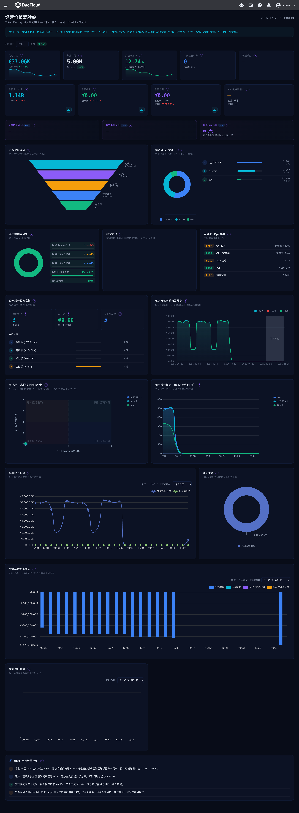

# Business Value

The Business Value page is intended for business managers. Use it to review platform capacity, token output, revenue, and customer or department usage. The page adapts to the deployment mode: operations mode (CSP) focuses on the revenue and customer structure of external services, while enterprise mode (WS) focuses on internal department usage and capacity.

## How to Open

1. Log in to the Token Factory console.
2. In the product navigation, open **Cockpit** and select **Business Value**.

The KPIs and regular panels on this page refresh about once per minute. Use the time range filter at the top of the page to view data for today, this week, this month, or this quarter. When you switch the range, the metrics and charts that support the filter update accordingly; real-time throughput and some trend analyses use their own fixed statistical windows.

## Page Metrics

**Intended audience:** platform operations staff, business owners, and users who need to understand what the metrics mean.

### Key Metrics

| Metric | Description | Applicable mode |
| --- | --- | --- |
| Real-time throughput | Average token production rate over the last 10 minutes, displayed per minute. | Operations, Enterprise |
| Rated capacity | The platform's rated token production capacity within the selected range, used to compare against current throughput. | Operations, Enterprise |
| Capacity utilization | The ratio of real-time throughput to rated capacity. | Operations, Enterprise |
| Registered users | The number of registered users in the selected calendar period, with a period-over-period comparison. | Operations |
| Active models | The number of deduplicated models with invocations in the selected period, along with their current online and offline counts. | Operations, Enterprise |
| Cumulative output | The total number of tokens produced in the selected period, with historical trends available. | Operations, Enterprise |
| Revenue | Revenue for the selected period, compared with the same point in the previous period. | Operations |
| Gross profit | Revenue minus cost; gross margin and period-over-period comparisons are also shown. | Operations |
| ROI | Measures the relationship between investment and return to help assess business performance. | Operations |
| Capacity bottleneck alert | Shows capacity bottleneck forecasts to help identify capacity risks. | Enterprise; shown in the forecast area in operations mode |

### Analysis Panels

| Panel | Description | Applicable mode |
| --- | --- | --- |
| Month-end forecast | Forecasts month-end revenue and gross profit based on existing data; shows a placeholder when data is insufficient. | Operations |
| Capacity monetization funnel | Shows the token volume at each stage: available, scheduled, effectively billed, high gross margin, and unmonetized. | Operations |
| Customer consumption distribution and concentration | Shows the customer usage ranking and share, as well as Top1, Top3, Top5, and long-tail concentration risks. | Operations |
| Department usage and concentration | Shows the department token usage ranking, as well as department usage concentration and risk level. | Enterprise |
| Model contribution | Shows how different models contribute to platform business. | Operations, Enterprise |
| Tenant value quadrants and growth trend | Observes customer distribution by token consumption and revenue, and shows recent tenant growth trends. | Operations |
| Platform revenue trend and revenue sources | Shows how platform revenue changes and how it is composed. | Operations |
| Balance and voucher overview, new user trend | Shows balance, top-ups, and vouchers, as well as changes in new users. | Operations |
| Health summary and business recommendations | Summarizes platform health, risk identification, and business recommendations. | Operations, Enterprise |

Some panels may use fixed windows and do not necessarily follow the time filter at the top of the page. Pay attention to the statistical range shown on each panel when comparing metrics.

## Operations Mode (CSP)

**Intended audience:** business owners of external MaaS services, commercial operations staff, and financial analysts.

The top of the page shows real-time throughput, rated capacity, capacity utilization, registered users, active models, cumulative output, revenue, gross profit, and ROI. Capacity utilization shows the current throughput relative to rated capacity; the revenue and gross profit cards provide period-over-period comparisons, and ROI helps assess return on investment. Some cards open historical trends for the selected range.

The lower part of the page provides month-end revenue and gross profit forecasts, capacity bottleneck alerts, the capacity monetization funnel, consumption distribution and concentration analysis by customer, revenue and gross profit trends and forecasts, and model contribution. Customer concentration is calculated from customer token consumption as Top1, Top3, Top5, and long-tail shares, and customer dependency is identified using the risk level shown on the page. The tenant value quadrants combine token consumption and revenue contribution to observe customer distribution; the tenant growth trend shows customers that have grown quickly recently.

The platform revenue analysis shows revenue trends and composition; the balance and voucher overview shows balance, top-ups, and vouchers; the new user trend shows recent changes in new users. Risk identification and business recommendations help you spot anomalies in business metrics and identify corrective actions.

## Enterprise Mode (WS)

**Intended audience:** enterprise AI platform owners, department administrators, and internal operations staff.

The top of the page shows real-time throughput, rated capacity, capacity utilization, active models, capacity bottleneck alerts, and cumulative output. External business metrics such as registered users, revenue, gross profit, and ROI do not apply to this mode.

The department token usage ranking and department concentration analysis help you understand usage distribution across the organization. The ranking shows the main departments; the concentration analysis calculates Top1, Top3, Top5, and long-tail shares from the usage of all valid departments. Capacity bottlenecks, risk identification, and business recommendations provide references for capacity and operations.

## Notes on Reading the Metrics

**Intended audience:** users who use the metrics for analysis, reconciliation, or troubleshooting data issues.

- **Real-time throughput** is the average rate of recent requests and token usage, suitable for observing the current production situation; cumulative output shows the total number of tokens in the selected period.
- **Revenue, cost, and gross profit** depend on billing and usage data. Business revenue data is usually calculated according to the local billing period configured for the service, so its time boundaries may differ from the time zone of your browser.
- **Forecasts** are trend references generated from existing historical data. When historical data is insufficient, forecasts may be unavailable or shown as placeholders.
- **Department quotas and usage** depend on workspace quotas and actual invocation records; when no quota is configured or there is no invocation data, the related modules may have nothing to display.
- **Customer or department concentration** is calculated for the current filter range; if the distribution total and ranking data are incomplete, check the upstream usage data first.

## Related Documents

**Intended audience:** users who want to learn more about Cockpit and cost management.

- [Business Overview Panel](./singlepage.md)
- [What Is Cockpit](../intro/index.md)
- [Cockpit Release Notes](../intro/release-notes.md)
- [Billing Center](../../leopard/index.md)
