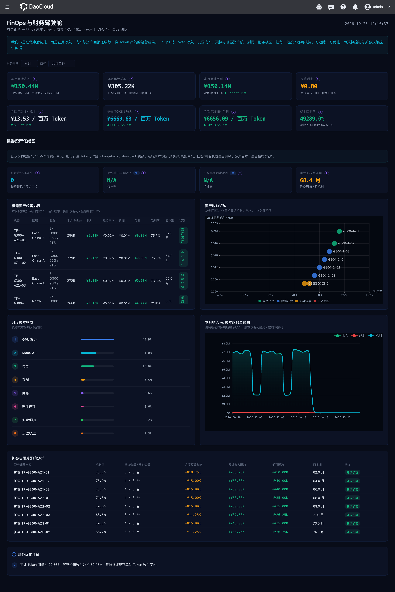

# Financial Operations

The Financial Operations (FinOps) page is intended for enterprise financial operations staff. It summarizes revenue, cost, budget, and return on assets for the selected financial period, helping you evaluate compute investment and business performance. The page adapts to the deployment mode: operations mode (CSP) shows revenue and asset performance analysis for external services, while enterprise mode (WS) focuses on cost, budget, and internal cost allocation.

## How to Open

1. Log in to the Token Factory console.
2. In the product navigation, open **Cockpit** and select **Financial Operations**.

## Filtering Financial Data

The top of the page provides two filters:

- **Financial period**: this month, last month, this quarter, or this year. When you switch periods, the related KPIs, cost structure, trends, and asset analysis update for the new period.
- **Accounting scope**: consolidated, external revenue, or internal accounting. Use it to select the accounting basis for financial data.

Amount and asset metrics are affected by upstream billing, cost, and asset data. An exception state is shown when a page request fails.

## Operations Mode (CSP)

The page KPIs include period revenue, cost, gross profit, and remaining budget; cost, revenue, and profit per unit token and the cost recovery rate; as well as the number of asset machines, average revenue and profit per machine, and the estimated weighted payback period.

Other analysis panels include:

- **Machine asset ranking**: shows machines, region, configuration, token usage, revenue, operating cost, depreciation, profit margin, and payback period. The list supports pagination.
- **Asset return matrix**: compares asset investment with business performance to identify assets with high returns or assets that need attention.
- **Cost structure analysis**: shows cost composition and the share of each item.
- **Revenue and cost trends**: observes how revenue and cost change over the selected financial period.
- **Expansion impact simulation**: compares the estimated impact of an expansion plan on budget, revenue, profit, and payback period.
- **FinOps recommendations**: provides optimization references based on the current business situation.

## Enterprise Mode (WS)

The page shows period cost, remaining budget, cost per unit token, and the number of asset machines. External business KPIs such as revenue and profit are not displayed in this mode.

Cost structure analysis helps you identify the main cost items; the cost allocation summary shows token usage, allocated cost, revenue contribution, and ROI by organization or business object; budget forecast helps you observe budget usage trends; and FinOps recommendations provide references for cost governance.

## Understanding Common Metrics

| Metric | Meaning |
| --- | --- |
| Gross profit | Revenue minus operating cost |
| Remaining budget | The amount left after deducting the used budget from the current period budget, with a minimum of 0 |
| Cost, revenue, and profit per unit token | Period cost, revenue, or profit converted by token usage into an amount per million tokens |
| Cost recovery rate | The ratio of period revenue to period cost |
| Average revenue and profit per machine | Period revenue or gross profit calculated as an average over the number of capitalized machines |
| Estimated weighted payback period | The investment payback period estimated by weighting asset value |

Different accounting scopes affect how revenue and cost are aggregated. When comparing periods or asset performance, keep the financial period and accounting scope consistent; when billing, cost, or asset records are missing, the related metrics may be empty or unavailable.

## Related Documents

- [Business Value](./business-value.md)
- [Business Overview Panel](./singlepage.md)
- [What Is Cockpit](../intro/index.md)
- [Cockpit Release Notes](../intro/release-notes.md)
