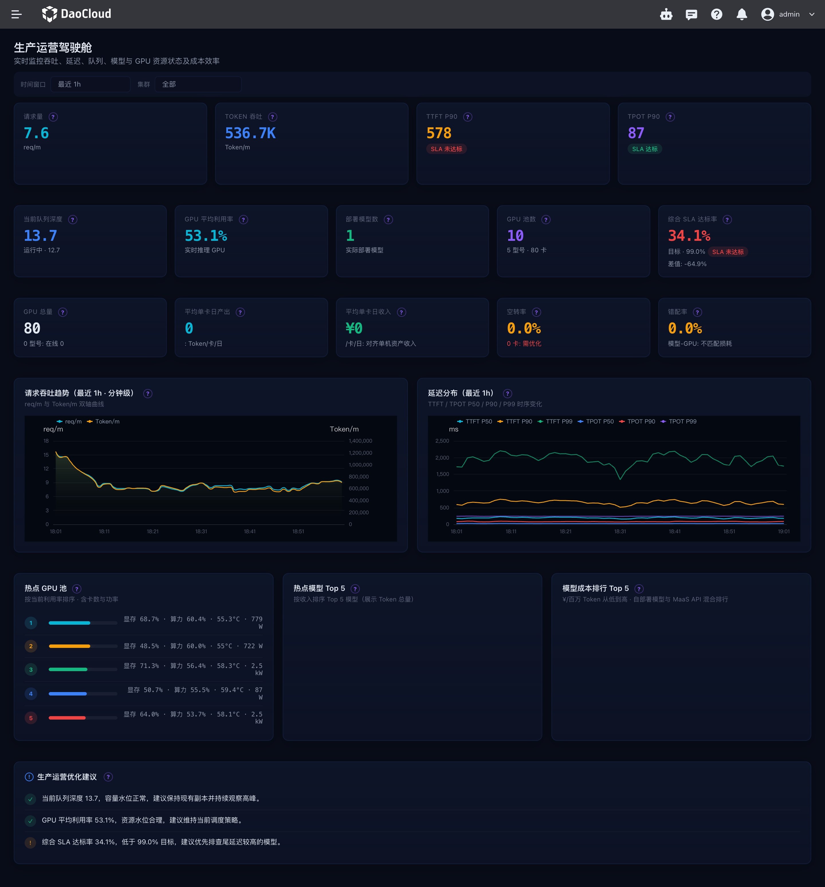

# Production Operations

The Production Operations page is intended for operations staff. It brings together the real-time production status, resource usage, and cost efficiency of token services, so you can check service load, troubleshoot anomalies, and evaluate resource utilization. The main metrics of the former resource cost dashboard have been merged into this page.

## How to Open

1. Log in to the Token Factory console.
2. In the product navigation, open **Cockpit** and select **Production Operations**.

Whether the menu is displayed depends on whether the user has permission to view the Production Operations page. If the menu is not visible, contact the administrator to check the Cockpit permissions.

## Filtering Data

By default, the page shows data for the last **1 hour** across **all clusters**. You can switch the time range to the last 1 hour, 6 hours, or 24 hours, and you can select a single cluster. Changing the time range updates real-time operational content such as production trends, latency, hotspot rankings, and events; the cluster filter applies to both operational data and resource cost data.

The core request volume and token throughput cards calculate per-minute averages based on the last 10 minutes and refresh about once per minute, so even after you switch to 6 hours or 24 hours, the statistical window of these two cards remains the last 10 minutes. Scheduled refreshes pause when the page is hidden and resume immediately when the page is shown again.

## Page Metrics

### Real-Time Production and Operational Status

| Area | Metric description |
| --- | --- |
| Core production metrics | Token throughput (token/m), request volume (req/m), time to first token TTFT P90, and time per output token TPOT P90. The request volume and token throughput cards also show recent trends. |
| Operations and resource metrics | Queue depth, average GPU utilization, number of deployed models, number of GPU pools, and the overall SLA compliance rate. The SLA card shows status based on whether the target is met. |
| Request and token throughput trends | View how request volume and token throughput change over time together; the two curves use their own scales. |
| Latency distribution trends | View the P50, P90, and P99 of TTFT and TPOT to observe latency levels and tail changes. |
| Hotspot GPU pools | Summarize utilization and GPU card count by cluster and GPU model; power consumption is also shown when power data is available. |
| Hotspot models | View the top five models by token usage within the selected time range. |
| Operational event timeline | View anomalies, alerts, scheduling changes, and scaling events from the last 6 hours. |
| Production operations recommendations | View optimization recommendations generated by the system from current capacity and operational data. |

### Resource Cost and Efficiency

The resource cost area uses data from the last **7 days** and updates with the cluster filter at the top of the page:

- **Resource cost metrics**: total GPUs, average daily output per card, idle rate, and mismatch rate; operations mode also shows average daily revenue per card.
- **GPU model cost efficiency ranking**: view utilization, memory utilization, and per-card output efficiency by GPU model; enterprise mode does not show daily gross profit per card.
- **Model cost ranking**: view self-deployed models and MaaS API models ordered from the lowest to the highest cost per million tokens.

Production operations trends use the time range selected at the top of the page, while the resource cost area is fixed to the last 7 days, so the two use different statistical periods.

## Data Status Notes

Each panel loads independently, so an exception in a single data source does not block the other panels. Panels show a loading state on first load and a system exception when a request fails. If an individual real-time metric is temporarily unavailable, that metric may show "—", while the other successfully loaded metrics remain available. When you select a specific cluster, requests without a model name that cannot be attributed to that cluster are not counted toward the request volume and token throughput of that cluster.

When hotspot model, hotspot GPU pool, or trend data is temporarily missing, the corresponding area may be empty. Check whether there are invocations within the selected time range and whether the cluster and monitoring data are healthy.

## Related Documents

- [What Is Cockpit](../intro/index.md)
- [Business Overview Panel](./singlepage.md)
- [Billing Center](../../leopard/index.md)
