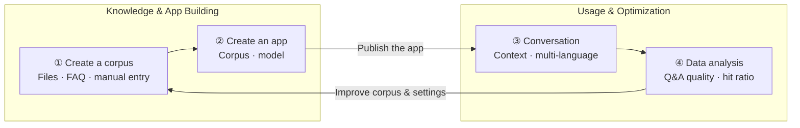

---
hide:
  - toc
---

# What is Intelligent Q&A

The d.run Intelligent Q&A (AI App) product is an intelligent conversation solution built on **RAG (Retrieval-Augmented Generation)** technology.
It first vectorizes your dedicated corpus, precisely retrieves content relevant to a question through **similarity search**, and then generates natural, fluent answers with a
**large language model (LLM)**. This approach significantly reduces model hallucination while protecting the security of private data, providing you with more accurate and personalized responses.

Whether for online customer service, knowledge management, or internal knowledge retrieval, d.run Intelligent Q&A helps you quickly build an **efficient, trustworthy, and controllable** AI knowledge service system.

## Key Capabilities

- :material-application-brackets-outline:{ .lg .middle } __Apps and Plugins__

    ---

    Manage the full lifecycle of intelligent Q&A apps, with corpus association, app secrets, and link sharing, and extend corpus processing by developing sharding plugins.

    [:arrow_forward: Create an app](user-guide/app-center/create-app.md)

- :material-library-outline:{ .lg .middle } __Corpus Management__

    ---

    Build your dedicated corpus through file import, formatted import, manual entry, image-text import, and more. Chunks are split automatically by separator or size, and access levels can be set to ensure data security and isolation.

    [:arrow_forward: Create a corpus](user-guide/corpus/create-corpus.md)

- :material-chat-processing-outline:{ .lg .middle } __Intelligent Conversation__

    ---

    Context-aware Q&A with rating, copying, regeneration, translation, and multi-language answers, as well as combined apps for intent recognition.

    [:arrow_forward: Conversation guide](user-guide/app-center/conversation.md)

- :material-cog-outline:{ .lg .middle } __System Configuration__

    ---

    Centrally manage model services, retrieval strategies, and other platform-level settings to improve answer quality.

    [:arrow_forward: System configuration](user-guide/system-config.md)

- :material-chart-box-outline:{ .lg .middle } __Data Analysis__

    ---

    Gain insight into app performance through Q&A counts, Q&A quality, chunk hit ratio, and chunk quality metrics, and continuously improve your corpus and answer quality.

    [:arrow_forward: View Q&A quality](data-analysis/qa-quality.md)

- :material-message-draw:{ .lg .middle } __My Feedback__

    ---

    Submit ratings and improvement suggestions at any time to help polish the product experience.

    [:arrow_forward: Submit feedback](my-feedback/my-feedback.md)

## Workflow

Using d.run Intelligent Q&A involves two stages: **knowledge and app building** and **usage and continuous optimization**. First import your dedicated corpus and create an app; once the app is published it can serve intelligent Q&A, and data analysis and user feedback help you continuously improve the corpus and app configuration.

| Step | Role | Description |
| ---- | ---- | ----------- |
| [① Create a corpus](user-guide/corpus/create-corpus.md) | Knowledge Administrator | Build a dedicated corpus through file import, formatted import, manual entry, image-text import, and more |
| [② Create an app](user-guide/app-center/create-app.md) | App Administrator | Create an app, associate a corpus, and select model services, with app secrets and link sharing |
| [③ Conversation](user-guide/app-center/conversation.md) | Business User | Ask questions in the chat window, with context, regeneration, translation, and multi-language answers |
| [④ Data analysis](data-analysis/qa-quality.md) | App Administrator | Continuously improve the corpus and app configuration through Q&A quality and chunk hit ratio metrics |

## Quick Start

  <a class="dak-path-step" style="--path-c:#2196f3" href="user-guide/corpus/create-corpus/">
    1
    Create a corpus
    Import docs · FAQ · manual entry
    Go →
  </a>
  <a class="dak-path-step" style="--path-c:#00acc1" href="user-guide/app-center/create-app/">
    2
    Create an app
    Corpus association · model
    Go →
  </a>
  <a class="dak-path-step" style="--path-c:#43a047" href="user-guide/app-center/conversation/">
    3
    Conversation
    Context-aware Q&A · multi-language
    Go →
  </a>
  <a class="dak-path-step" style="--path-c:#fb8c00" href="my-feedback/my-feedback/">
    4
    My Feedback
    Ratings and suggestions
    Go →
  </a>
  <a class="dak-path-step" style="--path-c:#8e24aa" href="data-analysis/qa-quality/">
    5
    Data Analysis
    Q&A quality · hit ratio
    Go →
  </a>

## More Resources

- :material-format-list-bulleted:{ .lg .middle } __Features__

    ---

    A complete list of Intelligent Q&A features across conversation, App Center, and corpus management.

    [:arrow_forward: View features](features.md)

- :material-comment-quote-outline:{ .lg .middle } __Improvement Suggestions__

    ---

    Review aggregated user feedback and improvement suggestions to understand the product roadmap.

    [:arrow_forward: View suggestions](data-analysis/suggestions.md)

- :material-file-document-outline:{ .lg .middle } __AI App Manual__

    ---

    View or download the complete AI App user manual (PDF).

    [:arrow_forward: View the manual](https://harbor-test2.cn-sh2.ufileos.com/docs/download/docs/dak.pdf)

[Download Center](https://docs.daocloud.io/en/download/){ .md-button .md-button--primary }
[Learn about d.run Token Factory](https://docs.daocloud.io/en/tf/){ .md-button .md-button--primary }
[Learn about d.run AI OS](https://docs.daocloud.io/en/drun/){ .md-button .md-button--primary }
