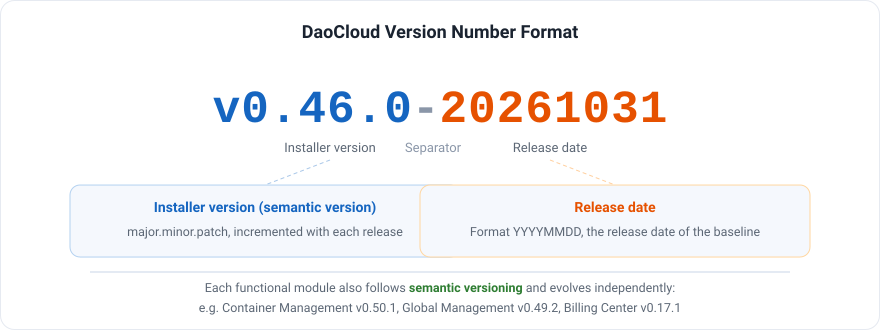

---
hide:
  - toc
---

# Release Notes

DaoCloud adopts a unified modular version baseline, and the release notes
apply to all product lines:

| Product Line | Positioning |
| :--- | :--- |
| d.run Token Factory | Token production and operations platform |
| d.run AI OS | AI-native operating system |
| DaoCloud Enterprise (DCE) | Enterprise-grade cloud-native operating system |

Since May 2023, the product lines typically ship a consolidated release once
every month. Each release page describes the modules included in the release,
new features, enhancements and bug fixes, along with links to the release
notes of each module.

Modules across the product lines follow [Semantic Versioning](https://semver.org/),
and the version number of a release page uses the format `v<installer version>-<release date>`:

The consolidated release notes only briefly summarize version changes and
major updates of each module; for feature details, configuration instructions,
and the complete changelog of a specific module, refer to that module's own
release notes.

## Lego-style Modular Combination

The three product lines are composed of the same set of functional modules,
and each module is independently decoupled and released:

- Each product line can be combined like Lego bricks: select modules as
  needed and upgrade them independently; module versions do not need to be
  synchronized with the installer baseline.
- The default set of modules included in each release is determined by the
  installer. To independently upgrade or replace a module, refer to
  [DaoCloud Download Center](../../download/index.md#download-modules) and
  installation and upgrade notes for different components.

[Download Center](https://docs.daocloud.io/en/download/){ .md-button }
[Learn about d.run Token Factory](https://docs.daocloud.io/en/tf/){ .md-button }
[Learn about d.run AI OS](https://docs.daocloud.io/en/drun/){ .md-button }
