# Frequently Asked Questions

This page aggregates FAQs and troubleshooting guides for DaoCloud product modules. Click a question to expand it and view detailed troubleshooting steps.

## Installation

For more questions, refer to [Installation Troubleshooting](../install/faq.md).

### UI Login Issues

??? "Cannot open DCE interface after installation is complete; you can execute the diag.sh script for quick troubleshooting"

    Since [installer v0.12.0](../install/release-notes.md#v0120), the diag.sh script has been added
    to help users quickly troubleshoot the UI issues.

    Run the command:

    ```bash
    ./offline/diag.sh
    ```

    Example of execution results:

    

??? "DCE login interface cannot be opened due to VIP access issues when installing with Metallb"

    1. Check if the VIP address is in the same subnet as the host. In Metallb L2 mode, it is necessary to ensure they are in the same subnet.
    2. If a network card was added to the control node in a Global cluster causing access issues, L2Advertisement needs to be configured manually.

    Refer to the [Metallb documentation on this issue](https://metallb.universe.tf/configuration/_advanced_l2_configuration/#specify-network-interfaces-that-lb-ip-can-be-announced-from).

### bootstrap node Issues

??? "After shutting down and restarting the bootstrap node, the kind cluster cannot restart properly"

    After shutting down and restarting the bootstrap node, the kind cluster cannot start properly
    due to the lack of auto-start configuration during deployment on the openEuler 22.03 LTS SP2 operating system.

    You need to run the following command to start it:

    ```bash
    podman restart $(podman ps | grep installer-control-plane | awk '{print $1}') 
    ```

    !!! note

        If this scenario occurs in other environments, you can also run this command to restart.

??? "Missing ip6tables when deploying Ubuntu 20.04 as a seed machine"

    Deploying Ubuntu 20.04 as a bootstrap node may cause errors during the deployment process due to the absence of ip6tables.

    Refer to the [Podman known issues](https://github.com/containers/podman/issues/3655).

    Temporary solution: Manually install iptables, refer to [Install and Use iptables on Ubuntu 22.04](https://orcacore.com/install-use-iptables-ubuntu-22-04/).

??? "After disabling IPv6 during installation, Podman on the bootstrap node cannot create containers"

    The error message is as follows:

    ```text
    ERROR: failed to create cluster: command "podman run --name kind-control-plane...
    ```

    Solution: Re-enable IPv6 or update the bootstrap node base to Docker.

    Refer to the related Podman issue:
    [podman 4.0 hangs indefinitely if ipv6 is disabled on system](https://github.com/containers/podman/issues/13388)

??? "After restarting the bootstrap node's kind container, the kubelet service cannot start"

    After the kind container restarts, the kubelet service cannot start and reports the following error:

    ```text
    failed to initialize top level QOS containers: root container [kubelet kubepods] doesn't exist
    ```

    Solutions:

    - Solution 1: Restart and run the command `podman restart [kind] --time 120`. Do not interrupt this task with Ctrl+C during execution.

    - Solution 2: Run `podman exec` to enter the kind container and run the following command:

        ```bash
        for i in $(systemctl list-unit-files --no-legend --no-pager -l | grep --color=never -o .*.slice | grep kubepod);
        do systemctl stop $i;
        done
        ```

??? "How to uninstall data from the bootstrap node"

    After deploying the commercial version, if you want to uninstall, in addition to the
    cluster nodes themselves, you also need to reset the bootstrap node. The reset steps are as follows:

    You need to use the `sudo rm -rf` command to delete these three directories:

    - /tmp
    - /var/lib/dce5/
    - /home/kind/etcd

### Certificate Issues

??? "The kubeconfig for the global service cluster needs to be updated on the seed's replica"

    Prior to v0.20.0, the kubeconfig of the Global cluster stored on the
    bootstrap node does not automatically update. v0.20.0 supports automatic updates, run once a month.

    In previous versions, you need to update the dce5-installer to v0.20.0 and then run:

    ```bash
    dce5-installer cluster-create -c clusterconfig.yaml -m mainfest.yaml --update-global-kubeconf
    ```

??? "Certificate updates and kubeconfig for the kind cluster on the bootstrap node"

    Prior to v0.20.0, the kubeconfig of the kind cluster stored on the bootstrap node
    does not automatically update. v0.20.0 supports automatic updates, run once a month.

    In previous versions, you need to update the dce5-installer to v0.20.0 and then run:

    ```bash
    dce5-installer cluster-create -c clusterconfig.yaml -m mainfest.yaml --update-kind-certs
    ```

??? "After installing Contour, the default certificate validity period is only one year and does not auto-renew, causing the contour-envoy component to restart continuously after expiration"

    For versions prior to v0.21.0, there was support for enabling the installation of the Contour component. Subsequent versions will no longer support this. Customers who have installed Contour in previous versions need to execute the `helm upgrade` command to update the certificate validity period:

    ```bash
    helm upgrade -n contour-system contour --reuse-values --set contour.contour.certgen.certificateLifetime=36500
    ```

### Operating System Related Issues

??? "Error during installation on CentOS 7.6"

    

    Executing `modprobe br_netfilter` on each node where the global service cluster is installed
    will resolve the issue by loading `br_netfilter`.

??? "CentOS environment preparation issues"

    An error occurs when running `yum install docker`:

    ```text
    Failed to set locale, defaulting to C.UTF-8
    CentOS Linux 8 - AppStream                                                                    93  B/s |  38  B     00:00    
    Error: Failed to download metadata for repo 'appstream': Cannot prepare internal mirrorlist: No URLs in mirrorlist
    ```

    You can try the following methods to resolve it:

    - Install `glibc-langpack-en`

        ```bash
        sudo yum install -y glibc-langpack-en
        ```

    - If the issue persists, try:

        ```bash
        sed -i 's/mirrorlist/#mirrorlist/g' /etc/yum.repos.d/CentOS-*
        sed -i 's|#baseurl=http://mirror.centos.org|baseurl=http://vault.centos.org|g' /etc/yum.repos.d/CentOS-*
        sudo yum update -y
        ```

??? "`osRepos` External Mode `externalRepoURLs` Check Failure"

    The `clusterConfig.yaml` is as follows:  

    ```yaml
      osRepos:
        type: external
        externalRepoType: rocky
        externalRepoURLs:
          - http://10.5.14.100:8081/rocky/\$releasever/os/\$basearch
          - http://10.5.14.100:8081/rocky-iso/\$releasever/os/\$basearch/AppStream
          - http://10.5.14.100:8081/rocky-iso/\$releasever/os/\$basearch/BaseOS
    ```

    Error message:  

    ```
    [root@localhost dce5]# ./dist/dce5-installer cluster-create -c ./sample/clusterConfig.yaml -m ./sample/manifest.yaml --max-tasks 2
    [Error]:[Error] invalid ClusterConfig: maybe the binaries.externalRepoURLs http://10.5.14.100:8081/rocky/$releasever/os/$basearch cannot be connected, return code: 404
    ```

    The configuration is actually correct, and `externalRepoURLs` can be accessed normally. However, during validation, the variables are not properly parsed, resulting in a `404` error.  

    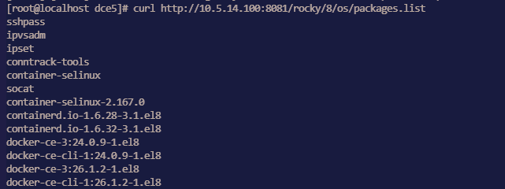  

    **Impact:** Clusters using `osRepos` in external mode cannot be created successfully.  

    **Workaround:** Retry using a new binary file.

??? "Manifest setting for enabling MySQL MGR mode not effective"

    **Issue:**

    Since `dce5-installer` v0.30, enabling MySQL MGR through the Manifest has no effect.  
    Other parameters such as `pvcSize` are also ineffective, and only the `enable` parameter works.

    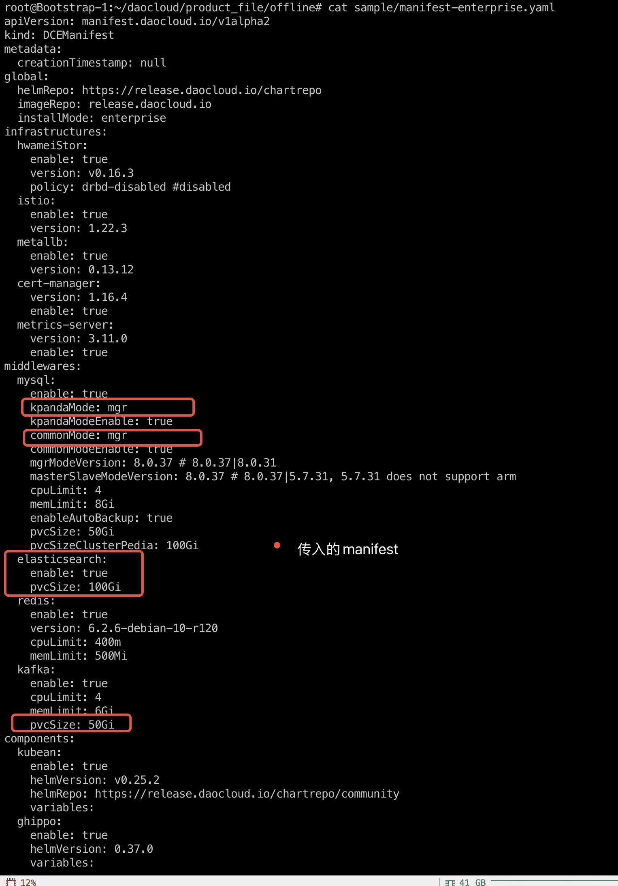

    **Solution:**

    1. Run the installer command with the `--dry-run` parameter to output the execution script to `installer.sh`:

        ```shell
        ./dce5-installer cluster-create -c clusterConfig.yml -m manifest-enterprise.yaml -z --dry-run > installer.sh
        ```

    2. At the beginning of the `installer.sh` script file, add the following line:

        ```script title="installer.sh"
        ManifestFile=/root/data/manifest-enterprise.yaml
        ```

    3. Add the `-s` parameter and re-run `installer.sh`:

        ```shell
        ./dce5-installer cluster-create -c clusterConfig.yml -m manifest-enterprise.yaml -z -s installer.sh
        ```

??? "Installation fails because the MySQL Common instance in MGR mode cannot be initialized"

    During installation, the MySQL initialization phase of the `mcamel-common` instance fails.
    It was observed that the `mysqlrouter` user is missing from MySQL, which keeps the `replica`
    count of the `router` Deployment at `0`, and the whole installation process cannot continue.

    ```text
    The mcamel-common instance failed to recreate the mysqlrouter user
    → router deployment replica = 0
    → installation hangs/fails
    ```

    - **Affected module:** The MySQL initialization process of the installer
    - **Scope of impact:** All `common` MySQL instances that use MGR mode
    - **Affected versions:** v0.27.0, v0.28.0, v0.29.0, etc.
    - **Summary of symptoms:**

        * The router cannot connect to the MGR cluster
        * The `mysqlrouter` user is missing
        * The router deployment cannot start (replica = 0)

    **Root Cause Analysis**

    After an abnormal operation (such as a power outage restart or PVC cleanup), the operations
    personnel manually restored the MGR cluster, but the Operator did not detect the change in the
    cluster state, so the corresponding reconciliation logic was not triggered.

    Because the PVC was cleared, the original `mysqlrouter` user information was lost in the MySQL
    database, so the router could not authenticate and connect to the cluster, and the installation
    kept crashing.

    **Data Verification**

    Query the user table through MySQL and you will find that the `mysqlrouter` user cannot be found:

    ```mysql
    mysql> select user,host from mysql.user;
    +---------------------------+-----------+
    | user                      | host      |
    +---------------------------+-----------+
    | kpanda                    | %         |
    | mysql_innodb_cluster_1000 | %         |
    | mysql_innodb_cluster_1001 | %         |
    | mysql_innodb_cluster_1002 | %         |
    | mysqladmin                | %         |
    | root                      | %         |
    | localroot                 | localhost |
    | mysql.infoschema          | localhost |
    | mysql.session             | localhost |
    | mysql.sys                 | localhost |
    | mysqlhealthchecker        | localhost |
    | mysqlmetrics              | localhost |
    +---------------------------+-----------+
    12 rows in set (0.00 sec)
    ```

    **Solution**

    1. Obtain the Secret of `mysqlrouter`

        Get the username and password of the Router from the Kubernetes cluster:

        ```shell
        kubectl get secret mcamel-common-kpanda-mgr-router -n mcamel-system -oyaml
        ```

        Example output:

        ```yaml
        apiVersion: v1
        data:
          routerPassword: aVVOZHEtWm9tb0gtamJYTGstS3E9VEotNnlqc1M=
          routerUsername: bXlzcWxyb3V0ZXI=
        kind: Secret
        metadata:
          name: mcamel-common-kpanda-mgr-router
          namespace: mcamel-system
        ```

        Decode to get the username and password:

        ```console
        ➜ b64-d bXlzcWxyb3V0ZXI=
        mysqlrouter

        ➜ b64-d aVVOZHEtWm9tb0gtamJYTGstS3E9VEotNnlqc1M=
        iUNdq-ZomoH-jbXLk-Kq=TJ-6yjsS
        ```

    2. Manually create the `mysqlrouter` user in the MGR cluster

        Log in to the MGR cluster that has been restored to normal, and call the `setupRouterAccount()`
        function to recreate the `mysqlrouter` user:

        ```mysql
        MySQL  localhost:33060+ ssl  JS > cluster.setupRouterAccount('mysqlrouter', {password: "iUNdq-ZomoH-jbXLk-Kq=TJ-6yjsS"})
        ```

        Output:

        ```text
        Creating user mysqlrouter@%.
        Account mysqlrouter@% was successfully created.
        ```

        Verify that the `mysqlrouter` user was created successfully:

        ```mysql hl_lines="10"
        MySQL  localhost:33060+ ssl  SQL > select user,host from mysql.user;
        +---------------------------+-----------+
        | user                      | host      |
        +---------------------------+-----------+
        | kpanda                    | %         |
        | mysql_innodb_cluster_1000 | %         |
        | mysql_innodb_cluster_1001 | %         |
        | mysql_innodb_cluster_1002 | %         |
        | mysqladmin                | %         |
        | mysqlrouter               | %         |
        | root                      | %         |
        | localroot                 | localhost |
        | mysql.infoschema          | localhost |
        | mysql.session             | localhost |
        | mysql.sys                 | localhost |
        | mysqlhealthchecker        | localhost |
        | mysqlmetrics              | localhost |
        +---------------------------+-----------+
        13 rows in set (0.00 sec)
        ```

    3. Restart the `router` deployment:

        ```shell
        kubectl scale deploy mcamel-common-kpanda-mgr-router --replicas=0 -n mcamel-system
        kubectl scale deploy mcamel-common-kpanda-mgr-router --replicas=2 -n mcamel-system
        ```

        Verify the recovery:

        ```shell
        kubectl get deploy | grep router

        mcamel-common-kpanda-mgr-router             2/2     2            2           2d2h
        mcamel-common-mgr-cluster-router            2/2     2            2           2d2h
        ```

        At this point, the `router` runs properly and the installation process returns to normal.

### Community Edition Installation Issues

??? "Redis gets stuck during DCE reinstallation in kind cluster"

    Issue: The Redis Pod has been stuck at 0/4 running for a long time, indicating: `primary ClusterIP can not unset`

    1. Delete rfs-mcamel-common-redis in the `mcamel-system` namespace

        ```shell
        kubectl delete svc rfs-mcamel-common-redis -n mcamel-system
        ```

    2. Then re-run the installation command.

??? "Failed to install fluent-bit in the community edition"

    Error message:

    ```text
    DaemonSet is not ready: insight-system/insight-agent-fluent-bit. 0 out of 2 expected pods are ready
    ```

    Check the Pod logs for the following key information:

    ```text
    [warn] [net] getaddrinfo(host='mcamel-common-es-cluster-masters-es-http.mcamel-system.svc.cluster.local',errt11):Could not contact DNS servers
    ```

    The above issue is a bug in fluent-bit. You can refer to an issue in aws/aws-for-fluent-bit:
    [Seeing `Timeout while contacting DNS servers` with latest v2.19.1](https://github.com/aws/aws-for-fluent-bit/issues/233)

## Workbench

For more questions, refer to [Workbench](../amamba/intro/index.md).

### Pipeline Related Issues

??? "Error when executing the pipeline"

    High network communication delay can lead to pipeline running errors, if Jenkins and
    the application are deployed in different data centers. The error message is similar to:

    ```console
    E0113 01:47:27.690555 50 request.go:1058] Unexpected error when reading response body: net/http: request canceled (Client.Timeout or context cancellation while reading body)
    error: unexpected error when reading response body. Please retry. Original error: net/http: request canceled (Client.Timeout or context cancellation while reading body)
    ```

    __Solution__ :

    In the pipeline's Jenkinsfile, change the deployment command from __kubectl apply -f__ to
    __kubectl apply -f. --request-timeout=30m__ .

??? "How to update the podTemplate image for built-in Label?"

    The Workbench declares 7 labels through podTemplate: __base__ , __maven__ , __mavenjdk11__ , __go__ , __go16__ , __node.js__ , and __python__ .
    You can specify a specific Agent label to use the corresponding podTemplate.

    If the image in the built-in podTemplate does not meet your needs, you can replace or add the container image in the following ways:

    1. Go to the __Container Management__ module and click the name of the cluster where the Jenkins component is running.

    2. In the left navigation bar, click __ConfigMaps & Secrets__ -> __ConfigMaps__ .

    3. Search for __jenkins-casc-config__ and click __Edit YAML__ in the Actions column.

        

    4. Under __data__ -> __jenkins.yaml__ -> `jenkins.clouds.kubernetes.templates` , select the podTemplate whose image you want to change.

        

    5. Once you have made the necessary updates, go to __Workloads__ section and restart Jenkins deployment.

??? "When the pipeline build environment is Maven, how to modify the dependency package source in settings.xml?"

    When use Maven as the pipeline build environment, most users need to modify __settings.xml__
    file to change the dependency source. You can follow these steps:

    1. Go to the Container Management module and click the name of the cluster where the Jenkins component is running.

    2. In the left navigation bar, click __ConfigMaps & Secrets__ -> __ConfigMaps__ .

    3. Search for __amamba-devops-agent__ and click __Edit YAML__ in the Actions column.

    4. Modify the __MavenSetting__ under the __data__ section as per your requirement.

        

    5. Once you have made the necessary updates, go to __Workloads__ and restart Jenkins.

??? "When building images through Jenkins, containers cannot access private registry"

    **Podman runtime**

    1. Go to the Container Management module and click the name of the cluster where the Jenkins component is running.

    2. Click __ConfigMaps & Secrets__ -> __ConfigMaps__ in the left navigation bar in order.

    3. Search for __insecure-registries__ and click __Edit YAML__ in the Actions column.

    4. Configure under the __registries.conf__ file in the __data__ section.

        Pay attention to the formatting and indentation when making modifications.
        Each registry should have a separate `[registries]` section, as shown in the image below:

        

        !!! note

            The value of the __registries__ keyword should be the complete domain name or
            IP address of the container registry, without adding the __http__ or __https__ prefix.
            If the container registry uses a non-standard port number, you can add a colon __:__
            followed by the port number after the address.

            ```toml
            [registries]
            location = "registry.example.com:5000"
            insecure=true

            [registries]
            location = "192.168.1.100:8080"
            insecure=true
            ```

        Refer to [Podman documentation](https://podman-desktop.io/docs/containers/registries/insecure-registry).

    **Cluster runtime is Docker**

    1. Open the Docker configuration file. On most Linux distributions, the configuration file
       is located at `/etc/docker/daemon.json` . If it doesn't exist, please create this configuration file.

    2. Add the repository address to the `insecure-registries` field.

        ```json
        {
          "insecure-registries": ["10.16.10.120:4443"]
        }
        ```

    3. After saving, restart Docker by executing the following commands:

        ```bash
        sudo systemctl daemon-reload
        sudo systemctl restart docker
        ```

    !!! note

        Refer to [Docker documentation](https://docs.docker.com/engine/reference/commandline/dockerd/#configuration-reload-behavior).

??? "How to modify the concurrency execution count of Jenkins pipelines"

    Currently, the number of concurrent running of Jenkins pipelines after DCE deployment is 2. The following will describe how to change the number of concurrent running:

    1. Go to the Container Management module, find the cluster where the Jenkins component is located, and click the cluster name.

    2. Click __ConfigMaps & Secrets__ -> __ConfigMaps__ in the left navigation bar in order.

    3. Search for __jenkins-casc-config__, and click __Edit YAML__ in the operation column.

    4. Modify the value under the __data__ -> __jenkins.yaml__ -> `jenkins.clouds.kubernetes.containerCapStr` field.

        

    5. After the update is completed, go to __Workloads__ to restart Jenkins.

??? "What to do if the pipeline running status does not update in time?"

    In the pod of Jenkins, there will be a sidecar container named `event-proxy`, which sends Jenkins events to the workbench through this container. Currently, Jenkins installed by dce5-installer will enable this container by default. Of course, you can also choose to create Jenkins yourself in the Addon module of the Container Management Platform (this is usually used when Jenkins is deployed in the worker cluster). When creating, you can also choose whether to enable this container.

    Based on whether this container is enabled or not, please check whether the different configmaps are correct:

    **The event-proxy container is enabled**

    1. Go to the Container Management module, find the cluster where the Jenkins component is located, and click the cluster name.

    2. Click __ConfigMaps & Secrets__ -> __ConfigMaps__ in the left navigation bar in order.

    3. Search for __jenkins-casc-config__, and click __Edit YAML__ in the operation column.

    4. Search for `eventDispatcher.receiver` in __data__ -> __jenkins.yaml__, its value should be `http://localhost:9090/event`.

        If Jenkins is deployed in the worker cluster (need to penetrate the gateway of DCE), you also need to check the following configmaps.

    5. Query the configmap named __event-proxy-config__ again, check YAML, and the configmap description:

        ```yaml
        eventProxy:
          host: amamba-devops-server.amamba-system:80   # (1)!
          proto: http  # (2)!
        ```

        1. This is the gateway address of dce5. If it is Jenkins installed by dce5-installer, this does not need to be modified
        2. This is the gateway protocol of dce5 (http or https)

    6. In the cluster where Jenkins is located, search for the secret __amamba-jenkins__ in __ConfigMaps & Secrets__ -> __ConfigMaps__.

    7. Check whether the __event-proxy-token__ in the secret is correct. This Token is used for the gateway authentication of DCE.
       If it is incorrect, Jenkins will not be able to send events to the workbench. For how to generate this Token, you can check [Access Key](../ghippo/user-guide/personal-center/accesstoken.md).

    If all the above configmaps are correct, but the status of Jenkins pipeline still cannot be updated, please first check the container log of __event-proxy__ in Jenkins.

    **The event-proxy container is not enabled**

    1. Go to the Container Management module, find the cluster where the Jenkins component is located, and click the cluster name.

    2. Click __ConfigMaps & Secrets__ -> __ConfigMaps__ in the left navigation bar in order.

    3. Search for __jenkins-casc-config__, and click __Edit YAML__ in the operation column.

    4. Search for `eventDispatcher.receiver` in __data__ -> __jenkins.yaml__, its value should be `http://amamba-devops-server.amamba-system:80/apis/internel.amamba.io/devops/pipeline/v1alpha1/webhooks/jenkins` where `amamba-system` is the namespace where the workbench is deployed.

### GitOps Related Issues

??? "Error when adding a GitHub repository under the GitOps module"

    When adding a **GitHub** repository in the GitOps section, the following error may appear due to GitHub removal of username/password auth:

    ```bash
    remote: Support for password authentication was removed on August 13, 2021.
    remote: Please see https://docs.github.com/en/get-started/getting-started-with-git/about-remote-repositories#cloning-with-https-urls for information on currently recommended modes of authentication.
    fatal: Authentication failed for 'https://github.com/DaoCloud/dce-installer.git/'
    ```

    **Solution:**

    Use SSH to import your **GitHub** repository.

??? "When adding a repository in the GitOps module under a certain workspace, it prompts that the repository already exists"

    One repo can be bound to only **one** workspace. When a repo is already bound to a workspace, but you try to add it in GitOps section under another workspace, such error will occur.

    **Solution:**

    Unbind the repo from its current workspace and then add it again in GitOps section under your target workspace.

### Toolchain Related Issues

??? "When the pipeline runs with Maven as the agent and uses integrated SonarQube for Java code scanning, it reports an error"

    In most cases, the error is caused by the Java environment provided by the pipeline being Java 11, which is incompatible with the Java version required by SonarQube. It is recommended to use the SonarQube deployment provided in the Helm template.

??? "What are the precautions when deploying GitLab"

    The Helm template supports GitLab deployment. During the deployment process, please pay attention to the following precautions:

    - Currently, it only supports POC (Proof of Concept) use and does not meet production operation and maintenance conditions.
    - The cluster needs to reserve 80GB of storage space.
    - Online deployment may experience instability in the short term due to the use of an acceleration station.

## Container Management

For more questions, refer to [Container Management FAQs](../kpanda/intro/faq.md).

??? "Permission Issues <a id="permissions" />"

    Regarding permission issues in the container management and global management modules, users often ask why they can see a certain cluster or why they cannot see a cluster. Here are three cases to investigate related permission issues:

    - Permissions in the container management module are divided into cluster permissions and namespace permissions. If a user is bound, they can view the corresponding clusters and resources. For specific permission details, refer to [Cluster Permission Description](../kpanda/user-guide/permissions/permission-brief.md).

        

    - User authorization in the global management module: Use the admin account to visit __Global Management__ -> __User and Access Control__ -> __Users__, and find the corresponding user. In the __Authorized User Groups__ tab, if there are roles like Admin, Kpanda Owner, etc., that have container management permissions, then even if there are no cluster or namespace permissions bound in container management, the user can still see all clusters. Refer to the [User Authorization Documentation](../ghippo/user-guide/access-control/user.md).

        

    - Workspace binding in the global management module: Log in to __Global Management__ -> __Workspaces and Hierarchies__ to see your authorized workspaces. Click on the workspace name.

        1. If the workspace is authorized only to you, you can see your account in the authorization tab and then check the resource group or shared resource tabs. If the resource group is bound to a namespace or shared resources are bound to a cluster, your account will be able to see the corresponding cluster.

        2. If you are granted a global management-related role, you will not see your account in the authorization tab, nor will you see the cluster resources bound to the workspace in the container management module.

        

    [Back to Top :arrow_up:](#top)

### Helm Installation

??? "Helm application installation fails with “OOMKilled” error"

    

    As shown, the container management automatically creates a Job responsible for the application installation. In version v0.6.0, due to improper job resource settings, OOM issues affected the application installation. This bug has been fixed in version 0.6.1. If you upgrade to v0.6.1, it will only take effect in newly created or integrated clusters; existing clusters need to be manually adjusted to take effect.

    ??? note "Click to View How to Adjust the Script"

        - The following scripts are executed in the global service cluster.
        - Find the corresponding cluster; this article uses skoala-dev as an example to obtain the corresponding skoala-dev-setting configmap.
        - After updating the configmap, it will take effect.

            ```shell
            kubectl get cm -n kpanda-system skoala-dev-setting -o yaml
            apiVersion: v1
            data:
            clusterSetting: '{"plugins":[{"name":1,"intelligent_detection":true},{"name":2,"enabled":true,"intelligent_detection":true},{"name":3},{"name":6,"intelligent_detection":true},{"name":7,"intelligent_detection":true},{"name":8,"intelligent_detection":true},{"name":9,"intelligent_detection":true}],"network":[{"name":4,"enabled":true,"intelligent_detection":true},{"name":5,"intelligent_detection":true},{"name":10},{"name":11}],"addon_setting":{"helm_operation_history_limit":100,"helm_repo_refresh_interval":600,"helm_operation_base_image":"release-ci.daocloud.io/kpanda/kpanda-shell:v0.0.6","helm_operation_job_template_resources":{"limits":{"cpu":"50m","memory":"120Mi"},"requests":{"cpu":"50m","memory":"120Mi"}}},"clusterlcm_setting":{"enable_deletion_protection":true},"etcd_backup_restore_setting":{"base_image":"release.daocloud.io/kpanda/etcdbrctl:v0.22.0"}}'
            kind: ConfigMap
                metadata:
                labels:
                    kpanda.io/cluster-plugins: ""
                name: skoala-dev-setting
                namespace: kpanda-system
                ownerReferences:
                - apiVersion: cluster.kpanda.io/v1alpha1
                    blockOwnerDeletion: true
                    controller: true
                    kind: Cluster
                    name: skoala-dev
                    uid: f916e461-8b6d-47e4-906e-5e807bfe63d4
                uid: 8a25dfa9-ef32-46b4-bc36-b37b775a9632
            ```

            Modify the clusterSetting -> helm_operation_job_template_resources to appropriate values. The values corresponding to v0.6.1 are cpu: 100m, memory: 400Mi.

    [Back to Top :arrow_up:](#top)

??? "Unable to pull kpanda-shell image when installing application with Helm"

    When integrating an offline environment, clusters often encounter failures to pull the kpanda-shell image when installing Helm applications, as shown:

    

    At this time, simply go to the cluster operation and maintenance - cluster settings page, in the advanced configuration tab, and modify the Helm operation base image to a kpanda-shell image that can be pulled normally by the cluster.

    

    [Back to Top :arrow_up:](#top)

??? "Helm Chart interface does not display the latest Chart uploaded to Helm Repo"

    

    At this time, simply refresh the corresponding Helm repository in the Helm repository.

    

    [Back to Top :arrow_up:](#top)

??? "When Helm application installation fails, it gets stuck during installation and cannot delete the application to reinstall"

    

    At this time, simply go to the custom resource page, find the helmreleases.helm.kpanda.io CRD, and delete the corresponding helmreleases CR.

    

    

    [Back to Top :arrow_up:](#top)

??? "Scheduling Issues <a id="scheduling-exception" />"

    After removing node affinity and other scheduling policies through **Workload**, scheduling exceptions occur.

    

    At this time, it may be because the policies were not deleted cleanly. Click edit and delete all policies.

    

    

    

    [Back to Top :arrow_up:](#top)

### Application Backup

??? "What is the logic for Kcoral application backup to detect Velero status in the working cluster"

    

    - The working cluster has the standard Velero components installed under the velero namespace.
    - The velero control plane deployment is running and has reached the desired replica count.
    - The velero data plane node agent is running and has reached the desired replica count.
    - Velero has successfully connected to the target MinIO (BSL status is Available).

??? "When backing up and restoring across clusters, how does Kcoral obtain available clusters"

    When Kcoral performs cross-cluster backup and restore of applications, it helps users filter the list of clusters that can perform cross-cluster restores on the restore page. The logic is as follows:

    

    - Filters out clusters that have not installed Velero.
    - Filters out clusters with abnormal Velero status.
    - Retrieves and returns the list of clusters that connect to the same MinIO and Bucket as the target cluster.

    Therefore, as long as they connect to the same MinIO and Bucket, and Velero is running, cross-cluster backups (with write permissions) and restores can be performed.

??? "Kcoral backed up Pods and Deployments with the same label, but after restoring the backup, two Pods appear"

    The reason for this phenomenon is that during restoration, the Pod labels were modified, causing their labels to not match the parent resource ReplicaSet / Deployment labels at the time of backup, resulting in two times the number of Pods upon restoration.

    To avoid this situation, try to avoid modifying the labels of any resources in the associated resources.

    [Back to Top :arrow_up:](#top)

??? "Log Issues <a id="autoscaling-log" />"

    Why do scaling records still exist after uninstalling VPA, HPA, and CronHPA?

    Although the corresponding components were uninstalled through the Helm Addon market, the records related to application scaling still remain, as shown in the figure:

    

    This is an issue with helm uninstall, as it does not uninstall the corresponding CRD, leading to data residue. At this point, we need to manually uninstall the corresponding CRD to complete the final cleanup.

??? "Console Issues <a id="console-error" />"

    Why does the console open abnormally in low-version clusters?

    In Kubernetes clusters with low versions (below v1.18), opening the console may result in CSR resource request failures. When opening the console, a certificate request is made through the CSR resource by the currently logged-in user in the target cluster. If the cluster version is too low or this feature's controller is not enabled, it will lead to certificate request failures, thus preventing connection to the target cluster.

    For the certificate request process, refer to [kubernetes website](https://kubernetes.io/docs/reference/access-authn-authz/certificate-signing-requests/).

    **Solution:**

    - If the cluster version is above v1.18, check if the kube-controller-manager has the CSR feature enabled, and ensure the following controllers are functioning properly:

        ```shell
        ttl-after-finished,bootstrapsigner,csrapproving,csrcleaner,csrsigning
        ```

    - For low-version clusters, the only solution is to upgrade the version.

        [Back to Top :arrow_up:](#top)

### Creating and Integrating Clusters

??? "How to reset a created cluster"

    There are two situations for created clusters:

    - Failed cluster creation: If the cluster creation fails due to incorrect parameter settings during the creation process, you can select to retry in the failed cluster and reset the parameters to recreate it.
    - Successfully created cluster: This cluster can be uninstalled first and then recreated. To uninstall the cluster, you need to disable cluster protection.

    

    

    [Back to Top :arrow_up:](#top)

??? "Failed to install plugins when integrating the cluster"

    For clusters integrated in an offline environment, you need to configure the CRI proxy repository to ignore TLS verification before installing plugins (this needs to be executed on all nodes).

    === "Docker"

        1. Modify the file `/etc/docker/daemon.json`

        2. Add "insecure-registries": ["172.30.120.243","temp-registry.daocloud.io"],

            The content after modification should be as follows:

            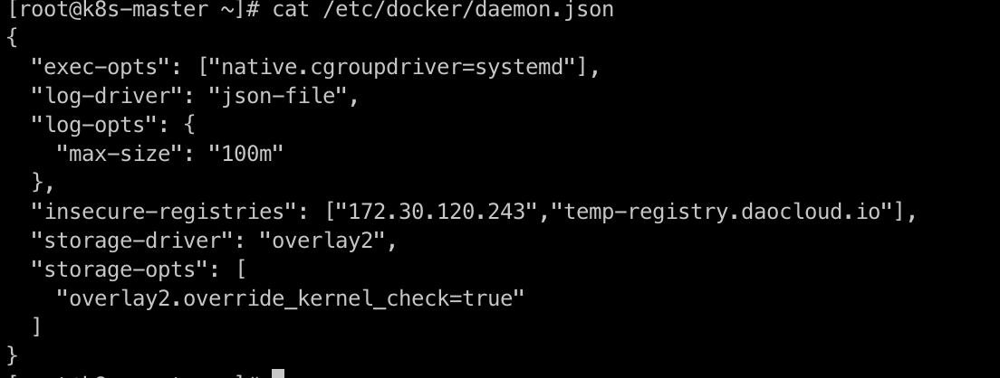

        3. Restart Docker 

            ```shell
            systemctl restart docker
            systemctl daemon-reload
            ```

    === "containerd"

        1. Modify `/etc/containerd/config.toml`

        2. The content after modification should be as follows:

            ```shell
            [plugins."io.containerd.grpc.v1.cri".registry.mirrors."docker.io"]
            endpoint = ["https://registry-1.docker.io"]
            [plugins."io.containerd.grpc.v1.cri".registry.mirrors."temp-registry.daocloud.io"]
            endpoint = ["http://temp-registry.daocloud.io"]
            [plugins."io.containerd.grpc.v1.cri".registry.configs."http://temp-registry.daocloud.io".tls]
            insecure_skip_verify = true
            ```

            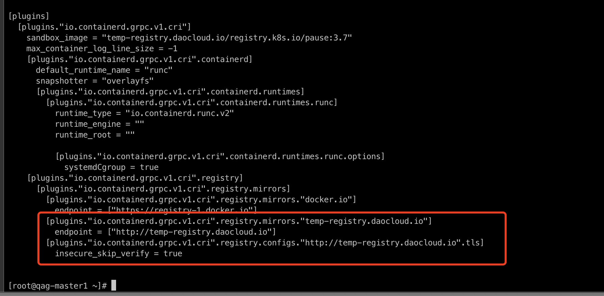

        3. Pay attention to spaces and line breaks to ensure the configuration is correct. After modification, run:

            ```shell
            systemctl restart containerd
            ```

??? "When creating a cluster, enabling **Kernel tuning for new clusters** in advanced settings fails the cluster creation"

    1. Check if the kernel module conntrack is loaded by executing the following command:

        ```shell
        lsmod |grep conntrack
        ```

    2. If the return is empty, it indicates that it is not loaded. Reload it with the following command:

        ```shell
        modprobe ip_conntrack
        ```

    !!! note

        If the kernel module has been upgraded, it may also lead to cluster creation failure.

??? "After the cluster is disconnected, the `kpanda-system` namespace remains in Terminating state"

    Check if the APIServices status is normal. The command to check is as follows. If the current status is false, try to repair the APIServices or delete the service.

    ```shell
    kubectl get apiservices
    ```

    [Back to Top :arrow_up:](#top)

## MultiCloud Management

For more questions, refer to [FAQs](../kairship/intro/faq.md).

??? "The kernel for multicloud management is Karmada; what is the currently supported version of Karmada? Can a specific version be specified? Can it be upgraded?"

    Yes, The current default version is v1.9.6, and you can upgrade the version by yourself.

??? "How to seamlessly migrate single-cluster applications to multicloud management?"

    Refer to [One-Click Conversion to Multicloud Workloads](../kairship/workload/promote.md).

??? "Does multicloud management support cross-cluster application log collection?"

    This is feature is still under development and will go public soon.

??? "For workloads distributed to multiple clusters in multicloud management, can monitoring information be presented in one view?"

    Yes. You can view it by clicking the name of the workload in the list of multicloud workloads.

??? "Can multicloud management workloads communicate across clusters?"

    Yes. Refer to [Multicloud Network Interconnection](../mspider/user-guide/multicluster/cluster-interconnect.md)

??? "Can multicloud management services achieve cross-cluster service discovery?"

    Yes. Refer to [Multicloud Network Interconnection](../mspider/user-guide/multicluster/cluster-interconnect.md)

??? "Is there production-level support for multicloud management?"

    It is still in the TP stage, and the high availability issue of many internal components needs to be resolved (Karmada depends on etcd, etc.).

??? "How does multicloud management achieve failover?"

    Due to Karmada's native support for fault tolerance, Karmada will intelligently reschedule to complete the fault tolerance when a member cluster experiences a failure. Refer to [Failover Introduction](../kairship/failover/failover.md)

??? "Multi-cluster permission issues"

    It uses the existing [permission system of DCE](../ghippo/user-guide/access-control/role.md), and bound Karmada instances with workspaces.

??? "How to query events from multiple clusters in multicloud management?"

    Multicloud Management integrates resources at the product level. You can view all Karmada-instance-level events.

??? "After creating a multicloud application through multicloud management, how can relevant resource information be obtained through container management?"

    The Karmada control-plane is essentially a complete Kubernetes control plane without any nodes carrying workloads. Therefore, when creating multicloud management instances, a clever action is taken to add the instance itself as a hidden cluster to the container management (not displayed in the container management). This allows for leveraging the full capabilities of container management (collecting and accelerating the retrieval of resources from various Kubernetes clusters, CRDs, etc.). When querying the resources of a specific multicloud management instance (such as Deployment, PropagationPolicy, OverridePolicy, etc.) in the interface, retrieval can be directly done through container management, achieving read and write separation and speeding up response time.

??? "How to customize the Karmada image source repository address in multicloud management?"

    Kairship uses the open-source __karmada-operator__ for multi-instance LCM management. Operator provides rich customization capabilities. It supports customizing the repository address of the karmada resource image in the startup parameters. 

    Add __--chat-repo-url__ in the startup commands of containers to specify the image source.

    

??? "How to connect to multicloud clusters?"

    Click __Console__ in the upper right corner of the instance overview page.

??? "Is it possible to delete only multicloud instances without deleting the components of multicloud management?"

    Yes, when creating a multicloud instance, you can choose whether to select the instance release feature. If selected, the corresponding Karmada instance will be deleted synchronously. If not deleted, you can continue to use it through the terminal, but you cannot manage the Karmada instance within the multicloud management, so it is recommended to delete it synchronously.

??? "How to achieve network intercommunication among multiple working clusters within a multicloud instance?"

    Refer to [Multicloud Network Interconnection](../mspider/user-guide/multicluster/cluster-interconnect.md)

## Cloud Native Networking

For more questions, refer to [Known Network Component Issues and Kernel Compatibility](../network/intro/issues.md).

### kube-proxy Issues

??? "IPVS Mode"

    Accessing services may encounter 1s delay or failed requests.

    - Symptoms:

        1. Accessing services through Service experiences a 1s delay.
        2. Some requests fail during a rolling update.

    - Impacts:

        | kubernetes Versions | kube-proxy Behaviors | Symptoms |
        | ------ | -------------- | -------- |
        | <= v1.17 | net.ipv4.vs.conn_reuse_mode=0 | RealServer could not be removed, and some requests fail during a rolling update. |
        | >= v1.19 | net.ipv4.vs.conn_reuse_mode=0 (kernel > v4.1)<br />net.ipv4.vs.conn_reuse_mode=1 (kernel < v4.1) | The default kernel version of CentOS 7.6-7.9 is earlier than v4.1, and accessing services through Service experiences a 1s delay. <br /> The default kernel version of CentOS 8 is higher than v4.1, and RealServer could not be removed, and some requests fail during a rolling update. |
        | >= v1.22 | The net.ipv4.vs.conn_reuse_mode value (kernel > v5.6) is not modified<br />net.ipv4.vs.conn_reuse_mode=0 (kernel > v4.1)<br />net.ipv4.vs.conn_reuse_mode = 1 (kernel < v4.1) <br /> | The default kernel version of CentOS 7.6-7.9 is earlier than v4.1, and accessing services through Service experiences a 1s delay. <br /> The default kernel v4.16 of CentOS 8 is higher than v4.1, and RealServer could not be removed, and some requests fail during a rolling update. <br /> The default kernel v5.15 of Ubuntu 22.04 is higher than v5.9 kernel, and does not have the issue. |

    - Recommendation: IPVS mode is not recommended when the kernel version is below v5.9.

    - Reference: [Kubernetes Issue #93297](https://github.com/kubernetes/kubernetes/issues/93297)

??? "iptables Mode"

    - Symptom: The source port is not random enough after NAT, resulting in a 1s delay

    - Impact:

        | Kernel | iptables Version | Symptom |
        | ------ | ------------- | ----- |
        | < v3.13 | v1.6.2 | The source port is not random enough after NAT, resulting in a 1s delay |

    - Recommendation: An upgrade of the kernel version is advised by considering released versions.

??? "externalIPs not working under `externalTrafficPolicy: Local`"

    - Impact: v1.26.0 <= affected version < v1.30.0

    - Recommendation: Update kubernetes to v1.30.0

    - Reference: [Kubernetes PR #121919](https://github.com/kubernetes/kubernetes/pull/121919)

??? "New endpoint rules for Service take a long time to take effect when updating endpoints"

    - Impact: v1.27.0 <= affected versions < v1.30.0

    - Recommendation: Update kubernetes to v1.30.0

    - Reference: [Kubernetes PR #122204](https://github.com/kubernetes/kubernetes/pull/122204)

??? "LoadBalancerSourceRanges not working properly under nftables mode"

    - Recommendation: Update kubernetes to v1.30.0

    - Reference: [Kubernetes PR #122614](https://github.com/kubernetes/kubernetes/pull/122614)

??? "iptables nft and legacy mode selection issues"

    - Impacts:

        | Versions | Behaviors | Impacts |
        | ------- | --- | --- |
        | < v1.18 | Using iptables-legacy | kube-proxy may not work |
        | >= v1.18 | Prefer to choose nft | None |

    - Reference: [kubernetes-sigs/iptables-wrappers](https://github.com/kubernetes-sigs/iptables-wrappers/tree/master)

### Calico Issues

??? "Offloading VXLAN causes latency"

    - Impacts:

        | Calico Versions | Behaviors | Impacts |
        | ---------- | ---- | --- |
        | < v3.20 | No response | When the kernel version is lower than v5.7, a 63s delay experiences between pods and Service.|
        | >= v3.20 | VXLAN offload is automatically disabled by default via FelixConfiguration.| The performance of NICs is low, only running 1-2 Gbps/s.|
        | >= v3.28 |VXLAN offload is automatically enabled in kernel v5.7, addressing previous packet loss issues with ClusterIP and improving performance.| When the kernel version is lower than v5.7, the performance of NICs is low, only running 1-2 Gbps/s. |

    - Recommendations:

        * When lower versions Calico have access latency issue, it can be avoided by `ethtool --offload vxlan.calico rx off tx off`.
        * Higher versions Calico will automatically disable VXLAN offload by default, so customers with network performance requirements can update the kernel version to v5.7 to solve the problem.

    - References:

        * [Calico Issue #3145](https://github.com/projectcalico/calico/issues/3145)
        * [Felix PR #2811](https://github.com/projectcalico/felix/pull/2811)

??? "VXLAN parent device changed but routing not updated"

    - Impacts:

        | Calico Versions | Behaviors | Impacts |
        | ----------- | ------------- | ------- |
        | < v3.28.0 | No response | If routing tables do not to use new parent NIC, old routes can't be cleaned up even after restarting felix. |
        | >= v3.28.0 | The VXLAN Manager recreates a routing table when the parent device changes. | None |

    - Recommendation: Update Calico to v3.28.0

    - Reference: [Calico PR #8279](https://github.com/projectcalico/calico/pull/8279)

??? "Cluster calico-kube-controllers cache desynchronization causing memory leaks"

    - Recommendation: Update Calico to v3.26.0

??? "Inter-node pod networking not working in IPIP mode"

    - Impacts:

        | Calico Versions | Behaviors | Impacts |
        | ----------- | --- | --- |
        | < v3.28.0 | No response | The inter-node networking may fail for pods in kernel < v5.7 due to incompatibility between checksum calculation and `iptables --random-fully`. |
        | >= v3.28.0 | The checksum calculation is disabled by default | None |

    - Recommendation: Update Calico to v3.28.0+. For earlier versions, you can manually turn off the feature using the`ethtool -K tunl0 tx off` command.

    - Reference: [Calico PR #8031](https://github.com/projectcalico/calico/pull/8031)

??? "iptables nft and legacy mode selection issues"

    - Impacts:

        | Calico Versions | Behaviors | Impacts |
        | ----------- | --- | --- |
        | < v3.26.0 | It needs to be specified manually, and there are some logical problems with automatic calculations. | Service network anomalies may occur due to a incorrect iptables mode selection. |
        | >= v3.26.0 | Automatic calculation | None |

    - Recommendations: Update Calico to v3.26.0+. For earlier versions, you need to manually specify the `FELIX_IPTABLESBACKEND` variable with either the NFT or LEGACY option.

    - Reference: [Calico PR #7111](https://github.com/projectcalico/calico/pull/7111)

### Known Issues in Spiderpool v0.9

??? "Error when SpiderCoordinator synchronizes status, but status remains running"

    - Analysis: If getting the CIDR information for the cluster fails, we should update its status to NotReady, which prevents the pod from being created properly. Otherwise, the pod will run with an incorrect CIDR, which makes network connectivity fail.

    - Reference: [Spiderpool PR #2929](https://github.com/spidernet-io/spiderpool/pull/2929)

??? "`Values.multus.multusCNI.uninstall` setting ineffective, causing multus resources not to be deleted correctly"

    - Analysis: After `Values.multus.multusCNI.uninstall` set to true and Spiderpool uninstalled, multus-related resources are still present and not removed as expected.

    - Reference: [Spiderpool PR #2974](https://github.com/spidernet-io/spiderpool/pull/2974)

??? "Unable to obtain serviceCIDR from kubeControllerManager Pod when kubeadm-config is missing"

    - Analysis: In some scenarios where kubeadm is not used to create a cluster, there may not be a kubeadm-config configMap,
      so that an attempt will be made to get the serviceCIDR from kubeControllerManager.
      Due to a bug, the serviceCIDR cannot be gotten from the kubeControllerManager pod, causing the SpiderCoordinator to fail to update status.

    - Reference: [Spiderpool PR #3020](https://github.com/spidernet-io/spiderpool/pull/3020)

??? "Upgrading from v0.7.0 to v0.9.0 causes panic due to new TxQueueLen property in SpiderCoordinator CRD"

    - Analysis: In Spiderpool v0.9.0, a new attribute `TxQueueLen` is added to SpiderCoordinator CRD.
      However, during the upgrade operation, there is no default value, which may cause a panic.
      Therefore, you need to use it and treat it as default value 0.

    - Reference: [Spiderpool PR #3118](https://github.com/spidernet-io/spiderpool/pull/3118)

??? "Due to different cluster deployment methods, SpiderCoordinator returns empty serviceCIDR, preventing Pod creation"

    - Analysis: Due to different cluster deployment methods, there are two types of CIDRs recorded in the cluster kube-controller-manager pod:

        - `Spec.Containers[0].Command`
        - `Spec.Containers[0].Args`

        For example, the RKE2 cluster is `Spec.Containers[0].Args` instead of `Spec.Containers[0].Command`.
        The `Spec.Containers[0].Command` is hardcoded in the original implementation logic, leading to a judgment error that results in an empty `serviceCIDR` and subsequently causes pods creation to fail.

    - Reference: [Spiderpool PR #3211](https://github.com/spidernet-io/spiderpool/pull/3211)

### Known Issues in Spiderpool v0.8

??? "ifacer cannot create bond using vlan 0"

    - Analysis: Creating a bond via ifacer fails when vlan 0 is used.

    - Reference: [Spiderpool PR #2639](https://github.com/spidernet-io/spiderpool/pull/2639)

??? "Disabling multus functionality still creates multus CR resources"

    - Symptom: During installation, the multus feature is disabled, but the multus CR resource is still created, which is not as expected.

    - Reference: [Spiderpool PR #2756](https://github.com/spidernet-io/spiderpool/pull/2756)

??? "SpiderCoordinator cannot detect gateway connections in Pod's netns"

    - Analysis: Currently, spiderCoordinator uses a plugin to use errgroup to concurrently check for gateway reachability and IP conflicts to improve detection speed.
      Each OS thread can have different network namespaces and the thread scheduling of Go is highly variable, so the caller is not guaranteed to set any particular namespaces.
      However, when starting a goroutine in netns.Do, the code is not guaranteed to execute in the specified network namespace when the Go is running.
      Therefore, the errgroup method of Go needs to be modified to manually switch to the target network namespace when starting goroutine, and then return to the original network namespace after execution to ensure that gateway reachability and IP conflicts can be checked.

    - Reference: [Spiderpool PR #2738](https://github.com/spidernet-io/spiderpool/pull/2738)

??? "spiderpool-agent Pod crashes when kubevirt fixed IP feature is turned off"

    - Analysis: When the kubevirt fixed IP feature is turned off, the spiderpool-agent pod crashes and fails to run, affecting the overall IPAM functionality.

    - Reference: [Spiderpool PR #2971](https://github.com/spidernet-io/spiderpool/pull/2971)

??? "SpiderIPPool resources do not inherit gateway and route properties from SpiderSubnet"

    - Analysis: If you create a SpiderSubnet resource first, and then create a SpiderIPPool resource for the corresponding subnet, the SpiderIPPool will inherit the gateway and routes of the SpiderSubnet.
      However, if you create an isolated SpiderIPPool first, and then create the corresponding SpiderSubnet resource, the SpiderIPPool resource will not inherit the attributes of SpiderSubnet.

    - Reference: [Spiderpool PR #3011](https://github.com/spidernet-io/spiderpool/pull/3011)

### Known Issues in Spiderpool v0.7

??? "StatefulSet type Pods report IP conflict when obtaining IP allocation after restart"

    - Analysis: As the StatefulSet pod restarts, GC scanAll will release the previous IP address, because the system considers that the pod UID is different from the IP address recorded by IPPool so that notifies conflicts.

    - Reference: [Spiderpool PR #2538](https://github.com/spidernet-io/spiderpool/pull/2538)

??? "Spiderpool cannot recognize certain third-party controllers, causing Pods in StatefulSet to be unable to use fixed IP"

    - Symptom: Spiderpool cannot recognize third-party controllers like RedisCluster, so that the pod of StatefulSet controlled by them cannot use fixed IPs.

    - Analysis: For third party controllers: RedisCluster -> StatefulSet -> Pod, if Spiderpool sets SpiderSubnet autopool annotations for them, the pod will not start successfully.

    - Reference: [Spiderpool PR #2370](https://github.com/spidernet-io/spiderpool/pull/2370)

??? "Empty `spidermultusconfig.spec` causes spiderpool-controller Pod to crash"

    - Symptom: After creating CR with empty `spidermultusconfig.spec`, webhook checksum succeeds, but the related
      network-attachment-definitions is not generated and spiderpool-controller experiences a panic.

    - Reference: [Spiderpool PR #2444](https://github.com/spidernet-io/spiderpool/pull/2444)

??? "Cilium mode obtains incorrect overlayPodCIDR"

    - Symptoms:
        * In the auto SpiderCoordinator mode, it is failed to get `podCIDRType`, so that the status of SpiderCoordinator is not as expected after updating.
        * Creating a Pod may cause network issues.

    - Reference: [Spiderpool PR #2434](https://github.com/spidernet-io/spiderpool/pull/2434)

??? "In scenarios with a 1:1 Pod to IP ratio, IPAM allocation blockage occurs, preventing some Pods from running and affecting IP allocation performance"

    - Analysis: An IPPool with 1000 IP addresses and a Deployment with 1000 replicas is created.
      After allocating a certain number of IP addresses, you will observe a significant decrease in allocation performance, even cannot continue to allocate IP addresses, while a pod cannot start normally without an IP address.
      An actual IPPool resource has already recorded the pod and assigned its IP address, but the pod corresponding to the SpiderEndpoint does not exist.

    - Reference: [Spiderpool PR #2518](https://github.com/spidernet-io/spiderpool/pull/2518)

??? "Disabling IP GC feature causes spiderpool-controller component to fail to start correctly due to readiness health check failure"

    - Analysis: After disabling the IP GC feature, the spiderpool-controller component will not start correctly due to a readiness health check failure

    - Reference: [Spiderpool PR #2532](https://github.com/spidernet-io/spiderpool/pull/2532)

??? "`IPPool.Spec.MultusName` namespace/multusName resolution error causes associated multusName to be unfindable"

    - Symptom: `IPPool.Spec.MultusName` specifies namespace/multusName, but a namespace parsing error makes the multusName unfindable, causinhg affinity to fail.

    - Analysis: The pod annotation `v1.multus-cni.io/default-network: kube-system/ipvlan-eth0` is specified.
      However, due to Spiderpool's incorrect resolution of namespace, the wrong namespace is used when querying network-attachment-definitions, and the corresponding network-attachment-definitions not being found, so that the pod could not be created successfully.

    - Reference: [Spiderpool PR #2514](https://github.com/spidernet-io/spiderpool/pull/2514)

## Cloud Native Storage

For more questions, refer to [HwameiStor FAQs](../storage/hwameistor/faqs.md).

??? "How does HwameiStor scheduler work in Kubernetes platform?"

    The HwameiStor scheduler is deployed as a pod in the HwameiStor namespace.

    

    When an application (Deployment or StatefulSet) is created, the pods of the application are automatically deployed
    to worker nodes that have been configured with HwameiStor local storage capability.

??? "How does HwameiStor handle scheduling for multi-replica workloads? How is it different from traditional general-purpose shared storage?"

    HwameiStor recommends using StatefulSet for applications with multiple replicas.

    StatefulSet deploys the replicated replicas to the same worker node, but creates a proper PV volume for each pod
    replica. If you need to deploy replicas to different nodes to distribute the workload, you need to manually configure using `podaffinity` .

    

    Deployment cannot share block volumes, so it is recommended to use a single replica.

    For traditional shared storage:

    StatefulSet deploys the replicated replicas to different nodes to distribute the workload, but creates a proper
    PV volume for each pod replica. Only when the number of replicas exceeds the number of worker nodes will multiple
    replicas be on the same node.

    Deployment deploys the replicated replicas to different nodes to distribute the workload, and all pods share one
    PV volume (currently only NFS is supported). Only when the number of replicas exceeds the number of Worker nodes
    will multiple replicas be on the same node. For block storage, since the volume cannot be shared, it is recommended
    to use a single replica.

??? "How to operate and maintain a data volume on a Kubernetes node?"

    HwameiStor provides volume eviction and migration features. When removing or restarting a Kubernetes node, the pods
    and volumes on that node can be automatically migrated to other available nodes, ensuring that the pods continue to
    run and provide services.

    **Removing a node**

    To ensure the continuous operation of pods and the availability of HwameiStor local data, before removing a Kubernetes
    node, you need to migrate the pods and local volumes on that node to other available nodes. This can be done through
    the following steps:

    1. Drain the node

        ```bash
        kubectl drain NODE --ignore-daemonsets=true --ignore-daemonsets=true
        ```

        This command will evict the pods on the node and reschedule them. It will also trigger the HwameiStor volume eviction
        behavior automatically. HwameiStor will automatically migrate all volume replicas on the node to other nodes and ensure
        that the data remains available.

    2. Check the migration progress

        ```bash
        kubectl get localstoragenode NODE -o yaml
        ```

        ```yaml
        apiVersion: hwameistor.io/v1alpha1
        kind: LocalStorageNode
        metadata:
          name: NODE
        spec:
          hostname: NODE
          storageIP: 10.6.113.22
          topogoly:
            region: default
            zone: default
        status:
          ...
          pools:
            LocalStorage_PoolHDD:
              class: HDD
              disks:
              - capacityBytes: 17175674880
                devPath: /dev/sdb
                state: InUse
                type: HDD
              freeCapacityBytes: 16101933056
              freeVolumeCount: 999
              name: LocalStorage_PoolHDD
              totalCapacityBytes: 17175674880
              totalVolumeCount: 1000
              type: REGULAR
              usedCapacityBytes: 1073741824
              usedVolumeCount: 1
              volumeCapacityBytesLimit: 17175674880
             volumes:  # (1)!
          state: Ready
        ```

        1. Ensure that the volumes field is empty

        At the same time, HwameiStor will automatically reschedule the evicted pods and schedule them to nodes with available
        volumes, ensuring that the pods run normally.

    3. Remove the node from the cluster

        ```bash
        kubectl delete nodes NODE
        ```

    **Restarting a node**

    Restarting a node usually takes a long time to restore the node to normal. During this time, all pods and local data on
    that node cannot run normally. This can be a significant cost, or even unacceptable, for some applications such as databases.

    HwameiStor can immediately schedule pods to other available nodes that have volumes and keep them running continuously.
    For pods that use HwameiStor multi-replica volumes, this process is very fast, taking about 10 seconds (subject to the
    native scheduling mechanism of Kubernetes). For pods that use single-replica volumes, the time required depends on the
    time required for volume migration, which is affected by the size of user data.

    If you want to keep the volumes on the node and still be able to access them after the node restarts, you can add the
    following label to the node to prevent the system from migrating the volumes on that node. The system will still immediately
    schedule pods to other nodes that have replicas of the volumes.

    1. Add a label (optional)

        If you don't need to migrate the volumes during the node restart, you can add the following label to the node before draining it:

        ```bash
        kubectl label node NODE hwameistor.io/eviction=disable
        ```

    2. Drain the node

        ```bash
        kubectl drain NODE --ignore-daemonsets=true --ignore-daemonsets=true
        ```

        - If you performed step 1, you can restart the node after step 2 is successful.
        - If you didn't perform step 1, after step 2 is successful, you should check if the data migration is completed
          (same as step 2 in [Remove a node](#removing-a-node)). After the data migration is completed, you can restart
          the node.

        After the first two steps are successful, you can restart the node and wait for the node system to return to normal.

    3. Uncordon the node to restore it to normal in Kubernetes

        ```bash
        kubectl uncordon NODE
        ```

    **For traditional shared storage**

    StatefulSet deploys the replicated replicas to different nodes to distribute the workload, but creates a proper PV volume
    for each pod replica. Only when the number of replicas exceeds the number of Worker nodes will multiple replicas be on
    the same node.

    Deployment deploys the replicated replicas to different nodes to distribute the workload, and all pods share one PV volume
    (currently only NFS is supported). Only when the number of replicas exceeds the number of Worker nodes will multiple replicas
    be on the same node. For block storage, since the volumes cannot be shared, it is recommended to use a single replica.

??? "How to handle errors when viewing LocalStorageNode?"

    When viewing `LocalStorageNode`, if you encounter the following error:

    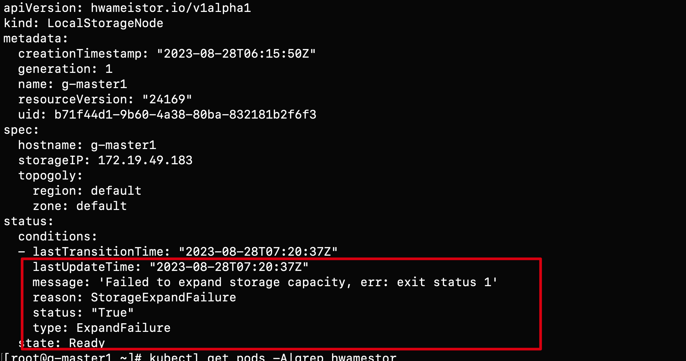

    Possible causes of the error:

    1. The LVM2 package is not installed on the node. You can install it with the following command:

        ```bash
        rpm -qa | grep lvm2 # (1)!
        yum install lvm2    # (2)!
        ```

        1. Check if LVM2 is installed
        2. Install LVM2 on each node

    2. Check if the proper disk has GPT partition:

        ```bash
        blkid /dev/sd*     # (1)!
        wipefs -a /dev/sd* # (2)!
        ```

        1. Check if the disk has clean partitions
        2. Clean the disk

??? "Why is StorageClass not automatically created after installing hwameistor-operator?"

    Possible reasons:

    1. There are no remaining bare disks on the nodes that can be automatically managed. You can check with the following command:

        ```bash
        kubectl get ld # (1)!
        kubectl get lsn <node-name> -o yaml # (2)!
        ```

        1. Check the disks
        2. Check if the disks are properly managed

    2. The Hwameistor-related components (excluding drbd-adapter) are not working properly. You can check with the following command:

        ```bash
        kubectl get pod -n hwameistor # (1)!
        kubectl get hmcluster -o yaml # (2)!
        ```

        1. Check if the pods are running properly
        2. Check the health field

        !!! note

            The drbd-adapter component only takes effect when HA is enabled. If it is not enabled, you can ignore the related errors.

## Virtual Machine

For more questions, refer to [Virtual Machine FAQs](../virtnest/faq/index.md).

??? "Virtual Machine Page API Error"

    Virtual machine (virtnest) consists of two parts: apiserver and agent. When encountering problems, troubleshoot from these two parts.


    **Page API Error**

    If the page requests API error 500 or cluster resource does not exist,
    first check the logs of VM-related services in the [Global Service Cluster](../kpanda/user-guide/clusters/cluster-role.md#global-service-cluster),
    looking for keywords of kpanda. If they exist, confirm whether kpanda-related services are running normally.

??? "Virtual Machine Created Successfully but Cannot Be Used"

    If the created VM cannot be used normally, there are various reasons. Here are the troubleshooting directions:

    **VM Creation Failed**

    When VM creation fails, check the detailed information of the VM in the target cluster:

    ```shell
    kubectl -n your-namespace describe vm your-vm
    ```

    If the detailed information involves storage such as PVC, PV, SC, etc., please check the SC status.
    If the problem is not resolved, [consult developers](../install/index.md#configure-helm-repo).

    If the detailed information involves devices such as KVM, GPU, etc., please verify whether the target cluster nodes have completed [dependency checks](../virtnest/install/install-dependency.md).
    If all dependencies are installed, [consult developers](../install/index.md#configure-helm-repo).

    **Case 1**

    - Phenomenon: Error reported even with sufficient resources:

        

    - Solution: [Enable hardware virtualization for nodes](../virtnest/install/install-dependency.md#all-nodes-having-hardware-virtualization-nested-virtualization-enabled)

    **Case 2**

    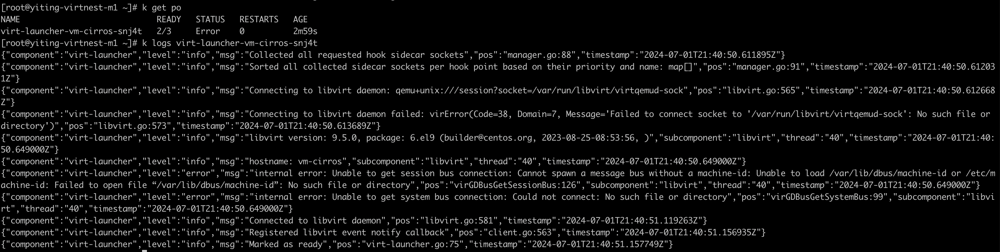

    Solution: [Upgrade the node operating system kernel](../virtnest/install/install-dependency.md)

    **Case 3**

    

    Solution: Run the following command in the worker cluster:

    ```bash
    kubectl patch cdi cdi \
      --type merge \
      --patch '{"spec":{"config":{"insecureRegistries":["your registry ip"]}}}'
    ```

    **VM Created Successfully but Cannot Be Used**

    If the VM is created successfully but cannot be used, check whether the VNC page of the VM works normally on the DCE page.
    If only startup information is displayed, check the [dependencies](../virtnest/install/install-dependency.md).
    If the dependencies are complete, [consult developers](../install/index.md#configure-helm-repo).

    If the VNC page displays an abnormality, use the following command to view the detailed information of the VM:

    ```shell
    kubectl -n your-namespace describe vm your-vm
    ```

    When the detailed information involves storage such as PVC, PV, SC, etc., check the SC status.
    If the problem is not resolved, [consult developers](../install/index.md#configure-helm-repo).

    **VNC Starts but the Network Is Unreachable**

    Follow the troubleshooting procedure below, record the relevant information, and report it to [the developers](../install/index.md#configure-helm-repo).
    Perform the following operations in the cluster where the VM is located:

    1. Get the Pod IP of the VM.

        ```bash
        kubectl -n your-namespace get vmi your-vm -o wide
        ```

    2. Log in to your VM via SSH on the node.

        ```bash
        ssh your-vm-username@xx.xx.xx.xx
        ```

        If it is unreachable, [consult developers](../install/index.md#configure-helm-repo).

    3. Check the network mode used by the VM.

        If it is the default network mode (masquerade), [consult developers](../install/index.md#configure-helm-repo).

        If it is bridge + ovs, confirm the following information.

        - Check whether Spiderpool is installed successfully and make sure it is installed in the `kube-system` namespace.
        - Check whether ovs is installed successfully and whether the ovs bridge is configured successfully.

        If the information above is correct, [consult developers](../install/index.md#configure-helm-repo).

??? "Windows VM Cannot Recognize a Newly Added Disk"

    When adding a new disk through KubeVirt on a newly installed Windows Server, the disk cannot be recognized. You need to install virtio drivers following these steps:

    1. Download stable virtio-win iso

        Download address:
        https://github.com/virtio-win/virtio-win-pkg-scripts/blob/master/README.md

        

    1. Install virtio-win iso

        After mounting the iso image, click virtio-win-gt-x64 to install. After installation, you can see the added disk

        

    1. Effect after adding disk

        

## Insight

For more questions, refer to [Insight](../insight/intro/index.md).

??? "Clock skew in trace data"

    In a distributed system, due to [Clock Skew (clock skew adjustment)](https://en.wikipedia.org/wiki/Clock_skew) influence,
    Time drift exists between different hosts. Generally speaking, the system time of different hosts at the same time has a slight deviation.

    The traces system is a typical distributed system, and it is also affected by this phenomenon in terms of
    time data collection. For example, in a link, the start time of the server-side span is earlier than
    that of the client-side span. This phenomenon does not exist logically, but due to the influence of clock skew,
    there is a deviation in the system time between the hosts at the moment when the trace data is collected in each service, which eventually leads to the phenomenon shown in the following figure:

    The phenomenon in the above figure cannot be eliminated theoretically. However, this phenomenon is rare,
    and even if it occurs, it will not affect the calling relationship between services.

    Currently Insight uses Jaeger UI to display trace data, and the UI will remind when encountering such a link:

    Currently Jaeger's community is [trying to optimize this problem through the UI level](https://github.com/jaegertracing/jaeger-ui/issues/197).

    For more information, refer to:

    - [Clock Skew Adjuster considered harmful](https://github.com/jaegertracing/jaeger/issues/1459#issuecomment-582519000)
    - [Add ability to display unadjusted trace in the UI](https://github.com/jaegertracing/jaeger-ui/issues/197)
    - [Clock Skew Adjustment](https://www.jaegertracing.io/docs/1.40/deployment/#clock-skew-adjustment)

??? "Log collection troubleshooting guide"

    After installing the __insight-agent__ in the cluster, __Fluent Bit__ in __insight-agent__ will collect logs in the cluster by default, including Kubernetes event logs, node logs, and container logs. __Fluent Bit__ has already configured various log collection plugins, related filter plugins, and log output plugins. The working status of these plugins determines whether log collection is normal. Below is a dashboard for __Fluent Bit__ that monitors the working conditions of each __Fluent Bit__ in the cluster and the collection, processing, and export of plugin logs.

    1. Use DCE platform, enter __Insight__ , and select the __Dashboard__ in the left navigation bar.

        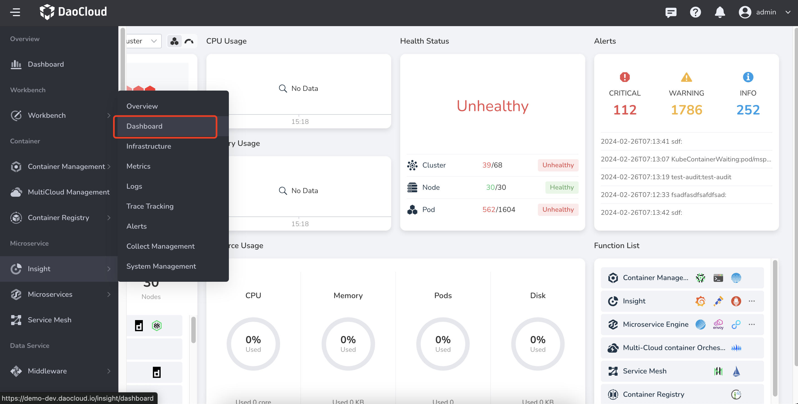

    2. Click the dashboard title __Overview__ .

        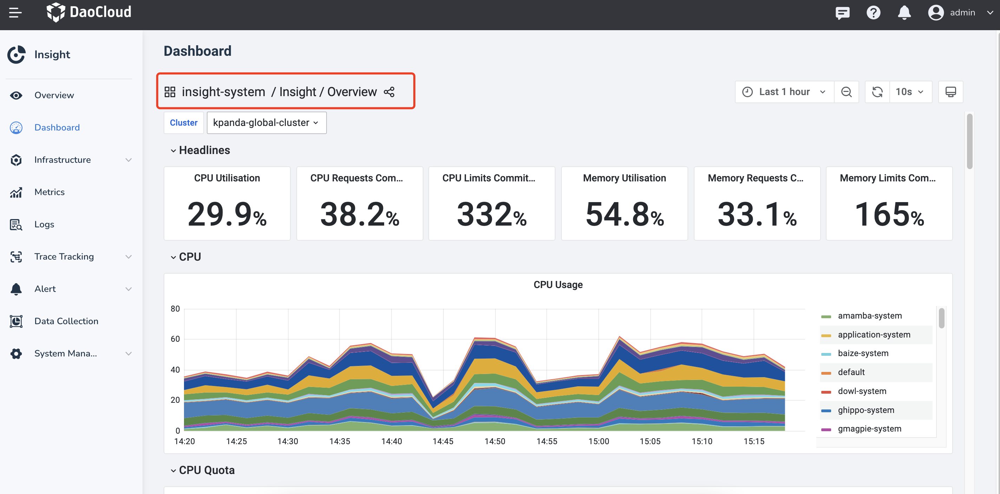

    3. Switch to the __insight-system__ -> __Fluent Bit__ dashboard.

        

    4. There are several check boxes above the __Fluent Bit__ dashboard to select the input plugin, filter plugin, output plugin, and cluster in which it is located.

        

    **Plugin Description**

    Here are some plugins for __Fluent Bit__ .

    **Log Collection Plugin**

    | Input Plugin | Plugin Description | Collection Directory |
    | ------------ | ------------------ | -------------------- |
    | tail.kube | Collect container logs | /var/log/containers/*.log |
    | tail.kubeevent | Collect Kubernetes event logs | /var/log/containers/*-kubernetes-event-exporter*.log |
    | tail.syslog.dmesg | Collect host dmesg logs | /var/log/dmesg |
    | tail.syslog.messages | Collect frequently used host logs | /var/log/secure, /var/log/messages, /var/log/syslog,/var/log/auth.log |
    | syslog.syslog.RSyslog | Collect RSyslog logs | |
    | systemd.syslog.systemd | Collect Journald daemon logs | |
    | tail.audit_log.k8s | Collect Kubernetes audit logs | /var/log/*/audit/*.log |
    | tail.audit_log.ghippo | Collect global management audit logs | /var/log/containers/*_ghippo-system_audit-log*.log |
    | tail.skoala-gw | Collect microservice gateway logs | /var/log/containers/*_skoala-gw*.log |

    **Log Filter Plugin**

    | Filter Plugin | Plugin Description |
    | ------------- | ------------------ |
    | Lua.audit_log.k8s | Use lua to filter Kubernetes audit logs that meet certain conditions |

    !!! note

        There are more filter plugins than Lua.audit_log.k8s, which only introduces filters that will discard logs.

    **Log Output Plugin**

    | Output Plugin | Plugin Description |
    | ------------- | ------------------ |
    | es.kube.kubeevent.syslog | Write Kubernetes audit logs, event logs, and syslog logs to [ElasticSearch cluster](../middleware/elasticsearch/intro/index.md) |
    | forward.audit_log | Send Kubernetes audit logs and [global management audit logs](../ghippo/user-guide/audit/audit-log.md) to __Global Management__ |
    | es.skoala | Write [request logs](../skoala/gateway/logs/reqlog.md) and [instance logs](../skoala/gateway/logs/inslog.md) of microservice gateway to ElasticSearch cluster  |

??? "Trace collection troubleshooting guide"

    Before attempting to troubleshoot issues with trace data collection, you need to understand the transmission path of 
    trace data. The following is a schematic diagram of the transmission of trace data:

    ```mermaid
    graph TB

    sdk[Language proble / SDK] --> workload[Workload cluster otel collector]
    --> otel[Global cluster otel collector]
    --> jaeger[Global cluster jaeger collector]
    --> es[Elasticsearch cluster]

    classDef plain fill:#ddd,stroke:#fff,stroke-width:1px,color:#000;
    classDef k8s fill:#326ce5,stroke:#fff,stroke-width:1px,color:#fff;
    classDef cluster fill:#fff,stroke:#bbb,stroke-width:1px,color:#326ce5;

    class sdk,workload,otel,jaeger,es cluster
    ```

    As shown in the above figure, any transmission failure at any step will result in the inability to query trace data. 
    If you find that there is no trace data after completing the application trace enhancement, please perform the following steps:

    1. Use DCE platform, enter __Insight__ , and select the __Dashboard__ in the left navigation bar.

        

    2. Click the dashboard title __Overview__ .

        

    3. Switch to the __insight-system__ -> __insight tracing debug__ dashboard.

        

    4. You can see that this dashboard is composed of three blocks, each responsible for monitoring the data transmission 
       of different clusters and components. Check whether there are problems with trace data transmission through the generated time series chart.

        - workload opentelemetry collector
        - global opentelemetry collector
        - global jaeger collector

        

    **Block Introduction**

    1. **workload opentelemetry collector**

        Display the __opentelemetry collector__ in different worker clusters receiving language probe/SDK trace data 
        and sending aggregated trace data. You can select the cluster where it is located by the __Cluster__ selection box 
        in the upper left corner.

        

        !!! note

            Based on these four time series charts, you can determine whether the __opentelemetry collector__ in this cluster is running normally.

    2. **global opentelemetry collector**

        Display the __opentelemetry collector__ in the __Global Service Cluster__ receiving trace data from the 
        __worker cluster's opentelemetry collector__ and sending aggregated trace data.

        

        !!! note

            The __opentelemetry collector__ in the __Global Management Cluster__ is also responsible for sending audit logs of all worker clusters' [global management module](../ghippo/intro/index.md) and Kubernetes audit logs (not collected by default) to the __audit server__ component of the global management module.

    3. **global jaeger collector**

        Display the __jaeger collector__ in the __Global Management Cluster__ receiving data from the __otel collector__ in the __Global Management Cluster__ and sending trace data to the [ElasticSearch cluster](../middleware/elasticsearch/intro/index.md).

??? "Using Insight to locate application anomalies"

    This article serves as a guide on using Insight to identify and analyze abnormal components in DCE and determine 
    the root causes of component exceptions.

    Please note that this post assumes you have a basic understanding of Insight's product features or vision.

    **Service Map - Identifying Abnormalities on a Macro Level**

    In enterprise microservice architectures, managing a large number of services with complex interdependencies 
    can be challenging. Insight offers service map monitoring, allowing users to gain a high-level overview of 
    the running microservices in the system.

    In the example below, you observe that the node __insight-server__ is highlighted in red/yellow on the service map.
    By hovering over the node, you can see the error rate associated with it. To investigate further and understand why 
    the error rate is not __0__ , you can explore more detailed information:

    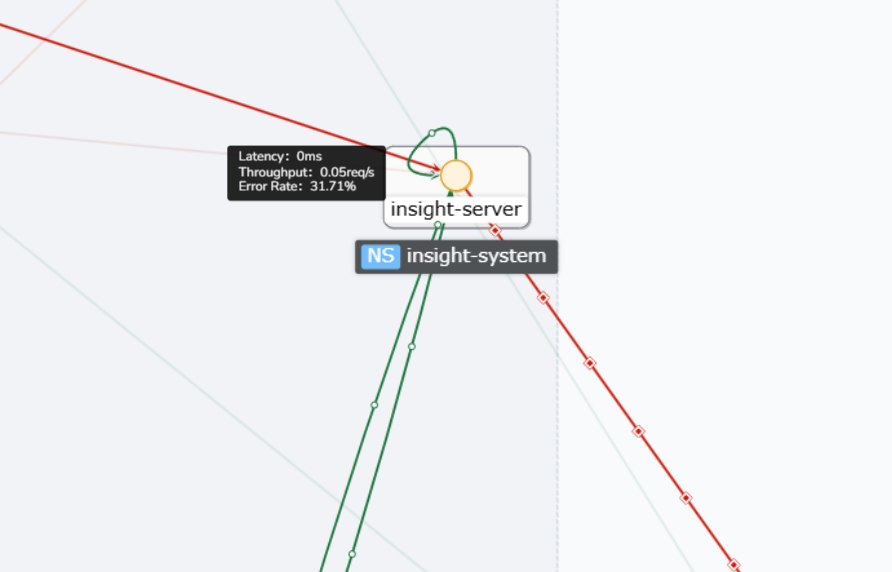

    Alternatively, clicking on the service name at the top will take you to the service's overview UI:

    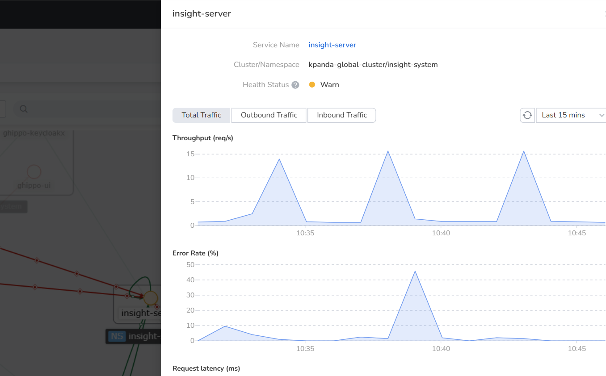

    **Service Overview - Delving into Detailed Analysis**

    When it becomes necessary to analyze inbound and outbound traffic separately, you can use the filter in 
    the upper right corner to refine the data. After applying the filter, you can observe that the service has 
    multiple __operations__ corresponding to a non-zero error rate. To investigate further, you can inspect 
    the traces generated by these __operations__ during a specific time period by clicking on "View Traces":

    

    

    **Trace Details - Identifying and Eliminating Root Causes of Errors**

    In the trace list, you can easily identify traces marked as __error__ (circled in red in the figure above) and 
    examine their details by clicking on the corresponding trace. The following figure illustrates the trace details:

    

    Within the trace diagram, you can quickly locate the last piece of data in an __error__ state. Expanding the 
    associated __logs__ section reveals the cause of the request error:

    

    Following the above analysis method, you can also identify traces related to other __operation__ errors:

    
    

    **Let's Get Started with Your Analysis!**

??? "What to do when ElasticSearch data is full?"

    When ElasticSearch memory is full, you can choose to either [scale up](#scale-up) or [delete data](#delete-data) to resolve the issue:

    You can run the following command to check the resource usage of ES nodes.

    ```bash
    kubectl get pod -n mcamel-system | grep common-es-cluster-masters-es | awk '{print $1}' | xargs -I {} kubectl exec {} -n mcamel-system -c elasticsearch -- df -h | grep /usr/share/elasticsearch/data
    ```

    **Scale Up**

    If the host still has available resources, **scaling up** is a common solution, which involves increasing the PVC capacity.

    1. First, run the following command to get the PVC configuration of the `es-data-0` node.
       Use the actual environment's PVC as a reference.

        ```bash
        kubectl edit -n mcamel-system pvc elasticsearch-data-mcamel-common-es-cluster-masters-es-data-0
        ```

    2. Then modify the following `storage` field (the storage class SC you are using should be scalable):

        ```yaml
        spec:
          accessModes:
            - ReadWriteOnce
          resources:
            requests:
              storage: 35Gi # (1)!
        ```

        1. Adjust this value as needed.

    **Delete Data**

    When ElasticSearch memory is full, you can also delete index data to free up resources.

    You can follow the steps below to access the Kibana page and manually delete data.

    1. First, ensure that the Kibana Pod exists and is running normally:

        ```bash
        kubectl get po -n mcamel-system | grep mcamel-common-es-cluster-masters-kb
        ```

    2. If it does not exist, manually set the replica to 1 and wait for the service to run normally. If it exists, skip this step.

        ```bash
        kubectl scale -n mcamel-system deployment mcamel-common-es-cluster-masters-kb --replicas 1
        ```

    3. Modify the Kibana Service to be exposed as a NodePort for access:

        ```bash
        kubectl patch svc -n mcamel-system mcamel-common-es-cluster-masters-kb-http -p '{"spec":{"type":"NodePort"}}'

        # After modification, check the NodePort. For example, if the port is 30128, the access URL will be https://{NodeIP in the cluster}:30128
        [root@insight-master1 ~]# kubectl get svc -n mcamel-system | grep mcamel-common-es-cluster-masters-kb-http
        mcamel-common-es-cluster-masters-kb-http   NodePort    10.233.51.174   <none>   5601:30128/TCP    108m
        ```

    4. Retrieve the ElasticSearch Secret to log in to Kibana (username is `elastic`):

        ```bash
        kubectl get secrets -n mcamel-system mcamel-common-es-cluster-masters-es-elastic-user -o jsonpath="{.data.elastic}" | base64 -d
        ```

    5. Go to **Kibana** -> **Stack Management** -> **Index Management** and enable the **Include hidden indices** option to see all indexes.
       Based on the index sequence numbers, keep the indexes with larger numbers and delete the ones with smaller numbers.

??? "How to configure container log blacklist"

    > Note: Currently only blacklists at the Deployment, Statefulset, Daemonset, and Pod levels are supported; Namespace level is not supported.

    The specific configuration method is as follows:

    1. For any Pod whose container logs do not need to be collected, add `insight.opentelemetry.io/log-ignore: "true"` to the Pod's annotation to specify the container logs that do not need to be collected.

    > ⚠️ Note: Starting from Insight Agent v0.37.0, the `insight.opentelemetry.io/log-ignore: "true"` annotation will be deprecated; please use `fluentbit.io/exclude: "true"` instead.

    For example:

        ```yaml
        apiVersion: apps/v1
        kind: Deployment
        metadata:
          name: log-generator
        spec:
          selector:
            matchLabels:
              app.kubernetes.io/name: log-generator
          replicas: 1
          template:
            metadata:
              labels:
                app.kubernetes.io/name: log-generator
              annotations:
                #insight.opentelemetry.io/log-ignore: "true" # 👈 Deprecated starting from Insight Agent v0.37.0
                fluentbit.io/exclude: "true"
            spec:
              containers:
                - name: nginx
                  image: banzaicloud/log-generator:0.3.2
        ```

    2. Restart the Pod. After the Pod returns to a running state, Fluent Bit will no longer collect the logs from the containers in this Pod.

## Microservices Engine

For more questions, refer to [Microservices Engine](../skoala/intro/index.md).

??? "x-kubernets-validations error issue with skoala-init"

    When upgrading skoala-init from v0.11.0 to v0.12.0, an error occurred that prevented the upgrade:

    ```console
    unknown field "x-kubernets-validations" in io.k8s.apiextensions-apiserver....
    ```

    

    **Troubleshooting Process**

    1. Q: Is the operation procedure correct?

        A: Apply the CRD(s) first, then perform the helm upgrade. The operation procedure is correct, ruling out operation issues.

    1. Q: Is the version tested and passed by QA, and was the upgrade function tested successfully during internal testing?

        A: Confirm that it is correct.

    1. Q: Confirm that the version being used matches the version of the Kubernetes cluster used for testing?

        A: v1.21 (version being used), v1.26 (version used for testing).

    1. Q: Based on the error screenshot and the above information, it is initially inferred that the customer's
       Kubernetes cluster version does not match the corresponding CRD. Additionally, skoala-init provides initial
       conditional configurations for all microservices, which includes multiple CRDs. According to the
       skoala-init v0.12.0 ChangeLog, the Gateway-API CRD has been upgraded. Therefore, the inference is:

        A: The issue is caused by the upgrade of the Gateway-API.

    **Reference Documents**

    - [Rollout, Upgrade and Rollback Planning](https://github.com/kubernetes/enhancements/blob/master/keps/sig-api-machinery/2876-crd-validation-expression-language/README.md#rollout-upgrade-and-rollback-planning)

        

    - [KEP-2876: Use Common Expression Language (CEL) for CRD Validation](https://docs.daocloud.io/blogs/230412-k8s-1.27.html#kep-2876cel-crd)

        

    - [CRD validation error for x-kubernetes-preserve-unknown-fields: true #88252](https://github.com/kubernetes/kubernetes/issues/88252#issuecomment-587250746)

    **Solution**

    Choose the appropriate solution based on the actual situation.

    - Solution 1: Upgrade the Kubernetes cluster version being used to at least v1.25.
    - Solution 2: Follow the instructions in [CRD validation error for x-kubernetes-preserve-unknown-fields: true #88252](https://github.com/kubernetes/kubernetes/issues/88252#issuecomment-587250746) and add:

        ```shell
        –validate=false
        ```

??? "Nacos version downgrade issue"

    If you are using a version later than Nacos 2.1.x and want to downgrade to a version earlier than 2.1.x,
    and you are using an external database, you can refer to the following steps to downgrade the version:

    1. Find the Nacos CR resource that needs to be downgraded.

        ```bash
        kubectl get nacos -A
        ```

    2. Modify the `image` field and replace it with the version to be downgraded to.

    3. Modify the database.

        ```sql
        alter table config_info drop column encrypted_data_key;
        alter table config_info_beta drop column encrypted_data_key;
        alter table his_config_info drop column encrypted_data_key;
        ```

    4. Restart the StatefulSet of this Nacos.

## Service Mesh

For more questions, refer to [FAQs](../mspider/intro/faq.md).

??? "Cannot find the associated cluster when creating a mesh"

    **Cause Analysis**

    The main reason is that the __MeshCluster__ status of the cluster to which it belongs is not "CLUSTER_RUNNING". You can log in to the global cluster to view the status of the MeshCluster CRD of the cluster to which it belongs.

    ```bash
    kubectl get meshcluster -n mspider-system
    ```

    There are several situations that can cause this problem:

    **Case 1**

    If the mesh has not been created with the cluster before, the meshcluster CRD of the cluster cannot be found by executing the above command.
    Probably because of gsc-controller syncing cluster exception from container management (kpanda).

    **Case 2**

    To remove the cluster from the created mesh, run the above command. The state of the __meshcluster__ found for this cluster may be in one of the following states:

    - MANAGED_RECONCILING
    - MANAGED_SUCCEED
    - MANAGED_EVICTING
    - MANAGED_FAILED

    The reason may be that resources are being cleaned up or there is a meshconfig that is not cleaned up.

    **Solution**

    1. For case 1, you only need to restart the gsc-controller of the global cluster.

         ```bash
         kubectl -n mspider-system delete pod $(kubectl -n mspider-system get pod -l app=mspider-gsc-controller -o 'jsonpath={.items.metadata.name}')
         ```

    2. For case 2, the environment may not be cleaned up. Please ensure that the control plane components of the cluster to which it belongs (control plane cluster) are cleaned up, otherwise it will affect the next mesh creation.

         1. Delete the meshconfig that has not been cleaned up and caused abnormal installation status

             ```bash
             kubectl delete meshcluster -n mspider-system ${clustername}
             ```

         1. Restart gsc-controller to resync the cluster

             ```bash
             kubectl delete po -n mspider-system ${gsc-coontroller-xxxxxxxxxx}
             ```

??? "Mesh creation is stuck in "Creating" and ultimately fails"

    **Problem Description**

    The mcpc-ckube-remote pod is always __ContainerCreating__ .
    The mcpc-remote-kube-api-server configmap waited for a long time without being created.

    

    **logs**

    1. View Pod logs

        ```bash
        kubectl describe pod mspider-mcpc-ckube-remote-5447c5bcfc-25t7t -n istio-system
        ```

        ```none
        Events:
        Type Reason Age From Message
        ---- ------- ---- ---- -------
        Normal Scheduled 18m default-scheduler Successfully assigned istio-system/mspider-mcpc-ckube-remote-5447c5bcfc-25t7t to yl-cluster1
        Warning FailedMount 6m59s kubelet Unable to attach or mount volumes: unmounted volumes=[remote-kube-api-server], unattached volumes=[remote-kube-api-server kube-api-access-ljncs ckube-config]: timed out waiting for the condition
        Warning FailedMount 2m23s (x5 over 16m) kubelet Unable to attach or mount volumes: unmounted volumes=[remote-kube-api-server], unattached volumes=[ckube-config remote-kube-api-server kube-api-access-ljncs ]: timed out waiting for the condition
        Warning FailedMount 105s (x16 over 18m) kubelet MountVolume.SetUp failed for volume "remote-kube-api-server" : configmap "mspider-mcpc-remote-kube-api-server" not found
        Warning FailedMount 5s (x2 over 13m) kubelet Unable to attach or mount volumes: unmounted volumes=[remote-kube-api-server], unattached volumes=[kube-api-access-ljncs ckube-config remote-kube-api-server ]: timed out waiting for the condition
        ```

    1. Check the gsc controller log

        ??? note "Click to view detailed log"

            ```none
            time="2022-12-27T08:08:10Z" level=error msg="unable to get livez for cluster hosted-mesh-hosted: client rate limiter Wait returned an error: context deadline exceeded - error from a previous attempt: read tcp 192.188.110.245:51674->10.105.106.29:6443: read: connection reset by peer" func="mesh-cluster.(*Reconciler).checkAPIServerHealthy.func1()" file="mesh-cluster.go:191"
            time="2022-12-27T08:08:10Z" level=error msg="cluster hosted-mesh-hosted reconcile api-server-healthy error: client rate limiter Wait returned an error: context deadline exceeded - error from a previous attempt : read tcp 192.188.110.245:51674->10.105.106.29:6443: read: connection reset by peer" func="mesh-cluster.(*Reconciler).Reconcile()" file="mesh-cluster.go:1212"
            time="2022-12-27T08:08:13Z" level=error msg="unable to get livez for cluster hosted-mesh-hosted: client rate limiter Wait returned an error: context deadline exceeded - error from a previous attempt: read tcp 192.188.110.245:35842->10.105.106.29:6443: read: connection reset by peer" func="mesh-cluster.(*Reconciler).checkAPIServerHealthy.func1()" file="mesh-cluster.go:191"
            time="2022-12-27T08:08:13Z" level=error msg="cluster hosted-mesh-hosted reconcile api-server-healthy error: client rate limiter Wait returned an error: context deadline exceeded - error from a previous attempt : read tcp 192.188.110.245:35842->10.105.106.29:6443: read: connection reset by peer" func="mesh-cluster.(*Reconciler).Reconcile()" file="mesh-cluster.go:1212"
            time="2022-12-27T08:08:16Z" level=error msg="unable to get livez for cluster hosted-mesh-hosted: client rate limiter Wait returned an error: context deadline exceeded - error from a previous attempt: read tcp 192.188.110.245:35874->10.105.106.29:6443: read: connection reset by peer" func="mesh-cluster.(*Reconciler).checkAPIServerHealthy.func1()" file="mesh-cluster.go:191"
            time="2022-12-27T08:08:16Z" level=error msg="cluster hosted-mesh-hosted reconcile api-server-healthy error: client rate limiter Wait returned an error: context deadline exceeded - error from a previous attempt : read tcp 192.188.110.245:35874->10.105.106.29:6443: read: connection reset by peer" func="mesh-cluster.(*Reconciler).Reconcile()" file="mesh-cluster.go:1212"
            time="2022-12-27T08:08:19Z" level=error msg="unable to get livez for cluster hosted-mesh-hosted: client rate limiter Wait returned an error: context deadline exceeded - error from a previous attempt: read tcp 192.188.110.245:35902->10.105.106.29:6443: read: connection reset by peer" func="mesh-cluster.(*Reconciler).checkAPIServerHealthy.func1()" file="mesh-cluster.go:191"
            time="2022-12-27T08:08:19Z" level=error msg="cluster hosted-mesh-hosted reconcile api-server-healthy error: client rate limiter Wait returned an error: context deadline exceeded - error from a previous attempt : read tcp 192.188.110.245:35902->10.105.106.29:6443: read: connection reset by peer" func="mesh-cluster.(*Reconciler).Reconcile()" file="mesh-cluster.go:1212"
            time="2022-12-27T08:08:22Z" level=error msg="unable to get livez for cluster hosted-mesh-hosted: client rate limiter Wait returned an error: context deadline exceeded - error from a previous attempt: read tcp 192.188.110.245:35940->10.105.106.29:6443: read: connection reset by peer" func="mesh-cluster.(*Reconciler).checkAPIServerHealthy.func1()" file="mesh-cluster.go:191"
            time="2022-12-27T08:08:22Z" level=error msg="cluster hosted-mesh-hosted reconcile api-server-healthy error: client rate limiter Wait returned an error: context deadline exceeded - error from a previous attempt: read tcp 192.188.110.245:35940->10.105.106.29:6443: read: connection reset by peer" func="mesh-cluster.(*Reconciler).Reconcile()" file="mesh-cluster.go:1212"
            time="2022-12-27T08:08:23Z" level=error msg="cluster cluster1-141 reconcile component-status error: deployment: istio-system/mspider-mcpc-mcpc-controller, error: {type: Available, reason: Deployment does not have minimum availability.;type: Progressing, reason: ReplicaSet \"mspider-mcpc-mcpc-controller-d7b76b945\" has timed out progressing.};deployment: istio-system/mspider-mcpc-ckube-remote, error: {type: Available, reason: Deployment does not have minimum availability.;type: Progressing, reason: ReplicaSet \"mspider-mcpc-ckube-remote-5447c5bcfc\" has timed out progressing.}" func="mesh-cluster.(*Reconciler).Reconcile()" file="mesh-cluster.go:1212"
            time="2022-12-27T08:08:23Z" level=info msg="get mesh hosted-mesh's address: 0.0.0.0:30527" func="hosted-apiserver-proxy.(*proxyServer).GetMeshPort()" file="proxy.go:87"
            time="2022-12-27T08:08:23Z" level=error msg="cluster cluster1-141 reconcile component-status error: deployment: istio-system/mspider-mcpc-mcpc-controller, error: {type: Available, reason: Deployment does not have minimum availability.;type: Progressing, reason: ReplicaSet \"mspider-mcpc-mcpc-controller-d7b76b945\" has timed out progressing.};deployment: istio-system/mspider-mcpc-ckube-remote, error: {type: Available, reason: Deployment does not have minimum availability.;type: Progressing, reason: ReplicaSet \"mspider-mcpc-ckube-remote-5447c5bcfc\" has timed out progressing.}" func="mesh-cluster.(*Reconciler).Reconcile()" file="mesh-cluster.go:1212"
            time="2022-12-27T08:08:25Z" level=error msg="unable to get livez for cluster hosted-mesh-hosted: client rate limiter Wait returned an error: context deadline exceeded - error from a previous attempt: read tcp 192.188.110.245:52050->10.105.106.29:6443: read: connection reset by peer" func="mesh-cluster.(*Reconciler).checkAPIServerHealthy.func1()" file="mesh-cluster.go:191"
            time="2022-12-27T08:08:25Z" level=error msg="cluster hosted-mesh-hosted reconcile api-server-healthy error: client rate limiter Wait returned an error: context deadline exceeded - error from a previous attempt: read tcp 192.188.110.245:52050->10.105.106.29:6443: read: connection reset by peer" func="mesh-cluster.(*Reconciler).Reconcile()" file="mesh-cluster.go:1212"
            1.672128505418613e+09   ERROR   Reconciler error        {"controller": "meshcluster", "controllerGroup": "discovery.mspider.io", "controllerKind": "MeshCluster", "MeshCluster": {"name":"hosted-mesh-hosted","namespace":"mspider-system"}, "namespace": "mspider-system", "name": "hosted-mesh-hosted", "reconcileID": "e3583462-c271-4e58-ae00-18ba923362b8", "error": "Operation cannot be fulfilled on meshclusters.discovery.mspider.io \"hosted-mesh-hosted\": the object has been modified; please apply your changes to the latest version and try again"}
            sigs.k8s.io/controller-runtime/pkg/internal/controller.(*Controller).reconcileHandler
                    /go/pkg/mod/sigs.k8s.io/controller-runtime@v0.13.0/pkg/internal/controller/controller.go:326
            sigs.k8s.io/controller-runtime/pkg/internal/controller.(*Controller).processNextWorkItem
                    /go/pkg/mod/sigs.k8s.io/controller-runtime@v0.13.0/pkg/internal/controller/controller.go:273
            sigs.k8s.io/controller-runtime/pkg/internal/controller.(*Controller).Start.func2.2
                    /go/pkg/mod/sigs.k8s.io/controller-runtime@v0.13.0/pkg/internal/controller/controller.go:234
            time="2022-12-27T08:08:25Z" level=error msg="update cluster status error: Operation cannot be fulfilled on meshclusters.discovery.mspider.io \"hosted-mesh-hosted\": the object has been modified; please apply your changes to the latest version and try again" func="mesh-cluster.(*Reconciler).Reconcile()" file="mesh-cluster.go:1241"
            time="2022-12-27T08:08:28Z" level=error msg="unable to get livez for cluster hosted-mesh-hosted: client rate limiter Wait returned an error: context deadline exceeded - error from a previous attempt: EOF" func="mesh-cluster.(*Reconciler).checkAPIServerHealthy.func1()" file="mesh-cluster.go:191"
            time="2022-12-27T08:08:28Z" level=error msg="cluster hosted-mesh-hosted reconcile api-server-healthy error: client rate limiter Wait returned an error: context deadline exceeded - error from a previous attempt: EOF" func="mesh-cluster.(*Reconciler).Reconcile()" file="mesh-cluster.go:1212"
            time="2022-12-27T08:08:31Z" level=error msg="unable to get livez for cluster hosted-mesh-hosted: client rate limiter Wait returned an error: context deadline exceeded - error from a previous attempt: read tcp 192.188.110.245:52104->10.105.106.29:6443: read: connection reset by peer" func="mesh-cluster.(*Reconciler).checkAPIServerHealthy.func1()" file="mesh-cluster.go:191"
            time="2022-12-27T08:08:31Z" level=error msg="cluster hosted-mesh-hosted reconcile api-server-healthy error: client rate limiter Wait returned an error: context deadline exceeded - error from a previous attempt: read tcp 192.188.110.245:52104->10.105.106.29:6443: read: connection reset by peer" func="mesh-cluster.(*Reconciler).Reconcile()" file="mesh-cluster.go:1212"
            1.6721285114885132e+09  ERROR   Reconciler error        {"controller": "meshcluster", "controllerGroup": "discovery.mspider.io", "controllerKind": "MeshCluster", "MeshCluster": {"name":"hosted-mesh-hosted","namespace":"mspider-system"}, "namespace": "mspider-system", "name": "hosted-mesh-hosted", "reconcileID": "b3abe28d-8ec4-4a69-8ecb-1e69e2f8c12d", "error": "Operation cannot be fulfilled on meshclusters.discovery.mspider.io \"hosted-mesh-hosted\": the object has been modified; please apply your changes to the latest version and try again"}
            sigs.k8s.io/controller-runtime/pkg/internal/controller.(*Controller).reconcileHandler
                    /go/pkg/mod/sigs.k8s.io/controller-runtime@v0.13.0/pkg/internal/controller/controller.go:326
            sigs.k8s.io/controller-runtime/pkg/internal/controller.(*Controller).processNextWorkItem
                    /go/pkg/mod/sigs.k8s.io/controller-runtime@v0.13.0/pkg/internal/controller/controller.go:273
            sigs.k8s.io/controller-runtime/pkg/internal/controller.(*Controller).Start.func2.2
            time="2022-12-27T08:08:31Z" level=error msg="update cluster status error: Operation cannot be fulfilled on meshclusters.discovery.mspider.io \"hosted-mesh-hosted\": the object has been modified; please apply your changes to the latest version and try again" func="mesh-cluster.(*Reconciler).Reconcile()" file="mesh-cluster.go:1241"
                    /go/pkg/mod/sigs.k8s.io/controller-runtime@v0.13.0/pkg/internal/controller/controller.go:234
            time="2022-12-27T08:08:34Z" level=error msg="unable to get livez for cluster hosted-mesh-hosted: client rate limiter Wait returned an error: context deadline exceeded - error from a previous attempt: read tcp 192.188.110.245:49646->10.105.106.29:6443: read: connection reset by peer" func="mesh-cluster.(*Reconciler).checkAPIServerHealthy.func1()" file="mesh-cluster.go:191"
            time="2022-12-27T08:08:34Z" level=error msg="cluster hosted-mesh-hosted reconcile api-server-healthy error: client rate limiter Wait returned an error: context deadline exceeded - error from a previous attempt: read tcp 192.188.110.245:49646->10.105.106.29:6443: read: connection reset by peer" func="mesh-cluster.(*Reconciler).Reconcile()" file="mesh-cluster.go:1212"
            time="2022-12-27T08:08:37Z" level=error msg="unable to get livez for cluster hosted-mesh-hosted: client rate limiter Wait returned an error: context deadline exceeded - error from a previous attempt: read tcp 192.188.110.245:49656->10.105.106.29:6443: read: connection reset by peer" func="mesh-cluster.(*Reconciler).checkAPIServerHealthy.func1()" file="mesh-cluster.go:191"
            time="2022-12-27T08:08:37Z" level=error msg="cluster hosted-mesh-hosted reconcile api-server-healthy error: client rate limiter Wait returned an error: context deadline exceeded - error from a previous attempt: read tcp 192.188.110.245:49656->10.105.106.29:6443: read: connection reset by peer" func="mesh-cluster.(*Reconciler).Reconcile()" file="mesh-cluster.go:1212"
            time="2022-12-27T08:08:37Z" level=error msg="update cluster status error: Operation cannot be fulfilled on meshclusters.discovery.mspider.io \"hosted-mesh-hosted\": the object has been modified; please apply your changes to the latest version and try again" func="mesh-cluster.(*Reconciler).Reconcile()" file="mesh-cluster.go:1241"
            1.6721285175748258e+09  ERROR   Reconciler error        {"controller": "meshcluster", "controllerGroup": "discovery.mspider.io", "controllerKind": "MeshCluster", "MeshCluster": {"name":"hosted-mesh-hosted","namespace":"mspider-system"}, "namespace": "mspider-system", "name": "hosted-mesh-hosted", "reconcileID": "4cc3c5be-dbe1-4bdc-a606-70ff2b7bc3f2", "error": "Operation cannot be fulfilled on meshclusters.discovery.mspider.io \"hosted-mesh-hosted\": the object has been modified; please apply your changes to the latest version and try again"}
            sigs.k8s.io/controller-runtime/pkg/internal/controller.(*Controller).reconcileHandler
                    /go/pkg/mod/sigs.k8s.io/controller-runtime@v0.13.0/pkg/internal/controller/controller.go:326
            sigs.k8s.io/controller-runtime/pkg/internal/controller.(*Controller).processNextWorkItem
                    /go/pkg/mod/sigs.k8s.io/controller-runtime@v0.13.0/pkg/internal/controller/controller.go:273sigs.k8s.io/controller-runtime/pkg/internal/controller.(*Controller).Start.func2.2
                    /go/pkg/mod/sigs.k8s.io/controller-runtime@v0.13.0/pkg/internal/controller/controller.go:234
            time="2022-12-27T08:08:39Z" level=error msg="mesh hosted-mesh reconcile remote-config error: create mesh hosted-mesh hosted ns error: an error on the server (\"unknown\") has prevented the request from succeeding (post namespaces)" func="global-mesh.(*Reconciler).Reconcile()" file="global-mesh.go:1198"
            time="2022-12-27T08:08:40Z" level=error msg="unable to get livez for cluster hosted-mesh-hosted: client rate limiter Wait returned an error: context deadline exceeded - error from a previous attempt: read tcp 192.188.110.245:49676->10.105.106.29:6443: read: connection reset by peer" func="mesh-cluster.(*Reconciler).checkAPIServerHealthy.func1()" file="mesh-cluster.go:191"
            time="2022-12-27T08:08:40Z" level=error msg="cluster hosted-mesh-hosted reconcile api-server-healthy error: client rate limiter Wait returned an error: context deadline exceeded - error from a previous attempt: read tcp 192.188.110.245:49676->10.105.106.29:6443: read: connection reset by peer" func="mesh-cluster.(*Reconciler).Reconcile()" file="mesh-cluster.go:1212"
            time="2022-12-27T08:08:40Z" level=error msg="update cluster status error: Operation cannot be fulfilled on meshclusters.discovery.mspider.io \"hosted-mesh-hosted\": the object has been modified; please apply your changes to the latest version and try again" func="mesh-cluster.(*Reconciler).Reconcile()" file="mesh-cluster.go:1241"
            1.6721285206091342e+09  ERROR   Reconciler error        {"controller": "meshcluster", "controllerGroup": "discovery.mspider.io", "controllerKind": "MeshCluster", "MeshCluster": {"name":"hosted-mesh-hosted","namespace":"mspider-system"}, "namespace": "mspider-system", "name": "hosted-mesh-hosted", "reconcileID": "31adec56-ca5b-4636-a74e-3ce4ae8b07af", "error": "Operation cannot be fulfilled on meshclusters.discovery.mspider.io \"hosted-mesh-hosted\": the object has been modified; please apply your changes to the latest version and try again"}
            sigs.k8s.io/controller-runtime/pkg/internal/controller.(*Controller).reconcileHandler
                    /go/pkg/mod/sigs.k8s.io/controller-runtime@v0.13.0/pkg/internal/controller/controller.go:326
            sigs.k8s.io/controller-runtime/pkg/internal/controller.(*Controller).processNextWorkItem
                    /go/pkg/mod/sigs.k8s.io/controller-runtime@v0.13.0/pkg/internal/controller/controller.go:273
            sigs.k8s.io/controller-runtime/pkg/internal/controller.(*Controller).Start.func2.2
                    /go/pkg/mod/sigs.k8s.io/controller-runtime@v0.13.0/pkg/internal/controller/controller.go:234
            time="2022-12-27T08:08:43Z" level=error msg="unable to get livez for cluster hosted-mesh-hosted: client rate limiter Wait returned an error: context deadline exceeded - error from a previous attempt: read tcp 192.188.110.245:47316->10.105.106.29:6443: read: connection reset by peer" func="mesh-cluster.(*Reconciler).checkAPIServerHealthy.func1()" file="mesh-cluster.go:191"
            time="2022-12-27T08:08:43Z" level=error msg="cluster hosted-mesh-hosted reconcile api-server-healthy error: client rate limiter Wait returned an error: context deadline exceeded - error from a previous attempt: read tcp 192.188.110.245:47316->10.105.106.29:6443: read: connection reset by peer" func="mesh-cluster.(*Reconciler).Reconcile()" file="mesh-cluster.go:1212"
            time="2022-12-27T08:08:43Z" level=error msg="update cluster status error: Operation cannot be fulfilled on meshclusters.discovery.mspider.io \"hosted-mesh-hosted\": the object has been modified; please apply your changes to the latest version and try again" func="mesh-cluster.(*Reconciler).Reconcile()" file="mesh-cluster.go:1241"
            1.6721285236628819e+09  ERROR   Reconciler error        {"controller": "meshcluster", "controllerGroup": "discovery.mspider.io", "controllerKind": "MeshCluster", "MeshCluster": {"name":"hosted-mesh-hosted","namespace":"mspider-system"}, "namespace": "mspider-system", "name": "hosted-mesh-hosted", "reconcileID": "908883a2-78a3-48f0-8a91-4f963903ae19", "error": "Operation cannot be fulfilled on meshclusters.discovery.mspider.io \"hosted-mesh-hosted\": the object has been modified; please apply your changes to the latest version and try again"}
            sigs.k8s.io/controller-runtime/pkg/internal/controller.(*Controller).reconcileHandler
                    /go/pkg/mod/sigs.k8s.io/controller-runtime@v0.13.0/pkg/internal/controller/controller.go:326
            sigs.k8s.io/controller-runtime/pkg/internal/controller.(*Controller).processNextWorkItem
                    /go/pkg/mod/sigs.k8s.io/controller-runtime@v0.13.0/pkg/internal/controller/controller.go:273
            sigs.k8s.io/controller-runtime/pkg/internal/controller.(*Controller).Start.func2.2
                    /go/pkg/mod/sigs.k8s.io/controller-runtime@v0.13.0/pkg/internal/controller/controller.go:234
             ```

    **Cause Analysis**

    1. Case 1: The hosted mesh fails to create a highly available ETCD because the control plane cluster has not deployed __StorageClass__ in advance.

        xxxxx-etcd-0 is always pending, etcd pvc cannot be bound to sc causing pvc pending,
        In turn, the etcd pod cannot be bound to pvc. You can try the following steps to solve the problem:

        1. Deploy hwameistor or localPath
        2. Delete the pending pvc under the istio-system namespace
        3. Restart the __xxx-etcd-0__ pod and wait

        !!! note
    the
            After deploying with hwameistor, there must be an empty disk on each node. You need to create LDC, then check LSN LocalStorage_PoolHDD.

    2. Case 2: Hosted mesh __istiod-xxxx-hosted-xxxx component__ is abnormal

    3. Case 3: The __mspider-mcpc-ckube-remote-xxxx component__ is abnormal, and the describe error is reported as follows:

        ```none
         Normal Scheduled 18m default-scheduler Successfully assigned istio-system/mspider-mcpc-ckube-remote-5447c5bcfc-25t7t to yl-cluster20
         Warning FailedMount 6m59s kubelet Unable to attach or mount volumes: unmounted volumes=[remote-kube-api-server], unattached volumes=[remote-kube-api-server kube-api-access-ljncs ckube-config]: timed out waiting for the condition
         Warning FailedMount 2m23s (x5 over 16m) kubelet Unable to attach or mount volumes: unmounted volumes=[remote-kube-api-server], unattached volumes=[ckube-config remote-kube-api-server kube-api-access-ljncs ]: timed out waiting for the condition
         Warning FailedMount 105s (x16 over 18m) kubelet MountVolume.SetUp failed for volume "remote-kube-api-server" : configmap "mspider-mcpc-remote-kube-api-server" not found
         Warning FailedMount 5s (x2 over 13m) kubelet Unable to attach or mount volumes: unmounted volumes=[remote-kube-api-server], unattached volumes=[kube-api-access-ljncs ckube-config remote-kube-api-server ]: timed out waiting for the condition
        ```

    4. Case 4: inotify watcher limit problems, remote-ckube component log

        ```none
        panic: too many open files
        ```

    **Solution**

    1. Case 1: The control plane cluster deploys sc in advance.

    2. Case 2: The abnormality of this component may cause the network failure due to the fact that metalLB is not deployed in the control plane cluster.
        istiod-xxxx-hosed-lb failed to allocate endpoint. metalLB can be deployed for this cluster in the addon.

    3. Case 3: In the environment where the original hosted mesh is removed and the hosted mesh is created again, it is easy to cause the control plane to be not delivered in time.
        The __mspider-mcpc-remote-kube-api-server__ ConfigMap was not created in time. You can restart the global cluster gsc controller:

        ```bash
        kubectl -n mspider-system delete pod $(kubectl -n mspider-system get pod -l app=mspider-gsc-controller -o 'jsonpath={.items.metadata.name}')
        ```

    4. Case 4: Modify __fs.inotify.max_user_instances = 65535__ 

??? "Created mesh is abnormal but cannot be deleted"

    **Cause Analysis**

    The mesh is in a failed state and the mesh instance cannot be clicked.
    Because the cluster is managed, a mesh gateway instance is created, or sidecar injection is enabled in the mesh, the detection always fails when the mesh is removed, so it cannot be deleted normally.

    **Solution**

    It is recommended to troubleshoot the cause of the failure of the specific mesh and solve it. If you want to delete it forcefully, please do the following:

    1. Disable sidecar injection for managed clusters

         1. Disable namespace sidecar automatic injection.

             In __Container Management__ , select the cluster -> __Namespace__ -> Modify the label —> remove the __istio-injection: enabled__ label, and restart all Pods under the namespace.


         1. Disable workload sidecar injection:

             In __Container Management__ , select the cluster -> __Workload__ —> __Stateless Load__ —> __Labels and Annotations__ —> remove __sidecar.istio.io/inject: true__ label.


    1. Delete the created mesh gateway instance.

    1. Remove the cluster.

         In __Container Management__ , select the global cluster, and search __globalmeshes.discovery.mspider.io__ for custom resources.
         Select the mesh to remove the cluster under the mspider-system namespace, and edit the YAML:


    1. Return to the service mesh and delete the mesh instance.

??? "Managed mesh management cluster failed"

    **Question**

    - istio-ingressgateway does not work properly when hosted mesh is connected to new cluster.

         ??? note "Click to see the full error log"

              ```none
              [root@dce88 metallb]# kubectl describe pod istio-ingressgateway-b8b597c59-7gnwr -n istio-system
              Name: istio-ingressgateway-b8b597c59-7gnwr
              Namespace: istio-system
              Priority: 0
              Node: dce88/10.6.113.100
              Start Time: Fri, 24 Feb 2023 10:51:22 +0800
              Labels: app=istio-ingressgateway
                          chart=gateways
                          heritage=Tiller
                          install.operator.istio.io/owning-resource=unknown
                          istio=ingressgateway
                          istio.io/rev=default
                          operator.istio.io/component=IngressGateways
                          pod-template-hash=b8b597c59
                          release=istio
                          service.istio.io/canonical-name=istio-ingressgateway
                          service.istio.io/canonical-revision=latest
                          sidecar.istio.io/inject=false
              Annotations: prometheus.io/path: /stats/prometheus
                          prometheus.io/port: 15020
                          prometheus.io/scrape: true
                          sidecar.istio.io/inject: false
              Status: Running
              IP: 10.244.0.17
              IPs:
              IP: 10.244.0.17
              Controlled By: ReplicaSet/istio-ingressgateway-b8b597c59
              Containers:
              istio-proxy:
                 Container ID: docker://40ef710d84433b108b58e8d286b46d6fde3f5ac2f6b7e80765d61aafb2d269da
                 Image: 10.16.10.120/release.daocloud.io/mspider/proxyv2:1.16.1-mspider
                 Image ID: docker-pullable://10.16.10.120/release.daocloud.io/mspider/proxyv2@sha256:4ac80ff62af5ebe7ebb5cb75d1b1f6791b55b56e1b45a0547197b26d9674fd22
                 Ports: 15021/TCP, 8080/TCP, 8443/TCP, 15090/TCP
                 Host Ports: 0/TCP, 0/TCP, 0/TCP, 0/TCP
                 Args:
                    proxy
                    router
                    --domain
                    $(POD_NAMESPACE).svc.cluster.local
                    --proxyLogLevel=warning
                    --proxyComponentLogLevel=misc:error
                    --log_output_level=default:info
                 State: Running
                    Started: Fri, 24 Feb 2023 10:51:25 +0800
                 Ready: False
                 Restart Count: 0
                 Limits:
                    cpu: 2
                    memory: 1Gi
                 Requests:
                    cpu: 100m
                    memory: 128Mi
                 Readiness: http-get http://:15021/healthz/ready delay=1s timeout=1s period=2s #success=1 #failure=30
                 Environment:
                    JWT_POLICY: third-party-jwt
                    PILOT_CERT_PROVIDER: istiod
                    CA_ADDR: istiod.istio-system.svc:15012
                    NODE_NAME: (v1:spec.nodeName)
                    POD_NAME: istio-ingressgateway-b8b597c59-7gnwr (v1:metadata.name)
                    POD_NAMESPACE: istio-system (v1:metadata.namespace)
                    INSTANCE_IP: (v1:status.podIP)
                    HOST_IP: (v1:status.hostIP)
                    SERVICE_ACCOUNT: (v1:spec.serviceAccountName)
                    ISTIO_META_WORKLOAD_NAME: istio-ingressgateway
                    ISTIO_META_OWNER: kubernetes://apis/apps/v1/namespaces/istio-system/deployments/istio-ingressgateway
                    ISTIO_META_MESH_ID: fupan-mesh
                    TRUST_DOMAIN: cluster.local
                    ISTIO_META_UNPRIVILEGED_POD: true
                    ISTIO_META_DNS_AUTO_ALLOCATE: true
                    ISTIO_META_DNS_CAPTURE: true
                    ISTIO_META_CLUSTER_ID: futest-2
                 Mounts:
                    /etc/istio/config from config-volume (rw)
                    /etc/istio/ingressgateway-ca-certs from ingressgateway-ca-certs (ro)
                    /etc/istio/ingressgateway-certs from ingressgateway-certs (ro)
                    /etc/istio/pod from podinfo (rw)
                    /etc/istio/proxy from istio-envoy (rw)
                    /var/lib/istio/data from istio-data (rw)
                    /var/run/secrets/credential-uds from credential-socket (rw)
                    /var/run/secrets/istio from istiod-ca-cert (rw)
                    /var/run/secrets/kubernetes.io/serviceaccount from kube-api-access-hpgkx (ro)
                    /var/run/secrets/tokens from istio-token (ro)
                    /var/run/secrets/workload-spiffe-credentials from workload-certs (rw)
                    /var/run/secrets/workload-spiffe-uds from workload-socket (rw)
              Conditions:
              Type Status
              Initialized True
              Ready False
              ContainersReady False
              PodScheduledTrue
              Volumes:
              workload-socket:
                 Type: EmptyDir (a temporary directory that shares a pod's lifetime)
                Medium:     
                SizeLimit:  <unset>
             credential-socket:
                Type:       EmptyDir (a temporary directory that shares a pod's lifetime)
                Medium:     
                SizeLimit:  <unset>
             workload-certs:
                Type:       EmptyDir (a temporary directory that shares a pod's lifetime)
                Medium:     
                SizeLimit:  <unset>
             istiod-ca-cert:
                Type:      ConfigMap (a volume populated by a ConfigMap)
                Name:      istio-ca-root-cert
                Optional:  false
             podinfo:
                Type:  DownwardAPI (a volume populated by information about the pod)
                Items:
                   metadata.labels -> labels
                   metadata.annotations -> annotations
             istio-envoy:
                Type:       EmptyDir (a temporary directory that shares a pod's lifetime)
                Medium:     
                SizeLimit:  <unset>
             istio-data:
                Type:       EmptyDir (a temporary directory that shares a pod's lifetime)
                Medium:     
                SizeLimit:  <unset>
             istio-token:
                Type:                    Projected (a volume that contains injected data from multiple sources)
                TokenExpirationSeconds:  43200
             config-volume:
                Type:      ConfigMap (a volume populated by a ConfigMap)
                Name:      istio
                Optional:  true
             ingressgateway-certs:
                Type:        Secret (a volume populated by a Secret)
                SecretName:  istio-ingressgateway-certs
                Optional:    true
             ingressgateway-ca-certs:
                Type:        Secret (a volume populated by a Secret)
                SecretName:  istio-ingressgateway-ca-certs
                Optional:    true
             kube-api-access-hpgkx:
                Type:                    Projected (a volume that contains injected data from multiple sources)
                TokenExpirationSeconds:  3607
                ConfigMapName:           kube-root-ca.crt
                ConfigMapOptional:       <nil>
                DownwardAPI:             true
             QoS Class:                   Burstable
             Node-Selectors:              <none>
             Tolerations:                 node.kubernetes.io/not-ready:NoExecute op=Exists for 300s
                                        node.kubernetes.io/unreachable:NoExecute op=Exists for 300s
             Events:
             Type     Reason     Age                 From               Message
             ----     ------     ----                ----               -------
             Normal   Scheduled  63s                 default-scheduler  Successfully assigned istio-system/istio-ingressgateway-b8b597c59-7gnwr to dce88
             Normal   Pulled     62s                 kubelet            Container image "10.16.10.120/release.daocloud.io/mspider/proxyv2:1.16.1-mspider" already present on machine
             Normal   Created    60s                 kubelet            Created container istio-proxy
             Normal   Started    60s                 kubelet            Started container istio-proxy
             Warning  Unhealthy  19s (x22 over 59s)  kubelet            Readiness probe failed: Get "http://10.244.0.17:15021/healthz/ready": dial tcp 10.244.0.17:15021: connect: connection refused
             ```

    - The istiod-remote ep ip assignment is wrong in the case where the control plane and data plane of the hosted mesh are deployed together.

         When the managed cluster is connected to the hosted mesh as a workload cluster, the istiod-remote ep ip is allocated as metalLB IP, which should be PodIP (mspider-mcpc-ckube-remote-xxx)

        

    **Cause Analysis**

    1. Case 1: The managed cluster does not have metalLB installed, resulting in a cluster network failure, ingressgateway cannot normally allocate endpoints and CrashLoopBackoff

    2. Case 2: The endpoint allocation of the istio-remote component is wrong, run __kubectl get ep -n istio-system__ to view the details

    **Solution**

    1. Case 1: addon deploys metalLB
    2. Scenario 2: Check

         1. Control plane cluster __istio-remote ep: istio-${meshID}-hosted ${podIP}:15012/15017__ 
         2. Workload cluster __istio-remote ep: istiod-hosted-mesh-hosted-lb ${loadBalancerIP}:15012/15017__ 

??? "Anomalies with istio-ingressgateway when managing mesh management cluster"

    **Situation analysis**

    It is common to see __istio-ingressgateway__ components become unhealthy when hosted meshs host workload clusters.

    As shown below:

    

    First check the istio-ingressgateway log error message:

    ```bash
    2023-04-25T12:18:04.657568Z info JWT policy is third-party-jwt
    2023-04-25T12:18:04.657573Z info using credential fetcher of JWT type in cluster.local trust domain
    2023-04-25T12:18:06.658680Z info Workload SDS socket not found. Starting Istio SDS Server
    2023-04-25T12:18:06.658716Z info CA Endpoint istiod.istio-system.svc:15012, provider Citadel
    2023-04-25T12:18:06.658747Z info Using CA istiod.istio-system.svc:15012 cert with certs: var/run/secrets/istio/root-cert.pem
    2023-04-25T12:18:06.667981Z info Opening status port 15020
    2023-04-25T12:18:06.694111Z info ads All caches have been synced up in 2.053719558s, marking server ready
    2023-04-25T12:18:06.694864Z info xdsproxy Initializing with upstream address "istiod-remote.istio-system.svc:15012" and cluster "yw55"
    2023-04-25T12:18:06.696385Z info sds Starting SDS grpc server
    2023-04-25T12:18:06.696568Z info starting Http service at 127.0.0.1:15004
    2023-04-25T12:18:06.698950Z info Pilot SAN: [istiod-remote.istio-system.svc]
    2023-04-25T12:18:06.705118Z info Starting proxy agent
    2023-04-25T12:18:06.705177Z info starting
    2023-04-25T12:18:06.705214Z info Envoy command: [-c etc/istio/proxy/envoy-rev.json --restart-epoch 0 --drain-time-s 45 --parent-shutdown-time- s 60 --local-address-ip-version v4 --file-flush-interval-msec 1000 --log-format %Y-%m-%dT%T.%fZ %l envoy %n %v -l warning --component-log-level misc:error]
    2023-04-25T12:18:07.696708Z info cache generated new workload certificate latency=1.001557215s ttl=23h59m59.303308657s
    2023-04-25T12:18:07.696756Z info cache Root cert has changed, start rotating root cert
    2023-04-25T12:18:07.696785Z info ads XDS: Incremental Pushing:0 ConnectedEndpoints:0 Version:
    2023-04-25T12:18:07.696896Z info cache returned workload trust anchor from cache ttl=23h59m59.303107754s
    2023-04-25T12:19:07.664759Z warning envoy config StreamAggregatedResources gRPC config stream to xds-grpc closed since 40s ago: 14, connection error: desc = "transport: Error while dialing dial tcp 10.233.48.75 :15012: i/o timeout"
    2023-04-25T12:19:29.530922Z warning envoy config StreamAggregatedResources gRPC config stream to xds-grpc closed since 62s ago: 14, connection error: desc = "transport: Error while dialing dial tcp 10.233.48.75 :15012: i/o timeout"
    2023-04-25T12:19:51.228936Z warning envoy config StreamAggregatedResources gRPC config stream to xds-grpc closed since 84s ago: 14, connection error: desc = "transport: Error while dialing dial tcp 10.233.48.75 :15012: i/o timeout"
    2023-04-25T12:20:11.732449Z warning envoy config StreamAggregatedResources gRPC config stream to xds-grpc closed since 104s ago: 14, connection error: desc = "transport: Error while dialing dial tcp 10.233.48.7 5:15012: i/o timeout"
    2023-04-25T12:20:41.426914Z warning envoy config StreamAggregatedResources gRPC config stream to xds-grpc closed since 134s ago: 14, connection error: desc = "transport: Error while dialing dial tcp 10.233.48.7 5:15012: i/o timeout"
    2023-04-25T12:21:15.199447Z warning envoy config StreamAggregatedResources gRPC config stream to xds-grpc closed since 168s ago: 14, connection error: desc = "transport: Error while dialing dial tcp 10.233.48.7 5:15012: i/o timeout"
    ```

    The above error message shows that the connection to __10.233.48.75:15012__ is __istiod-remote__ ’s service ip:15012 timeout !!!.

    At this point we look at the __endpoint__ of __istiod-remote__ under the __istio-system__ namespace.

    ```bash
    kubectl get ep -n istio-system
    ```
    ```none
    NAME ENDPOINTS AGE
    istio-eastwestgateway 36s
    istio-ingressgateway 10m
    istiod 10.233.97.220:15012,10.233.97.220:15010,10.233.97.220:15017 + 1 more... 10m
    istiod-remote 10.233.95.141:15012,10.233.95.141:15017 10m
    ```

    It can be seen here that the __endpoint__ address assigned by __istio-remote__ is __istiod-remote 10.233.95.141:15012,10.233.95.141:15017__ . As shown below:

    

    !!! note

         When the workload cluster is connected to the hosted mesh, the endpoint address of istiod-remote should be allocated as
         loadBalancer IP of istiod-xxxx-hosted-lb service: 15012,
         But here it is assigned as the istiod-xxxx-hosted-xxxx Pod IP of the control plane cluster.

    **Solution**

    Update the control plane address in the mesh __basic information__ configuration:

    1. Log in to the control plane cluster and run the following command to obtain this address:

         ```bash
         kubectl get svc -n istio-system istiod-ywistio-hosted-lb -o "jsonpath={.status.loadBalancer.ingress[0].ip}"
         ```

             

    1. Click the menu on the right and select __Edit Basic Information__ .


    1. Fill in the control plane address.


    1. Check the __istio-ingressgateway__ of the workload cluster again, and find that it is normal now.

        

    1. View __istiod-remote endpoint__ information is also normal.

        

??? "Mesh space cannot unbind properly"

    **Problems**

    - Mesh type: Hosted mesh
    - Istio version: 0.16.1-mspider

    After renaming the workspace managed by [Global Management](../ghippo/intro/index.md),
    the mesh space cannot be unbound properly; Similarly, after unbinding the space in
    Global Management, the service mesh still shows binding and cannot be unbound.
    The space deleted by Global Management cannot be unbound in the mesh space.

    **Analysis**

    The service mesh has cached the workspace and needs to clean up dirty data from the cache.

    **Solution**

    1. If it is a hosted mesh, go to the $ClusterName where the corresponding
       mesh instance is deployed and find mesh-hosted-apiserver.

        ```text
        /kpanda/clusters/$ClusterName/namespaces/istio-system/pods/mesh-hosted-apiserver-0/containers
        ```

        If it is a dedicated mesh, perform the operation directly in the proper cluster.

    2. Use the following command to remove the annotations from the namespace:

        ```shell
        kubectl annotate ns $namespace controller.mspider.io/workspace-id- controller.mspider.io/workspace-name-
        ```

??? "Tracking issues to integrate DCE 4.0"

    This page lists some common issues encountered when joining DCE 4.0 with service mesh.

    **LimitRange Issue**

    **Symptoms**

    1. When joining DCE 4.0, an error occurs:

        ```console
        message: 'unable to retrieve Pods: Unauthorized'
        ```

    2. Control plane cluster:

        The following error is displayed:

        ```console
        mspider-mcpc-mcpc-controller-5bd6d54c4-df6kg  CrashLoopBackOff
        ```

        Checking the logs of the control plane:

        ```shell
        kubectl logs -n istio-system mspider-mcpc-mcpc-controller-5bd6d54c4-df6kg
        ```

        ```console
        time="2022-10-19T06:35:49Z" level=error msg="Unable to get kube configs of multi clusters: Get \"http://mspider-mcpc-ckube-remote/api/v1/namespaces/istio-system/configmaps/mspider-mcpc-remote-kube-api-server?resourceVersion=dsm-cluster-dce4-mspider\": dial tcp: lookup mspider-mcpc-ckube-remote: i/o timeout" func="cmholder.NewConfigHolder()" file="holder.go:52"
        panic: unable to get kube configs of multi clusters: Get "http://mspider-mcpc-ckube-remote/api/v1/namespaces/istio-system/configmaps/mspider-mcpc-remote-kube-api-server?resourceVersion=dsm-cluster-dce4-mspider": dial tcp: lookup mspider-mcpc-ckube-remote: i/o timeout

        goroutine 1 [running]:
        main.main()
            /app/cmd/control-plane/mcpc/main.go:62 +0x694
        ```

    3. rs: istio-operator-*** error:

        ```console
        message: 'pods "istio-operator-5fbbf5bbd-hf2q2" is forbidden: memory max limit
            to request ratio per Container is 1, but provided ratio is 2.000000'
        ```

    **Solution**

    Manually set the limit range in the __istio-operator__ and __istio-system__ namespaces to set the overallocation ratio to 0.

    Run the following command to view the limit range in the __istio-operator__ namespace:

    ```shell
    kubectl describe limits -n istio-operator dce-default-limit-range
    ```

    Run the following command to view the limit range in the __istio-system__ namespace:

    ```shell
    kubectl describe limits -n istio-system dce-default-limit-range
    ```

    **istiod and ingressgateway are always in ContainerRunning state**

    Root cause analysis: DCE 4.0 uses Kubernetes version 1.18, which is relatively outdated for the new version of the service mesh.

    Symptom 01: 'istio-managed-istio-hosted' fails to start, indicating that the Configmap of 'istio-token' does not exist.

    To resolve this issue, manually for mesh instance of CR __ GlobalMesh __ add corresponding parameters: __istio.custom_params.values.global.jwtPolicy__ .

    

    !!! tip

        1. Before integrating with the new version of the service mesh, deploy coreDNS in advance for DCE 4.0.
        2. The __Global Mesh__ configuration is in Global Cluster, not in the access cluster.

??? "Sidecar configuration conflicts with workload sidecar"

    **Description**

    After modifying the Namespace Sidecar policy, the injection of sidecars into Pods does not take effect immediately upon injection.

    **Analysis**

    The Namespace configuration represents the default sidecar injection policy for sidecars within the current namespace.
    When a Pod is enabled, it automatically undergoes sidecar injection based on the policy defined in the current namespace.
    This injection occurs at the start of the Pod on the launching node.
    If the Namespace sidecar policy is modified while the Pod is running.

    In Istio, the frist order to ensure the stability of the production environment, does not automatically restart the Pod.
    Therefore, the user needs to manually restart the Pod.

    **Solution**

    * To address this issue, it is necessary to manually restart the Pod. Please proceed with caution and plan accordingly based on the specific business requirements.
    * Use the command __kubectl rollout restart deployment <deployment-name> -n <namespace>__ to restart the Pod.

??? "Multi-cloud interconnect anomalies in managed mesh"

    This page explains issues related to cross-cluster interconnect in a service mesh and their solutions.

    **Cross-Cluster Service Experiences 10s Access Latency**

    In a hosted mesh with 2 clusters, both clusters have the same test service.
    When accessing the test service via the ingress gateway, there are occasional 10-second delays.

    **Cause Analysis**

    1. The clusters are managed, services are discovered, but multi-cloud interconnect is not enabled,
       causing network issues. Requests fail and fallback to the local cluster's test service, leading to delays.
    2. Multi-cloud interconnect is enabled, clusters are in the same network group,
       but the network communication between pods in interconnected clusters is not established.
    3. East-West gateways are in an abnormal state.
    4. Some clusters are down. Multi-cloud interconnect solves the network connectivity between
       clusters but does not handle individual service anomalies. Hence, an outlier
       detection policy needs to be configured.

    **Solutions**

    1. Enable multi-cloud interconnect.
    2. Create multiple network groups, place clusters in different groups, and restart all pods.
    3. Identify and fix the cause of the East-West gateway issues.
    4. Enable outlier detection in the destination rule:

        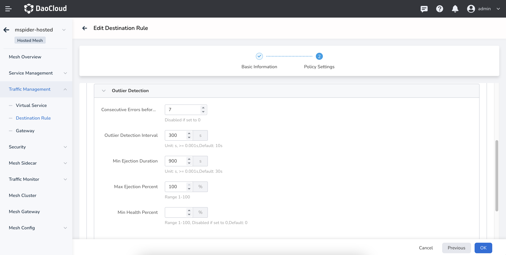

        After successful configuration, instances from down clusters will be automatically removed, preventing delays.

    **Traffic in Mesh Only Hits Test Services in Some Clusters**

    In a hosted mesh with 2 clusters, multi-cloud interconnect is enabled and successfully configured. However, continuous access to the test service via the ingress gateway only hits test services in some clusters.

    **Cause Analysis**

    1. Some test services are in an abnormal state. Check the service status.
    2. Some test services have not injected sidecars. Check the sidecar injection status.
    3. Some test service configurations are incorrect. Check service configurations such as svc ports and port names
    4. Multi-cloud interconnect was enabled after the test services were created.

    **Solutions**

    1. Investigate and resolve the causes of service anomalies to restore normal service status.
    2. Inject sidecars into the services.
    3. Ensure consistent svc configurations for all test services.
       Use the __Service Management__ -> __Service List__ diagnostic function to assist in observation:

        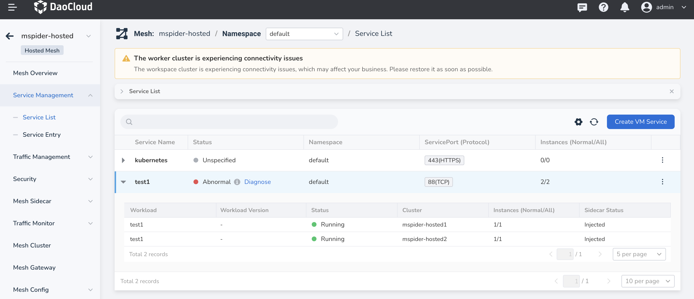

    4. Restart all gateways, including self-built gateways and the North-South and East-West gateways in the data plane clusters:

        

    By following these steps, you can troubleshoot and resolve issues related to cross-cluster interconnect in your service mesh.

??? "Sidecar occupies a lot of memory"

    There are several situations that can cause this issue:

    **Case 1**

    The namespace isolation feature for sidecar discovery scope is not enabled. The sidecar caches information about all services in the mesh. When the mesh cluster is large and there are many service discovery rules, it can consume a significant amount of memory.
    It is recommended to enable this feature when creating the mesh or by selecting it in the __Mesh Overview__ -> __Edit Sidecar__ section. For cross-namespace access, configure individual namespaces in __Sidecar Management__ -> __Namespace__.

    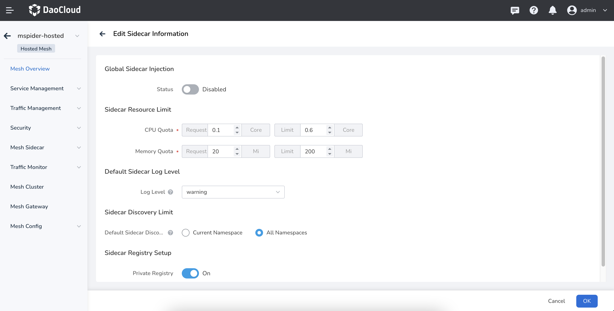

    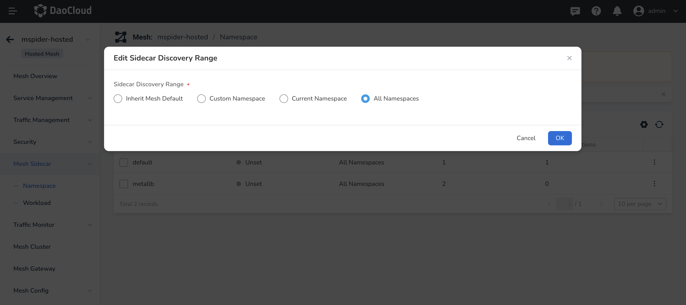

    **Case 2**

    A large volume of traffic passing through the sidecar, high request latency, and large response body text can all consume more memory. You can confirm this by checking the monitoring topology.

    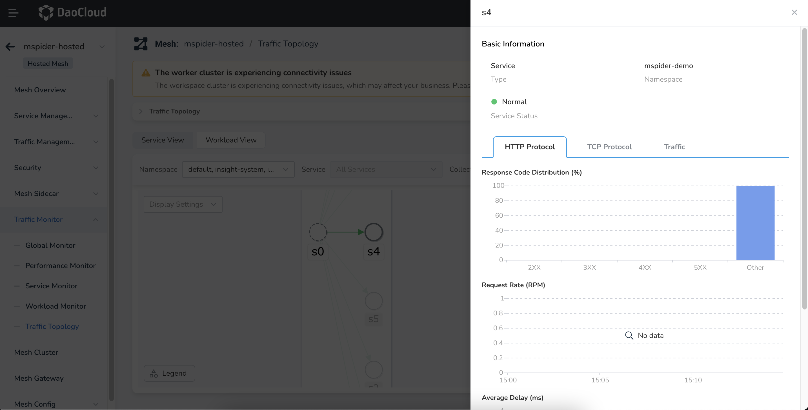

    **Case 3**

    Memory leak in the sidecar. Check using monitoring components, such as DCE component Insight.
    If the cluster traffic scale has not changed but the sidecar memory usage continues to rise, it could be a memory leak. Contact us to diagnose the issue.

    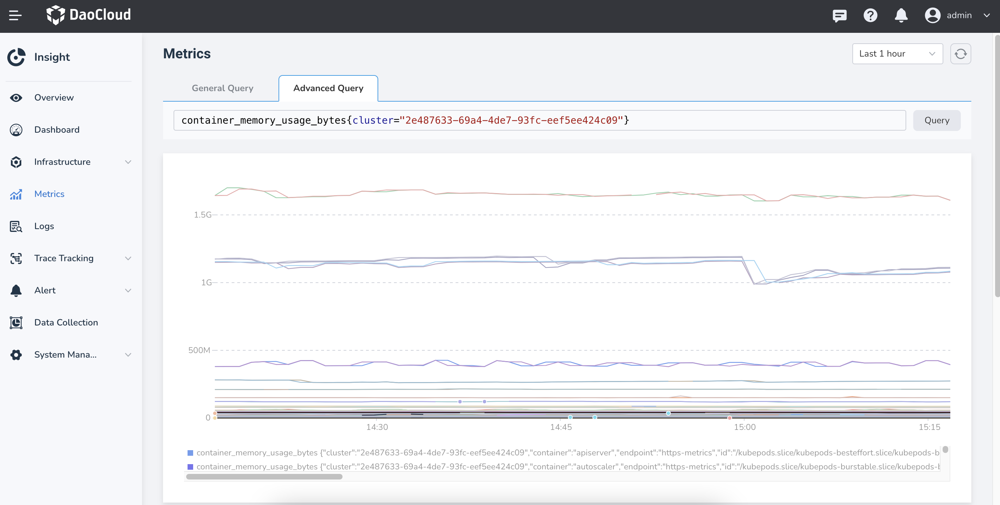

??? "When creating a mesh, the cluster list contains unknown clusters"

    There are several potential reasons for this issue:

    - **Reason**: The unknown cluster was recently uninstalled, and the cluster synchronization task has not yet been triggered.

        **Analysis**: The mesh instance of the unknown cluster may still be in the process of being uninstalled, waiting for the uninstallation to complete.

        **Solution**: In this case, simply trigger the cluster synchronization automatically.

    - **Reason**: There are remnants from the cluster uninstallation.

        **Solution**: Confirm that the unknown cluster no longer exists, and manually delete
        any remained cluster information. To do this, log into the global service cluster
        `kpanda-global-cluster` and run the following commands:

        ```bash
        kubectl -n mspider-system get mc
        kubectl -n mspider-system delete mc jy-test
        ```

        

??? "Managed mesh APIServer certificate expiration handling methods"

    **Problem Description**

    For security reasons, the certificates for the hosted mesh are valid for only one year. We need to periodically regenerate these certificates to ensure that the cluster services operate normally.

    If you notice an abnormal mesh status on the interface and see logs in the hosted-apiserver of the control plane cluster with messages similar to the following:

    ```info
    x509: certificate has expired or is not yet valid
    MspiderHostedKubeAPICertExpiration
    ```

    It indicates that the certificate has expired or is about to expire and needs to be replaced.

    **Impact Scope**

    Certificate expiration will not affect normal business operations but will impact policy issuance, application creation, or restart operations. Therefore, timely replacement is necessary.

    **Solution**

    For an already installed mesh, we need to manually handle the certificate update process.

    First, replace all instances of `MESH_ID` in the following YAML with the mesh ID (the name on the interface, such as hosted-demo).

    ```yaml
    apiVersion: batch/v1
    kind: Job
    metadata:
      name: MESH_ID-hosted-apiserver-certs-renew
      namespace: istio-system
    spec:
      parallelism: 1
      completions: 1
      template:
        spec:     
          serviceAccountName: mspider-mcpc
          restartPolicy: Never
          volumes:
            - name: etcd-certs
              secret:
                secretName: MESH_ID-etcd-certs
            - name: kube-certs
              secret:
                secretName: MESH_ID-kube-certs
          containers:
            - name: init-certs
              image: release.daocloud.io/mspider/self-hosted-apiserver:0.0.13
              imagePullPolicy: IfNotPresent
              env:
                - name: MESH_ID
                  value: MESH_ID
                - name: KUBE_CERT_SECRET
                  value: MESH_ID-kube-certs
                - name: ETCD_CERT_SECRET
                  value: MESH_ID-etcd-certs
                - name: KUBECONFIG_SECRET
                  value: MESH_ID-apiserver-admin-kubeconfig
                - name: EXT_SANS
                  value: MESH_ID-hosted-apiserver,MESH_ID-hosted-apiserver.istio-system,MESH_ID-hosted-apiserver.istio-system.svc,MESH_ID-hosted-apiserver.istio-system.svc.cluster.local
              command:
              - bash
              - -c
              volumeMounts:
                - name: etcd-certs
                  mountPath: /etc/kubernetes/pki/etcd
                - name: kube-certs
                  mountPath: /etc/kubernetes/pki
              args:
              - |-
                set -ex
                cd /etc/kubernetes/pki
                if [ ! -f ca.crt ]; then
                  echo "ca.crt not found"
                  exit 1
                fi
                d=$(mktemp -d)
                cp -Lrf /etc/kubernetes/pki/* ${d}
                cd ${d}
                # renew certs
                kubeadm  certs renew all --cert-dir ${d}
                files=$(for a in $(find . -maxdepth 1 -type f); do echo -n " --from-file $a "; done)
                cat > /tmp/secret-patch.json <<EOF
                {"data": $(kubectl create secret generic ${KUBE_CERT_SECRET} ${files} --dry-run -o jsonpath='{.data}')}
                EOF
                kubectl patch secrets ${KUBE_CERT_SECRET} --type merge --patch-file /tmp/secret-patch.json

                files=$(for a in $(find etcd -maxdepth 1 -type f); do echo -n " --from-file $a "; done)
                cat > /tmp/secret-patch.json <<EOF
                {"data": $(kubectl create secret generic ${ETCD_CERT_SECRET} ${files} --dry-run -o jsonpath='{.data}')}
                EOF
                kubectl patch secrets ${ETCD_CERT_SECRET} --type merge --patch-file /tmp/secret-patch.json

                kubeadm init phase kubeconfig admin --cert-dir ${d} --kubeconfig-dir ${d}
                cp admin.conf config
                sed -i 's#server: .*#server: https://MESH_ID-hosted-apiserver:6443#g' config
                cat > /tmp/secret-patch.json <<EOF
                {"data": $(kubectl create secret generic ${KUBECONFIG_SECRET} --from-file config --dry-run -o jsonpath='{.data}')}
                EOF
                kubectl patch secrets ${KUBECONFIG_SECRET} --type merge --patch-file /tmp/secret-patch.json
    ```

    Next, in the control plane cluster of the hosted mesh (which can be viewed in the mesh list),
    create this Job and wait for it to execute successfully. After successful execution,
    you need to restart the istiod, hosted-apiserver, etcd, and ckube-remote components in the istio-system namespace.

    **Restarting these components will not affect normal business services.**

    **Verification**

    - Check the mesh status on the interface.
    - Ensure that deleting and creating mesh-related resources work properly.

??? "Common 503 errors in service mesh"

    This page describes common 503 error scenarios in the service mesh and their solutions.

    **Occasional 503**

    **Using Custom Metrics Where a Few 503 Errors Appear in Log Monitoring Whenever the Configuration Changes**

    #### Problem Cause

    The logic of the custom metrics feature is to update the configuration of `istio.stats` by generating a corresponding EnvoyFilter.
    This configuration takes effect at the Envoy Listener level, that is, it takes effect through LDS synchronization. When Envoy applies a Listener-level configuration,
    it needs to disconnect existing connections. The corresponding in-flight requests return 503 because the connection is reset or closed.

    #### Solution

    When the upstream server actively closes the connection, the 503 you see is not sent by the upstream server, but is a response returned locally by the client sidecar because the upstream connection was actively disconnected.

    The default retry configuration of Istio does not include "the upstream server actively closes the connection". Among the retry conditions of EnvoyProxy,
    `reset` matches the trigger condition for this case. Therefore, you need to configure a retry policy for the route of the corresponding service.
    The retry policy configured under the VirtualService includes the trigger condition `reset`.

    The configuration example is as follows. This configuration only takes effect for the Ratings service.

    ```yaml
    apiVersion: networking.istio.io/v1beta1
    kind: VirtualService
    metadata:
      name: ratings-route
    spec:
      hosts:
        - ratings.prod.svc.cluster.local
      http:
        - route:
            - destination:
                host: ratings.prod.svc.cluster.local
                subset: v1
          retries:
            attempts: 2
            retryOn: connect-failure,refused-stream,unavailable,cancelled,retriable-status-codes,reset,503
    ```

    #### Related FAQs

    **Why does the default retry mechanism of Istio not take effect?**

    The conditions under which the default retry of Istio occurs are as follows. By default, it retries 2 times. This scenario is not among the retry conditions, so it does not take effect.

    ```yaml
    "retry_policy":
      {
        "retry_on": "connect-failure,refused-stream,unavailable,cancelled,retriable-status-codes",
        "num_retries": 2,
        "retry_host_predicate":
          [{ "name": "envoy.retry_host_predicates.previous_hosts" }],
        "host_selection_retry_max_attempts": "5",
        "retriable_status_codes": [503],
      }
    ```

    - **connect-failure**: The connection failed.
    - **refused-stream**: The HTTP2 stream returns the `REFUSED_STREAM` error code.
    - **unavailable**: The gRPC request returns the `unavailable` error code.
    - **cancelled**: The gRPC request returns the `cancelled` error code.
    - **retriable-status-codes**: The `status_code` returned by the request matches the error code defined in the `retriable_status_codes` configuration.

    For the complete retry conditions of the latest version of EnvoyProxy, see the following documents.

    - Existing retry condition configuration for HTTP (including HTTP2 and HTTP3):
      [Router](https://www.envoyproxy.io/docs/envoy/latest/configuration/http/http_filters/router_filter#x-envoy-retry-on)
    - Retry condition configuration specific to gRPC:
      [x-envoy-retry-grpc-on](https://www.envoyproxy.io/docs/envoy/latest/configuration/http/http_filters/router_filter#config-http-filters-router-x-envoy-retry-grpc-on)

    **Occasional 503 Without Regularity and Without Configuration Changes During the Process**

    503 appears occasionally, but it appears continuously when the traffic is intensive. It usually appears on the Inbound side of the sidecar.

    #### Problem Cause

    The idle connection keep-alive time of Envoy does not match that of the application. The default Envoy idle connection time is 1 hour.

    - The Envoy idle connection time is too long while that of the application is relatively short:

        The application has ended the idle connection, but Envoy thinks it has not ended. If there is a new connection at this time, a 503UC will be reported.

    - The Envoy idle connection time is too short while that of the application is relatively long:

        This case will not cause a 503. Envoy thinks the previous connection has been closed, so it directly creates a new connection.

    #### Solution

    **Solution 1: Configure idleTimeout in the DestinationRule**

    The cause of this problem is that idleTimeout does not match, so configuring idleTimeout in the DestinationRule is a relatively fundamental solution.

    If idleTimeout is configured, it takes effect on both the Outbound and Inbound sides, that is, the Sidecar on both the Outbound and Inbound sides
    will have the idleTimeout configuration. If the client has no Sidecar, idleTimeout will also take effect and can effectively reduce 503s.

    Configuration suggestion: This configuration is related to the business. If it is too short, the number of connections will be too high. It is recommended that you configure it slightly shorter than the real idleTimeout of the business application.

    **Solution 2: Configure retries in the VirtualService**

    Retries will re-establish the connection and can solve this problem. For details, see the solution in [Scenario 1](#using-custom-metrics-where-a-few-503-errors-appear-in-log-monitoring-whenever-the-configuration-changes).

    !!! important

        This operation is a non-idempotent request, and retries carry great risks. Please proceed with caution.

    **Related to Sidecar Lifecycle**

    #### Problem Cause

    It is caused by the lifecycle of the sidecar and the business container, and often occurs when a Pod is restarted.

    #### Solution

    For details, see [Sidecar Lifecycle](../mspider/troubleshoot/sidecar-lifecycle.md).

    **Guaranteed 503**

    **Application Listens on localhost**

    #### Problem Cause

    When an application in the cluster listens on the localhost network address, since localhost is a local address, other Pods in the cluster cannot access it normally.

    #### Solution

    You can solve this problem by exposing the application service externally. For details, see [How to Make an Application Listening on localhost in a Cluster Accessible by Other Pods](../mspider/troubleshoot/localhost-by-pod.md).

    **Health Check Always Fails with a 503 Error After Enabling the Sidecar**

    #### Problem Cause

    After mTLS is enabled in the service mesh, the health check request sent by kubelet to the Pod is intercepted by the sidecar, and kubelet does not have the corresponding TLS certificate, which causes the health check to fail.

    #### Solution

    You can solve this problem by configuring the port so that the health check traffic bypasses the sidecar proxy.

??? "How to allow applications listening on localhost in the cluster to be accessed by other Pods"

    This page describes how to configure sidecar resources so that an application listening on localhost can be accessed by other Pods in the cluster through a Service.

    **Symptom**

    When an application deployed in the cluster listens on localhost, even if the service port of the application is exposed through a Service, the service cannot be accessed by other Pods in the cluster.

    Examples of applications listening on localhost in different languages are as follows:

    - Golang: net.Listen("tcp", "localhost:8080")
    - Node.js: http.createServer().listen(8080, "localhost")
    - Python: socket.socket().bind(("localhost", 8083))

    **Problem Cause**

    When an application in the cluster listens on the localhost network address, since localhost is a local address, it is normal that other Pods in the cluster cannot access it.

    **Solution**

    You can choose any of the following ways to expose the application service.

    - Method 1: Change the network address the application listens on

        If you want the service provided by the application to be exposed externally, it is recommended to modify the application code and change the network address the application listens on from localhost to 0.0.0.0.

    - Method 2: Use the service mesh to expose a service listening on localhost

        If you do not want to modify the application code and need to expose the application listening on localhost to other Pods in the cluster, you can configure it when creating the sidecar.

        Replace the following fields according to your actual situation.

         | **Field**           | **Description**                              |
         | ------------------ | ------------------------------------- |
         | `{namespace}`      | Replace it with the namespace where the application is deployed.        |
         | `{container_port}` | Replace it with the container port on which the application listens on localhost. |
         | `{port}`           | Replace it with the Service port of the application.           |
         | `{key} : {value}`  | Replace it with the label of the selected application Pod.           |

         ```yaml
         apiVersion: networking.istio.io/v1beta1
         kind: Sidecar
         metadata:
           name: localhost-access
           namespace: { namespace }
         spec:
           ingress:
             - defaultEndpoint: "127.0.0.1:{container_port}"
               port:
                 name: tcp
                 number: { port }
                 protocol: TCP
           workloadSelector:
             labels:
               { key }: { value }
         ```

## Middleware

For more questions, refer to [Middleware](../middleware/index.md).

### MySQL Troubleshooting

??? "MySQL health check"

    > If you encounter an issue that is not covered in the "Troubleshooting" section, you can quickly jump to the bottom of the page and submit your problem.

    To perform a regular health check on MySQL, you can use a single command to quickly view the overall status of the MySQL instance:

    ```none
    kubectl get pod -n mcamel-system -Lhealthy,role | grep mysql
    ```

    The output is similar to:

    ```
    mcamel-common-mysql-cluster-auto-2023-03-28t00-00-00-backujgg9m 0/1 Completed 0 27h
    mcamel-common-mysql-cluster-auto-2023-03-29t00-00-00-backusgf59 0/1 Completed 0 3h43m
    mcamel-common-mysql-cluster-mysql-0 4/4 Running 6 (11h ago) 25h yes master
    mcamel-common-mysql-cluster-mysql-1 4/4 Running 690 (11h ago) 4d20h yes replica
    mcamel-mysql-apiserver-9797c7f76-bvf5n 2/2 Running 0 22h
    mcamel-mysql-ui-7ffd9dd8db-d5jfm 2/2 Running 0 25m
    mysql-operator-0 2/2 Running 109 (47m ago) 2d21h
    ```

    As shown above, if the status of the active and standby nodes ( __master__ __replica__ ) is __yes__ , it means that MySQL is in a normal state.

??? "MySQL Pod issues"

    You can use the following command to quickly check the health status of all MySQL instances in the current cluster:

    ```bash
    kubectl get mysql -A
    ```

    The output will be similar to:

    ```bash
    NAMESPACE       NAME                          READY   REPLICAS   AGE
    ghippo-system   test                          True    1          3d
    mcamel-system   mcamel-common-mysql-cluster   False   2          62d
    ```

    For different replica states, refer to the troubleshooting solutions below.

    **Pod running = 0/4, with state __Init:Error__**

    When encountering this issue, start by checking the logs of the master node (sidecar) for more information.

    ```bash
    kubectl get pod -n mcamel-system -Lhealthy,role | grep cluster-mysql | grep master | awk '{print $1}' | xargs -I {} kubectl logs -f {} -n mcamel-system -c sidecar
    ```

    ??? note "Example Output"

        ```none
        2023-02-09T05:38:56.208445-00:00 0 [Note] [MY-011825] [Xtrabackup] perl binary not found. Skipping the version check
        2023-02-09T05:38:56.208521-00:00 0 [Note] [MY-011825] [Xtrabackup] Connecting to MySQL server host: 127.0.0.1, user: sys_replication, password: set, port: not set, socket: not set
        2023-02-09T05:38:56.212595-00:00 0 [Note] [MY-011825] [Xtrabackup] Using server version 8.0.29
        2023-02-09T05:38:56.217325-00:00 0 [Note] [MY-011825] [Xtrabackup] Executing LOCK INSTANCE FOR BACKUP ...
        2023-02-09T05:38:56.219880-00:00 0 [ERROR] [MY-011825] [Xtrabackup] Found tables with row versions due to INSTANT ADD/DROP columns
        2023-02-09T05:38:56.219931-00:00 0 [ERROR] [MY-011825] [Xtrabackup] This feature is not stable and will cause backup corruption.
        2023-02-09T05:38:56.219940-00:00 0 [ERROR] [MY-011825] [Xtrabackup] Please check https://docs.percona.com/percona-xtrabackup/8.0/em/instant.html for more details.
        2023-02-09T05:38:56.219945-00:00 0 [ERROR] [MY-011825] [Xtrabackup] Tables found:
        2023-02-09T05:38:56.219951-00:00 0 [ERROR] [MY-011825] [Xtrabackup] keycloak/USER_SESSION
        2023-02-09T05:38:56.219956-00:00 0 [ERROR] [MY-011825] [Xtrabackup] keycloak/AUTHENTICATION_EXECUTION
        2023-02-09T05:38:56.219960-00:00 0 [ERROR] [MY-011825] [Xtrabackup] keycloak/AUTHENTICATION_FLOW
        2023-02-09T05:38:56.219968-00:00 0 [ERROR] [MY-011825] [Xtrabackup] keycloak/AUTHENTICATOR_CONFIG
        2023-02-09T05:38:56.219984-00:00 0 [ERROR] [MY-011825] [Xtrabackup] keycloak/CLIENT_SESSION
        2023-02-09T05:38:56.219991-00:00 0 [ERROR] [MY-011825] [Xtrabackup] keycloak/IDENTITY_PROVIDER
        2023-02-09T05:38:56.219998-00:00 0 [ERROR] [MY-011825] [Xtrabackup] keycloak/PROTOCOL_MAPPER
        2023-02-09T05:38:56.220005-00:00 0 [ERROR] [MY-011825] [Xtrabackup] keycloak/RESOURCE_SERVER_SCOPE
        2023-02-09T05:38:56.220012-00:00 0 [ERROR] [MY-011825] [Xtrabackup] keycloak/REQUIRED_ACTION_PROVIDER
        2023-02-09T05:38:56.220018-00:00 0 [ERROR] [MY-011825] [Xtrabackup] keycloak/COMPONENT
        2023-02-09T05:38:56.220027-00:00 0 [ERROR] [MY-011825] [Xtrabackup] keycloak/RESOURCE_SERVER
        2023-02-09T05:38:56.220036-00:00 0 [ERROR] [MY-011825] [Xtrabackup] keycloak/CREDENTIAL
        2023-02-09T05:38:56.220043-00:00 0 [ERROR] [MY-011825] [Xtrabackup] keycloak/FED_USER_CREDENTIAL
        2023-02-09T05:38:56.220049-00:00 0 [ERROR] [MY-011825] [Xtrabackup] keycloak/MIGRATION_MODEL
        2023-02-09T05:38:56.220054-00:00 0 [ERROR] [MY-011825] [Xtrabackup] keycloak/REALM
        2023-02-09T05:38:56.220062-00:00 0 [ERROR] [MY-011825] [Xtrabackup] keycloak/CLIENT
        2023-02-09T05:38:56.220069-00:00 0 [ERROR] [MY-011825] [Xtrabackup] keycloak/REALM_ATTRIBUTE
        2023-02-09T05:38:56.220075-00:00 0 [ERROR] [MY-011825] [Xtrabackup] keycloak/OFFLINE_USER_SESSION
        2023-02-09T05:38:56.220084-00:00 0 [ERROR] [MY-011825] [Xtrabackup] Please run OPTIMIZE TABLE or ALTER TABLE ALGORITHM=COPY on all listed tables to fix this issue.
        E0209 05:38:56.223635       1 deleg.go:144] sidecar "msg"="failed waiting for xtrabackup to finish" "error"="exit status 1"
        ```

    Log in to the __master__ node of MySQL and execute an __ALTER__ table command:

    ```bash
    [root@master-01 ~]$ kubectl get pod -n mcamel-system -Lhealthy,role | grep cluster-mysql | grep master
    mcamel-common-mysql-cluster-mysql-0

    **Get the password**
    [root@master-01 ~]$ kubectl get secret -n mcamel-system mcamel-common-mysql-cluster-secret -o=jsonpath='{.data.ROOT_PASSWORD}' | base64 -d

    [root@master-01 ~]$ kubectl exec -it mcamel-common-mysql-cluster-mysql-0 -n mcamel-system -c mysql -- /bin/bash

    **Note: Modifying table structure requires root privileges for login**
    ~bash:mysql -uroot -p
    ```

    ??? note "SQL statements"

        ```sql
        use keycloak;
        ALTER TABLE USER_SESSION ALGORITHM=COPY;
        ALTER TABLE AUTHENTICATION_EXECUTION ALGORITHM=COPY;
        ALTER TABLE AUTHENTICATION_FLOW ALGORITHM=COPY;
        ALTER TABLE AUTHENTICATOR_CONFIG ALGORITHM=COPY;
        ALTER TABLE CLIENT_SESSION ALGORITHM=COPY;
        ALTER TABLE IDENTITY_PROVIDER ALGORITHM=COPY;
        ALTER TABLE PROTOCOL_MAPPER ALGORITHM=COPY;
        ALTER TABLE RESOURCE_SERVER_SCOPE ALGORITHM=COPY;
        ALTER TABLE REQUIRED_ACTION_PROVIDER ALGORITHM=COPY;
        ALTER TABLE COMPONENT ALGORITHM=COPY;
        ALTER TABLE RESOURCE_SERVER ALGORITHM=COPY;
        ALTER TABLE CREDENTIAL ALGORITHM=COPY;
        ALTER TABLE FED_USER_CREDENTIAL ALGORITHM=COPY;
        ALTER TABLE MIGRATION_MODEL ALGORITHM=COPY;
        ALTER TABLE REALM ALGORITHM=COPY;
        ALTER TABLE CLIENT ALGORITHM=COPY;
        ALTER TABLE REALM_ATTRIBUTE ALGORITHM=COPY;
        ALTER TABLE OFFLINE_USER_SESSION ALGORITHM=COPY
        ```

    **Pod running = 2/4**

    This type of issue is likely caused by the disk usage of the MySQL instances reaching 100%. You can run the following command on the __master__ node to check the disk usage:

    ```bash
    kubectl get pod -n mcamel-system | grep cluster-mysql | awk '{print $1}' | xargs -I {} kubectl exec {} -n mcamel-system -c sidecar -- df -h | grep /var/lib/mysql
    ```

    The output will be similar to:

    ```console
    /dev/drbd43001            50G   30G   21G  60% /var/lib/mysql
    /dev/drbd43005            80G   29G   52G  36% /var/lib/mysql
    ```

    If you find that a PVC (PersistentVolumeClaim) is full, you need to resize the PVC.

    ```bash
    kubectl edit pvc data-mcamel-common-mysql-cluster-mysql-0 -n mcamel-system # Modify the requested size
    ```

    **Pod running = 3/4**

    

    When using __kubectl describe__ on the Pod highlighted in the image above, you may encounter an error message: __Warning Unhealthy 4m50s (x7194 over 3h58m) kubelet Readiness probe failed:__ .

    In this case, manual intervention is required due to a current bug in the open-source __mysql-operator__ version. You have two options to fix it:

    - Restart the __mysql-operator__ , or
    - Manually update the configuration status of __sys_operator__ .

    ```bash
    kubectl exec mcamel-common-mysql-cluster-mysql-1 -n mcamel-system -c mysql -- mysql --defaults-file=/etc/mysql/client.conf -NB -e 'update sys_operator.status set value="1"  WHERE name="configured"'
    ```

??? "MySQL Operator issues"

    **Unspecified __storageClass__**

    When the __storageClass__ is not specified, it causes the __mysql-operator__ to be unable to retrieve the Persistent Volume Claim (PVC), resulting in a __pending__ state.

    If you are using Helm to deploy, you can make the following configuration:

    1. Disable PVC provisioning:

        ```console
        orchestrator.persistence.enabled=false 
        ```

    2. Specify the __storageClass__ to retrieve the PVC:

        ```console
        orchestrator.persistence.storageClass={storageClassName} 
        ```

    If you are using a different tool, you can modify the corresponding field in the __value.yaml__ file to achieve the same effect as deploying with Helm.

??? "MySQL master-slave relationship issues"

    The master-slave relationship in MySQL can be complex when it comes to troubleshooting, as different symptoms may require different solutions.

    1. Run the following command to confirm the MySQL status:

        ```bash
        kubectl get mysql -A
        ```

        The output will be similar to:

        ```
        NAMESPACE       NAME                          READY   REPLICAS   AGE
        ghippo-system   test                          True    1          3d
        mcamel-system   mcamel-common-mysql-cluster   False   2          62d
        ```

    2. Pay attention to the databases with a __Ready__ field value of __False__ (here, the judgement of __True__ is that the delay is less than 30 seconds), and check the logs of the MySQL slave:

        ```bash
        [root@master-01 ~]$ kubectl get pod -n mcamel-system -Lhealthy,role | grep cluster-mysql | grep replica | awk '{print $1}' | xargs -I {} kubectl logs {} -n mcamel-system -c mysql | grep ERROR
        ```

    When the instance status is __False__ , there may be several types of failures. You can troubleshoot and fix them based on the information in the database logs.

    **Instance Status is __False__ but No Error Messages in Logs**

    If there are no __ERROR__ messages in the logs of the slave, it means that the __False__ status is due to a large delay in master-slave synchronization. You can further investigate the slave by performing the following steps:

    1. Find the Pod of the slave node:

        ```bash
        kubectl get pod -n mcamel-system -Lhealthy,role | grep cluster-mysql | grep replica | awk '{print $1}'
        ```

        The output will be similar to:

        ```
        mcamel-common-mysql-cluster-mysql-1
        ```

    2. Set the __binlog__ parameter:

        ```bash
        kubectl exec mcamel-common-mysql-cluster-mysql-1 -n mcamel-system -c mysql -- mysql --defaults-file=/etc/mysql/client.conf -NB -e 'set global sync_binlog=10086;'
        ```

    3. Enter the MySQL container:

        ```bash
        kubectl exec -it mcamel-common-mysql-cluster-mysql-1 -n mcamel-system -c mysql -- mysql --defaults-file=/etc/mysql/client.conf
        ```

    4. Run the following command inside the MySQL container to check the slave status.

        The __Seconds_Behind_Master__ field indicates the delay between the master and slave. If the value is between 0 and 30, it can be considered as no delay, indicating that the master and slave are in sync.

        ??? note "SQL statements"

            ```sql
            mysql> show slave status\G; 
            *************************** 1. row ***************************
                          Slave_IO_State: Waiting for source to send event
                              Master_Host: mcamel-common-mysql-cluster-mysql-0.mysql.mcamel-system
                              Master_User: sys_replication
                              Master_Port: 3306
                            Connect_Retry: 1
                          Master_Log_File: mysql-bin.000304
                      Read_Master_Log_Pos: 83592007
                          Relay_Log_File: mcamel-common-mysql-cluster-mysql-1-relay-bin.000002
                            Relay_Log_Pos: 83564355
                    Relay_Master_Log_File: mysql-bin.000304
                        Slave_IO_Running: Yes
                        Slave_SQL_Running: Yes
                          Replicate_Do_DB:
                      Replicate_Ignore_DB:
                      Replicate_Do_Table:
                  Replicate_Ignore_Table:
                  Replicate_Wild_Do_Table:
              Replicate_Wild_Ignore_Table:
                              Last_Errno: 0
                              Last_Error:
                            Skip_Counter: 0
                      Exec_Master_Log_Pos: 83564299
                          Relay_Log_Space: 83592303
                          Until_Condition: None
                          Until_Log_File:
                            Until_Log_Pos: 0
                      Master_SSL_Allowed: No
                      Master_SSL_CA_File:
                      Master_SSL_CA_Path:
                          Master_SSL_Cert:
                        Master_SSL_Cipher:
                          Master_SSL_Key:
                    Seconds_Behind_Master: 0
            Master_SSL_Verify_Server_Cert: No
                            Last_IO_Errno: 0
                            Last_IO_Error:
                          Last_SQL_Errno: 0
                          Last_SQL_Error:
              Replicate_Ignore_Server_Ids:
                        Master_Server_Id: 100
                              Master_UUID: e17dae09-8da0-11ed-9104-c2f9484728fd
                        Master_Info_File: mysql.slave_master_info
                                SQL_Delay: 0
                      SQL_Remaining_Delay: NULL
                  Slave_SQL_Running_State: Replica has read all relay log; waiting for more updates
                      Master_Retry_Count: 86400
                              Master_Bind:
                  Last_IO_Error_Timestamp:
                Last_SQL_Error_Timestamp:
                          Master_SSL_Crl:
                      Master_SSL_Crlpath:
                      Retrieved_Gtid_Set: e17dae09-8da0-11ed-9104-c2f9484728fd:21614244-21621569
                        Executed_Gtid_Set: 4bc2107c-819a-11ed-bf23-22be07e4eaff:1-342297,
            7cc717ea-7c1b-11ed-b59d-c2ba3f807d12:1-619197,
            a5ab763a-7c1b-11ed-b5ca-522707642ace:1-178069,
            a6045297-8743-11ed-8712-8e52c3ace534:1-4073131,
            a95cf9df-84d7-11ed-8362-5e8a1c335253:1-493942,
            b5175b1b-a2ac-11ed-b0c6-d6fbe05d7579:1-3754703,
            c4dc2b14-9ed9-11ed-ac61-36da81109699:1-945884,
            e17dae09-8da0-11ed-9104-c2f9484728fd:1-21621569
                            Auto_Position: 1
                    Replicate_Rewrite_DB:
                            Channel_Name:
                      Master_TLS_Version:
                  Master_public_key_path:
                    Get_master_public_key: 0
                        Network_Namespace:
            1 row in set, 1 warning (0.00 sec)
            ```

    5. After the master-slave synchronization, if __Seconds_Behind_Master__ is less than 30s, set __sync_binlog=1__ :

        ```bash
        kubectl exec mcamel-common-mysql-cluster-mysql-1 -n mcamel-system -c mysql -- mysql --defaults-file=/etc/mysql/client.conf -NB -e 'set global sync_binlog=1';
        ```

    6. If the issue persists, you can check the host load or IO of the slave node by running the following command:

        ```bash
        [root@master-01 ~]$ uptime
        11:18  up 1 day, 17:49, 2 users, load averages: 9.33 7.08 6.28
        ```

        In normal circumstances, the __load averages__ should not exceed 10 for a prolonged period. If it exceeds 30 or above, consider adjusting the Pod and disk allocation for that node.

    **Replication Error in Slave Logs**

    If there are replication errors in the logs of the slave Pod, it may be caused by various reasons. The following sections will provide different scenarios along with their corresponding diagnosis and repair methods.

    **Purged Binlog Error**

    In case you encounter the keyword __purged binlog__ in the logs, it typically indicates the need to rebuild the slave.

    ??? note "Erros"

        ```bash
        [root@demo-alpha-master-01 /]$ kubectl get pod -n mcamel-system -Lhealthy,role | grep cluster-mysql | grep replica | awk '{print $1}' | xargs -I {} kubectl logs {} -n mcamel-system -c mysql | grep ERROR
        2023-02-08T18:43:21.991730Z 116 [ERROR] [MY-010557] [Repl] Error reading packet from server for channel '': Cannot replicate because the master purged required binary logs. Replicate the missing transactions from elsewhere, or provision a new slave from backup. Consider increasing the master's binary log expiration period. The GTID sets and the missing purged transactions are too long to print in this message. For more information, please see the master's error log or the manual for GTID_SUBTRACT (server_errno=1236)
        2023-02-08T18:43:21.991777Z 116 [ERROR] [MY-013114] [Repl] Slave I/O for channel '': Got fatal error 1236 from master when reading data from binary log: 'Cannot replicate because the master purged required binary logs. Replicate the missing transactions from elsewhere, or provision a new slave from backup. Consider increasing the master's binary log expiration period. The GTID sets and the missing purged transactions are too long to print in this message. For more information, please see the master's error log or the manual for GTID_SUBTRACT', Error_code: MY-013114
        ```

    The steps to perform the rebuild operation are as follows:

    1. Find the Pod of the slave node:

        ```bash
        [root@master-01 ~]$ kubectl get pod -n mcamel-system -Lhealthy,role | grep cluster-mysql | grep replica | awk '{print $1}'
        mcamel-common-mysql-cluster-mysql-1
        ```

    2. Find the PVC (PersistentVolumeClaim) of the slave node:

        ```bash
        [root@master-01 /]$ kubectl get pvc -n mcamel-system | grep mcamel-common-mysql-cluster-mysql-1
        data-mcamel-common-mysql-cluster-mysql-1                                        Bound    pvc-5840569e-834f-4236-a5c6-878e41c55c85   50Gi       RWO            local-path                   33d
        ```

    3. Delete the PVC of the slave node:

        ```bash
        [root@master-01 /]$ kubectl delete pvc data-mcamel-common-mysql-cluster-mysql-1 -n mcamel-system
        persistentvolumeclaim "data-mcamel-common-mysql-cluster-mysql-1" deleted
        ```

    4. Delete the Pod of the slave:

        ```bash
        [root@master-01 /]$ kubectl delete pod mcamel-common-mysql-cluster-mysql-1 -n mcamel-system
        pod "mcamel-common-mysql-cluster-mysql-1" deleted
        ```

    **Primary Key Conflict Error**

    ??? note "Errors"

        ```bash
        [root@demo-alpha-master-01 /]$ kubectl get pod -n mcamel-system -Lhealthy,role | grep cluster-mysql | grep replica | awk '{print $1}' | xargs -I {} kubectl logs {} -n mcamel-system -c mysql | grep ERROR
        2023-02-08T18:43:21.991730Z 116 [ERROR] [MY-010557] [Repl] Could notexecute Write_rows event on table dr_brower_db.dr_user_info; Duplicate entry '24' for key 'PRIMARY', Error_code:1062; handler error HA_ERR_FOUND_DUPP_KEY; the event's master logmysql-bin.000010, end_log_pos 5295916
        ```

    If you see the following error in the error log: __Duplicate entry '24' for key 'PRIMARY', Error_code:1062; handler error HA_ERR_FOUND_DUPP_KEY;__ , it indicates a primary key conflict or an error where the primary key does not exist. In such cases, you can recover using an idempotent mode or skip the error by inserting an empty transaction:

    **Method 1**: Idempotent Recovery

    1. Find the Pod of the slave node:

        ```bash
        [root@master-01 ~]$ kubectl get pod -n mcamel-system -Lhealthy,role | grep cluster-mysql | grep replica | awk '{print $1}'
        mcamel-common-mysql-cluster-mysql-1
        ```

    2. Set MySQL to idempotent mode:

        ```bash
        [root@master-01 ~]$ kubectl exec mcamel-common-mysql-cluster-mysql-1 -n mcamel-system -c mysql -- mysql --defaults-file=/etc/mysql/client.conf -NB -e 'stop slave;set global slave_exec_mode="IDEMPOTENT";set global sync_binlog=10086;start slave;'
        ```

    **Method 2**: Insert Empty Transaction to Skip Error

    ```sql
    mysql> stop slave;
    mysql> SET @@SESSION.GTID_NEXT= 'xxxxx:105220'; /* Specific value mentioned in the logs */
    mysql> BEGIN;
    mysql> COMMIT;
    mysql> SET SESSION GTID_NEXT = AUTOMATIC;
    mysql> START SLAVE;
    ```

    After completing the above steps, observe the progress of the slave rebuild:

    ```bash
    **Enter the MySQL container**
    [root@master-01 ~]$ kubectl exec -it mcamel-common-mysql-cluster-mysql-1 -n mcamel-system -c mysql -- mysql --defaults-file=/etc/mysql/client.conf
    ```

    Run the following command to check the slave's replication delay status in the field __Seconds_Behind_Master__ . If the value is between 0 and 30, it indicates that there is no significant delay, and the master and slave databases are essentially synchronized.

    ```sql
    mysql> show slave status\G;
    ```

    After confirming the master-slave synchronization (when __Seconds_Behind_Master__ is less than 30s), run the following command to set MySQL strict mode:

    ```bash
    [root@master-01 ~]$ kubectl exec mcamel-common-mysql-cluster-mysql-1 -n mcamel-system -c mysql -- mysql --defaults-file=/etc/mysql/client.conf -NB -e 'stop slave;set global slave_exec_mode="STRICT";set global sync_binlog=10086;start slave;
    ```

    **Replication Error in Master-Slave Setup**

    When the slave database encounters an error message similar to __[Note] Slave: MTS group recovery relay log info based on Worker-Id 0, group_r__ , you can perform the following steps:

    1. Find the Pod of the slave node:

        ```shell
        [root@master-01 ~]# kubectl get pod -n mcamel-system -Lhealthy,role | grep cluster-mysql | grep replica | awk '{print $1}'
        mcamel-common-mysql-cluster-mysql-1
        ```

    2. Set the slave to skip this particular log and continue replication:

        ```shell
        [root@master-01 ~]# kubectl exec mcamel-common-mysql-cluster-mysql-1 -n mcamel-system -c mysql -- mysql --defaults-file=/etc/mysql/client.conf -NB -e 'stop slave;reset slave;change master to MASTER_AUTO_POSITION = 1;start slave;'
        ```

    !!! tip

        1. This situation can be handled using an idempotent mode.
        2. In such replication errors, redoing the setup on the slave database is also a viable option.

    **Both Primary and Replica Pods are Labeled as __replica__**

    1. By executing the following command, you will discover that both MySQL Pods
       are labeled as __replica__ role. You need to correct one of them to __master__ .

        ```bash
        [root@aster-01 ~]$ kubectl get pod -n mcamel-system -Lhealthy,role|grep mysql
        mcamel-common-mysql-cluster-mysql-0                          4/4     Running   5 (16h ago)   16h   no       replica
        mcamel-common-mysql-cluster-mysql-1                          4/4     Running   6 (16h ago)   16h   no       replica
        mysql-operator-0                                             2/2     Running   1 (16h ago)   16h
        ```

    2. Go to MySQL to check:

        ```bash
        kubectl exec -it mcamel-common-mysql-cluster-mysql-0 -n mcamel-system -c mysql -- mysql --defaults-file=/etc/mysql/client.conf
        ```

    3. To check the status information of the __slave__ , look for the results where the query output is empty. These correspond to the original __master__ . In the example below, __mysql-0__ corresponds to the relevant content:

        ??? note "Status examples“

            ```sql
            -- mysql-0
            mysql> show slave status\G;
            empty set, 1 warning (0.00 sec)

            -- mysql-1
            mysql> show slave status\G;
            *************************** 1. row ***************************
                          Slave_IO_State: Waiting for source to send event
                              Master_Host: mcamel-common-mysql-cluster-mysql-0.mysql.mcamel-system
                              Master_User: sys_replication
                              Master_Port: 3306
                            Connect_Retry: 1
                          Master_Log_File: mysql-bin.000004
                      Read_Master_Log_Pos: 38164242
                          Relay_Log_File: mcamel-common-mysql-cluster-mysql-1-relay-bin.000002
                            Relay_Log_Pos: 38164418
                    Relay_Master_Log_File: mysql-bin.000004
                        Slave_IO_Running: Yes
                        Slave_SQL_Running: Yes
                          Replicate_Do_DB:
                      Replicate_Ignore_DB:
                      Replicate_Do_Table:
                  Replicate_Ignore_Table:
                  Replicate_Wild_Do_Table:
              Replicate_Wild_Ignore_Table:
                              Last_Errno: 0
                              Last_Error:
                            Skip_Counter: 0
                      Exec_Master_Log_Pos: 38164242
                          Relay_Log_Space: 38164658
                          Until_Condition: None
                          Until_Log_File:
                            Until_Log_Pos: 0
                      Master_SSL_Allowed: No
                      Master_SSL_CA_File:
                      Master_SSL_CA_Path:
                          Master_SSL_Cert:
                        Master_SSL_Cipher:
                          Master_SSL_Key:
                    Seconds_Behind_Master: 0
            Master_SSL_Verify_Server_Cert: No
                            Last_IO_Errno: 0
                            Last_IO_Error:
                          Last_SQL_Errno: 0
                          Last_SQL_Error:
              Replicate_Ignore_Server_Ids:
                        Master_Server_Id: 100
                              Master_UUID: c16da70b-ad12-11ed-8084-0a580a810256
                        Master_Info_File: mysql.slave_master_info
                                SQL_Delay: 0
                      SQL_Remaining_Delay: NULL
                  Slave_SQL_Running_State: Replica has read all relay log; waiting for more updates
                      Master_Retry_Count: 86400
                              Master_Bind:
                  Last_IO_Error_Timestamp:
                Last_SQL_Error_Timestamp:
                          Master_SSL_Crl:
                      Master_SSL_Crlpath:
                      Retrieved_Gtid_Set: c16da70b-ad12-11ed-8084-0a580a810256:537-59096
                        Executed_Gtid_Set: c16da70b-ad12-11ed-8084-0a580a810256:1-59096
                            Auto_Position: 1
                    Replicate_Rewrite_DB:
                            Channel_Name:
                      Master_TLS_Version:
                  Master_public_key_path:
                    Get_master_public_key: 0
                        Network_Namespace:
            1 row in set, 1 warning (0.01 sec)
            ```

    4. Perform a reset operation on the MySQL shell of the master:

        ```sql
        mysql> stop slave; reset slave;
        ```

    5. Manually edit the Pod of the master: change its label from __role replica__ to __master__ and set __healthy no__ to __yes__ .

    6. Run the following command on the MySQL shell of the slave:

        ```sql
        mysql> start slave;
        ```

    7. If the master and slave are not establishing a connection, run the following command on the MySQL shell of the slave:

        ```sql
        -- Note to replace {master-host-pod-index}
        mysql > change master to master_host='mcamel-common-mysql-cluster-mysql-{master-host-pod-index}.mysql.mcamel-system',master_port=3306,master_user='root',master_password='{password}',master_auto_position=1,MASTER_HEARTBEAT_PERIOD=2,MASTER_CONNECT_RETRY=1, MASTER_RETRY_COUNT=86400;
        ```

    **Inconsistent Primary and Standby Data**

    When there is inconsistency in data between the primary and standby instances, you can run the following commands to achieve primary-standby consistency synchronization:

    ```sql
    pt-table-sync --execute --charset=utf8 --ignore-databases=mysql,sys,percona --databases=amamba,audit,ghippo,insight,ipavo,keycloak,kpanda,skoala dsn=u=root,p=xxx,h=mcamel-common-kpanda-mysql-cluster-mysql-0.mysql.mcamel-system,P=3306 dsn=u=root,p=xxx,h=mcamel-common-kpanda-mysql-cluster-mysql.mysql.mcamel-system,P=3306  --print

    pt-table-sync --execute --charset=utf8 --ignore-databases=mysql,sys,percona --databases=kpanda dsn=u=root,p=xxx,h=mcamel-common-kpanda-mysql-cluster-mysql-0.mysql.mcamel-system,P=3306 dsn=u=root,p=xxx,h=mcamel-common-kpanda-mysql-cluster-mysql-1.mysql.mcamel-system,P=3306  --print
    ```

    To address this issue and achieve data supplementation, you can use __pt-table-sync__ . The following example demonstrates how to supplement data from __mysql-0__ to __mysql-1__ .

    This scenario is often applicable during master-slave switching, where the new slave has extra executed GTIDs that need to be synchronized before redoing the process.

    Data supplementation ensures that data is not lost. However, there are potential risks involved. If the new master has deleted data, it will be re-supplemented. Additionally, if the new master has existing data, it will be replaced with older data.

??? "MySQL MGR parameter configuration issues"

    When configuring MySQL Group Replication (MGR), the `loose_` prefix is required for some parameters to ensure 
    flexibility and backward compatibility. Some parameters in MySQL may be experimental or used only in certain scenarios. 
    In these cases, the `loose_` prefix ensures that these parameters can be ignored.

    **Examples**

    The following is an example of configuring MySQL Group Replication with the `loose_` prefix:

    ```ini
    [mysqld]
    **Enable Group Replication**
    loose_group_replication_start_on_boot=off
    loose_group_replication_bootstrap_group=off
    loose_group_replication_group_name="aaaaaaaa-bbbb-cccc-dddd-eeeeeeeeeeee"
    loose_group_replication_local_address="192.168.0.1:33061"
    loose_group_replication_group_seeds="192.168.0.1:33061,192.168.0.2:33061,192.168.0.3:33061"
    loose_group_replication_single_primary_mode=on
    loose_group_replication_enforce_update_everywhere_checks=off

    **Group Replication SSL settings (optional)**
    loose_group_replication_ssl_mode=REQUIRED
    loose_group_replication_ssl_ca=ca.pem
    loose_group_replication_ssl_cert=server-cert.pem
    loose_group_replication_ssl_key=server-key.pem

    **Other necessary settings**
    binlog_checksum=NONE
    binlog_format=ROW
    log_slave_updates=ON
    gtid_mode=ON
    enforce_gtid_consistency=ON
    master_info_repository=TABLE
    relay_log_info_repository=TABLE
    transaction_write_set_extraction=XXHASH64
    ```

    !!! info

        Using the `loose_` prefix is a safe practice when configuring MGR parameters, especially when running in 
        different versions or plugin states. It ensures compatibility and flexibility of configuration files 
        and avoids unwanted startup errors.

??? "MySQL MGR troubleshooting manual"

    **Common Commands**

    **Retrieve Root Password**

    To find the secret resource ending with "-mgr-secret" in the namespace of the MySQL MGR cluster, here is an example to retrieve the secret for the "kpanda-mgr" cluster:

    ```shell
    kubectl get secrets/kpanda-mgr-mgr-secret -n mcamel-system --template={{.data.rootPassword}} | base64 -d
    ```

    The command will output the root password, for example:

    ```
    root123!
    ```

    **Check Cluster Status**

    You can check the cluster status using the MySQL command line:

    ```shell
    mysqlsh -uroot -pPassword -- cluster status
    ```

    Replace `Password` with the actual root password retrieved in the previous step.

    ```sql
    sh-4.4$ mysqlsh -uroot -pPassword  -- cluster status
    {
        "clusterName": "kpanda_mgr", 
        "defaultReplicaSet": {
            "name": "default", 
            "primary": "kpanda-mgr-2.kpanda-mgr-instances.mcamel-system.svc.cluster.local:3306", 
            "ssl": "REQUIRED", 
            "status": "OK", 
            "statusText": "Cluster is ONLINE and can tolerate up to ONE failure.", 
            "topology": {
                "kpanda-mgr-0.kpanda-mgr-instances.mcamel-system.svc.cluster.local:3306": {
                    "address": "kpanda-mgr-0.kpanda-mgr-instances.mcamel-system.svc.cluster.local:3306", 
                    "memberRole": "SECONDARY", 
                    "mode": "R/O", 
                    "readReplicas": {}, 
                    "replicationLag": "applier_queue_applied", 
                    "role": "HA", 
                    "status": "ONLINE", 
                    "version": "8.0.31"
                }, 
                "kpanda-mgr-1.kpanda-mgr-instances.mcamel-system.svc.cluster.local:3306": {
                    "address": "kpanda-mgr-1.kpanda-mgr-instances.mcamel-system.svc.cluster.local:3306", 
                    "memberRole": "SECONDARY", 
                    "mode": "R/O", 
                    "readReplicas": {}, 
                    "replicationLag": "applier_queue_applied", 
                    "role": "HA", 
                    "status": "ONLINE", 
                    "version": "8.0.31"
                }, 
                "kpanda-mgr-2.kpanda-mgr-instances.mcamel-system.svc.cluster.local:3306": {
                    "address": "kpanda-mgr-2.kpanda-mgr-instances.mcamel-system.svc.cluster.local:3306", 
                    "memberRole": "PRIMARY", 
                    "mode": "R/W", 
                    "readReplicas": {}, 
                    "replicationLag": "applier_queue_applied", 
                    "role": "HA", 
                    "status": "ONLINE", 
                    "version": "8.0.31"
                }
            }, 
            "topologyMode": "Single-Primary"
        }, 
        "groupInformationSourceMember": "kpanda-mgr-2.kpanda-mgr-instances.mcamel-system.svc.cluster.local:3306"
    }
    ```

    !!! note

        Under normal circumstances in the cluster:

        - The status of all nodes should be ONLINE.
        - One node should have the memberRole of PRIMARY, while the other nodes should have the memberRole of SECONDARY.

    To check using an SQL statement: `SELECT * FROM performance_schema.replication_group_members\G`

    ```sql
    mysql> SELECT * FROM performance_schema.replication_group_members\G
    *************************** 1. row ***************************
                  CHANNEL_NAME: group_replication_applier
                     MEMBER_ID: 6f464f4e-ba96-11ee-a028-a225dc125542
                   MEMBER_HOST: kpanda-mgr-2.kpanda-mgr-instances.mcamel-system.svc.cluster.local
                   MEMBER_PORT: 3306
                  MEMBER_STATE: ONLINE
                   MEMBER_ROLE: PRIMARY
                MEMBER_VERSION: 8.0.31
    MEMBER_COMMUNICATION_STACK: MySQL
    *************************** 2. row ***************************
                  CHANNEL_NAME: group_replication_applier
                     MEMBER_ID: b3a53102-bfec-11ee-a821-0a8fb9f7d1ce
                   MEMBER_HOST: kpanda-mgr-0.kpanda-mgr-instances.mcamel-system.svc.cluster.local
                   MEMBER_PORT: 3306
                  MEMBER_STATE: ONLINE
                   MEMBER_ROLE: SECONDARY
                MEMBER_VERSION: 8.0.31
    MEMBER_COMMUNICATION_STACK: MySQL
    *************************** 3. row ***************************
                  CHANNEL_NAME: group_replication_applier
                     MEMBER_ID: bdddd16f-bfec-11ee-a7a4-324c8edaca40
                   MEMBER_HOST: kpanda-mgr-1.kpanda-mgr-instances.mcamel-system.svc.cluster.local
                   MEMBER_PORT: 3306
                  MEMBER_STATE: ONLINE
                   MEMBER_ROLE: SECONDARY
                MEMBER_VERSION: 8.0.31
    MEMBER_COMMUNICATION_STACK: MySQL
    3 rows in set (0.00 sec)
    ```

    **View Member Status**

    View member status: `SELECT * FROM performance_schema.replication_group_member_stats\G`

    ```sql
    mysql> SELECT * FROM performance_schema.replication_group_member_stats\G
    *************************** 1. row ***************************
                                  CHANNEL_NAME: group_replication_applier
                                       VIEW_ID: 17066729271025607:9
                                     MEMBER_ID: 6f464f4e-ba96-11ee-a028-a225dc125542
                   COUNT_TRANSACTIONS_IN_QUEUE: 0
                    COUNT_TRANSACTIONS_CHECKED: 4748638
                      COUNT_CONFLICTS_DETECTED: 0
            COUNT_TRANSACTIONS_ROWS_VALIDATING: 1109
            TRANSACTIONS_COMMITTED_ALL_MEMBERS: 6f464f4e-ba96-11ee-a028-a225dc125542:1-10,
    95201c7d-ba96-11ee-a018-bed74fb0bf8d:1-8,
    b438e224-ba96-11ee-bc57-bed74fb0bf8d:1-12516339,
    b439a7d3-ba96-11ee-bc57-bed74fb0bf8d:1-18
                LAST_CONFLICT_FREE_TRANSACTION: b438e224-ba96-11ee-bc57-bed74fb0bf8d:12519298
    COUNT_TRANSACTIONS_REMOTE_IN_APPLIER_QUEUE: 0
             COUNT_TRANSACTIONS_REMOTE_APPLIED: 6
             COUNT_TRANSACTIONS_LOCAL_PROPOSED: 4748638
             COUNT_TRANSACTIONS_LOCAL_ROLLBACK: 0
    *************************** 2. row ***************************
                                  CHANNEL_NAME: group_replication_applier
                                       VIEW_ID: 17066729271025607:9
                                     MEMBER_ID: b3a53102-bfec-11ee-a821-0a8fb9f7d1ce
                   COUNT_TRANSACTIONS_IN_QUEUE: 0
                    COUNT_TRANSACTIONS_CHECKED: 4514132
                      COUNT_CONFLICTS_DETECTED: 0
            COUNT_TRANSACTIONS_ROWS_VALIDATING: 1110
            TRANSACTIONS_COMMITTED_ALL_MEMBERS: 6f464f4e-ba96-11ee-a028-a225dc125542:1-10,
    95201c7d-ba96-11ee-a018-bed74fb0bf8d:1-8,
    b438e224-ba96-11ee-bc57-bed74fb0bf8d:1-12519027,
    b439a7d3-ba96-11ee-bc57-bed74fb0bf8d:1-18
                LAST_CONFLICT_FREE_TRANSACTION: b438e224-ba96-11ee-bc57-bed74fb0bf8d:12520590
    COUNT_TRANSACTIONS_REMOTE_IN_APPLIER_QUEUE: 0
             COUNT_TRANSACTIONS_REMOTE_APPLIED: 4514129
             COUNT_TRANSACTIONS_LOCAL_PROPOSED: 0
             COUNT_TRANSACTIONS_LOCAL_ROLLBACK: 0
    *************************** 3. row ***************************
                                  CHANNEL_NAME: group_replication_applier
                                       VIEW_ID: 17066729271025607:9
                                     MEMBER_ID: bdddd16f-bfec-11ee-a7a4-324c8edaca40
                   COUNT_TRANSACTIONS_IN_QUEUE: 0
                    COUNT_TRANSACTIONS_CHECKED: 4658713
                      COUNT_CONFLICTS_DETECTED: 0
            COUNT_TRANSACTIONS_ROWS_VALIDATING: 1093
            TRANSACTIONS_COMMITTED_ALL_MEMBERS: 6f464f4e-ba96-11ee-a028-a225dc125542:1-10,
    95201c7d-ba96-11ee-a018-bed74fb0bf8d:1-8,
    b438e224-ba96-11ee-bc57-bed74fb0bf8d:1-12519027,
    b439a7d3-ba96-11ee-bc57-bed74fb0bf8d:1-18
                LAST_CONFLICT_FREE_TRANSACTION: b438e224-ba96-11ee-bc57-bed74fb0bf8d:12520335
    COUNT_TRANSACTIONS_REMOTE_IN_APPLIER_QUEUE: 0
             COUNT_TRANSACTIONS_REMOTE_APPLIED: 4658715
             COUNT_TRANSACTIONS_LOCAL_PROPOSED: 0
             COUNT_TRANSACTIONS_LOCAL_ROLLBACK: 0
    3 rows in set (0.00 sec)
    ```

    **Assign Member Role**

    1. Assign a node as PRIMARY.

        ```shell
        select group_replication_set_as_primary('4697c302-3e52-11ed-8e61-0050568a658a');
        ```

    2. `mysqlsh` syntax

        ```shell
        JS > var c=dba.getCluster()
        JS > c.status()
        JS > c.setPrimaryInstance('172.30.71.128:3306')
        ```

    **Common Failure Scenarios**

    **A SECONDARY node is not in ONLINE status**

    ```json
    {
        "clusterName": "mgr0117",
        "defaultReplicaSet": {
            "name": "default",
            "primary": "mgr0117-2.mgr0117-instances.m0103.svc.cluster.local:3306",
            "ssl": "REQUIRED",
            "status": "OK_NO_TOLERANCE_PARTIAL",
            "statusText": "Cluster is NOT tolerant to any failures. 1 member is not active.",
            "topology": {
                "mgr0117-0.mgr0117-instances.m0103.svc.cluster.local:3306": {
                    "address": "mgr0117-0.mgr0117-instances.m0103.svc.cluster.local:3306",
                    "instanceErrors": [
                        "NOTE: group_replication is stopped."
                    ],
                    "memberRole": "SECONDARY",
                    "memberState": "OFFLINE",
                    "mode": "R/O",
                    "readReplicas": {},
                    "role": "HA",
                    "status": "(MISSING)",
                    "version": "8.0.31"
                },
                "mgr0117-1.mgr0117-instances.m0103.svc.cluster.local:3306": {
                    "address": "mgr0117-1.mgr0117-instances.m0103.svc.cluster.local:3306",
                    "memberRole": "SECONDARY",
                    "mode": "R/O",
                    "readReplicas": {},
                    "replicationLag": "applier_queue_applied",
                    "role": "HA",
                    "status": "ONLINE",
                    "version": "8.0.31"
                },
                "mgr0117-2.mgr0117-instances.m0103.svc.cluster.local:3306": {
                    "address": "mgr0117-2.mgr0117-instances.m0103.svc.cluster.local:3306",
                    "memberRole": "PRIMARY",
                    "mode": "R/W",
                    "readReplicas": {},
                    "replicationLag": "applier_queue_applied",
                    "role": "HA",
                    "status": "ONLINE",
                    "version": "8.0.31"
                }
            },
            "topologyMode": "Single-Primary"
        },
        "groupInformationSourceMember": "mgr0117-2.mgr0117-instances.m0103.svc.cluster.local:3306"
    }
    ```

    Here, we see the proper address field is mgr0117-0.mgr0117-instances.m0103.svc.cluster.local:3306. Enter the mgr0117-0 pod and execute:

    ```sql
    mysql> start group_replication;
    Query OK, 0 rows affected (5.82 sec)
    ```

    If the data volume is large, this node will remain in the RECOVERING state for a relatively long time.

    **No PRIMARY Node**

    **All Nodes Show OFFLINE**

    ```mysql
    mysql> SELECT * FROM performance_schema.replication_group_members;
    +---------------------------+-----------+-------------+-------------+--------------+-------------+----------------+----------------------------+
    | CHANNEL_NAME              | MEMBER_ID | MEMBER_HOST | MEMBER_PORT | MEMBER_STATE | MEMBER_ROLE | MEMBER_VERSION | MEMBER_COMMUNICATION_STACK |
    +---------------------------+-----------+-------------+-------------+--------------+-------------+----------------+----------------------------+
    | group_replication_applier |           |             |        NULL | OFFLINE      |             |                |                            |
    +---------------------------+-----------+-------------+-------------+--------------+-------------+----------------+----------------------------+
    1 row in set (0.00 sec)
    ```

    At this point, you can attempt to restart the cluster from the MySQL shell:

    ```shell
    dba.rebootClusterFromCompleteOutage();
    ```

    If the issue persists, log in to the previous PRIMARY node using the command line and start the group replication on that node:

    ```shell
    set global group_replication_bootstrap_group=on;
    start group_replication;
    set global group_replication_bootstrap_group=off;
    ```

    !!! warning

        For the other nodes, run the above commands sequentially.

??? "Handle Network Fluctuations in MySQL Master-Slave Mode"

    The high availability guarantee in MySQL master-slave mode is independent of the cluster, which can lead to misjudgments. For example, consider the following cluster:

    <!--Add image later-->

    Suppose the master's network experiences a brief disconnection (lasting longer than the failover tolerance time set by `orch`). `Orch` will perform a failover, promoting one of the slaves to master. However, if the master's network recovers shortly after the switch, this failover operation would be redundant.

    To handle such scenarios, we can disable `orch`'s automatic switch capability for the MySQL cluster.

    !!! note

        This is applicable in situations where the network status of the cluster is uncontrollable. The principle is to ignore the master when `orch` detects that the master's network is unreachable.

    **Steps**

    1. For the `common-mysql` database, use Helm to update the operator:

        ```shell
        helm -n mcamel-system get values mysql-operator > values.yaml
        ```

    2. Retrieve the values set during the previous installation and upgrade the mysql-operator:

        ```shell
        helm upgrade \
          --install mysql-operator \
          --create-namespace \
          -n mcamel-system \
          --cleanup-on-fail mcamel-release/mysql-operator \
          --version 0.14.0-rc2 \
          -f values.yaml
          --set "orchestrator.config.RecoveryIgnoreHostnameFilters[0]=^mcamel-common"  # (1)!
        ```

        1. This is a regular expression that will match with the MySQL pod names.

    !!! note

        Ensure that the operator restarts after execution is complete.
        Ensure that the `mysql-operator-orc` configmap includes the content set by `--set` after execution is complete.

    **Verification Procedure**

    1. Create a 3-node master-slave cluster (with `-0` as the master), ensuring the name matches the regular expression set above:

        <!--Add image later-->

    2. Disconnect the master's network:

        <!--Add image later-->

    3. Observe that no master switch occurs:

        <!--Add image later-->

    4. Observe that the cluster has returned to normal, with `-0` still as the master:

        <!--Add image later-->

    !!! note

        Additionally, verify that for clusters whose names do not match the regular expression set above, the same steps result in a normal switch.

??? "Error Encountered when Creating Database with CR"

    The database is running normally, but an error occurs when creating a database using CR. 
    This issue can be caused by the presence of special characters in the __mysql root__ password.

    

    1. Retrieve and view the original password:

        ```bash
        [root@master-01 ~]$ kubectl get secret -n mcamel-system mcamel-common-mysql-cluster-secret -o=jsonpath='{.data.ROOT_PASSWORD}' | base64 -d
        ```

    2. If the password contains special characters such as __-__ , attempting to enter the original password 
       in MySQL Shell will result in the following error:

        ```console
        bash-4.4# mysql -uroot -p
        Enter password:
        ERROR 1045 (28000): Access denied for user 'root'@'localhost' (using password: YES)
        ```

    3. To resolve this issue, you are offered two methods to clean up and rebuild:

        - Method 1: Clear the data directory and delete the Pod. Wait for the sidecar to be running, 
          then delete the data directory again and repete deleting the Pod:

            ```bash
            [root@master-01 ~]# kubectl exec -it mcamel-common-mysql-cluster-mysql-1 -n mcamel-system -c sidecar -- /bin/sh
            sh-4.4# cd /var/lib/mysql
            sh-4.4# ls | xargs rm -rf
            ```

        - Method 2: Delete the PVC first, then delete the Pod to restore functionality:

            ```bash
            kubectl delete pvc data-mcamel-common-mysql-cluster-mysql-1 -n mcamel-system
            ```

            ```bash
            kubectl delete pod mcamel-common-mysql-cluster-mysql-1 -n mcamel-system
            ```

    !!! note

        Using the above methods to clean and rebuild will result in the database being reset and data loss.

??? "The Following MySQL Message in the DCE Platform"

    When the following message appears during operations in the management platform, it indicates that 
    the master-replica relationship of the MySQL nodes has changed. 
    However, other modules of the platform have not timely updated the connection objects, 
    resulting in a write operation being executed on a read-only replica node.

    ```prompt
    The MySQL server is running with the read-only option so it cannot execute this statement
    ```

    Solution: Go to the __Container Management__ platform and restart all related __replica__ nodes.

??? "Error Code 1045 in the Operator or Related MySQL Resources"

    **Cause: Poor Disk Performance Interrupts MySQL Initialization**

    When this error occurs, log in to MySQL and execute:

    ```shell
    mysql -uroot
    ```

    If you can log in directly, it is most likely that MySQL initialization was interrupted due to poor disk performance.

    **Temporary Solution**

    1. Scale the mysql-operator StatefulSet down to 0.
    2. Delete the probe of the MySQL container in the corresponding MySQL StatefulSet.
    3. Delete the PVC of MySQL.
    4. Delete the Pod of MySQL and wait for MySQL to reinitialize.
    5. (After MySQL starts successfully) Log in to MySQL with `mysql -uroot` and check whether you can log in.
       If you cannot log in, it means MySQL was initialized successfully.
    6. Scale the mysql-operator StatefulSet back up to its original value.

### Elasticsearch Troubleshooting

??? "Elasticsearch PVC disk capacity full"

    > Storage depends on hwameistor

    **Error message**

    ```info
    {"type": "server", "timestamp": "2022-12-18T10:47:08,573Z", "level": "ERROR", "component": "o.e.m.f.FsHealthService", "cluster.name": " mcamel-common-es-cluster-masters", "node.name": "mcamel-common-es-cluster-masters-es-masters-0", "message": "health check of [/usr/share/elasticsearch /data/nodes/0] failed", "cluster.uuid": "afIglgTVTXmYO2qPFNvsuA", "node.id": "nZRiBCUZQymQVV1son34pA" ,
    "stacktrace": ["java.io.IOException: No space left on device",
    "at sun.nio.ch.FileDispatcherImpl.write0(Native Method) ~[?:?]",
    "at sun.nio.ch.FileDispatcherImpl.write(FileDispatcherImpl.java:62) ~[?:?]",
    "at sun.nio.ch.IOUtil.writeFromNativeBuffer(IOUtil.java:132) ~[?:?]",
    "at sun.nio.ch.IOUtil.write(IOUtil.java:97) ~[?:?]",
    "at sun.nio.ch.IOUtil.write(IOUtil.java:67) ~[?:?]",
    "at sun.nio.ch.FileChannelImpl.write(FileChannelImpl.java:285) ~[?:?]",
    "at java.nio.channels.Channels.writeFullyImpl(Channels.java:74) ~[?:?]",
    "at java.nio.channels.Channels.writeFully(Channels.java:96) ~[?:?]",
    "at java.nio.channels.Channels$1.write(Channels.java:171) ~[?:?]",
    "at java.io.OutputStream.write(OutputStream.java:127) ~[?:?]",
    "at org.elasticsearch.monitor.fs.FsHealthService$FsHealthMonitor.monitorFSHealth(FsHealthService.java:170) [elasticsearch-7.16.3.jar:7.16.3]",
    "at org.elasticsearch.monitor.fs.FsHealthService$FsHealthMonitor.run(FsHealthService.java:144) [elasticsearch-7.16.3.jar:7.16.3]",
    "at org.elasticsearch.threadpool.Scheduler$ReschedulingRunnable.doRun(Scheduler.java:214) [elasticsearch-7.16.3.jar:7.16.3]",
    "at org.elasticsearch.common.util.concurrent.ThreadContext$ContextPreservingAbstractRunnable.doRun(ThreadContext.java:777) [elasticsearch-7.16.3.jar:7.16.3]",
    "at org.elasticsearch.common.util.concurrent.AbstractRunnable.run(AbstractRunnable.java:26) [elasticsearch-7.16.3.jar:7.16.3]",
    "at java.util.concurrent.ThreadPoolExecutor.runWorker(ThreadPoolExecutor.java:1136) [?:?]",
    "at java.util.concurrent.ThreadPoolExecutor$Worker.run(ThreadPoolExecutor.java:635) [?:?]",
    "at java.lang.Thread.run(Thread.java:833) [?:?]"] }
    ```

    **Solution**

    1. Expansion of PVC (modified from 1Gi to 10Gi)

         ```shell
         kubectl edit pvc elasticsearch-data-mcamel-common-es-cluster-masters-es-masters-0 -n mcamel-system
         ```
         ```yaml
         spec:
           accessModes:
           - ReadWriteOnce
           resources:
             requests:
               storage: 10Gi
         ```

    2. PVC expansion log

         View elasticsearch-data-mcamel-common-es-cluster-masters-es-masters-0 expansion log information.

         ```shell
         kubectl describe pvc elasticsearch-data-mcamel-common-es-cluster-masters-es-masters-0 -n mcamel-system
         ```
         ```none
         Name: elasticsearch-data-mcamel-common-es-cluster-masters-es-masters-0
         Namespace: mcamel-system
         StorageClass: hwameistor-storage-lvm-hdd
         Status: Bound
         Volume: pvc-42309e19-b74f-45b4-9284-9c68b7dd93b3
         Labels: common.k8s.elastic.co/type=elasticsearch
                        elasticsearch.k8s.elastic.co/cluster-name=mcamel-common-es-cluster-masters
                        elasticsearch.k8s.elastic.co/statefulset-name=mcamel-common-es-cluster-masters-es-masters
         Annotations: pv.kubernetes.io/bind-completed: yes
                        pv.kubernetes.io/bound-by-controller: yes
                        volume.beta.kubernetes.io/storage-provisioner:lvm.hwameistor.io
                        volume.kubernetes.io/selected-node: xulongju-worker03
         Finalizers: [kubernetes.io/pvc-protection]
         Capacity: 10Gi
         Access Modes: RWO
         VolumeMode: Filesystem
         Used By: mcamel-common-es-cluster-masters-es-masters-0
         Events:
           Type Reason Age From Message
           ---- ------- ---- ---- -------
           Normal WaitForPodScheduled 51m (x18 over 55m) persistent volume-controller waiting for pod mcamel-common-es-cluster-masters-es-masters-0 to be scheduled
           Normal WaitForFirstConsumer 50m (x7 over 56m) persistent volume-controller waiting for first consumer to be created before binding
           Normal External Provisioning 50m persistent volume-controller waiting for a volume to be created, either by external provisioner "lvm.hwameistor.io" or manually created by system administrator
           Normal Provisioning 50mlvm.hwameistor.io_hwameistor-local-storage-csi-controller-68c9df8db8-kzdgn_680380b5-fc4d-4b82-ba80-5681e99a8711  External provisioner is provisioning volume for claim "mcamel-system/elasticsearch-data-mcamel-common-es-cluster-masters-es-masters-0"
          Normal   ProvisioningSucceeded       50m                    lvm.hwameistor.io_hwameistor-local-storage-csi-controller-68c9df8db8-kzdgn_680380b5-fc4d-4b82-ba80-5681e99a8711  Successfully provisioned volume pvc-42309e19-b74f-45b4-9284-9c68b7dd93b3
          Warning  ExternalExpanding           3m39s                  volume_expand                                                                                                    Ignoring the PVC: didn't find a plugin capable of expanding the volume; waiting for an external controller to process this PVC.
          Warning  VolumeResizeFailed          3m39s                  external-resizer lvm.hwameistor.io                                                                               resize volume "pvc-42309e19-b74f-45b4-9284-9c68b7dd93b3" by resizer "lvm.hwameistor.io" failed: rpc error: code = Unknown desc = volume expansion not completed yet
          Warning  VolumeResizeFailed          3m39s                  external-resizer lvm.hwameistor.io                                                                               resize volume "pvc-42309e19-b74f-45b4-9284-9c68b7dd93b3" by resizer "lvm.hwameistor.io" failed: rpc error: code = Unknown desc = volume expansion in progress
          Normal   Resizing                    3m38s (x3 over 3m39s)  external-resizer lvm.hwameistor.io                                                                               External resizer is resizing volume pvc-42309e19-b74f-45b4-9284-9c68b7dd93b3
          Normal   FileSystemResizeRequired    3m38s                  external-resizer lvm.hwameistor.io                                                                               Require file system resize of volume on node
          Normal   FileSystemResizeSuccessful  2m42s                  kubelet   
        ```

??? "Elasticsearch business index alias is occupied"

    > Phenomenon: index alias is occupied

    

    __*-write__ in this figure is an alias, such as __jaeger-span-write__ , which needs to be processed

    View the alias __rollover_alias corresponding value__ used in the business index template

    

    Temporary processing method: enter the es pod container and run the following script:

    1. Modify the corresponding value of TEMPLATE_NAME

    2. Modify the corresponding value of INDEX_ALIAS

    3. You need to enter the elasticsearch pod to run the script

    4. Modify the password value of the elastic user inside (ES_PASSWORD=xxxx)

    ```shell
    #!/bin/bash
    **Add a template/policy/index**
    TEMPLATE_NAME=insight-es-k8s-logs
    INDEX_ALIAS="${TEMPLATE_NAME}-alias"
    ES_PASSWORD="DaoCloud"
    ES_URL=https://localhost:9200
    while [[ "$(curl -s -o /dev/null -w '%{http_code}\n' -u elastic:${ES_PASSWORD} $ES_URL -k)" != "200" ]]; do sleep 1 ; done
    curl -XDELETE -u elastic:${ES_PASSWORD} -k "$ES_URL/${INDEX_ALIAS}"
    curl -XPUT -u elastic:${ES_PASSWORD} -k "$ES_URL/${TEMPLATE_NAME}-000001" -H 'Content-Type: application/json' -d'{"aliases": {'\""${ INDEX_ALIAS}"\"':{"is_write_index": true }}}'
    ```

    > Note: This script has a certain chance of failure, depending on the data writing speed, as a temporary solution.

    In the real situation, it is necessary to stop the writing of the data source, and then run the above method.

??? "Error setting GoMAXPROCS for operator"

    **error message**

    

    Environmental information:

    ```info
    Kind version: 0.17.0
    containerd:1.5.2
    k8s:1.21.1
    ```

    **Solution**

    Upgrade your version:

    ```info
    kind: 1.23.6
    runc version 1.1.0
    ```

??? "Error terminating due to java.lang.OutOfMemoryError: Java heap space"

    **The complete error message is as follows:**

    ```info
    {"type": "server", "timestamp": "2023-01-04T14:44:05,920Z", "level": "WARN", "component": "o.e.d.PeerFinder", "cluster.name": "gsc-cluster-1-master-es", "node.name": "gsc-cluster-1-master-es-es-data-0", "message": "address [127.0.0.1:9305], node [null], requesting [false] connection failed: [][127.0.0.1:9305] connect_exception: Connection refused: /127.0.0.1:9305: Connection refused", "cluster.uuid": "JOa0U_Q6T7WT60SPYiR1Ig", "node.id": "_zlorWVeRbyrUMYf9wJgfQ"  }
    {"type": "server", "timestamp": "2023-01-04T14:44:06,379Z", "level": "WARN", "component": "o.e.m.j.JvmGcMonitorService", "cluster.name": "gsc-cluster-1-master-es", "node.name": "gsc-cluster-1-master-es-es-data-0", "message": "[gc][15375] overhead, spent [1.3s] collecting in the last [1.3s]", "cluster.uuid": "JOa0U_Q6T7WT60SPYiR1Ig", "node.id": "_zlorWVeRbyrUMYf9wJgfQ"  }
    {"timestamp": "2023-01-04T14:44:06+00:00", "message": "readiness probe failed", "curl_rc": "28"}
    java.lang.OutOfMemoryError: Java heap space
    Dumping heap to data/java_pid7.hprof ...
    {"timestamp": "2023-01-04T14:44:11+00:00", "message": "readiness probe failed", "curl_rc": "28"}
    {"timestamp": "2023-01-04T14:44:14+00:00", "message": "readiness probe failed", "curl_rc": "28"}
    {"timestamp": "2023-01-04T14:44:17+00:00", "message": "readiness probe failed", "curl_rc": "28"}
    {"timestamp": "2023-01-04T14:44:21+00:00", "message": "readiness probe failed", "curl_rc": "28"}
    {"timestamp": "2023-01-04T14:44:26+00:00", "message": "readiness probe failed", "curl_rc": "28"}
    {"timestamp": "2023-01-04T14:44:31+00:00", "message": "readiness probe failed", "curl_rc": "28"}
    Heap dump file created [737115702 bytes in 25.240 secs]
    Terminating due to java.lang.OutOfMemoryError: Java heap space
    ```

    **Solution**

    If conditions permit, resource and capacity planning can be carried out.

    ```shell
    kubectl edit elasticsearch mcamel-common-es-cluster-masters -n mcamel-system
    ```

    <!--screenshot-->

??? "Error during Elasticsearch installation in OCP environment: Operation not permitted"

    **error message**

    

    **Solution**

    

??? "One node has abnormal disk read throughput and high CPU workload"

    **Exceptions**

    <!--screenshot-->

    

    **Solution**

    If es is on this node, the ES process can be killed and restored.

??? "Error status:429 when writing data to Elasticsearch"

    **The complete error message is as follows:**

    ```info
    [2023/03/23 09:47:16] [error] [output:es:es.kube.kubeevent.syslog] error: Output
    {"took":0,"errors":true,"items":[{"create":{"_index":"insight-es-k8s-logs-000067","_type":"_doc","_id ":"MhomDIcBLVS7yRloG6PF","status":429,"error":{"type":"es_rejected_execution_exception","reason":"rejected execution of org.elasticsearch.action.support.replication.TransportWriteAction$1/WrappedActionListener{org. elasticsearch.action.support.replication.ReplicationOperation$$Lambda$7002/0x0000000801b2b3d0@16e9faf7}{org.elasticsearch.action.support.replication.ReplicationOperation$$Lambda$7003/0x0000000801b2b5f8@46 bcb787} on EsThreadPoolExecutor[name = mcamel-common-es- cluster-masters-es-data-0/write, queue capacity = 10000, org.elasticsearch.common.util.concurrent.EsThreadPoolExecutor@499b0f50[Running, pool size = 2, active threads = 2, queued tasks = 10000, completed tasks = 11472149]]"}}},{"create":{"_index":"insight-es-k8s-logs-000067","_type":"_doc","_id":"MxomDIcBLVS7yRloG6PF","status" :429,"error":{"type":"es_rejected_execution_exception","reason":"rejected execution of org.elasticsearch.action.support.replication.TransportWriteAction$1/WrappedActionListener{org.elasticsearch.action.support.replication.ReplicationOperation $$Lambda$7002/0x0000000801b2b3d0@16e9faf7}{org.elasticsearch.action.support.replication.ReplicationOperation$$Lambda$7003/0x0000000801b2b5f8@46bcb787} on EsThreadPoolExecutor[name = mcamel -common-es-cluster-masters-es-data-0 /write, queue capacity = 10000, org.elasticsearch.common.util.concurrent.EsThreadPoolExecutor@499b0f50[Running, pool size = 2, active threads = 2, queued tasks = 10000, completed tasks = 11472149]]"}} }, {"create":{"_index":"insight-es-k8s-logs-000067","_type":"_doc","_id":"NBomDIcBLVS7yRloG6PF","status":429,"error":{" type":"es_rejected_execution_exception","reason":"rejected execution of org.elasticsearch.action.support.replication.TransportWriteAction$1/WrappedActionListener{org.elasticsearch.action.support.replication.ReplicationOperation$$Lambda$7002/0x000000 0801b2b3d0@16e9faf7} {org.elasticsearch.action.support.replication.ReplicationOperation$$Lambda$7003/0x0000000801b2b5f8@46bcb787} on EsThreadPoolExecutor[name = mcamel-common-es-cluster-masters-es-data-0/write, queue capacity = 10000 , org .elasticsearch.common.util.concurrent.EsThreadPoolExecutor@499b0f50[Running, pool size = 2, active threads = 2, queued tasks = 10000, completed tasks = 11472149]]"}}}]}
    ```

    **Solution**

    - Method 1: The reason for the 429 error is that the writing concurrency of __Elasticsearch__ is too large, and __Elasticsearch__ is too late to deal with it. You can properly reduce the writing concurrency and control the amount of writing.

    - Method 2: If resources permit, the queue size can be appropriately increased

         ```shell
         nodeSets:
           - config:
               node.store.allow_mmap: false
               thread_pool.write.queue_size: 1000 # Increase/increase the value of this parameter
         ```

    Method 1 and method 2 can be used together.

## AI Lab

For more questions, refer to [Troubleshooting](../baize/troubleshoot/index.md).

??? "Cluster not found in AI Lab dropdown list"

    **Symptom**

    In the AI Lab Developer and Operator UI, the desired cluster cannot
    be found in the drop-down list while you search for a cluster.

    **Analysis**

    If the desired cluster is missing from the cluster drop-down list in AI Lab,
    it could be due to the following reasons:

    - The `baize-agent` is not installed or failed to install, causing AI Lab
      to be unable to retrieve cluster information.
    - The cluster name was not configured when installing `baize-agent`, causing
      AI Lab to be unable to retrieve cluster information.
    - Observable components within the worker cluster are abnormal,
      leading to the inability to collect metrics information from the cluster.

    **Solution**

    **`baize-agent` not installed or failed to install**

    AI Lab requires some basic components to be installed in each worker cluster.
    If the `baize-agent` is not installed in the worker cluster, you can choose to install
    it via UI, which might lead to some unexpected errors.

    Therefore, to ensure a good user experience, the selectable cluster range only includes
    clusters where the `baize-agent` has been successfully installed.

    If the issue is due to the `baize-agent` not being installed or installation failure,
    use the following steps:

    **Container Management** -> **Clusters** -> **Helm Apps** -> **Helm Charts** ,
    find `baize-agent` and install it.

    !!! note

        Quickly jump to this address: `https://<dce_host>/kpanda/clusters/<cluster_name>/helm/charts/addon/baize-agent`.
        Note to replace `<dce_host>` with the actual DCE console address, and `<cluster_name>` with the actual cluster name.

    **Cluster name not configured in the process of installing `baize-agent`**

    When installing `baize-agent`, ensure to configure the cluster name. This name will be used
    for Insight metrics collection and **is empty by default, requiring manual configuration** .

    <!-- add screenshot later -->

    **Insight components in the worker cluster are abnormal**

    If the Insight components in the cluster are abnormal, it might cause AI Lab
    to be unable to retrieve cluster information. Check if the platform's Insight services
    are running and configured correctly.

    - Check if the insight-server component is running properly in the
      [Global Service Cluster](../kpanda/user-guide/clusters/cluster-role.md#global-service-cluster).
    - Check if the insight-agent component is running properly in the
      [worker cluster](../kpanda/user-guide/clusters/cluster-role.md#worker-cluster).

??? "AI Lab Notebook not controlled by queue quotas"

    In the AI Lab module, when users create a Notebook,
    they find that even if the selected queue lacks resources, the Notebook can still be created successfully.

    **Issue 01: Unsupported Kubernetes Version**

    - Analysis:

        The queue management capability in AI Lab is provided by [Kueue](https://kueue.sigs.k8s.io/),
        and the Notebook service is provided through [JupyterHub](https://jupyter.org/hub). JupyterHub has high
        requirements for the Kubernetes version. For versions below v1.27, even if queue quotas are set in DCE,
        and users select the quota when creating a Notebook, the Notebook will not actually be restricted by the queue quota.

        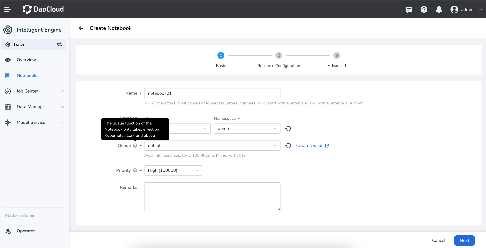

    - Solution: Plan in advance. It is recommended to use Kubernetes version `v1.27` or above in the production environment.

    - Reference: [Jupyter Notebook Documentation](https://jupyter-notebook.readthedocs.io/en/latest/)

    **Issue 02: Configuration Not Enabled**

    - Analysis:

        When the Kubernetes cluster version is greater than v1.27, the Notebook still cannot be restricted by the queue quota.

        This is because Kueue needs to have support for `enablePlainPod` enabled to take effect for the Notebook service.

        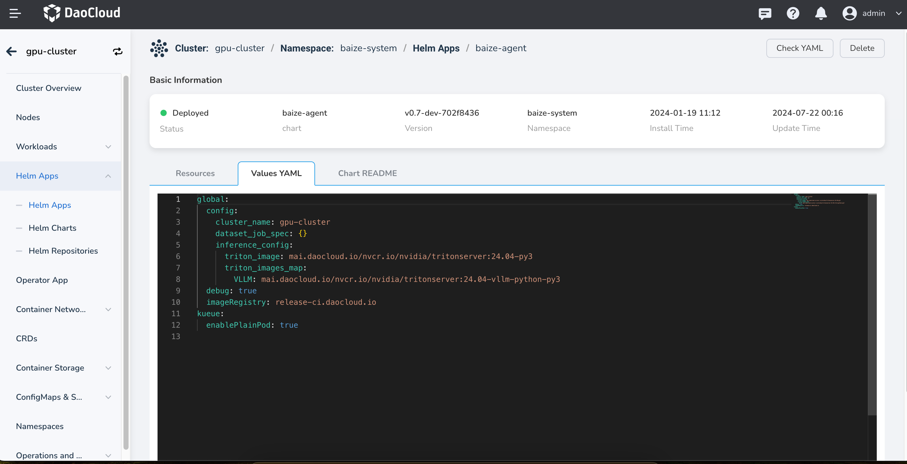

    - Solution: When deploying `baize-agent` in the worker cluster, enable Kueue support for `enablePlainPod`.

    - Reference: [Run Plain Pods as a Kueue-Managed Job](https://kueue.sigs.k8s.io/docs/tasks/run/plain_pods/)

??? "AI Lab queue initialization failed"

    **Issue Description**

    When creating a Notebook, training task, or inference service, if the queue is being used for
    the first time in that namespace, there will be a prompt to initialize the queue with one click.
    However, the initialization fails.

    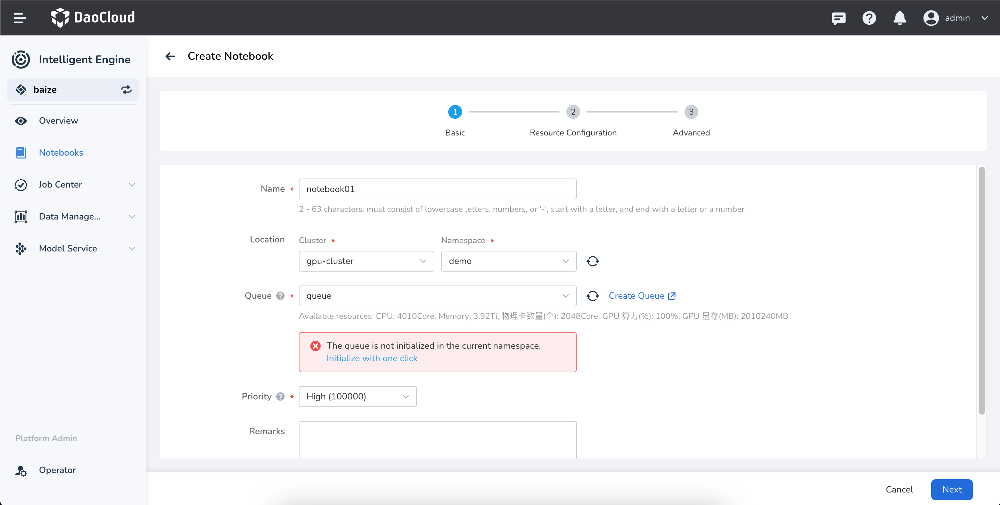

    **Issue Analysis**

    In the AI Lab environment, the queue management capability is provided by
    [Kueue](https://kueue.sigs.k8s.io/). Kueue provides two types of queue management resources:

    - **ClusterQueue**: A cluster-level queue mainly used to manage resource quotas within
      the queue, including CPU, memory, and GPU.
    - **LocalQueue**: A namespace-level queue that needs to point to a ClusterQueue
      for resource allocation within the queue.

    In the AI Lab environment, if a service is created and the specified
    namespace does not have a `LocalQueue`, there will be a prompt to initialize the queue.

    In rare cases, the `LocalQueue` initialization might fail due to special reasons.

    **Solution**

    Check if Kueue is running normally. If the `kueue-controller-manager` is not running,
    you can check it with the following command:

    ```bash
    kubectl get deploy kueue-controller-manager -n baize-system
    ```

    If the `kueue-controller-manager` is not running properly, fix Kueue first.

    **References**

    - [ClusterQueue](https://kueue.sigs.k8s.io/docs/concepts/cluster_queue/)
    - [LocalQueue](https://kueue.sigs.k8s.io/docs/concepts/local_queue/)

## Global Management

For more questions, refer to [Global Management FAQs](../ghippo/intro/faq.md).

??? "Why can't istio-ingressgateway start after restarting the cluster (virtual machine)?"

    The error message is as shown in the following image:

    

    Possible cause: The jwtsUri address of the RequestAuthentication CR cannot be accessed, causing istiod to be unable to push the configuration to istio-ingressgateway (This bug can be avoided in Istio 1.15: [https://github.com/istio/istio/pull/39341/](https://github.com/istio/istio/pull/39341/files)).

    Solution:

    1. Back up the RequestAuthentication ghippo CR.

        ```shell
        kubectl get RequestAuthentication ghippo -n istio-system -o yaml > ghippo-ra.yaml
        ```

    2. Delete the RequestAuthentication ghippo CR.

        ```shell
        kubectl delete RequestAuthentication ghippo -n istio-system
        ```

    3. Restart Istio.

        ```shell
        kubectl rollout restart deploy/istiod -n istio-system
        kubectl rollout restart deploy/istio-ingressgateway -n istio-system
        ```

    4. Reapply the RequestAuthentication ghippo CR.

        ```sh
        kubectl apply -f ghippo-ra.yaml
        ```

        !!! note

            Before applying the RequestAuthentication ghippo CR, make sure that ghippo-apiserver and ghippo-keycloak are started correctly.

??? "Login infinite loop, error 401 or 403"

    This issue occurs when the MySQL database connected to ghippo-keycloak encounters a failure, causing the __OIDC Public keys__ to be reset.

    For Global Management version 0.11.1 and above, you can follow these steps to restore normal operation by updating the Global Management configuration file using __helm__ .

    ```shell
    **Update helm repository**
    helm repo update ghippo

    **Backup ghippo parameters**
    helm get values ghippo -n ghippo-system -o yaml > ghippo-values-bak.yaml

    **Get the current deployed ghippo version**
    version=$(helm get notes ghippo -n ghippo-system | grep "Chart Version" | awk -F ': ' '{ print $2 }')

    **Perform the update operation to make the configuration file take effect**
    helm upgrade ghippo ghippo/ghippo \
    -n ghippo-system \
    -f ./ghippo-values-bak.yaml \
    --version ${version}
    ```

??? "Keycloak cannot start"

    **Common Issues**

    **Symptoms**

    MySQL is ready with no errors. After installing the global management, Keycloak fails to start (more than 10 times).

    

    **Checklist**

    - If the database is MySQL, check if the Keycloak database encoding is UTF8.
    - Check the network connection from Keycloak to the database, ensure the database resources
      are sufficient, including but not limited to resource limits, storage space, and physical machine resources.

    **Troubleshooting Steps**

    

    1. Check if MySQL resource usage has reached the limit
    2. Check if the number of tables in the MySQL database keycloak is 95. (The number of tables may
       vary across different versions of Keycloak, so you can compare it with the number of tables in
       the Keycloak database of the same version in development or testing environments). If the number
       is fewer, it indicates that there may be an issue with the database table initialization (The
       command to check the number of tables is: show tables;).
    3. Delete and recreate the Keycloak database with the command
       **CREATE DATABASE IF NOT EXISTS keycloak CHARACTER SET utf8**
    4. Restart the Keycloak Pod to resolve the issue

    **CPU does not support ×86-64-v2**

    **Symptoms**

    Keycloak cannot start normally, the Keycloak pod is in the `CrashLoopBackOff` state, and the Keycloak log shows:

    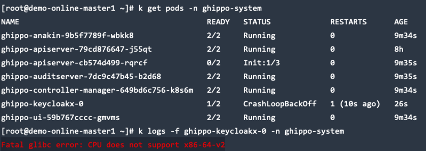

    **Checklist**

    Run the following script to check the supported CPU types:

    ```bash
    cat <<"EOF" > detect-cpu.sh
    #!/bin/sh -eu

    flags=$(cat /proc/cpuinfo | grep flags | head -n 1 | cut -d: -f2)

    supports_v2='awk "/cx16/&&/lahf/&&/popcnt/&&/sse4_1/&&/sse4_2/&&/ssse3/ {found=1} END {exit !found}"'
    supports_v3='awk "/avx/&&/avx2/&&/bmi1/&&/bmi2/&&/f16c/&&/fma/&&/abm/&&/movbe/&&/xsave/ {found=1} END {exit !found}"'
    supports_v4='awk "/avx512f/&&/avx512bw/&&/avx512cd/&&/avx512dq/&&/avx512vl/ {found=1} END {exit !found}"'

    echo "$flags" | eval $supports_v2 || exit 2 && echo "CPU supports x86-64-v2"
    echo "$flags" | eval $supports_v3 || exit 3 && echo "CPU supports x86-64-v3"
    echo "$flags" | eval $supports_v4 || exit 4 && echo "CPU supports x86-64-v4"
    EOF

    chmod +x detect-cpu.sh
    sh detect-cpu.sh
    ```

    Execute the command below to check the current CPU features. If the output contains sse4_2, it indicates that your processor supports SSE 4.2.

    ```bash
    lscpu | grep sse4_2
    ```

    **Solution**
    You need to upgrade your virtual machine or physical machine CPU to support x86-64-v2 and above, ensuring that the x86 CPU instruction set supports SSE4.2. For details on how to upgrade, you should consult your virtual machine platform provider or your physical machine provider.

    For more information, see: https://github.com/keycloak/keycloak/issues/17290

??? "Upgrade fails when upgrading global management alone"

    **CRD Not Updated Error**

    If the upgrade fails and includes the following message, you can refer to the
    [Offline Upgrade](../ghippo/install/offline-install.md#__tabbed_3_2) section to complete
    the installation of CRDs by following the steps for updating the ghippo crd.

    ```console
    ensure CRDs are installed first
    ```

    **Database Migration Error**

    **Symptoms**

    Pod fails to start, and the following log message appears:

    ```console
    init database failed    {"error": "migrate failed: Dirty database version 0. Fix and force version."}
    ```

    **Causes**

    This error usually occurs due to issues such as abnormal environment conditions, inconsistent database state,
    or SQL syntax errors. The real database error message is only output the first time the Pod reports the failure;
    subsequent restarts will show the generic “dirty database” error.

    **Solution**

    1. Log in to MySQL and select the database corresponding to the failed service
       (possible databases include `audit` and `ghippo`).

    2. Update the `dirty` field in the `schema_migrations` table:

        ```console
        update schema_migrations set dirty=0;
        ```

    3. Restart the failed service.

    4. If the SQL migration still fails after the restart, it may be due to an actual issue in the SQL statements.
       In this case, report a bug and contact the development team for resolution.

## Permission Issues

For more questions, refer to [Permissions of All Modules](../ghippo/permissions/kpanda.md).

??? "Container management permission description"

    The container management module uses the following roles:

    - Admin / Kpanda Owner
    - [Cluster Admin](../kpanda/user-guide/permissions/permission-brief.md#cluster-admin)
    - [NS Admin](../kpanda/user-guide/permissions/permission-brief.md#ns-admin)
    - [NS Editor](../kpanda/user-guide/permissions/permission-brief.md#ns-editor)
    - [NS Viewer](../kpanda/user-guide/permissions/permission-brief.md#ns-viewer)

    !!! note

        - For more information about permissions, please refer to the [Container Management Permission System Description](../kpanda/user-guide/permissions/permission-brief.md).
        - For creating, managing, and deleting roles, please refer to [Role and Permission Management](../ghippo/user-guide/access-control/role.md).
        - The permissions of __Cluster Admin__ , __NS Admin__ , __NS Editor__ , __NS Viewer__ only take effect within the current cluster or namespace.

    The permissions granted to each role are as follows:

    <!--
    Use `&check;`for permissions granted and `&cross;`for permissions not granted.
    -->

    | Primary Function | Secondary Function | Permission | Cluster Admin | Ns Admin | Ns Editor | NS Viewer |
    | ------------ | -------------------- | ------------ | ------------- | -------- | --------- | --------- |
    | Cluster | Cluster List | View Cluster List | &#x2714; | &#x2714; | &#x2714; | &#x2714; |
    | | | Access Cluster | &#x2718; | &#x2718; | &#x2718; | &#x2718; |
    | | | Create Cluster | &#x2718; | &#x2718; | &#x2718; | &#x2718; |
    | | Cluster Operations | Enter Console | &#x2714; | &#x2714; (only in the list) | &#x2714; | &#x2718; |
    | | | View Monitoring | &#x2714; | &#x2718; | &#x2718; | &#x2718; |
    | | | Edit Basic Configuration | &#x2714; | &#x2718; | &#x2718; | &#x2718; |
    | | | Download kubeconfig | &#x2714; | &#x2714; (with ns permission) | &#x2714; (with ns permission) | &#x2714; (with ns permission) |
    | | | Disconnect Cluster | &#x2718; | &#x2718; | &#x2718; | &#x2718; |
    | | | View Logs | &#x2714; | &#x2718; | &#x2718; | &#x2718; |
    | | | Retry | &#x2718; | &#x2718; | &#x2718; | &#x2718; |
    | | | Uninstall Cluster | &#x2718; | &#x2718; | &#x2718; | &#x2718; |
    | | Cluster Overview | View Cluster Overview | &#x2714; | &#x2718; | &#x2718; | &#x2718; |
    | | Node Management | Access Node | &#x2718; | &#x2718; | &#x2718; | &#x2718; |
    | | | View Node List | &#x2714; | &#x2718; | &#x2718; | &#x2718; |
    | | | View Node Details | &#x2714; | &#x2718; | &#x2718; | &#x2718; |
    | | | View YAML | &#x2714; | &#x2718; | &#x2718; | &#x2718; |
    | | | Pause Scheduling | &#x2714; | &#x2718; | &#x2718; | &#x2718; |
    | | | Modify Labels | &#x2714; | &#x2718; | &#x2718; | &#x2718; |
    | | | Modify Annotations | &#x2714; | &#x2718; | &#x2718; | &#x2718; |
    | | | Modify Taints | &#x2714; | &#x2718; | &#x2718; | &#x2718; |
    | | | Remove Node | &#x2718; | &#x2718; | &#x2718; | &#x2718; |
    | | Deployment | View List | &#x2714; | &#x2714; | &#x2714; | &#x2714; |
    | | | View/Manage Details | &#x2714; | &#x2714; | &#x2714; | &#x2714; (view only) |
    | | | Create by YAML | &#x2714; | &#x2714; | &#x2714; | &#x2718; |
    | | | Create by image | &#x2714; | &#x2714; | &#x2714; | &#x2718; |
    | Select an instance in ws bound to ns | Select image | &#x2714; | &#x2714; | &#x2714; | &#x2718; |
    | | | View IP Pool | &#x2714; | &#x2714; | &#x2714; | &#x2718; |
    | | | Edit Network Interface | &#x2714; | &#x2714; | &#x2714; | &#x2718; |
    | | | Enter Console | &#x2714; | &#x2714; | &#x2714; | &#x2718; |
    | | | View Monitoring | &#x2714; | &#x2714; | &#x2714; | &#x2714; |
    | | | View Logs | &#x2714; | &#x2714; | &#x2714; | &#x2714; |
    | | | Load Balancer Scaling | &#x2714; | &#x2714; | &#x2714; | &#x2718; |
    | | | Edit YAML | &#x2714; | &#x2714; | &#x2714; | &#x2718; |
    | | | Update | &#x2714; | &#x2714; | &#x2714; | &#x2718; |
    | | | Status - Pause Upgrade | &#x2714; | &#x2714; | &#x2714; | &#x2718; |
    | | | Status - Stop | &#x2714; | &#x2714; | &#x2714; | &#x2718; |
    | | | Status - Restart | &#x2714; | &#x2714; | &#x2714; | &#x2718; |
    | | | Delete | &#x2714; | &#x2714; | &#x2714; | &#x2718; |
    | | StatefulSet | View List | &#x2714; | &#x2714; | &#x2714; | &#x2714; |
    | | | View/Manage Details | &#x2714; | &#x2714; | &#x2714; | &#x2714; (view only) |
    | | | Create by YAML | &#x2714; | &#x2714; | &#x2714; | &#x2718; |
    | | | Create by image | &#x2714; | &#x2714; | &#x2714; | &#x2718; |
    | | Select an instance in ws bound to ns | Select image | &#x2714; | &#x2714; | &#x2714; | &#x2718; |
    | | | Enter Console | &#x2714; | &#x2714; | &#x2714; | &#x2718; |
    | | | View Monitoring | &#x2714; | &#x2714; | &#x2714; | &#x2714; |
    | | | View Logs | &#x2714; | &#x2714; | &#x2714; | &#x2714; |
    | | | Load Balancer Scaling | &#x2714; | &#x2714; | &#x2714; | &#x2718; |
    | | | Edit YAML | &#x2714; | &#x2714; | &#x2714; | &#x2718; |
    | | | Update | &#x2714; | &#x2714; | &#x2714; | &#x2718; |
    | | | Status - Stop | &#x2714; | &#x2714; | &#x2714; | &#x2718; |
    | | | Status - Restart | &check; | &check; | &check; | &cross; |
    | | | Delete | &check; | &check; | &check; | &cross; |
    | | DaemonSet | View list | &check; | &check; | &check; | &check; |
    | | | View/Manage details | &check; | &check; | &check; | &check; (Only view) |
    | | | Create by YAML | &check; | &check; | &check; | &cross; |
    | | | Create by image | &check; | &check; | &check; | &cross; |
    | | Select an instance in ws bound to ns | Select image | &check; | &check; | &check; | &cross; |
    | | | Go to console | &check; | &check; | &check; | &cross; |
    | | | Check monitor | &check; | &check; | &check; | &check; |
    | | | View logs | &check; | &check; | &check; | &check; |
    | | | Edit YAML | &check; | &check; | &check; | &cross; |
    | | | Update | &check; | &check; | &check; | &cross; |
    | | | Status - restart | &check; | &check; | &check; | &cross; |
    | | | Delete | &check; | &check; | &check; | &cross; |
    | | Job | View list | &check; | &check; | &check; | &check; |
    | | | View/Manage details | &check; | &check; | &check; | &check; (Only view) |
    | | | Create by YAML | &check; | &check; | &check; | &cross; |
    | | | Create by image | &check; | &check; | &check; | &cross; |
    | | | Instance list | &check; | &check; | &check; | &check; |
    | | Select an instance in ws bound to ns | Select image | &check; | &check; | &check; | &cross; |
    | | | Go to console | &check; | &check; | &check; | &cross; |
    | | | View logs | &check; | &check; | &check; | &check; |
    | | | View YAML | &check; | &check; | &check; | &check; |
    | | | Restart | &check; | &check; | &check; | &cross; |
    | | | View event | &check; | &check; | &check; | &check; |
    | | | Delete | &check; | &check; | &check; | &cross; |
    | | CronJob | View list | &check; | &check; | &check; | &check; |
    | | | View/Manage details | &check; | &check; | &check; | &check; (Only view) |
    | | | Create by YAML | &check; | &check; | &check; | &cross; |
    | | | Create by image | &check; | &check; | &check; | &cross; |
    | | Select an instance in ws bound to ns | Select image | &check; | &check; | &check; | &cross; |
    | | | Edit YAML | &check; | &check; | &check; | &cross; |
    | | | Stop | &check; | &check; | &check; | &cross; |
    | | | View jobs | &check; | &check; | &check; | &check; |
    | | | View event | &check; | &check; | &check; | &check; |
    | | | Delete | &check; | &check; | &check; | &cross; |
    | | Pod | View list | &check; | &check; | &check; | &check; |
    | | | View/Manage details | &check; | &check; | &check; | &check; (Only view) |
    | | | Go to console | &check; | &check; | &check; | &cross; |
    | | | Check monitor | &check; | &check; | &check; | &check; |
    | | | View logs | &check; | &check; | &check; | &check; |
    | | | View YAML | &check; | &check; | &check; | &check; |
    | | | Upload file | &check; | &check; | &check; | &cross; |
    | | | Download file | &check; | &check; | &check; | &cross; |
    | | | View containers | &check; | &check; | &check; | &check; |
    | | | View event | &check; | &check; | &check; | &check; |
    | | | Delete | &check; | &check; | &check; | &cross; |
    | | ReplicaSet | View list | &check; | &check; | &check; | &check; |
    | | | View/Manage details | &check; | &check; | &check; | &check; (Only view) |
    | | | Go to console | &check; | &check; | &check; | &cross; |
    | | | Check monitor | &check; | &check; | &check; | &check; |
    | | | View logs | &check; | &check; | &check; | &check; |
    | | | View YAML | &check; | &check; | &check; | &check; |
    | | | Delete | &check; | &check; | &check; | &cross; |
    | | Helm app | View list | &check; | &check; | &check; | &check; |
    | | | View/Manage details | &check; | &check; | &check; | &check; (Only view) |
    | | | Update | &check; | &check; | &check; | &cross; |
    | | | View YAML | &check; | &check; | &check; | &check; |
    | | | Delete | &check; | &check; | &check; | &cross; |
    | | Helm chart | View list | &check; | &check; | &check; | &check; |
    | | | View details | &check; | &check; | &check; | &check; |
    | | | Install chart | &check; | &check; (Fine for ns level) | &cross; | &cross; |
    | | | Download chart | &check; | &check; | &check; (Consistent with viewing interface) | &check; |
    | | Helm repo | View list | &check; | &check; | &check; | &check; |
    | | | Create repo | &check; | &cross; | &cross; | &cross; |
    | | | Update repo | &check; | &cross; | &cross; | &cross; |
    | | | Clone repo | &check; | &cross; | &cross; | &cross; |
    | | | Refresh repo | &check; | &cross; | &cross; | &cross; |
    | | | Modify label | &check; | &cross; | &cross; | &cross; |
    | | | Modify annotation | &check; | &cross; | &cross; | &cross; |
    | | | Delete | &check; | &cross; | &cross; | &cross; |
    | | Service | View list | &check; | &check; | &check; | &check; |
    | | | View/Manage details | &check; | &check; | &check; | &check; (Only view) |
    | | | Create by YAML | &check; | &check; | &check; | &cross; |
    | | | Create | &check; | &check; | &check; | &cross; |
    | | | Update | &check; | &check; | &check; | &cross; |
    | | | View event | &check; | &check; | &check; | &check; |
    | | | Edit YAML | &check; | &check; | &check; | &cross; |
    | | | Delete | &check; | &check; | &check; | &cross; |
    | | Ingress | View list | &check; | &check; | &check; | &check; |
    | | | View/Manage details | &check; | &check; | &check; | &check; (Only view) |
    | | | Create by YAML | &check; | &check; | &check; | &cross; |
    | | | Create | &check; | &check; | &check; | &cross; |
    | | | Update | &check; | &check; | &check; | &cross; |
    | | | View event | &check; | &check; | &check; | &check; |
    | | | Edit YAML | &check; | &check; | &check; | &cross; |
    | | | Delete | &check; | &check; | &check; | &cross; |
    | | Network policy | View list | &check; | &check; | &check; | &check; |
    | | | View/Manage details | &check; | &check; | &check; | &cross; |
    | | | Create by YAML | &check; | &check; | &check; | &cross; |
    | | | Create | &check; | &check; | &check; | &cross; |
    | | | Delete | &check; | &check; | &check; | &cross; |
    | | Network config | Config | &check; | &check; | &check; | &cross; |
    | | CRD | View list | &check; | &cross; | &cross; | &cross; |
    | | | View/Manage details | &check; | &cross; | &cross; | &cross; |
    | | | Create by YAML | &check; | &cross; | &cross; | &cross; |
    | | | Edit YAML | &check; | &cross; | &cross; | &cross; |
    | | | Delete | &check; | &cross; | &cross; | &cross; |
    | | PVC | View list | &check; | &check; | &check; | &check; |
    | | | View/Manage details | &check; | &check; | &check; | &check; (Only view) |
    | | | Create | &check; | &check; | &check; | &cross; |
    | | | Select sc | &check; | &check; | &check; | &cross; |
    | | | Create by YAML | &check; | &check; | &check; | &cross; |
    | | | Edit YAML | &check; | &check; | &check; | &cross; |
    | | | Clone | &check; | &check; | &check; | &cross; |
    | | | Delete | &check; | &check; | &check; | &cross; |
    | | PV | View list | &check; | &cross; | &cross; | &cross; |
    | | | View/Manage details | &check; | &cross; | &cross; | &cross; |
    | | | Create by YAML | &check; | &cross; | &cross; | &cross; |
    | | | Create | &check; | &cross; | &cross; | &cross; |
    | | | Edit YAML | &check; | &cross; | &cross; | &cross; |
    | | | Update | &check; | &cross; | &cross; | &cross; |
    | | | Clone | &check; | &cross; | &cross; | &cross; |
    | | | Modify label | &check; | &cross; | &cross; | &cross; |
    | | | Modify annotation | &check; | &cross; | &cross; | &cross; |
    | | | Delete | &check; | &cross; | &cross; | &cross; |
    | | SC | View list | &check; | &cross; | &cross; | &cross; |
    | | | Create by YAML | &check; | &cross; | &cross; | &cross; |
    | | | Create | &check; | &cross; | &cross; | &cross; |
    | | | View YAML | &check; | &cross; | &cross; | &cross; |
    | | | Update | &check; | &cross; | &cross; | &cross; |
    | | | Authorize NS | &check; | &cross; | &cross; | &cross; |
    | | | Deauthorize | &check; | &cross; | &cross; | &cross; |
    | | | Delete | &check; | &cross; | &cross; | &cross; |
    | | ConfigMap | View list | &check; | &check; | &check; | &check; |
    | | | View/Manage details | &check; | &check; | &check; | &check; (Only view) |
    | | | Create by YAML | &check; | &check; | &check; | &cross; |
    | | | Create | &check; | &check; | &check; | &cross; |
    | | | Edit YAML | &check; | &check; | &check; | &cross; |
    | | | Update | &check; | &check; | &check; | &cross; |
    | | | Export ConfigMap | &check; | &check; | &check; | &cross; |
    | | | Delete | &check; | &check; | &check; | &cross; |
    | | Secret | View list | &check; | &check; | &check; | &cross; |
    | | | View/Manage details | &check; | &check; | &check; | &cross; |
    | | | Create by YAML | &check; | &check; | &check; | &cross; |
    | | | Create | &check; | &check; | &check; | &cross; |
    | | | Edit YAML | &check; | &check; | &check; | &cross; |
    | | | Update | &check; | &check; | &check; | &cross; |
    | | | Export secret | &check; | &check; | &check; | &cross; |
    | | | Delete | &check; | &check; | &check; | &cross; |
    | | Namespace | View list | &check; | &check; | &check; | &check; |
    | | | View/Manage details | &check; | &check; | &check; | &check; (Only view) |
    | | | Create by YAML | &check; | &cross; | &cross; | &cross; |
    | | | Create | &check; | &cross; | &cross; | &cross; |
    | | | View YAML | &check; | &check; | &check; | &cross; |
    | | | Modify label | &check; | &check; | &cross; | &cross; |
    | | | Unbind WS | &cross; | &cross; | &cross; | &cross; |
    | | | Bind WS | &cross; | &cross; | &cross; | &cross; |
    | | | Quotas | &check; | &cross; | &cross; | &cross; |
    | | | Delete | &check; | &cross; | &cross; | &cross; |
    | | Cluster operation | View list | &check; | &cross; | &cross; | &cross; |
    | | | View YAML | &check; | &cross; | &cross; | &cross; |
    | | | View logs | &check; | &cross; | &cross; | &cross; |
    | | | Delete | &check; | &cross; | &cross; | &cross; |
    | | Helm operation | Set preserved entries | &check; | &cross; | &cross; | &cross; |
    | | | View YAML | &check; | &check; | &cross; | &cross; |
    | | | View logs | &check; | &check; | &cross; | &cross; |
    | | | Delete | &check; | &check; | &cross; | &cross; |
    | | Cluster upgrade | View details | &check; | &cross; | &cross; | &cross; |
    | | | Upgrade | &cross; | &cross; | &cross; | &cross; |
    | | Cluster settings | Addon config | &check; | &cross; | &cross; | &cross; |
    | | | Advanced config | &check; | &cross; | &cross; | &cross; |
    | Namespace | | View list | &check; | &check; | &check; | &check; |
    | | | Create | &check; | &cross; | &cross; | &cross; |
    | | | View/Manage details | &check; | &check; | &check; | &check; |
    | | | View YAML | &check; | &check; | &check; | &cross; |
    | | | Modify label | &check; | &check; | &cross; | &cross; |
    | | | Bind WS | &check; | &cross; | &cross; | &cross; |
    | | | Quotas | &check; | &cross; | &cross; | &cross; |
    | | | Delete | &check; | &cross; | &cross; | &cross; |
    | Workload | Deployment | View list | &check; | &check; | &check; | &check; |
    | | | View/Manage details | &check; | &check; | &check; | &check; (Only view) |
    | | | Go to console | &check; | &check; | &check; | &cross; |
    | | | Check monitor | &check; | &check; | &check; | &check; |
    | | | View logs | &check; | &check; | &check; | &check; |
    | | | Workload scaling | &check; | &check; | &check; | &cross; |
    | | | Edit YAML | &check; | &check; | &check; | &cross; |
    | | | Update | &check; | &check; | &check; | &cross; |
    | | | Status - Pause Upgrade | &check; | &check; | &check; | &cross; |
    | | | Status - Stop | &check; | &check; | &check; | &cross; |
    | | | Status - restart | &check; | &check; | &check; | &cross; |
    | | | Revert | &check; | &check; | &check; | &cross; |
    | | | Modify label and annotation | &check; | &check; | &check; | &cross; |
    | | | Delete | &check; | &check; | &check; | &cross; |
    | | StatefulSet | View list | &check; | &check; | &check; | &check; |
    | | | View/Manage details | &check; | &check; | &check; | &check; (Only view) |
    | | | Go to console | &check; | &check; | &check; | &cross; |
    | | | Check monitor | &check; | &check; | &check; | &check; |
    | | | View logs | &check; | &check; | &check; | &check; |
    | | | Workload scaling | &check; | &check; | &check; | &cross; |
    | | | Edit YAML | &check; | &check; | &check; | &cross; |
    | | | Update | &check; | &check; | &check; | &cross; |
    | | | Status - Stop | &check; | &check; | &check; | &cross; |
    | | | Status - restart | &check; | &check; | &check; | &cross; |
    | | | Delete | &check; | &check; | &check; | &cross; |
    | | DaemonSet | View list | &check; | &check; | &check; | &check; |
    | | | View/Manage details | &check; | &check; | &check; | &check; (Only view) |
    | | | Go to console | &check; | &check; | &check; | &cross; |
    | | | Check monitor | &check; | &check; | &check; | &check; |
    | | | View logs | &check; | &check; | &check; | &check; |
    | | | Edit YAML | &check; | &check; | &check; | &cross; |
    | | | Update | &check; | &check; | &check; | &cross; |
    | | | Status - restart | &check; | &check; | &check; | &cross; |
    | | | Delete | &check; | &check; | &check; | &cross; |
    | | Job | View list | &check; | &check; | &check; | &check; |
    | | | View/Manage details | &check; | &check; | &check; | &check; (Only view) |
    | | | Go to console | &check; | &check; | &check; | &cross; |
    | | | View logs | &check; | &check; | &check; | &check; |
    | | | View YAML | &check; | &check; | &check; | &cross; |
    | | | Restart | &check; | &check; | &check; | &cross; |
    | | | View event | &check; | &check; | &check; | &check; |
    | | | Delete | &check; | &check; | &check; | &cross; |
    | | CronJob | View list | &check; | &check; | &check; | &check; |
    | | | View/Manage details | &check; | &check; | &check; | &check; (Only view) |
    | | | View event | &check; | &check; | &check; | &check; |
    | | | Delete | &check; | &check; | &check; | &cross; |
    | | Pod | View list | &check; | &check; | &check; | &check; |
    | | | View/Manage details | &check; | &check; | &check; | &check; (Only view) |
    | | | Go to console | &check; | &check; | &check; | &cross; |
    | | | Check monitor | &check; | &check; | &check; | &check; |
    | | | View logs | &check; | &check; | &check; | &check; |
    | | | View YAML | &check; | &check; | &check; | &check; |
    | | | Upload file | &check; | &check; | &check; | &cross; |
    | | | Download file | &check; | &check; | &check; | &cross; |
    | | | View containers | &check; | &check; | &check; | &check; |
    | | | View event | &check; | &check; | &check; | &check; |
    | | | Delete | &check; | &check; | &check; | &cross; |
    | Backup and Restore | App backup | View list | &check; | &cross; | &cross; | &cross; |
    | | | View/Manage details | &check; | &cross; | &cross; | &cross; |
    | | | Create backup schedule | &check; | &cross; | &cross; | &cross; |
    | | | View YAML | &check; | &cross; | &cross; | &cross; |
    | | | Update Schedule | &check; | &cross; | &cross; | &cross; |
    | | | Pause | &check; | &cross; | &cross; | &cross; |
    | | | Run now | &check; | &cross; | &cross; | &cross; |
    | | | Delete | &check; | &cross; | &cross; | &cross; |
    | | Resume backup | View list | &check; | &cross; | &cross; | &cross; |
    | | | View/Manage details | &check; | &cross; | &cross; | &cross; |
    | | | Resume backup | &check; | &cross; | &cross; | &cross; |
    | | | Delete | &check; | &cross; | &cross; | &cross; |
    | | Backup point | View list | &check; | &cross; | &cross; | &cross; |
    | | | Delete | &check; | &cross; | &cross; | &cross; |
    | | Object storage | View list | &check; | &cross; | &cross; | &cross; |
    | | etcd backup | View backup policies | &check; | &cross; | &cross; | &cross; |
    | | | Create backup policies | &check; | &cross; | &cross; | &cross; |
    | | | View logs | &check; | &cross; | &cross; | &cross; |
    | | | View YAML | &check; | &cross; | &cross; | &cross; |
    | | | Update backup policy | &check; | &cross; | &cross; | &cross; |
    | | | Stop/Start | &check; | &cross; | &cross; | &cross; |
    | | | Run now | &check; | &cross; | &cross; | &cross; |
    | | | View/Manage details | &check; | &cross; | &cross; | &cross; |
    | | | Delete backup records | &check; | &cross; | &cross; | &cross; |
    | | | View backup points | &check; | &cross; | &cross; | &cross; |
    | Cluster inspection | Cluster inspection | View list | &check; | &cross; | &cross; | &cross; |
    | | | View/Manage details | &check; | &cross; | &cross; | &cross; |
    | | | Cluster inspection | &check; | &cross; | &cross; | &cross; |
    | | | Settings | &check; | &cross; | &cross; | &cross; |
    | Permissions | Permissions | View list | &check; | &cross; | &cross; | &cross; |
    | | | Grant to cluster admin | &check; | &cross; | &cross; | &cross; |
    | | | Delete | &check; | &cross; | &cross; | &cross; |
    | | NS permissions | View list | &check; | &check; | &cross; | &cross; |
    | | | Grant to ns admin | &check; | &check; | &cross; | &cross; |
    | | | Grant to ns editor | &check; | &check; | &cross; | &cross; |
    | | | Grant to ns viewer | &check; | &check; | &cross; | &cross; |
    | | | Edit permissions | &check; | &check; | &cross; | &cross; |
    | | | Delete | &check; | &check; | &cross; | &cross; |
    | Security | Compliance scanning | View scanning report | &check; | &cross; | &cross; | &cross; |
    | | | View scanning report details | &check; | &cross; | &cross; | &cross; |
    | | | Download scanning report | &check; | &cross; | &cross; | &cross; |
    | | | Delete scanning report | &check; | &cross; | &cross; | &cross; |
    | | | View scanning policies | &check; | &cross; | &cross; | &cross; |
    | | | Create scanning policy | &check; | &cross; | &cross; | &cross; |
    | | | Delete scanning policy | &check; | &cross; | &cross; | &cross; |
    | | | View scanning config list | &check; | &cross; | &cross; | &cross; |
    | | | View scanning config details | &check; | &cross; | &cross; | &cross; |
    | | | Delete scanning config | &check; | &cross; | &cross; | &cross; |
    | | Scan permission | View scanning reports | &check; | &cross; | &cross; | &cross; |
    | | | View scanning report details | &check; | &cross; | &cross; | &cross; |
    | | | Delete scanning report | &check; | &cross; | &cross; | &cross; |
    | | | View scanning policies | &check; | &cross; | &cross; | &cross; |
    | | | Create scanning policy | &check; | &cross; | &cross; | &cross; |
    | | | Delete scanning policy | &check; | &cross; | &cross; | &cross; |
    | | Scan vulnerability | View scanning reports | &check; | &cross; | &cross; | &cross; |
    | | | View scanning report detail | &check; | &cross; | &cross; | &cross; |
    | | | Delete scanning report | &check; | &cross; | &cross; | &cross; |
    | | | View scanning policies | &check; | &cross; | &cross; | &cross; |
    | | | Create scanning policy | &check; | &cross; | &cross; | &cross; |
    | | | Delete scanning policy | &check; | &cross; | &cross; | &cross; |

??? "Microservices engine permission description"

    [Microservice engine](../skoala/intro/index.md) includes two parts: microservice management center and microservice gateway. The microservice engine supports three user roles:

    - Workspace Admin
    - Workspace Editor
    - Workspace Viewer

    Each role has different permissions, which are described below.

    <!--
    Use `&check;`for permissions granted and `&cross;`for permissions not granted.
    -->

    **Microservice Governance Permissions**

    | Menu Objects | Actions | Workspace Admin | Workspace Editor | Workspace Viewer |
    | ------------ | ------- | --------------- | ---------------- | ---------------- |
    | Hosted Registry List | View List | &check; | &check; | &check; |
    | Hosted Registry | View Basic Information | &check; | &check; | &check; |
    | | Create | &check; | &check; | &cross; |
    | | restart | &check; | &check; | &cross; |
    | | edit | &check; | &check; | &cross; |
    | | delete | &check; | &cross; | &cross; |
    | | On/Off | &check; | &check; | &cross; |
    | Microservice Namespace | View | &check; | &check; | &check; |
    | | Create | &check; | &check; | &cross; |
    | | edit | &check; | &check; | &cross; |
    | | delete | &check; | &check; | &cross; |
    | Microservice List | View | &check; | &check; | &check; |
    | | filter namespace | &check; | &check; | &check; |
    | | Create | &check; | &check; | &cross; |
    | | Governance | &check; | &check; | &cross; |
    | | delete | &check; | &check; | &cross; |
    | Service Governance Rules-Sentinel | View | &check; | &check; | &check; |
    | | Create | &check; | &check; | &cross; |
    | | edit | &check; | &check; | &cross; |
    | | delete | &check; | &check; | &cross; |
    | Service Governance Rules-Mesh | Governance | &check; | &check; | &cross; |
    | Instance List | View | &check; | &check; | &check; |
    | | On/Off | &check; | &check; | &cross; |
    | | edit | &check; | &check; | &cross; |
    | Service Governance Policy-Sentinel | View | &check; | &check; | &check; |
    | | Create | &check; | &check; | &cross; |
    | | edit | &check; | &check; | &cross; |
    | | delete | &check; | &check; | &cross; |
    | Service Governance Policy-Mesh | View | &check; | &check; | &check; |
    | | Create | &check; | &check; | &cross; |
    | | Create with YAML | &check; | &check; | &cross; |
    | | edit | &check; | &check; | &cross; |
    | | YAML Editing | &check; | &check; | &cross; |
    | | delete | &check; | &check; | &cross; |
    | Microservice Configuration List | View | &check; | &check; | &check; |
    | | filter namespace | &check; | &check; | &check; |
    | | Batch delete | &check; | &check; | &cross; |
    | | Export/Import | &check; | &check; | &cross; |
    | | Create | &check; | &check; | &cross; |
    | | Clone | &check; | &check; | &cross; |
    | | edit | &check; | &check; | &cross; |
    | | History query | &check; | &check; | &check; |
    | | rollback | &check; | &check; | &cross; |
    | | listen query | &check; | &check; | &check; |
    | Business Monitor | View | &check; | &check; | &check; |
    | Resource Monitor | View | &check; | &check; | &check; |
    | Request Log | View | &check; | &check; | &check; |
    | Instance Log | View | &check; | &check; | &check; |
    | Plugin Center | View | &check; | &check; | &check; |
    | | Open | &check; | &check; | &cross; |
    | | Close | &check; | &check; | &cross; |
    | | edit | &check; | &check; | &cross; |
    | | View Details | &check; | &check; | &check; |
    | access registry list | view | &check; | &check; | &check; |
    | | Access | &check; | &check; | &cross; |
    | | edit | &check; | &check; | &cross; |
    | | Remove | &check; | &cross; | &cross; |
    | Microservices | View List | &check; | &check; | &check; |
    | | View Details | &check; | &check; | &check; |
    | | Governance | &check; | &check; | &cross; |
    | Service Governance Policy-Mesh | View | &check; | &check; | &check; |
    | | Create | &check; | &check; | &cross; |
    | | Create with YAML | &check; | &check; | &cross; |
    | | edit | &check; | &check; | &cross; |
    | | YAML Editing | &check; | &check; | &cross; |
    | | delete | &check; | &check; | &cross; |

    **Microservice Gateway Permissions**

    | Objects | Actions | Workspace Admin | Workspace Editor | Workspace Viewer |
    | ------- | ---- | --------------- | ---------------- | ---------------- |
    | Gateway List | View | &check; | &check; | &check; |
    | Gateway instance | View | &check; | &check; | &check; |
    | | Create | &check; | &check; | &cross; |
    | | edit | &check; | &check; | &cross; |
    | | delete | &check; | &cross; | &cross; |
    | Diagnostic Mode | View | &check; | &check; | &check; |
    | | debug | &check; | &check; | &cross; |
    | Service List | View | &check; | &check; | &check; |
    | | Add | &check; | &check; | &cross; |
    | | edit | &check; | &check; | &cross; |
    | | delete | &check; | &check; | &cross; |
    | Service Details | View | &check; | &check; | &check; |
    | Service Source Management | View | &check; | &check; | &check; |
    | | Add | &check; | &check; | &cross; |
    | | edit | &check; | &check; | &cross; |
    | | delete | &check; | &check; | &cross; |
    | API List | View | &check; | &check; | &check; |
    | | Create | &check; | &check; | &cross; |
    | | edit | &check; | &check; | &cross; |
    | | delete | &check; | &check; | &cross; |
    | Request Log | View | &check; | &check; | &check; |
    | Instance Log | View | &check; | &check; | &check; |
    | Plugin Center | View | &check; | &check; | &check; |
    | | enable | &check; | &check; | &cross; |
    | | disabled | &check; | &check; | &cross; |
    | Plugin Configuration | View | &check; | &check; | &check; |
    | | enable | &check; | &check; | &cross; |
    | Domain List | View | &check; | &check; | &check; |
    | | Add | &check; | &check; | &cross; |
    | | edit | &check; | &check; | &cross; |
    | | delete | &check; | &check; | &check; |
    | Monitor Alert | View | &check; | &check; | &check; |

    !!! note

        For a complete introduction to role and access management, please refer to [Role and Access Management](../ghippo/user-guide/access-control/role.md).

??? "Application workbench permission description"

    [Workbench](../amamba/intro/index.md) supports three user roles:

    - Workspace Admin
    - Workspace Editor
    - Workspace Viewer

    Each role has different permissions, which are described below.

    <!--
    Use `&check;`for permissions granted and `&cross;`for permissions not granted.
    -->

    | Menu Objects | Actions | Workspace Admin | Workspace Editor | Workspace Viewer |
    | -------- | ----------- | -------------- | ---------------- | ---------------- |
    | Apps | View App List | &check; | &check; | &check; |
    | | View details (jump to container management) | &check; | &check; | &check; |
    | | View application logs (jump to observables) | &check; | &check; | &check; |
    | | View application monitoring (jump to observables) | &check; | &check; | &check; |
    | | View RabbitMQ Details - Basic Information | &check; | &check; | &check; |
    | | View service mesh (jump to service mesh) | &check; | &check; | &check; |
    | | View microservice engine (jump to microservice engine) | &check; | &check; | &check; |
    | | Create App | &check; | &check; | &cross; |
    | | Edit YAML | &check; | &check; | &cross; |
    | | Update replica count | &check; | &check; | &cross; |
    | | Update container image | &check; | &check; | &cross; |
    | | Edit Pipeline | &check; | &check; | &cross; |
    | | App Grouping | &check; | &check; | &cross; |
    | | delete | &check; | &check; | &cross; |
    | Namespace | View | &check; | &check; | &check; |
    | | Create | &check; | &cross; | &cross; |
    | | Edit Tab | &check; | &cross; | &cross; |
    | | Edit Resource Quota | &check; | &cross; | &cross; |
    | | delete | &check; | &cross; | &cross; |
    | Pipeline | View Pipeline | &check; | &check; | &check; |
    | | View running records | &check; | &check; | &check; |
    | | Create | &check; | &check; | &cross; |
    | | run | &check; | &check; | &cross; |
    | | delete | &check; | &check; | &cross; |
    | | Copy | &check; | &check; | &cross; |
    | | edit | &check; | &check; | &cross; |
    | | cancel run | &check; | &check; | &cross; |
    | Credentials | View | &check; | &check; | &check; |
    | | Create | &check; | &check; | &cross; |
    | | edit | &check; | &check; | &cross; |
    | | delete | &check; | &check; | &cross; |
    | Continuous Deployment | View | &check; | &check; | &check; |
    | | Create | &check; | &check; | &cross; |
    | | sync | &check; | &check; | &cross; |
    | | edit | &check; | &check; | &cross; |
    | | delete | &check; | &check; | &check; |
    | Code repository | View | &check; | &check; | &cross; |
    | | import | &check; | &check; | &cross; |
    | | delete | &check; | &check; | &cross; |
    | Grayscale release | View | &check; | &check; | &check; |
    | | Create | &check; | &check; | &cross; |
    | | Post | &check; | &check; | &cross; |
    | | Continue posting | &check; | &check; | &cross; |
    | | End of publication | &check; | &check; | &cross; |
    | | Update | &check; | &check; | &cross; |
    | | rollback | &check; | &check; | &cross; |
    | | delete | &check; | &check; | &cross; |

    !!! note

        For a complete introduction to role and access management, please refer to [Role and Access Management](../ghippo/user-guide/access-control/role.md).

??? "Service mesh permission description"

    [Service Mesh](../mspider/intro/index.md) supports several user roles:

    - Admin
    - Workspace Admin
    - Workspace Editor
    - Workspace Viewer

    !!! info

        Starting from installer [v0.6.0](../download/index.md) of DCE, the global management module supports custom roles configuration for Service Mesh, meaning that in addition to using default system roles, custom roles can be defined and granted different permissions within Service Mesh.

    <!--
    Use `&check;`for permissions granted and `&cross;`for permissions not granted.
    -->

    The specific permissions for each role are shown in the following table.

    | Menu Object | Action | Admin | Workspace Admin | Workspace Editor | Workspace Viewer |
    | ----------- | ------ | ----- | --------------- | ---------------- | ---------------- |
    | Service Mesh List | [Create Mesh](../mspider/user-guide/service-mesh/index.md) | &check; | &cross; | &cross; | &cross; |
    | | Edit Mesh | &check; | &check; | &cross; | &cross; |
    | | [Delete Mesh](../mspider/user-guide/service-mesh/delete.md) | &check; | &cross; | &cross; | &cross; |
    | | [View Mesh](../mspider/user-guide/service-mesh/index.md) | &check; | &check; | &check; | &check; |
    | Mesh Overview | View | &check; | &check; | &check; | &check; |
    | Service List | View | &check; | &check; | &check; | &check; |
    | | Create VM | &check; | &check; | &check; | &cross; |
    | | Delete VM | &check; | &check; | &check; | &cross; |
    | Service Entry | Create | &check; | &check; | &check; | &cross; |
    | | Edit | &check; | &check; | &check; | &cross; |
    | | Delete | &check; | &check; | &check; | &cross; |
    | | View | &check; | &check; | &check; | &check; |
    | Virtual Service | Create | &check; | &check; | &check; | &cross; |
    | | Edit | &check; | &check; | &check; | &cross; |
    | | Delete | &check; | &check; | &check; | &cross; |
    | | View | &check; | &check; | &check; | &check; |
    | Destination Rule | Create | &check; | &check; | &check; | &cross; |
    | | Edit | &check; | &check; | &check; | &cross; |
    | | Delete | &check; | &check; | &check; | &cross; |
    | | View | &check; | &check; | &check; | &check; |
    | Gateway Rule | Create | &check; | &check; | &check; | &cross; |
    | | Edit | &check; | &check; | &check; | &cross; |
    | | Delete | &check; | &check; | &check; | &cross; |
    | | View | &check; | &check; | &check; | &check; |
    | Peer Authentication | Create | &check; | &check; | &check; | &cross; |
    | | Edit | &check; | &check; | &check; | &cross; |
    | | Delete | &check; | &check; | &check; | &cross; |
    | | View | &check; | &check; | &check; | &check; |
    | Request Authentication | Create | &check; | &check; | &check; | &cross; |
    | | Edit | &check; | &check; | &check; | &cross; |
    | | Delete | &check; | &check; | &check; | &cross; |
    | | View | &check; | &check; | &check; | &check; |
    | Authorization Policy | Create | &check; | &check; | &check; | &cross; |
    | | Edit | &check; | &check; | &check; | &cross; |
    | | Delete | &check; | &check; | &check; | &cross; |
    | | View | &check; | &check; | &check; | &check; |
    | Namespace Sidecar Management | Enable Injection | &check; | &check; | &check; | &cross; |
    | | Disable Injection | &check; | &check; | &check; | &cross; |
    | | View | &check; | &check; | &check; | &check; |
    | | Sidecar Service Discovery Scope | &check; | &check; | &check; | &cross; |
    | Workload Sidecar Management | Enable Injection | &check; | &check; | &check; | &cross; |
    | | Disable Injection | &check; | &check; | &check; | &cross; |
    | | Configure Sidecar Resources | &check; | &check; | &check; | &cross; |
    | | View | &check; | &check; | &check; | &check; |
    | Global Sidecar Injection | Enable Injection | &check; | &check; | &cross; | &cross; |
    | | Disable Injection | &check; | &check; | &cross; | &cross; |
    | | Configure Sidecar Resources | &check; | &check; | &cross; | &cross; |
    | | View | &check; | &check; | &check; | &check; |
    | Cluster Management (for Hosted Mesh only) | Join Cluster | &check; | &check; | &cross; | &cross; |
    | | Leave Cluster | &check; | &check; | &cross; | &cross; |
    | | View | &check; | &check; | &check; | &check; |
    | Mesh Gateway Management | Create | &check; | &check; | &cross; | &cross; |
    | | Edit | &check; | &check; | &check; | &cross; |
    | | Delete | &check; | &check; | &cross; | &cross; |
    | | View | &check; | &check; | &check; | &check; |
    | Istio Resource Management | Create | &check; | &check; | &cross; | &cross; |
    | | Edit | &check; | &check; | &check; | &cross; |
    | | Delete | &check; | &check; | &cross; | &cross; |
    | | View | &check; | &check; | &check; | &check; |
    | TLS Certificate Management | Create | &check; | &check; | &check; | &cross; |
    | | Edit | &check; | &check; | &check; | &cross; |
    | | Delete | &check; | &check; | &check; | &cross; |
    | | View | &check; | &check; | &check; | &check; |
    | Multicloud Network Interconnection | Enable | &check; | &check; | &cross; | &cross; |
    | | View | &check; | &check; | &cross; | &cross; |
    | | Edit | &check; | &check; | &cross; | &cross; |
    | | Delete | &check; | &check; | &cross; | &cross; |
    | | Disable | &check; | &check; | &cross; | &cross; |
    | System Upgrade | Istio Upgrade | &check; | &check; | &cross; | &cross; |
    | | Sidecar Upgrade | &check; | &check; | &cross; | &cross; |
    | | View | &check; | &check; | &check; | &check; |
    | Workspace Management | Bind | &check; | &cross; | &cross; | &cross; |
    | | Unbind | &check; | &cross; | &cross; | &cross; |
    | | View | &check; | &cross; | &cross; | &cross; |

??? "Middleware permission description"

    [Middleware](../middleware/index.md) includes selected middleware:
    MySQL, Redis, MongoDB, PostgreSQL, Elasticsearch, Kafka, RabbitMQ, RocketMQ, MinIO.
    Middleware supports three user roles:

    - Workspace Admin
    - Workspace Editor
    - Workspace Viewer

    Each role has different permissions, which are described below.

    <!--
    Use `&check;`for permissions granted and `&cross;`for permissions not granted.
    -->

    **Middleware Permissions**

    | Middleware Modules | Menu Objects | Actions | Workspace Admin | Workspace Editor | Workspace Viewer |
    | ------- | ----------------- | ------- | --------------- | ---------------- | --------------- |
    | MySQL | MySQL Instance List | View List | &check; | &check; | &check; |
    | | | instance name search | &check; | &check; | &check; |
    | | | Create instance | &check; | &check; | &cross; |
    | | | Update Instance Configuration | &check; | &check; | &cross; |
    | | | delete instance | &check; | &cross; | &cross; |
    | | MySQL Instance Details | Instance Overview | &check; | &check; | &check; |
    | | | Instance Monitoring | &check; | &check; | &check; |
    | | | View Instance Configuration Parameters | &check; | &check; | &check; |
    | | | Modify instance configuration parameters | &check; | &check; | &cross; |
    | | | View Instance Access Password | &check; | &check; | &cross; |
    | | | View instance backup list | &check; | &check; | &check; |
    | | | instance creation backup | &check; | &check; | &cross; |
    | | | Instance modification automatic backup task | &check; | &check; | &cross; |
    | | | Create new instance with backup | &check; | &check; | &cross; |
    | | Backup configuration management | Backup configuration list | &check; | &cross; | &cross; |
    | | | Create Backup Configuration | &check; | &cross; | &cross; |
    | | | Modify backup configuration | &check; | &cross; | &cross; |
    | | | delete backup configuration | &check; | &cross; | &cross; |
    | RabbitMQ | RabbitMQ Instance List | View List | &check; | &check; | &check; |
    | | | instance name search | &check; | &check; | &check; |
    | | | Create instance | &check; | &check; | &cross; |
    | | | Update Instance Configuration | &check; | &check; | &cross; |
    | | | delete instance | &check; | &cross; | &cross; |
    | | RabbitMQ Instance Details | Instance Overview | &check; | &check; | &check; |
    | | | Instance Monitoring | &check; | &check; | &check; |
    | | | View Instance Configuration Parameters | &check; | &check; | &check; |
    | | | Modify instance configuration parameters | &check; | &check; | &cross; |
    | | | View Instance Access Password | &check; | &check; | &cross; |
    | Elasticsearch | Elasticsearch Instance List | View List | &check; | &check; | &check; |
    | | | instance name search | &check; | &check; | &check; |
    | | | Create instance | &check; | &check; | &cross; |
    | | | Update Instance Configuration | &check; | &check; | &cross; |
    | | | delete instance | &check; | &cross; | &cross; |
    | | Elasticsearch Instance Details | Instance Overview | &check; | &check; | &check; |
    | | | Instance Monitoring | &check; | &check; | &check; |
    | | | View Instance Configuration Parameters | &check; | &check; | &check; |
    | | | Modify instance configuration parameters | &check; | &check; | &cross; |
    | | | View Instance Access Password | &check; | &check; | &cross; |
    | Redis | Redis Instance List | View List | &check; | &check; | &check; |
    | | | instance name search | &check; | &check; | &check; |
    | | | Create instance | &check; | &check; | &cross; |
    | | | Update Instance Configuration | &check; | &check; | &cross; |
    | | | delete instance | &check; | &cross; | &cross; |
    | | Redis Instance Details | Instance Overview | &check; | &check; | &check; |
    | | | Instance Monitoring | &check; | &check; | &check; |
    | | | View Instance Configuration Parameters | &check; | &check; | &check; |
    | | | Modify instance configuration parameters | &check; | &check; | &cross; |
    | | | View Instance Access Password | &check; | &check; | &cross; |
    | Kafka | Kafka instance list | View list | &check; | &check; | &check; |
    | | | instance name search | &check; | &check; | &check; |
    | | | Create instance | &check; | &check; | &cross; |
    | | | Update Instance Configuration | &check; | &check; | &cross; |
    | | | delete instance | &check; | &cross; | &cross; |
    | | Kafka Instance Details | Instance Overview | &check; | &check; | &check; |
    | | | Instance Monitoring | &check; | &check; | &check; |
    | | | View Instance Configuration Parameters | &check; | &check; | &check; |
    | | | Modify instance configuration parameters | &check; | &check; | &cross; |
    | | | View Instance Access Password | &check; | &check; | &cross; |
    | MinIO | MinIO Instance List | View List | &check; | &check; | &check; |
    | | | instance name search | &check; | &check; | &check; |
    | | | Create instance | &check; | &check; | &cross; |
    | | | Update Instance Configuration | &check; | &check; | &cross; |
    | | | delete instance | &check; | &cross; | &cross; |
    | | MinIO Instance Details | Instance Overview | &check; | &check; | &check; |
    | | | Instance Monitoring | &check; | &check; | &check; |
    | | | View Instance Configuration Parameters | &check; | &check; | &check; |
    | | | Modify instance configuration parameters | &check; | &check; | &cross; |
    | | | View Instance Access Password | &check; | &check; | &cross; |

??? "AI Lab permission description"

    [AI Lab](../baize/intro/index.md) supports four user roles:

    - Admin / Baize Owner: Has full permissions (create, read, update, delete) for all features in the `Developer` and `Operator`.
    - Workspace Admin: Has full permissions (create, read, update, delete) for all features in the authorized workspace's `Developer`.
    - Workspace Editor: Has update and read permissions for all features in the authorized workspace's `Developer`.
    - Workspace Viewer: Has read permissions for all features in the authorized workspace's `Developer`.

    Each role has different permissions, as detailed below.

    <!--
    Use `&check;` for permission granted, and `&cross;` for permission denied.
    -->

    | Menu Object | Operation | Admin / Baize Owner | Workspace Admin | Workspace Editor | Workspace Viewer |
    |---------------|-------------|-----------------------|-------------------|--------------------|--------------------|
    | **Developer** | | | | | |
    | Overview | View Overview | &check; | &check; | &check; | &check; |
    | Notebooks | View Notebooks | &check; | &check; | &check; | &check; |
    | | View Notebooks Details | &check; | &check; | &check; | &cross; |
    | | Create Notebooks | &check; | &check; | &cross; | &cross; |
    | | Update Notebooks | &check; | &check; | &check; | &cross; |
    | | Clone Notebooks | &check; | &check; | &cross; | &cross; |
    | | Stop Notebooks | &check; | &check; | &check; | &cross; |
    | | Start Notebooks | &check; | &check; | &check; | &cross; |
    | | Delete Notebooks | &check; | &check; | &cross; | &cross; |
    | Jobs | View Jobs | &check; | &check; | &check; | &check; |
    | | View Job Details | &check; | &check; | &check; | &check; |
    | | Create Job | &check; | &check; | &cross; | &cross; |
    | | Clone Job | &check; | &check; | &cross; | &cross; |
    | | View Job Load Details | &check; | &check; | &check; | &cross; |
    | | Delete Job | &check; | &check; | &cross; | &cross; |
    | Job Analysis | View Job Analysis | &check; | &check; | &check; | &check; |
    | | View Job Analysis Details | &check; | &check; | &check; | &check; |
    | | Delete Job Analysis | &check; | &check; | &cross; | &cross; |
    | Datasets | View Datasets | &check; | &check; | &check; | &cross; |
    | | Create Dataset | &check; | &check; | &cross; | &cross; |
    | | Resync Dataset | &check; | &check; | &check; | &cross; |
    | | Update Credentials | &check; | &check; | &check; | &cross; |
    | | Delete Dataset | &check; | &check; | &cross; | &cross; |
    | Runtime Env | View Runtime Env | &check; | &check; | &check; | &check; |
    | | Create Runtime Env | &check; | &check; | &cross; | &cross; |
    | | Update Runtime Env | &check; | &check; | &check; | &cross; |
    | | Delete Runtime Env | &check; | &check; | &cross; | &cross; |
    | Inference Services | View Inference Services | &check; | &check; | &check; | &check; |
    | | View Inference Services Details | &check; | &check; | &check; | &check; |
    | | Create Inference Service | &check; | &check; | &cross; | &cross; |
    | | Update Inference Service | &check; | &check; | &check; | &cross; |
    | | Stop Inference Service | &check; | &check; | &check; | &cross; |
    | | Start Inference Service | &check; | &check; | &check; | &cross; |
    | | Delete Inference Service | &check; | &check; | &cross; | &cross; |
    | **Operator** | | | | | |
    | Overview | View Overview | &check; | &cross; | &cross; | &cross; |
    | GPU Management | View GPU Management | &check; | &cross; | &cross; | &cross; |
    | Queue Management | View Queue Management | &check; | &cross; | &cross; | &cross; |
    | | View Queue Details | &check; | &cross; | &cross; | &cross; |
    | | Create Queue | &check; | &cross; | &cross; | &cross; |
    | | Update Queue | &check; | &cross; | &cross; | &cross; |
    | | Delete Queue | &check; | &cross; | &cross; | &cross; |
