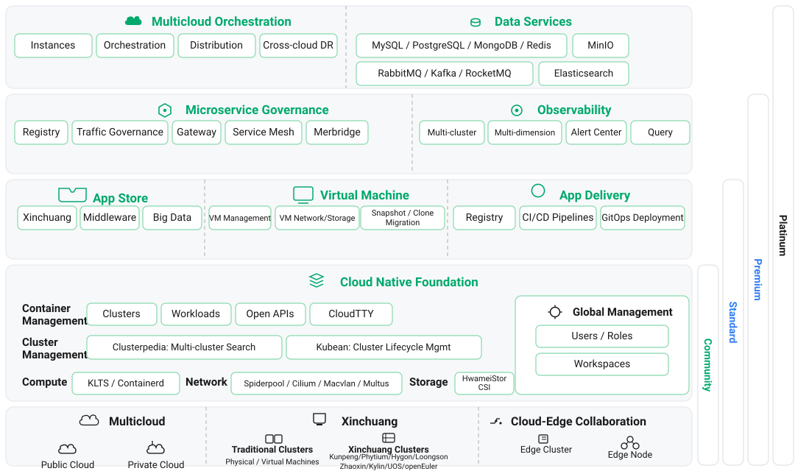

---
hide:
  - toc
---

# DaoCloud Enterprise Docs

DaoCloud Enterprise (DCE) is built on Kubernetes as its foundation, providing highly scalable, powerful, and flexible production-grade features that enable enterprises to easily build and manage distributed applications.
With DCE's cloud native DNA, enterprises can fully leverage the advantages of both cloud and on-premises environments, achieve optimal resource utilization, improve the reliability and elasticity of IT systems, and greatly accelerate application delivery.

  

    
Cloud Native Infra

    

      <a class="tf-arch-card tf-arch-card--compute" href="../middleware/">
        Middleware
        Databases and message queues
      </a>
      <a class="tf-arch-card tf-arch-card--compute" href="../kairship/intro/">
        Multicloud Management
        Multicloud and hybrid cloud orchestration
      </a>
      <a class="tf-arch-card tf-arch-card--compute" href="../kangaroo/intro/">
        Container Registry
        Image hosting and integration
      </a>
      <a class="tf-arch-card tf-arch-card--compute" href="../mspider/intro/">
        Service Mesh
        Non-intrusive service governance
      </a>
      <a class="tf-arch-card tf-arch-card--compute" href="../skoala/intro/">
        Microservice Engine
        Microservice governance and gateway
      </a>
      <a class="tf-arch-card tf-arch-card--compute" href="../amamba/intro/">
        Workbench
        CI/CD and application delivery
      </a>
      <a class="tf-arch-card tf-arch-card--compute" href="../kpanda/intro/">
        Container Management
        Cluster and workload management
      </a>
      <a class="tf-arch-card tf-arch-card--compute" href="../virtnest/intro/">
        Virtual Machine
        KubeVirt virtual machine management
      </a>
      <a class="tf-arch-card tf-arch-card--compute" href="../topohub/intro/">
        Device Management
        Unified hardware device management
      </a>
      <a class="tf-arch-card tf-arch-card--compute" href="../kant/intro/">
        Cloud Edge Collaboration
        Edge node management and collaboration
      </a>
      <a class="tf-arch-card tf-arch-card--compute" href="../network/intro/">
        Cloud Native Network
        Multi-CNI fused network
      </a>
      <a class="tf-arch-card tf-arch-card--compute" href="../storage/">
        Cloud Native Storage
        Containerized storage and CSI
      </a>
    

  

  
▲

  

    
OAM

    

      <a class="tf-arch-card tf-arch-card--ops" href="../insight/intro/">
        Observability
        Metrics, logs, and tracing
      </a>
      <a class="tf-arch-card tf-arch-card--ops" href="../ghippo/intro/">
        Global Management
        User permissions and platform settings
      </a>
    

  

## Product Architecture

## Installation and Tutorials

- :fontawesome-solid-jet-fighter-up:{ .lg .middle } __Installation__

    ---

    DCE supports both [offline](../install/community/k8s/offline.md) and [online](../install/community/k8s/online.md) installation methods,
    and can be installed on [various Linux distributions](../install/os-install/uos-v20-install-dce5.0.md).

    - [Install Dependencies](../install/install-tools.md)
    - [Install Community Package](../install/community/resources.md)
    - [Install Enterprise Package](../install/commercial/deploy-requirements.md)
    - [Install on Different Linux Distributions](../install/os-install/uos-v20-install-dce5.0.md)
    - [Install on Different K8s Versions](../install/k8s-install/ocp-install-dce5.0.md)

- :material-microsoft-azure-devops:{ .lg .middle } __Video Tutorials__

    ---

    We have created many video tutorials for different modules and scenarios of DCE.

    - [Scenario-based Videos](../videos/use-cases.md)
    - [Workbench Videos](../videos/amamba.md)
    - [Container Management Videos](../videos/kpanda.md)
    - [Microservices Videos](../videos/skoala.md)
    - [Middleware Videos](../videos/mcamel.md)
    - [Global Management Videos](../videos/ghippo.md)

## Learning Path

  <a class="dce-path-step" style="--path-c:#2196f3" href="../install/">
    1
    Deploy the Platform
    Install DCE 5.0 online or offline
    Go →
  </a>
  <a class="dce-path-step" style="--path-c:#00acc1" href="../kpanda/intro/">
    2
    Manage Clusters
    Integrate clusters and orchestrate containers
    Go →
  </a>
  <a class="dce-path-step" style="--path-c:#43a047" href="../amamba/intro/">
    3
    Deliver Apps
    CI pipelines and GitOps delivery
    Go →
  </a>
  <a class="dce-path-step" style="--path-c:#fb8c00" href="../insight/intro/">
    4
    Observe the System
    Unified metrics, logs, and traces
    Go →
  </a>
  <a class="dce-path-step" style="--path-c:#8e24aa" href="../ghippo/intro/">
    5
    Govern the Platform
    Users, permissions, and global policies
    Go →
  </a>

[Apply for Community Free Trial](./license0.md){ .md-button }
[Best Practices](./bphome.md){ .md-button }
[FAQs](./faq.md){ .md-button }
[Read the DaoCloud Enterprise Brochure](https://harbor-test2.cn-sh2.ufileos.com/docs/download/dce.pdf){ .md-button }
