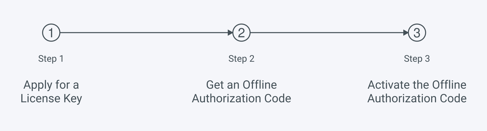

# Free Trial

The modules included in DCE Community are [Global Management](../ghippo/intro/index.md),
[Container Management](../kpanda/intro/index.md), and [Insight](../insight/intro/index.md).
You are advised to [download](../download/index.md) and [install](../install/community/k8s/online.md)
DCE Community first, and then follow the steps below to activate it.

## Apply for a License

Follow the steps below to get a license for your DCE Community:

1. Click [Apply for a license key](https://qingflow.com/f/58604bf8){ .md-button } and click __Submit__ after you fill in required information in the form.

    

2. Follow the on-screen instructions, check your email containing the license key, and then click [Get an offline authorization code](https://license.daocloud.io/dce5-license){ .md-button } .

    

3. Input the license key obtained in the previous step, input the unique ESN of the device, and click __Get an offline authorization code__ .

    

    ESN is the unique device code of the cluster system.
    To obtain it, open DCE, click __Global Management__ -> __Settings__ -> __Licenses__ , click the __Manage License__ button to open the __Manage License__ page, and copy the ESN code.

    

4. Copy and paste the offline authorization code obtained in the previous step, and click __Activate Now__ . Congratulations! :smile: It's time to explore the new DCE now!

*[ESN]: Abbreviation for Electronic Serial Number. It is a unique identifier used to identify a device, typically consisting of eight characters.
*[DCE]: Abbreviation for DaoCloud Enterprise, a next-generation AI computing platform.

!!! info "📢 Tips"

    The offline authorization code is bound to the device ESN. Please keep the license key email safe and secure.
    You can contact the DaoCloud delivery team at any time to reapply, as we have saved all your license keys for you.

## Renew License

If your license expires for any reason, you can follow the steps below to renew it.

### Recommended Approach

1. First, [clear the device code](https://qingflow.com/f/58604bf8). In the form, select __Remove ESN/Cluster ID__ and enter the [previous license key](https://license.daocloud.io/dce5-licenses). Once completed, click __SUBMIT__ .

    

2. Refer to [the previous section](#apply-for-a-license) to reapply for the license.

### Renew License by Modules

This method requires renewing the license for each installed module.
For example, DCE Community includes three modules: Container Management, Global Management, and Insight, each with its own license.
To do this, go to the [license page](https://qingflow.com/f/58604bf8) and select __Renew License__ for each module.

## Reference Links

The pages you may frequently access in the process of above procedure are listed as follows:

[Apply for a license key](https://qingflow.com/f/58604bf8){ .md-button .md-button--primary }
[View license keys](https://license.daocloud.io/dce5-licenses){ .md-button .md-button--primary }
[Get an offline authorization code](https://license.daocloud.io/dce5-license){ .md-button .md-button--primary }
[Install DCE](../install/index.md){ .md-button .md-button--primary }
