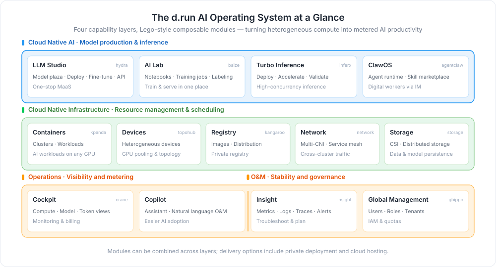

---
hide:
  - toc
---

# d.run AI Operating System

d.run leverages the world's top-three Kubernetes scheduling technology and core contributions to mainstream open-source inference engines such as vLLM to uniformly manage diverse heterogeneous computing power. It enables granular scheduling, full-stack inference optimization, and end-to-end token governance, achieving a compute utilization rate of over 80% and efficiently transforming computing power into manageable, controllable token-based AI productivity. The platform aggregates the global mainstream large model ecosystem, equipped with a visual operations cockpit and the d.run Copilot intelligent assistant, delivering stable and efficient AI services to all departments of the enterprise and comprehensively supporting long-term business intelligence upgrades.

[View/Download the d.run AI OS brochure](https://harbor-test2.cn-sh2.ufileos.com/docs/download/drun.pdf){ .md-button }

  

    
CNAI

    

      <a class="tf-arch-card tf-arch-card--model" href="hydra/intro/">
        LLM Studio
        Model serving and O&M management
      </a>
      <a class="tf-arch-card tf-arch-card--model" href="baize/intro/">
        AI Lab
        Cloud Native integrated training and inference
      </a>
      <a class="tf-arch-card tf-arch-card--model" href="inferx/">
        Turbo Inference
        Inference acceleration and engine management
      </a>
      <a class="tf-arch-card tf-arch-card--model" href="clawos/intro/">
        ClawOS
        Multi-agent runtime and governance
      </a>
    

  

  
▲

  

    
CN Infra

    

      <a class="tf-arch-card tf-arch-card--compute" href="kpanda/intro/">
        Container Management
        Cluster and workload management
      </a>
      <a class="tf-arch-card tf-arch-card--compute" href="kangaroo/intro/">
        Container Registry
        Image hosting and integration
      </a>
      <a class="tf-arch-card tf-arch-card--compute" href="topohub/intro/">
        Device Management
        Unified hardware device management
      </a>
      <a class="tf-arch-card tf-arch-card--compute" href="network/intro/">
        Cloud Native Network
        Multi-CNI converged network
      </a>
      <a class="tf-arch-card tf-arch-card--compute" href="storage/">
        Cloud Native Storage
        Container storage and CSI
      </a>
    

  

  
▲

  

    
Ops

    

      <a class="tf-arch-card tf-arch-card--ops" href="copilot/">
        Copilot
        Intelligent O&M assistant
      </a>
      <a class="tf-arch-card tf-arch-card--ops" href="crane/intro/">
        Cockpit
        Operations data visualization
      </a>
    

  

  
▲

  

    
OAM

    

      <a class="tf-arch-card tf-arch-card--ops" href="insight/intro/">
        Insight
        Metrics, logs, and tracing
      </a>
      <a class="tf-arch-card tf-arch-card--ops" href="ghippo/intro/">
        Global Management
        User permissions and platform settings
      </a>
    

  

As an AI operating system designed for enterprises, d.run integrates compute scheduling, large model inference, and operations governance into a unified platform. The platform uniformly manages NVIDIA and domestic heterogeneous computing power, relying on granular scheduling and full-stack inference optimization to transform distributed GPU resources into low-cost, highly stable token services. It features a visual operations cockpit that presents real-time data across the entire chain of compute consumption, model invocations, and token production. The built-in d.run Copilot intelligent assistant lowers the barrier for all enterprise departments to adopt AI, driving long-term business intelligence upgrades.

## Customer success stories

  

    

      

        
Full-stack solutionFinance

        

Asset management group

China top-500 financial group; full-stack AI infra from GPU planning to LLM adaptation

<b>Reliable</b>compute supply<b>Multi-scenario</b>AI services

      

      

        
AI all-in-oneManufacturing

        

Panel maker

Leading LCD panel manufacturer running high-performance GPU clusters on AI appliances for scenario-based model applications

<b>30%</b>R&D efficiency<b>10,000+</b>AI agents

      

      

        
AI knowledge baseJapan

        

OMRON

Global automation leader with an enterprise AI knowledge base for manufacturing and administration

<b>65%</b>curation time saved<b>60%</b>support efficiency

      

      

        
First HK LLMHong Kong

        

HKGAI

High-efficiency compute cluster powering Hong Kong's first LLM and the HKGAI Studio platform

<b>90%</b>GPU utilization<b>60%</b>faster fine-tuning

      

      

        
Compute servicesShanghai

        

ModelSpeed Space

Compute service platform for China's first LLM innovation ecosystem community, lowering the bar via pooling, elastic scheduling, and cost optimization

<b>One-stop</b>compute-model-app<b>First</b>LLM innovation community

      

      

        
AI super nodeDomestic compute

        

Shanghai Cube

China's first open-architecture intelligent computing supernode, co-developed with domestic compute vendors for large-scale adoption

<b>80%</b>of imported flagship performance<b>Full-stack</b>chip-system-platform domestication

      

    

    

      

        
Full-stack solutionFinance

        

Asset management group

China top-500 financial group; full-stack AI infra from GPU planning to LLM adaptation

<b>Reliable</b>compute supply<b>Multi-scenario</b>AI services

      

      

        
AI all-in-oneManufacturing

        

Panel maker

Leading LCD panel manufacturer running high-performance GPU clusters on AI appliances for scenario-based model applications

<b>30%</b>R&D efficiency<b>10,000+</b>AI agents

      

      

        
AI knowledge baseJapan

        

OMRON

Global automation leader with an enterprise AI knowledge base for manufacturing and administration

<b>65%</b>curation time saved<b>60%</b>support efficiency

      

      

        
First HK LLMHong Kong

        

HKGAI

High-efficiency compute cluster powering Hong Kong's first LLM and the HKGAI Studio platform

<b>90%</b>GPU utilization<b>60%</b>faster fine-tuning

      

      

        
Compute servicesShanghai

        

ModelSpeed Space

Compute service platform for China's first LLM innovation ecosystem community, lowering the bar via pooling, elastic scheduling, and cost optimization

<b>One-stop</b>compute-model-app<b>First</b>LLM innovation community

      

      

        
AI super nodeDomestic compute

        

Shanghai Cube

China's first open-architecture intelligent computing supernode, co-developed with domestic compute vendors for large-scale adoption

<b>80%</b>of imported flagship performance<b>Full-stack</b>chip-system-platform domestication

      

    

  

## Learning Path

  <a class="drun-path-step" style="--path-c:#2196f3" href="install/">
    1
    Deploy and Install
    Install d.run AI Operating System offline
    Go →
  </a>
  <a class="drun-path-step" style="--path-c:#00acc1" href="kpanda/intro/">
    2
    Onboard Compute
    Attach clusters and manage heterogeneous GPU resources
    Go →
  </a>
  <a class="drun-path-step" style="--path-c:#43a047" href="hydra/intro/">
    3
    Deploy Models
    Pick models from the catalog and deploy inference services in one click
    Go →
  </a>
  <a class="drun-path-step" style="--path-c:#fb8c00" href="clawos/intro/">
    4
    Build Agents
    Orchestrate multi-agent workflows for business scenarios
    Go →
  </a>
  <a class="drun-path-step" style="--path-c:#8e24aa" href="crane/intro/">
    5
    Operational Insight
    Monitor end-to-end token operations in the Cockpit
    Go →
  </a>

[Download d.run AI OS Package](https://docs.daocloud.io/download/drun/){ .md-button }
[View the d.run AI OS brochure](https://harbor-test2.cn-sh2.ufileos.com/docs/download/drun.pdf){ .md-button }
[Install d.run AI Operating System](install/index.md){ .md-button }
{: .tf-footer-cta }
