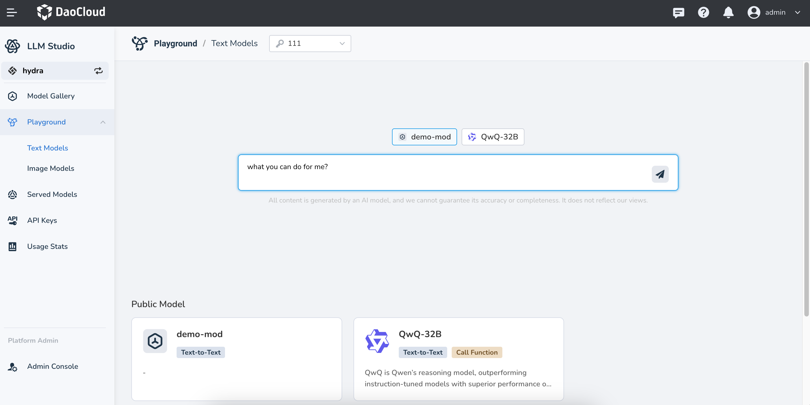

# Try Out and Call Models - User

Once the model service is running, this tutorial helps you verify it through online chats in the [Playground](../hydra/exp.md), then create an
[API Key](../hydra/apikey.md) and integrate the model into your application with the OpenAI-compatible API.

## Prerequisites

- You have completed [Deploy a Model Service](deploy-model.md), or use the preset public models of the platform.

## Online experience

1. In the left navigation bar, click **LLM Studio** -> **Playground**;
   you can also click **Experience** on the target model in the [Model Gallery](../hydra/index.md) to go there directly.

    

2. On first entry, select an API Key (if you do not have one, you can authorize the platform to create one automatically),
   then choose a model from the **Public Models** or **Model Services** list.

3. Type a question in the dialog box to start chatting. The bottom of the dialog shows the tokens consumed by the response;
   click **Add Model** in the upper right corner to compare up to 3 text models at the same time.

    !!! tip

        In **Model Settings** you can tune parameters such as `temperature`, `top_p`, and `max_tokens`:
        a lower `temperature` gives more stable output, a higher one is more creative. In practice, tune either `temperature` or `top_p`, not both.

## Create an API Key

1. In the left navigation bar, click **API Key Management** and click **Create** in the upper right corner.

2. Enter the API Key name (e.g. `test-key`) and click **OK** to generate a new Key.

    !!! note

        The full secret is displayed only once. Save it immediately; if it leaks, delete it and generate a new one.

## Call the model via API

d.run AI Operating System provides an OpenAI-compatible API. To call a model service you deployed, use the endpoint of the region where it runs
(e.g. `sh-02.d.run`); to call shared models via MaaS by Token, use the endpoint `chat.d.run`.

Verify with curl:

```bash
curl 'https://sh-02.d.run/v1/chat/completions' \
  -H "Content-Type: application/json" \
  -H "Authorization: Bearer $API_KEY" \
  -d '{
    "model": "u-8105f7322477/test",
    "messages": [{"role": "user", "content": "Hello, model!"}],
    "temperature": 0.7
  }'
```

Or with Python (OpenAI SDK):

```python
import openai

openai.api_key = "your-api-key"          # Replace with your API Key
openai.api_base = "https://sh-02.d.run"  # Replace with the region of your model service

response = openai.Completion.create(
  model="u-1100a15812cc/qwen2",          # Replace with the access name of your model service
  prompt="What is your name?"
)

print(response.choices[0].text)
```

## Verify

If the online chat returns model answers and the curl call returns a normal response, the model pipeline works end to end.

## Next step

To integrate the model into an agent scenario, see [Create an Agent](deploy-agent.md). For more invocation methods and parameters, see [Model Invocation](../hydra/api-call.md).
