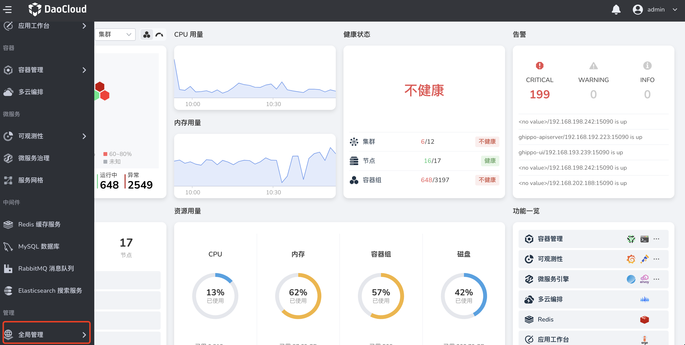
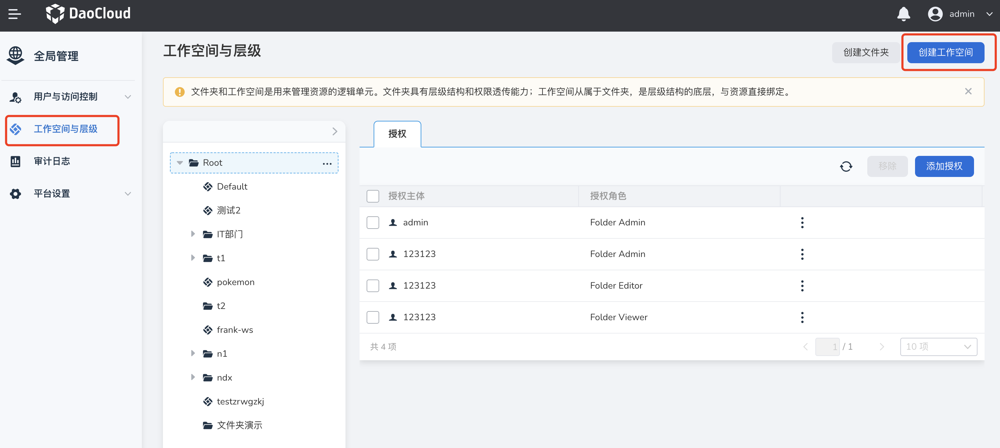

# Create Users and Workspaces - Admin

d.run AI Operating System adopts a multi-tenant system: admins create users and workspaces, then assign resources to different project teams.
This tutorial creates one user and one workspace with a minimal configuration, and binds the user to that workspace.

## Prerequisites

- You have signed in to the d.run AI Operating System console as `admin`.

## Steps

1. In the left navigation bar, click **Global Management** -> **Users and Access Control** -> **Users**, then click **Create User** in the upper right corner.

2. Enter the username and password (e.g. `drun-user`) and click **OK**.
   You can create up to 5 users in one batch.

    

    !!! note

        The username and password set here are used to sign in to the platform. Keep them safe.

3. Find the new user in the user list, click **┇** -> **Authorize**, select role permissions (e.g. Container Management Module Admin), and click **OK**.
   A new user has no permissions by default and can only use a module after being authorized.

    

4. In the left navigation bar, click **Global Management** -> **Workspaces and Folders**, then click **Create Workspace** in the upper right corner.

    

5. Enter the workspace name (e.g. `drun-demo`) and the folder it belongs to, then click **OK**.

    

6. Go to the workspace details page and add the user under **Groups** or **Members** so that the user can access resources in the workspace.

## Verify

Sign in to the console as the new user `drun-user`. If the authorized module entries and the workspace are visible, the configuration succeeded.

## Next step

Continue to [Create a Work Cluster](join-cluster.md) to onboard GPU compute.

For the complete usage of users, permissions, and workspaces, see [Users and Access Control](../ghippo/user-guide/access-control/index.md) and [Workspaces and Folders](../ghippo/user-guide/workspace/index.md).
