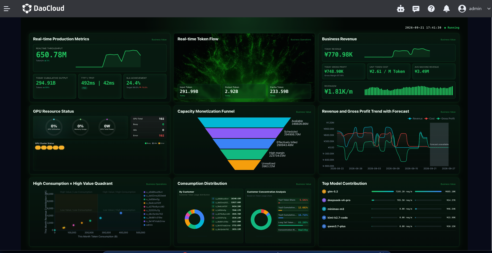

# Operations Insight - User

After the models and agents are running, the top concern of operators is the business status of the platform. This tutorial uses the
[Cockpit](../crane/intro/index.md) to review end-to-end operations data such as compute capacity, token output, revenue, and cost.

## Prerequisites

- You have completed [Deploy a Model Service](deploy-model.md), [Experience and Call Models](call-model.md), or [Create an Agent](deploy-agent.md), and the platform has produced real token consumption.
- Sign in to the console with a user who has the Cockpit permission.

!!! note

    Cockpit (`crane`) is disabled by default after installation. Enable it in [manifest-cloud.yaml](../install/commercial/manifest.md) and re-apply before the module appears.

## View the Cockpit

1. Open **Cockpit** in the product navigation. The [Business Overview Panel](../crane/user-guide/singlepage.md) opens by default.

2. In the business overview, review core metrics such as revenue, cost, gross profit, capacity monetization, and customer spending structure,
   and keep track of compute capacity, token output, and production health.

    

3. To review department quota consumption and organization usage distribution, switch to the enterprise mode view;
   to review business performance, switch to the operations mode view.

## Verify

If the Cockpit shows token output and consumption data matching the actual invocations, the operations insight pipeline works end to end.

## Next step

To confirm that metrics and log collection work properly, see [Insight](../insight/intro/index.md).
For more operations metrics, see [Cockpit](../crane/intro/index.md).
