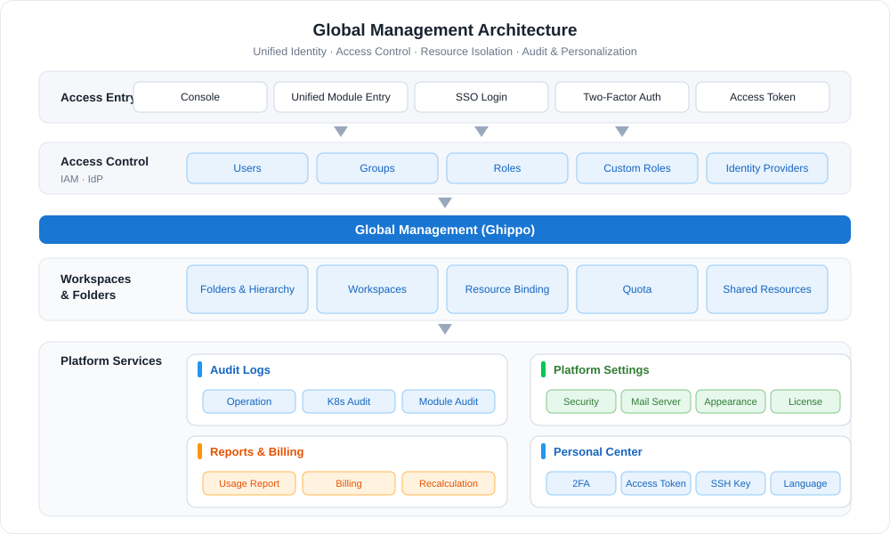
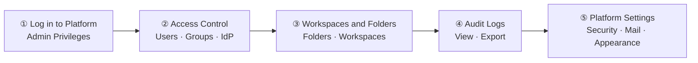

---
hide:
  - toc
MTPE: windsonsea
date: 2026-11-06
---

# What is Global Management

Global Management (Ghippo) is a comprehensive, user-centric service module that brings access control, workspaces and folders, audit logs, and platform settings together in one place. Flat management of users and groups combined with hierarchical tenant (workspace) collaboration enables platform-level access control and resource-based permission division. It also supports customizing the login page and top navigation bar, with security policies such as password rules and session timeout pre-configured, so administrators can complete basic platform settings and user management under one menu, ready to use out of the box.

## Core Capabilities

- :material-shield-account-outline:{ .lg .middle } __Access Control__

    ---

    Create and manage users, groups, and roles with flexible permissions. Supports identity providers such as OIDC, LDAP, and OAuth2.

    [:arrow_forward: Access Control](../user-guide/access-control/iam.md)

- :material-view-grid-outline:{ .lg .middle } __Workspaces and Folders__

    ---

    Resource isolation units with hierarchical structure and access permission control. Organize folders by enterprise environment or department structure and control who can access which resources.

    [:arrow_forward: Workspaces and Folders](../user-guide/workspace/ws-folder.md)

- :material-text-search:{ .lg .middle } __Audit Logs__

    ---

    Record resource operations across the platform and modules for security analysis, change tracking, and troubleshooting. Audit logs can be exported.

    [:arrow_forward: Audit Logs](../user-guide/audit/audit-log.md)

- :material-cog-outline:{ .lg .middle } __Platform Settings__

    ---

    Configure security policies, mail server, appearance customization, and genuine license to keep user information secure and the platform personalized.

    [:arrow_forward: Platform Settings](../user-guide/platform-setting/mail-server.md)

- :material-chart-box-outline:{ .lg .middle } __Reports and Billing__

    ---

    Aggregate usage reports of clusters and modules, with billing management, report recalculation, and GPU usage statistics.

    [:arrow_forward: Usage Report](../user-guide/report-billing/report.md)

- :material-lock-outline:{ .lg .middle } __Personal Center__

    ---

    Manage personal account security settings such as two-factor authentication, access tokens, SSH keys, and language preference.

    [:arrow_forward: Personal Center](../user-guide/personal-center/security-setting.md)

## Procedure

Global Management is usually initialized in the following five steps for users, tenants, and basic platform policies:

| Step | Description |
| ---- | ----------- |
| ① [Log in to the platform](../install/login.md) | Log in to the platform as the platform administrator (Admin) or a user with admin privileges |
| ② [Access Control](../user-guide/access-control/user.md) | [Create users and authorize](../user-guide/access-control/user.md), [create groups and authorize](../user-guide/access-control/group.md), and [create an identity provider](../user-guide/access-control/idprovider.md) |
| ③ [Workspaces and Folders](../user-guide/workspace/ws-folder.md) | [Create folders](../user-guide/workspace/ws-folder.md) (enterprise hierarchy) and [create workspaces](../user-guide/workspace/workspace.md) (tenants) |
| ④ [Audit Logs](../user-guide/audit/audit-log.md) | View and [export audit logs](../user-guide/audit/audit-log.md) |
| ⑤ [Platform Settings](../user-guide/platform-setting/security.md) | Configure security policy, mail server, appearance, and genuine license |

## Quick Start

  <a class="ghippo-path-step" style="--path-c:#2196f3" href="../user-guide/access-control/user/">
    1
    Create Users and Authorize
    Users · Groups · Roles
    Go →
  </a>
  <a class="ghippo-path-step" style="--path-c:#00acc1" href="../user-guide/workspace/ws-folder/">
    2
    Create Folders and Workspaces
    Enterprise hierarchy · Tenant isolation
    Go →
  </a>
  <a class="ghippo-path-step" style="--path-c:#43a047" href="../user-guide/workspace/wsbind-permission/">
    3
    Bind Resources and Authorize
    Workspace binding · Permission division
    Go →
  </a>
  <a class="ghippo-path-step" style="--path-c:#fb8c00" href="../user-guide/audit/audit-log/">
    4
    View Audit Logs
    Operation records · Security analysis
    Go →
  </a>

## More Resources

- :material-format-list-bulleted:{ .lg .middle } __Feature List__

    ---

    View the complete feature list of Global Management covering access control, workspaces and folders, audit logs, and platform settings.

    [:arrow_forward: View the feature list](features.md)

- :material-book-open-page-variant:{ .lg .middle } __Glossary__

    ---

    Learn common terms and concepts in Global Management, such as IAM, folder, workspace, and resource binding.

    [:arrow_forward: View the glossary](glossary.md)

- :material-chat-question-outline:{ .lg .middle } __FAQs__

    ---

    Common issues and troubleshooting for installation, login, and usage of Global Management.

    [:arrow_forward: View FAQs](faq.md)

- :material-map-outline:{ .lg .middle } __Best Practices__

    ---

    Practical recommendations for workspace planning, permission assignment, folder design, and OEM customization.

    [:arrow_forward: View best practices](../best-practice/ws-best-practice.md)

[Start Free Trial Now](../../dce/license0.md){ .md-button .md-button--primary }
[Download Center](https://docs.daocloud.io/en/download/){ .md-button .md-button--primary }
[Learn about d.run Token Factory](https://docs.daocloud.io/en/tf/){ .md-button .md-button--primary }
[Learn about d.run AI OS](https://docs.daocloud.io/en/drun/){ .md-button .md-button--primary }
[Read the Global Management User Guide (PDF)](https://harbor-test2.cn-sh2.ufileos.com/docs/download/docs/ghippo.pdf){ .md-button .md-button--primary }
