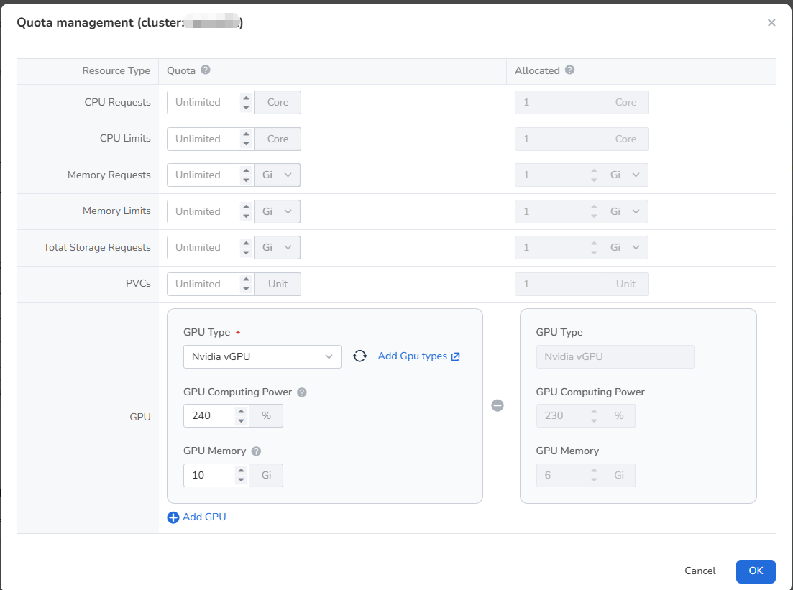

# Resource Quota

Shared resources do not necessarily mean that the shared users can use the shared resources without
any restrictions. Admin, Kpanda Owner, and Workspace Admin can limit the maximum usage quota of a user
through the __Resource Quota__ feature in shared resources. If no restrictions are set, it means the
usage is unlimited.

- CPU Request (Core)
- CPU Limit (Core)
- Memory Request (MB)
- Memory Limit (MB)
- Total Storage Request (GB)
- Persistent Volume Claims (PVC)
- GPU Type, Compute, and Memory (including but not limited to Nvidia, Ascend, ILLUVATAR, and other GPUs)

A resource (cluster) can be shared among multiple workspaces, and a workspace can use resources from
multiple shared clusters simultaneously.

## Resource Groups and Shared Resources

Cluster resources in both shared resources and resource groups are derived from [Container Management](../../../kpanda/intro/index.md). However, different effects will occur when binding a cluster to a workspace or sharing it with a workspace.

1. Binding Resources

    Users/User groups in the workspace will have full management and usage permissions for the cluster.
    Workspace Admin will be mapped as Cluster Admin.
    Workspace Admin can access the [Container Management module](../../../kpanda/user-guide/permissions/permission-brief.md)
    to manage the cluster.

    

    !!! note

        As of now, there are no Cluster Editor and Cluster Viewer roles in the Container Management module.
        Therefore, Workspace Editor and Workspace Viewer cannot be mapped.

2. Adding Shared Resources

    Users/User groups in the workspace will have usage permissions for the cluster resources, which can be

    used when [creating namespaces](../../../amamba/user-guide/namespace/namespace.md).

    

    Unlike resource groups, when sharing a cluster with a workspace, the roles of the users in the workspace
    will not be mapped to the resources. Therefore, Workspace Admin will not be mapped as Cluster Admin.

## Configure Shared Resource Quotas

1. In **Global Management** -> **Workspaces and Hierarchies**, select the target workspace and open the
   **Shared Resources** tab.
2. Locate the target shared cluster and select **Quota Management** from its action menu.
3. Set the CPU, memory, storage, and GPU quotas in the **Quota** column as needed, and click **OK**.
   Select a GPU type, and then set the GPU computing power and GPU memory quotas:

    - **GPU Computing Power**: The total GPU computing power that the workspace can allocate to all its
      namespaces. It is the sum across multiple GPUs and can therefore exceed 100%.
    - **GPU Memory**: The total GPU memory that the workspace can allocate to all its namespaces. It is
      the sum of GPU memory across multiple GPUs.

    

The quota values have the following meanings:

- **Quota**: The resource limit assigned from the shared cluster to the current workspace. Set a specific
  value as needed or leave it unlimited. A separate physical GPU count is no longer required for vGPU quotas.
- **Allocated**: The sum of quotas assigned to namespaces bound to the workspace. It is not real-time GPU usage.
- **Remaining**: Quota minus Allocated. For example, if the computing-power quota is 240% and 230% is
  allocated, 10% remains available.

!!! note

    The sum of all namespace quotas in a workspace cannot exceed the shared-resource quota. Otherwise,
    the namespace cannot be bound to the workspace.

This section demonstrates three scenarios related to resource quotas.

## Create Namespaces

Creating a namespace involves resource quotas.

1. Add a shared cluster to workspace __ws01__ .

    

2. Select workspace __ws01__ and the shared cluster in Workbench, and create a namespace __ns01__ .

    

    - If no resource quotas are set in the shared cluster, there is no need to set resource quotas when creating
      the namespace.
    - If resource quotas are set in the shared cluster (e.g., CPU Request = 100 cores), the CPU request for the
      namespace must be less than or equal to 100 cores (__CPU Request ≤ 100 core__) for successful creation.

## Bind Namespace to Workspace

Prerequisite: Workspace ws01 has added a shared cluster, and the operator has the Workspace Admin + Kpanda Owner
or Admin role.

The two methods of binding have the same effect.

- Bind the created namespace ns01 to ws01 in Container Management.

    

    - If no resource quotas are set in the shared cluster, the namespace ns01 can be successfully bound regardless
      of whether resource quotas are set.
    - If resource quotas are set in the shared cluster (e.g., CPU Request = 100 cores), the namespace ns01
      must meet the requirement of CPU requests less than or equal to 100 cores (__CPU Request ≤ 100 core__)
      for successful binding.

- Bind the namespace ns01 to ws01 in Global Management.

    

    - If no resource quotas are set in the shared cluster, the namespace ns01 can be successfully bound
      regardless of whether resource quotas are set.
    - If resource quotas are set in the shared cluster (e.g., CPU Request = 100 cores), the namespace ns01
      must meet the requirement of CPU requests less than or equal to 100 cores (__CPU Request ≤ 100 core__)
      for successful binding.

## Unbind Namespace from Workspace

The two methods of unbinding have the same effect.

- Unbind the namespace ns01 from workspace ws01 in Container Management.

    

    - If no resource quotas are set in the shared cluster, unbinding the namespace ns01 will not affect the
      resource quotas, regardless of whether resource quotas were set for the namespace.
    - If resource quotas (__CPU Request = 100 cores__) are set in the shared cluster and the namespace ns01
      has its own resource quotas, unbinding will release the corresponding resource quota.

- Unbind the namespace ns01 from workspace ws01 in Global Management.

    

    - If no resource quotas are set in the shared cluster, unbinding the namespace ns01 will not affect the
      resource quotas, regardless of whether resource quotas were set for the namespace.
    - If resource quotas (__CPU Request = 100 cores__) are set in the shared cluster and the namespace ns01
      has its own resource quotas, unbinding will release the corresponding resource quota.
