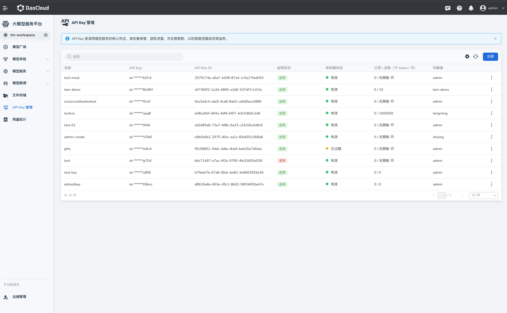
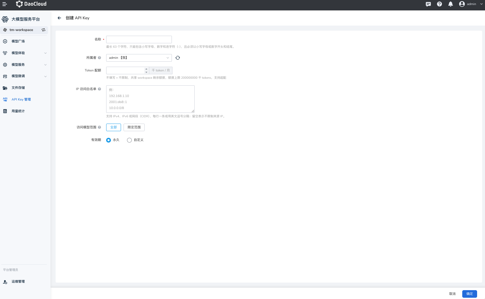
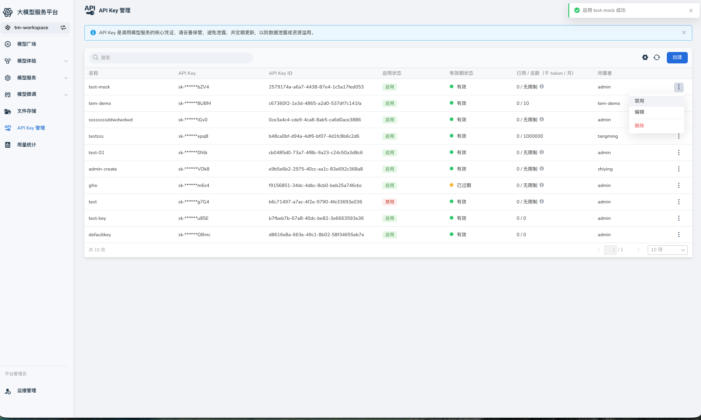

# API Key Management

An API key is a core credential for accessing model services. It verifies user identity and helps protect data.



## Overview

- **Purpose**: An API key is required to authenticate requests to deployed model services.
- **Security**: Keep API keys secure. Do not expose them in client-side code or public environments. If a key is compromised, delete it and generate a replacement.

## Create an API Key

1. On the **API Key Management** page, click **Create** in the upper-right corner.
2. In the **Create API Key** dialog, enter a name, such as `test-key`, to identify its purpose or project.
3. Select the owner account.
4. Set the **Token quota** for the key.
5. Configure the **IP allowlist** to restrict the IP addresses or CIDR ranges that can use the key to call models.
6. Set the **Accessible models** that the key can use.
7. Set the **Validity period** for model access.
8. Click **Confirm** to create the key.



!!! note

    Save the API key when it is first displayed. The full key will not be shown again.

## View API Keys

The API key list shows the keys you have created, including their names, partially masked values, and creation times. Click the refresh icon in the upper-right corner to update the list.

## Delete an API Key

1. Find the key in the list and select the delete action for its row.
2. Confirm the deletion in the dialog.
3. The key becomes invalid immediately, and requests that use it are rejected.

## Enable or Disable an API Key

Use **Disable** to disable a key, or **Enable** to reactivate it.



## Call a Service with an API Key

Add the following header to the HTTP request:

```http
Authorization: Bearer {API_KEY}
```

Example:

```shell
curl 'https://sh-02.d.run/v1/chat/completions' \
  -H "Content-Type: application/json" \
  -H "Authorization: Bearer <API_KEY>" \
  -d '{
    "model": "u-8105f7322477/test",
    "messages": [{"role": "user", "content": "Hello, model!"}],
    "temperature": 0.7
  }'
```

Replace `<API_KEY>` with your key.

## Notes

- Each account has a limit on the number of API keys it can create. Allocate keys according to your needs.
- If a key is exposed, delete it immediately and create a replacement.
- Use separate keys for different projects or services to isolate permissions.
- Rotate keys regularly.
- API keys are tenant-scoped. The signed-in account can edit only keys in tenants for which it has permission.
