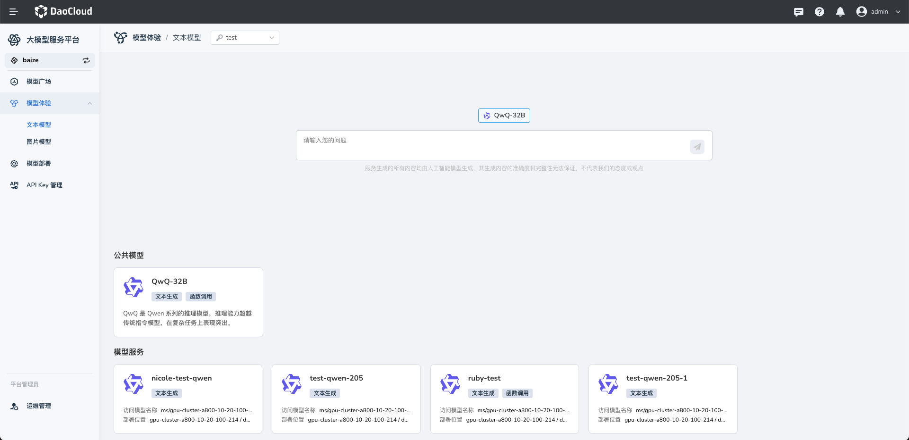
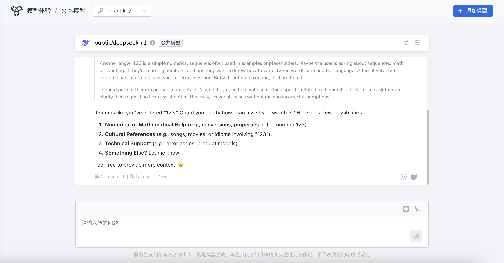
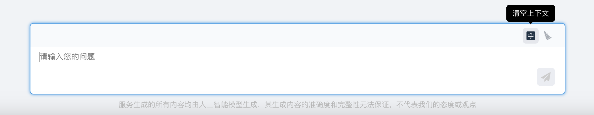
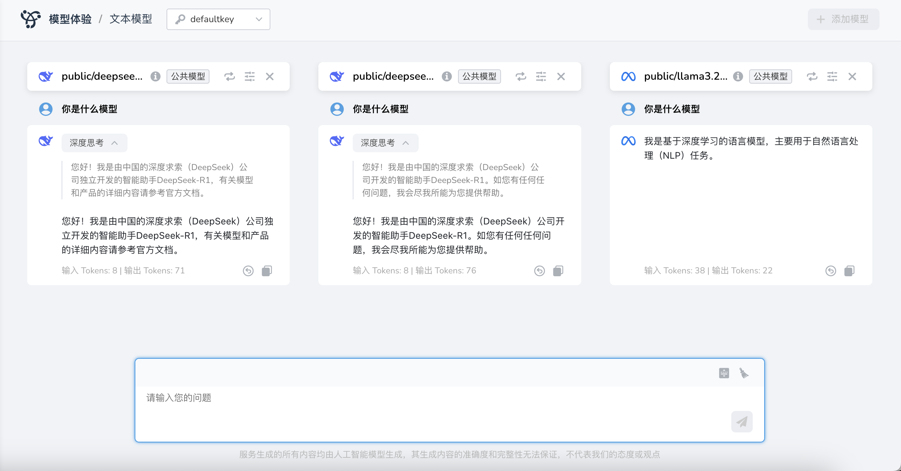
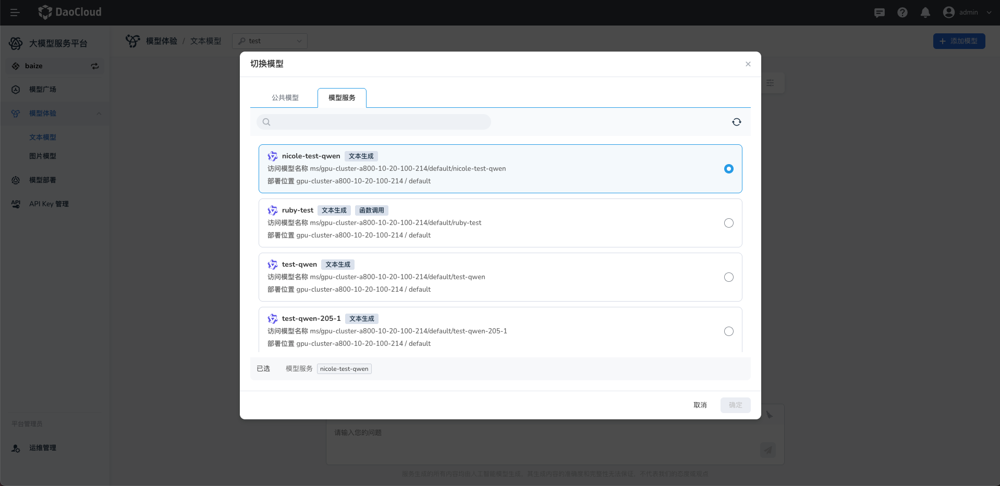
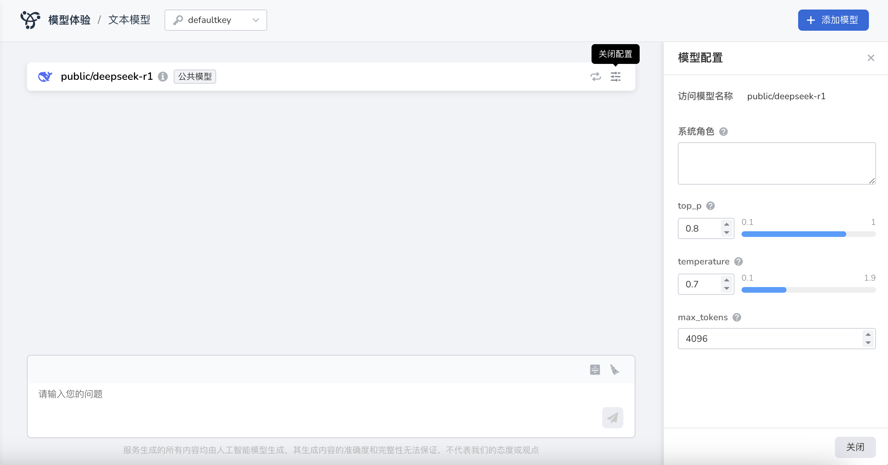
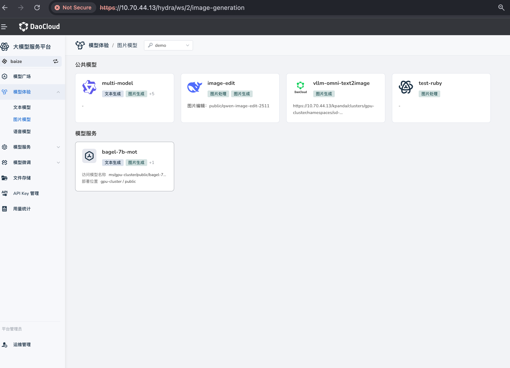
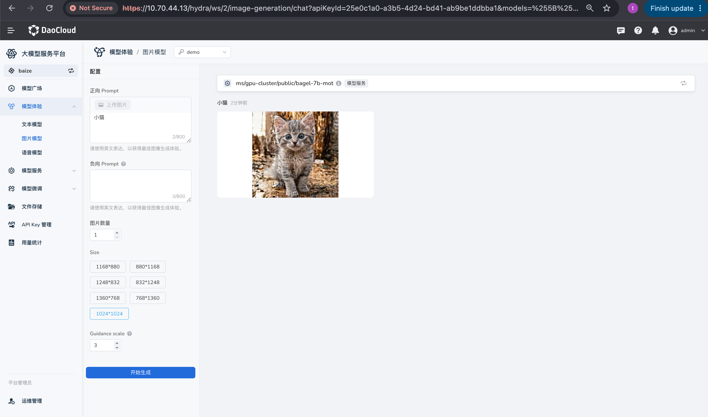
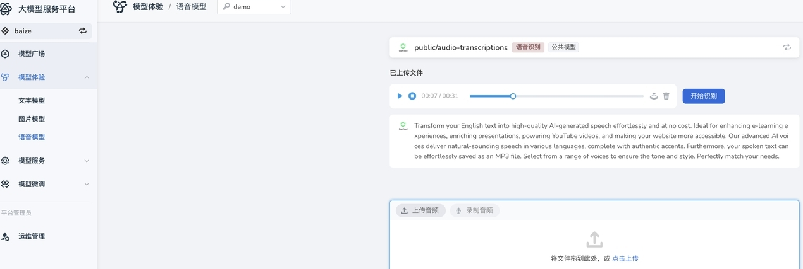

# Model Experience

*[Hydra]: The development codename for the LLM Service Platform

Most models in Hydra provide both information and an interactive inference experience. For example, you can chat with a large language model to explore its capabilities.

## Open the Experience Center

You can access the experience center in either of these ways:

- On the [Model Plaza](./index.md), select a model and click **Try it**.
- In the left navigation, click **Model Experience**, select a model type, and start an experience. Text and image models are available.

## Choose a Model

When you first open the **Experience Center**, the platform recommends popular models. You can select a recommended model, choose another model from **Public Models**, or select a deployed model from **Model Services**.

## Text Models

The experience center supports built-in chat models and services you have created. You can add multiple models for online comparison.

### Have a Text Conversation

1. On your first visit, select an API key. If you do not have one, you can authorize the platform to create one automatically.
2. Select a model from the list and open it. If you have already added a model, you can skip this step.
3. If you are not satisfied with an answer, click **Regenerate**. Click **Copy** to copy the generated content.

The bottom of the conversation also shows the number of tokens used for the response, which can help you compare model performance.

### Clear Conversation Context

Click **Clear context** in the upper-right corner of the conversation panel to end the current conversation and clear its context. Messages below it will not be affected by earlier content.

### Compare Text Models

Click **Add model** in the upper-right corner. You can compare up to three text-generation models.

### Switch Text Models

In the model information bar at the top, click **Switch model** to select another model.

### Configure Text Model Parameters

Click **Model configuration** on the right side of the model information bar to adjust generation parameters. Hover over the **?** next to a parameter name for its description.

| Parameter | Description | Suggested value |
| --- | --- | --- |
| System role | Defines the model's behavior, background, responsibilities, and role. | For example, “You are an AI assistant.” |
| `top_p` | Controls output diversity. Higher values allow more varied output. | `0.8` |
| `temperature` | Controls randomness. Higher values produce more varied output; lower values produce more focused output. | `0.7` |
| `max_tokens` | Sets the maximum number of tokens the model can generate. `0` means unlimited. | Chat: 500–800; short text: 800–2,000; code: 2,000–3,600; long text: 4,000+ |

!!! note

    Both `temperature` and `top_p` control randomness, but in different ways. `temperature` adjusts the overall probability distribution, while `top_p` limits sampling to tokens within a cumulative probability threshold. In practice, adjust one of them at a time: use `temperature` for more predictable output or `top_p` for natural output that does not diverge too much. See the [Hugging Face documentation](https://huggingface.co/docs/transformers/) for more information.

## Image Models

The experience center supports built-in image-generation models and services you have created. Online experience currently supports one model at a time.

### Generate an Image

1. On your first visit, select an API key. If you do not have one, you can authorize the platform to create one automatically.
2. Select an image model from the list.
3. Enter a prompt, choose the image size, and click **Generate**.

Select a model service:

Enter a prompt, choose a size, and click **Generate**:

## Speech Recognition Models

The experience center supports built-in speech recognition models and services you have created. Online experience currently supports one model at a time.

### Transcribe Speech

1. On your first visit, select an API key. If you do not have one, you can authorize the platform to create one automatically.
2. Select a speech recognition model from the list.
3. Click **Upload audio** to upload an audio file, then click **Start recognition** to generate a transcript.

