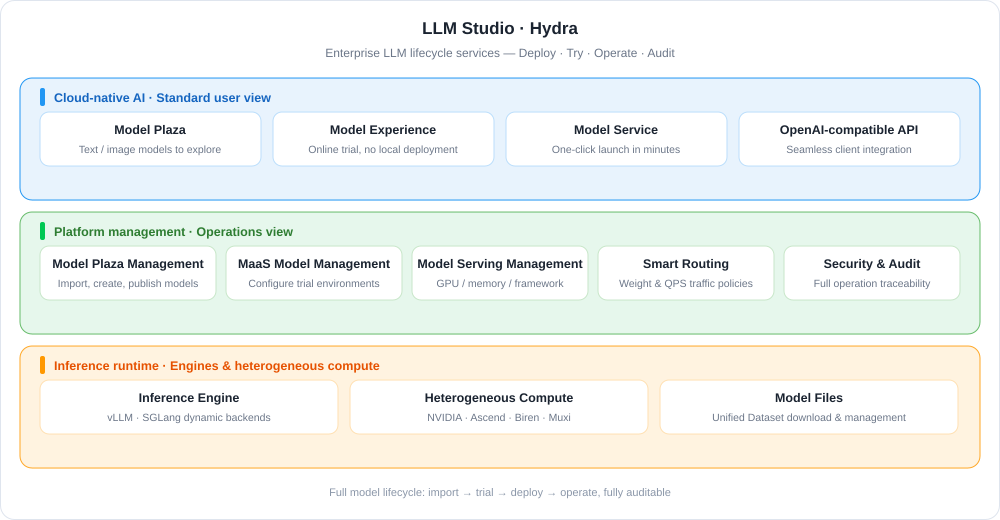
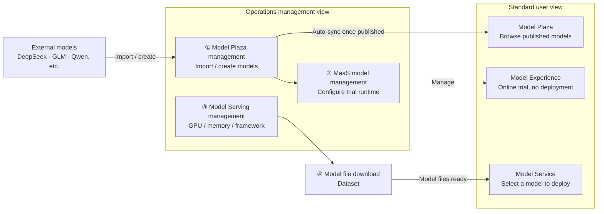
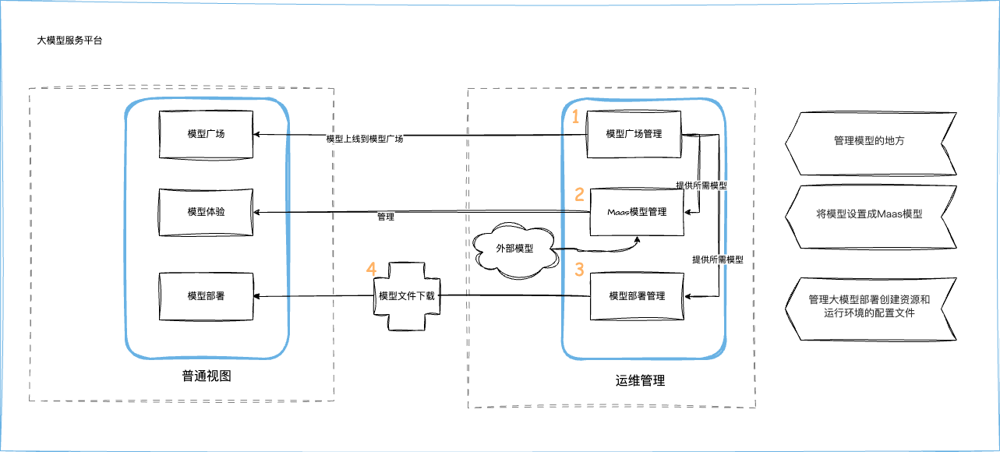

---
hide:
  - toc
---

# What Is LLM Studio

LLM Studio (Hydra) is a comprehensive AI model service management platform built for enterprise users. It addresses key challenges enterprises face when adopting large models, such as deployment complexity, model selection difficulties, stability issues, and potential security risks.

By offering end-to-end lifecycle services—from model deployment to operational management—the platform helps enterprises and developers efficiently integrate large model capabilities, accelerating digital transformation and intelligent innovation.

[Read or Download the LLM Studio User Manual](https://harbor-test2.cn-sh2.ufileos.com/docs/download/docs/hydra.pdf){ .md-button }

## Key Capabilities

- :material-rocket-launch-outline:{ .lg .middle } __One-Click Deployment and Simplified Operations__

    ---

    Both web UI and API are supported, so mainstream models go live within minutes. Dynamic inference backends such as vLLM and SGLang support real-time scaling and multi-region deployment.

    [:arrow_forward: Deploy a new model](../deploy/deploy.md)

- :material-transit-connection-horizontal:{ .lg .middle } __Traffic Management and Stability__

    ---

    Intelligent traffic policies based on weights, QPS limits, and more, plus three-level rate limiting (global, API key, tenant) to keep services stable.

    [:arrow_forward: Smart routing and rate limiting](../oam/auto-route.md)

- :material-server-network:{ .lg .middle } __Distributed Inference__

    ---

    Multi-node, multi-GPU serving for ultra-large models such as DeepSeek and GLM; compatible with NVIDIA, Ascend, Biren, Muxi, and other GPUs, with round-robin, random, and weighted load balancing.

    [:arrow_forward: Model service overview](../deploy/index.md)

- :material-chart-box-outline:{ .lg .middle } __Accurate Billing and Analytics__

    ---

    Token-level accounting covering mainstream large models; call volume and input/output token analytics by API key, model type, and time.

    [:arrow_forward: API key management](../apikey.md)

- :material-view-grid-outline:{ .lg .middle } __Unified Multimodal Management__

    ---

    The Model Plaza brings together text generation, image generation, and vision models. Send one input and compare responses from multiple models, with rich demos and integration guides.

    [:arrow_forward: Model Plaza](../index.md)

- :material-lan-connect:{ .lg .middle } __Open Ecosystem__

    ---

    An OpenAI-compatible API with rich call examples; mainstream clients such as Cherry Studio, Cline, LobeChat, and Bob work out of the box.

    [:arrow_forward: Client practices](../user-guides/index.md)

## Workflow

The platform combines the **operations management view + standard user view** to achieve unified model management, trial, and rapid deployment.
The model usage process consists of **three steps + model file download**:

??? note "View the original hand-drawn workflow"

    

| Step | Operations management view | Standard user view | Documentation |
| :--- | :--- | :--- | :--- |
| ① Model Plaza management | Import or create models in **Model Plaza Management**; published models sync automatically to the user view | Browse published models in the **Model Plaza** as the entry point for trials or deployments | [Model Plaza Management](../oam/index.md) |
| ② MaaS model management | Set a model as a **MaaS model** and configure its trial runtime environment | Try configured models online in **Model Experience** without local deployment | [MaaS Model Management](../oam/maas.md) |
| ③ Model Serving management | Create deployment profiles for resources and environments, e.g. GPU/memory/runtime framework | Select a model in **Model Service** to deploy quickly without manually filling in complex parameters | [Model Serving Management](../oam/mdm.md) |
| ④ Model file download | Operations staff [download model files to designated locations](../dataset.md) as the foundation for deployment | — | [Dataset management](../dataset.md) |

## Quick Start

=== ":material-shield-account: Admin: deploy and operate the platform"

    

      <a class="hydra-path-step" style="--path-c:#2196f3" href="deploy-ws/">
        1
        Deploy the platform
        Install LLM Studio in WS mode
        Go →
      </a>
      <a class="hydra-path-step" style="--path-c:#00acc1" href="../oam/">
        2
        Publish models
        Import or create models and publish
        Go →
      </a>
      <a class="hydra-path-step" style="--path-c:#43a047" href="../oam/maas/">
        3
        Configure trials
        Set up MaaS trial environments
        Go →
      </a>
      <a class="hydra-path-step" style="--path-c:#fb8c00" href="../oam/mdm/">
        4
        Configure serving
        Plan GPUs, memory, and frameworks
        Go →
      </a>
      <a class="hydra-path-step" style="--path-c:#8e24aa" href="../dataset/">
        5
        Prepare model files
        Download models with Dataset
        Go →
      </a>
    

=== ":material-account: User: try and call models"

    

      <a class="hydra-path-step" style="--path-c:#2196f3" href="../">
        1
        Choose a model
        Browse and compare in Model Plaza
        Go →
      </a>
      <a class="hydra-path-step" style="--path-c:#00acc1" href="../exp/">
        2
        Try online
        Chat and generate images in Model Experience
        Go →
      </a>
      <a class="hydra-path-step" style="--path-c:#43a047" href="../deploy/deploy/">
        3
        Deploy a service
        One-click model deployment
        Go →
      </a>
      <a class="hydra-path-step" style="--path-c:#fb8c00" href="../apikey/">
        4
        Create an API key
        Manage credentials and rate limits
        Go →
      </a>
      <a class="hydra-path-step" style="--path-c:#8e24aa" href="../user-guides/">
        5
        Connect a client
        Cherry Studio / Cline / LobeChat
        Go →
      </a>
    

## Security and Audit {: #security-audit }

The audit feature is a core part of the LLM Studio module. By recording key operation events, it keeps user behavior and system changes traceable to meet compliance, traceability, and security auditing requirements. The main audit items are:

| Audit category | Covered operations | Event identifiers |
| :--- | :--- | :--- |
| **Model management** | Create, update, and delete models; enable/disable the MaaS model trial feature; publish and unpublish models | `Model`, `EnabledMAASModel`, `PublishModel`, `UnPublishModel` |
| **Deployment template management** | Add and update model deployment templates | `AddDeployTemplates`, `UpdateDeployTemplates` |
| **Model provider management** | Create, update, and delete model providers | `ModelProvider` |
| **Workspace API key management** | Create and delete workspace API keys | `CreateWSAPIKey`, `DeleteWSAPIKey` |
| **Model service management** | Create and delete workspace model services; update replicas; perform service actions | `CreateWSModelServing`, `DeleteWSModelServing`, `UpdateWSModelServingReplicas`, `DoModelWSServingAction` |

These audit items cover every aspect of the model lifecycle, ensuring that every operation is traceable.

For instructions, see [Security Audit Logs](../oam/security-audit-logs.md). For the complete list of audit items, see [LLM Studio Audit Items](../../ghippo/user-guide/audit/gproduct-audit/hydra.md).

[Download Center](https://docs.daocloud.io/en/download/){ .md-button .md-button--primary }
[Learn about d.run Token Factory](https://docs.daocloud.io/en/tf/){ .md-button .md-button--primary }
[Learn about d.run AI OS](https://docs.daocloud.io/en/drun/){ .md-button .md-button--primary }
