# Cost Analysis Center

Platform administrators can use the Cost Analysis Center to manage upstream cost pricing for GPU hardware and MaaS models, track LLM service usage and cost trends, compare cost per Token between self-hosted and MaaS models, and pinpoint cost drivers and abnormal risks by model, workspace (or tenant), endpoint, and quota status.

## Overview and Modes

The Analysis Center provides **7 analysis tabs** at the top of the page. Certain tab names and displayed metrics adapt automatically based on the platform operating mode:

| Tab | Applicable Mode | Primary Purpose |
| --- | --- | --- |
| Cost Overview | All | View key cost/usage KPI cards, quota or budget risks, daily trends, cost composition, and drill-down rankings. |
| Token Cost Analysis | All | Compare input/output pricing, cost per Token, high-cost call ratio, and top cost sources across models. |
| Model Cost Analysis | All | Rank models from lowest to highest cost per Token to evaluate model cost efficiency. |
| Workspace Cost Analysis / Tenant / Customer Cost Analysis | Workspace Mode / CSP Mode | Track cost, usage, and calls (or revenue and gross margin) along with growth by consumer. |
| Endpoint / Deployment Cost Analysis | All | Review average daily request volume and cost ranking for each model endpoint or deployment. |
| Revenue / Profit Analysis | All (primarily CSP Mode) | Track revenue trends, profit trends, and gross margin changes. |
| Quota Status / Budget / Forecast | Workspace Mode / CSP Mode | Monitor real-time workspace quota usage, or monthly budgets and cost forecasts in CSP mode. |

Two global controls are available in the top-right corner:

- **Time Range Selector**: Switch between **Last 1 day**, **Last 7 days**, and **Last 30 days** (default: **Last 30 days**). Applies to the first 6 analysis tabs. The **Quota Status** tab displays real-time quota status and does not show the time range selector.
- **Cost Config (Gear Icon)**: Accessible from the top-right corner of any tab to configure GPU hardware costs and upstream MaaS pricing.

## Enter the Cost Analysis Center

1. Log in as a platform administrator and go to **LLM Studio**. When Token Factory is enabled, the product entry appears as **Token Factory Management**.
2. In the left navigation under **Admin**, click **Analysis Center** to open **Cost Overview** by default.

    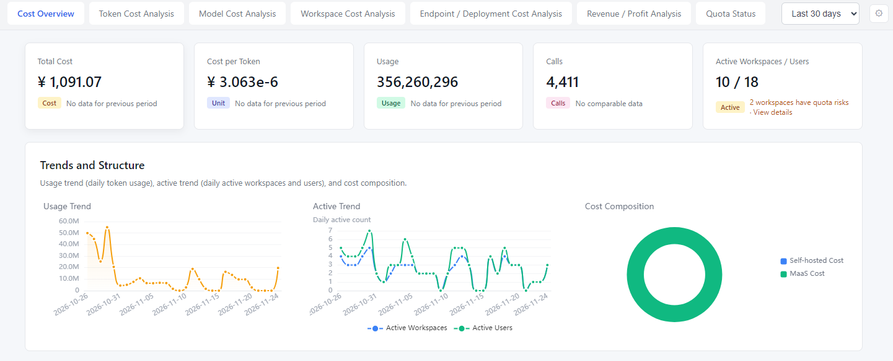

## Configure Costs

Before reviewing accurate cost statistics, configure the GPU hardware costs for self-hosted inference and the upstream pricing for MaaS models. Click the gear icon in the top-right corner of any analysis page to open the **Cost Config** dialog (you can click the maximize icon in the top-right corner of the dialog to expand it), then configure costs under the following three tabs as needed.

### Configure GPU Costs

On the **GPU** (**GPU hourly price**) tab, enter the compute cost parameters for self-hosted model inference:

| Parameter | Description | Unit / Example |
| --- | --- | --- |
| Cluster | Name of the cluster where the GPU resides | e.g., `tm-cluster` |
| Node | Name of the node where the GPU resides (optional) | e.g., `node-rtx3060` |
| Product | GPU model name | e.g., `NVIDIA H100` |
| Memory | VRAM specification per GPU (optional) | e.g., `80Gi` |
| Price | Hourly GPU accounting rate | `CNY / hour` |
| Count | Number of GPUs (optional) | `pcs` |
| Purchase price / GPU | Per-GPU purchase price when tracking asset depreciation | `CNY` |
| Depreciation start | Date when depreciation begins | Enter `Year`, `Month`, `Day` |
| Useful life | Expected depreciation lifecycle | `months` |
| Residual value | Estimated salvage value after full depreciation | `CNY` |

Click **Save** when finished. In the saved list below, the system automatically calculates and displays **Depreciation status** (such as `Active`) and **Hourly depreciation** (`CNY / hour`). To modify or remove an entry, click **Edit** or **Delete** in the lower-right corner of the card.

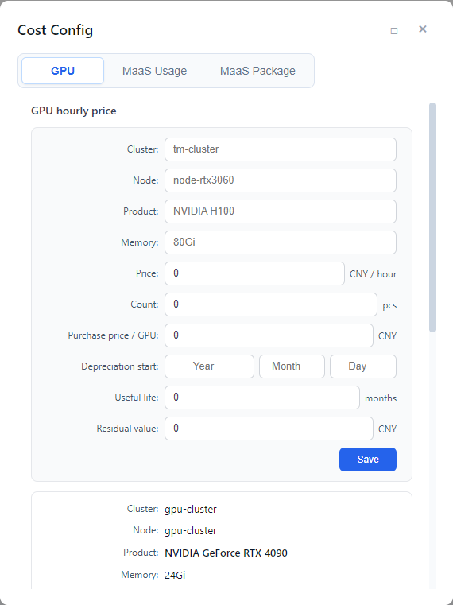

### Configure MaaS Usage Costs

When upstream MaaS models are billed by actual usage, switch to the **MaaS Usage** (**MaaS usage price**) tab:

1. In **MaaS model**, search and select an existing model, or enter a reported usage name directly.
2. Fill in the upstream unit prices according to the capabilities supported by the model:

    - **Input price**, **Cached price**, **Output price**: in `CNY / 1M tokens`.
    - **Input image price**, **Output image price**: in `CNY / image`.
    - **Input audio price**, **Output audio price**: in `CNY / minute`.

3. Click **Save**. You can click **Edit** or **Delete** on any saved model configuration in the list below at any time.

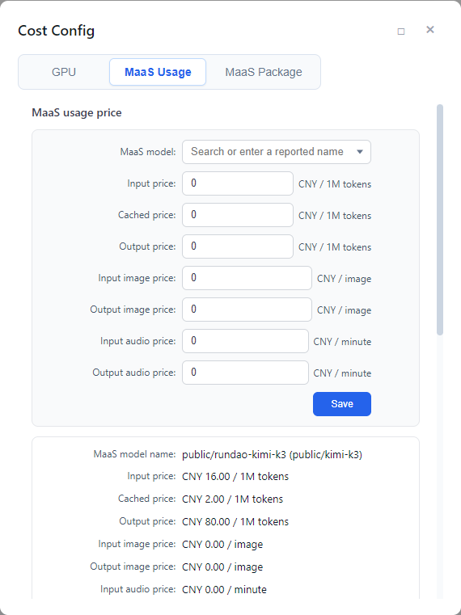

### Configure MaaS Package Costs

When upstream MaaS models are purchased via hourly packages, switch to the **MaaS Package** (**MaaS package hourly price**) tab:

1. Enter the basic information:

    - **Name**: Identifier for the package configuration (e.g., `deepseek4-pro`).
    - **MaaS model name**: Target MaaS model name (e.g., `public/qwen3-06b`).
    - **Expiration time**: Package expiration timestamp in ISO 8601 format (e.g., `2027-01-01T00:00:00Z`).

2. Enter the applicable hourly rates (all in `CNY / hour`): **Input token hourly**, **Cached token hourly**, **Output token hourly**, **Input image hourly**, **Output image hourly**, **Input audio hourly**, and **Output audio hourly**.
3. Click **Save**.

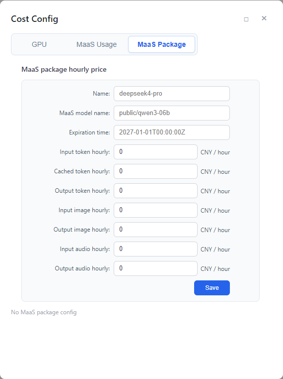

## View Cost Overview

1. In the top-right corner of **Cost Overview**, select a reporting period: **Last 1 day**, **Last 7 days**, or **Last 30 days** (default: **Last 30 days**).
2. Review the **5 KPI summary cards** at the top (each card also displays a comparison status against the previous period):

    - **Total Cost**: Total model invocation cost within the selected period.
    - **Cost per Token**: Average unit cost per Token within the selected period.
    - **Usage** / **Calls** (Workspace Mode): Total Token consumption and total call count within the period; in CSP mode, these cards display **Revenue** and **Gross Margin** instead.
    - **Active Workspaces / Users**: Number of active workspaces and active users with calls during the period.

3. **View risk details**: When workspace quota risks (or account budget risks in CSP mode) are detected, a risk count and **View details** link appear on the **Active Workspaces / Users** card. Click **View details** to open the popover listing each affected workspace and reason, such as **Exceeded** (showing the usage percentage and amount exceeded) or **Unlimited** (indicating no quota limit is configured).

    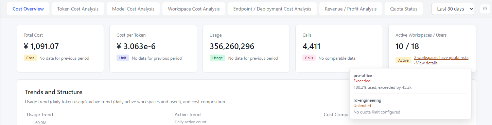

4. Inspect the 3 charts under **Trends and Structure**:

    - **Usage Trend**: Daily Token consumption trend across the selected period.
    - **Active Trend**: Daily comparison of **Active Workspaces** and **Active Users**.
    - **Cost Composition**: Donut chart comparing the share of **Self-hosted Cost** and **MaaS Cost**.

5. Use **Drill-down Analysis** to pinpoint top consumers:

    - **User Ranking**: Top 10 users ranked from highest to lowest Token usage.
    - **Model Ranking**: Top 10 models ranked from highest to lowest Token usage.
    - **Quota Table**: Filter workspaces by name using the **Filter Workspace...** input, inspect **Quota**, **Used**, **Usage Rate**, **Remaining**, and **Status** (`Exceeded`, `Normal`, `Unlimited`), and paginate with `10 / 20 / 50 items` per page.

    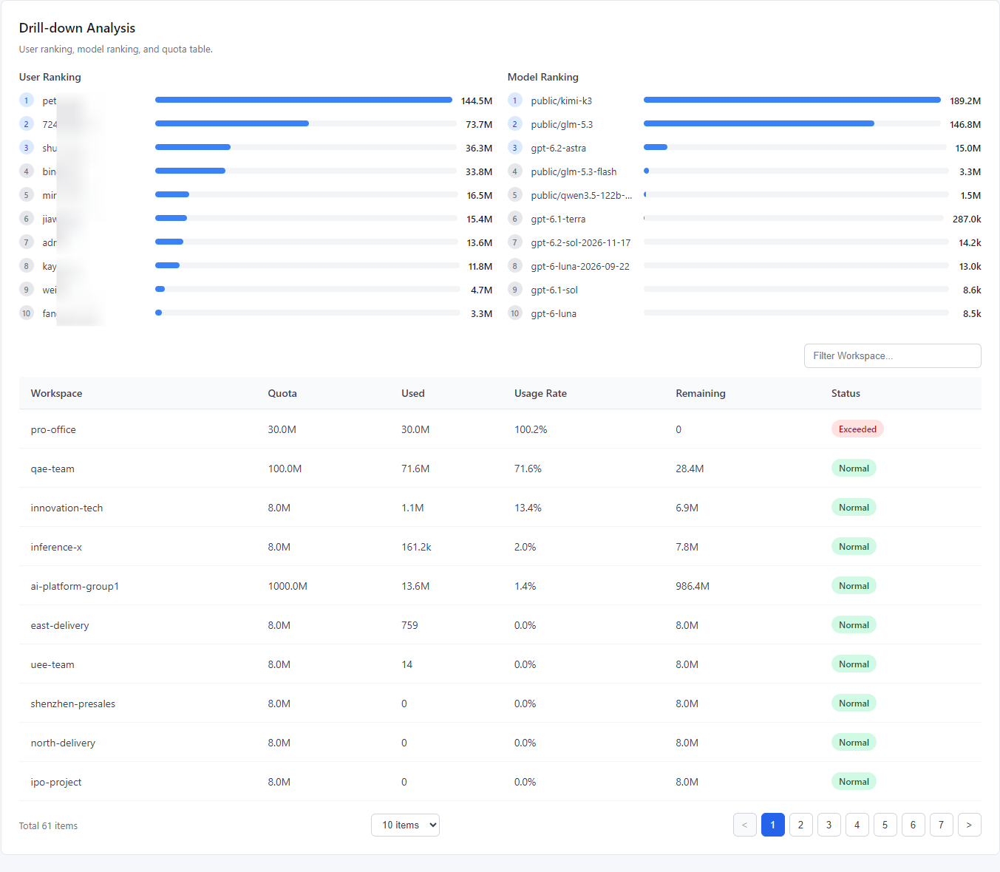

## Analyze Token Costs

1. Click **Token Cost Analysis** in the top navigation bar.
2. In the **Cost per Token by Model** table on the left, review each model (MaaS models carry the `[MaaS]` tag) for **Input Cost**, **Output Cost**, **Cost per Token**, and **High-cost Call Ratio**.
3. In the **Top Cost Sources** donut chart on the right, inspect the cost breakdown and combined share of **Input Token** and **Output Token**.
4. To adjust the threshold used to identify high-cost calls, click the gear icon next to the **High-cost Call Ratio** column header to open **High-cost Threshold**, and drag the slider between `0.1%` and `10%` (step `0.1%`, default `1%`):

    - **Threshold purpose**: Sets the cost-share threshold for classifying a call as high-cost. For example, a `1%` threshold means any single call whose cost reaches `1%` of the model's total cost is counted as a high-cost call.
    - **Calculation logic**: `High-cost Call Ratio = High-cost Calls / Total Calls`.

    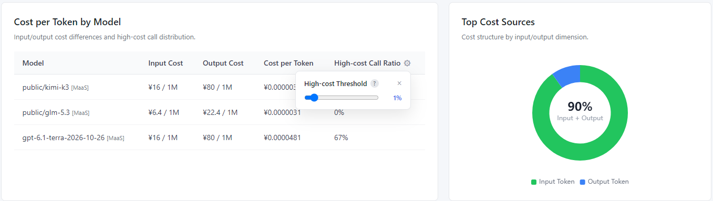

## Other Analysis Dimensions

### Model Cost Analysis

Displays the **Model Cost Ranking** horizontal bar list showing each model's source tag (such as `[MaaS]`) and unit cost per Token. Models are sorted **from lowest to highest** cost per Token (lower cost indicates higher efficiency), making it easy to compare cost-effectiveness across models. Models without configured unit pricing appear at the bottom.

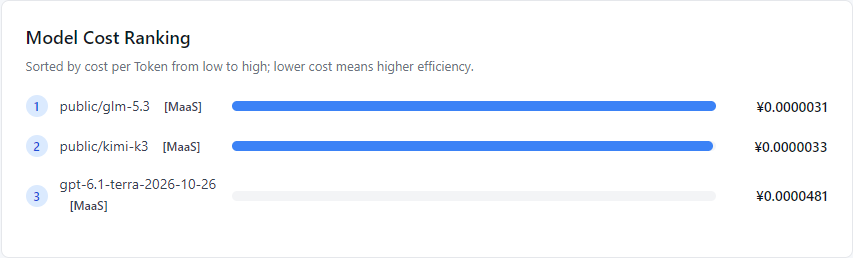

### Workspace Cost Analysis (CSP Mode: Tenant / Customer Cost Analysis)

- **Workspace Mode**: Displays the **Ranking by Workspace** table with **Workspace**, **Cost**, **Usage**, **Calls**, **Growth**, and **Hint**, presenting both high-cost and high-growth workspaces together to help identify rapidly growing consumption.
- **CSP Mode**: Appears as **Tenant / Customer Cost Analysis**, showing revenue, cost, gross margin, and growth by tenant.

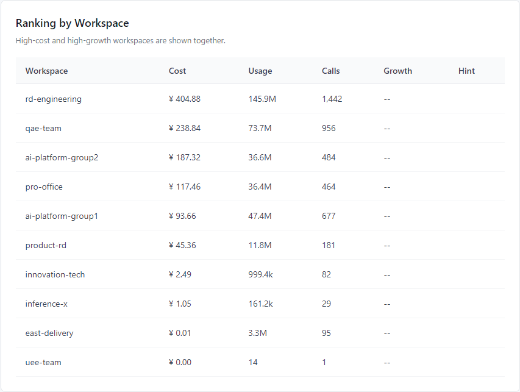

### Endpoint / Deployment Cost Analysis

Displays the **Endpoint / Deployment Cost Analysis** table listing each **Endpoint** (tagged with `[MaaS]` when applicable), **Requests** (average daily volume, e.g., `11.6M/day`), and **Cost**. The list is sorted from highest to lowest cost by default to help evaluate traffic load and cost contribution across endpoints or deployments.

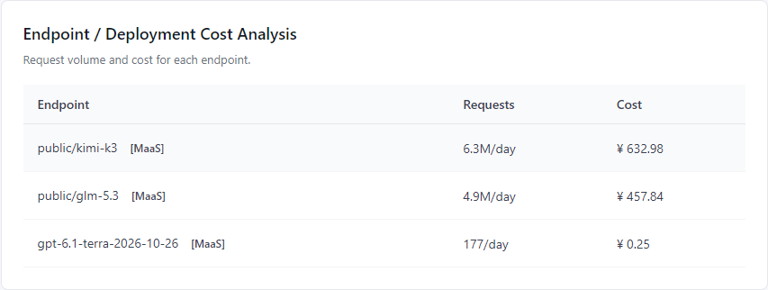

### Revenue / Profit Analysis

Displays the **Revenue / Profit Trend** dual-line chart tracking daily **Revenue Trend**, **Profit Trend**, and gross margin changes, primarily used in CSP mode to monitor billing revenue and profitability.

!!! note

    In Workspace mode where external billing revenue tracking is not enabled, the revenue trend line displays as 0 when no revenue data is available.

### Quota Status (CSP Mode: Budget / Forecast)

- **Workspace Mode**: Provides a standalone real-time **Quota Status** view (independent of the top-right time range selector). Filter workspaces by name using **Filter Workspace...**, review **Quota**, **Used**, **Usage Rate**, **Remaining**, and **Status** (`Exceeded`, `Normal`, `Unlimited`), and switch pagination between `10 / 20 / 50 items` per page.
- **CSP Mode**: Appears as **Budget / Forecast**, displaying monthly budget, current consumption, 7-day and 30-day cost forecasts, and budget alerts.

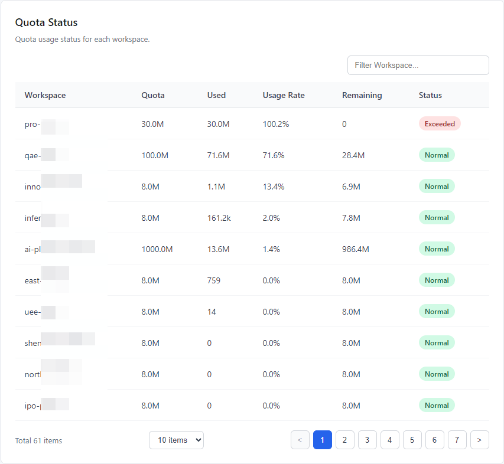
