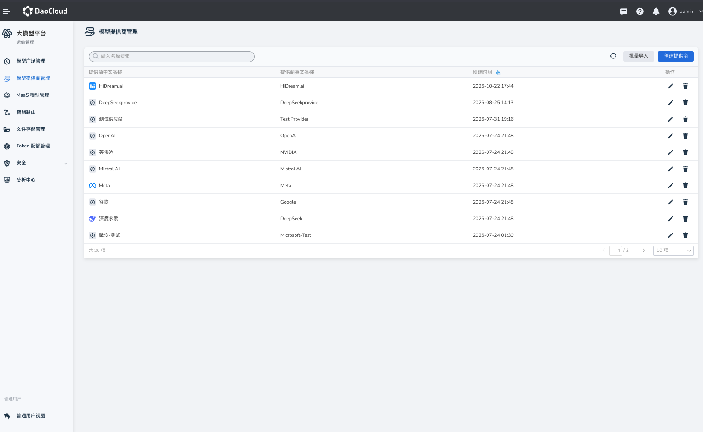

# Model Provider Management

Platform administrators can use **Model Provider Management** to maintain the model service providers available on the platform. The module supports importing providers in batches, creating providers, updating their information, and deleting providers. Provider information is used as a foundation for model onboarding and management.

## Access Model Provider Management

1. Sign in to Hydra with a platform administrator account.
2. Open **Model Provider Management** from **Operations Management** in the LLM platform.

## View Providers

The page lists the configured model providers. Use the available search or filter options to find a provider, then open its details to review its configuration.

## Create a Provider

1. On the Model Provider Management page, click **Create Provider**.
2. Fill in the provider details, such as its Chinese name, English name, and icon. Keep the identifier unique and consistent with the value referenced by model configurations.
3. Review the information and click **Confirm**.
4. Return to the list and verify that the provider appears.

## Update a Provider

1. Find the provider in the list and click **Edit**.
2. Update the required information and save your changes.
3. Return to the list or details page to verify the update.

## Delete a Provider

1. Find the provider in the list and click **Delete**.
2. Verify the provider in the confirmation prompt and confirm the deletion.

Before deleting a provider, check whether any models or other configurations still reference it. Update those configurations first to avoid affecting model management or requests.

## Recommendations

- Use clear, stable provider names and identifiers so administrators can recognize and reference them consistently.
- Check related models and business configurations before updating or deleting a provider.
- Treat login credentials as sensitive information. Distribute them through a controlled channel and replace default credentials promptly.
- Model providers are also loaded as filters on the Model Plaza.
