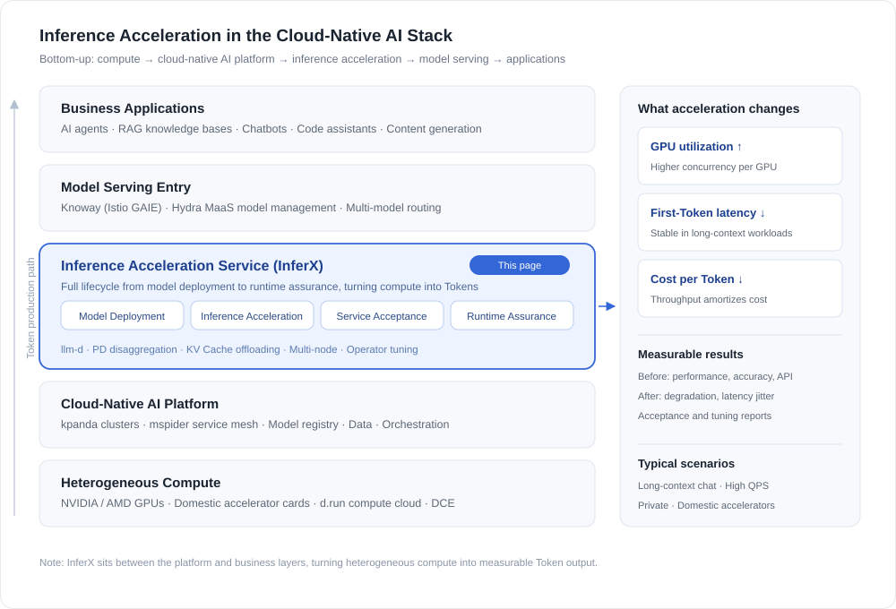

---
hide:
  - toc
---

# Inference Acceleration

The Inference Acceleration Service is an integrated platform for optimizing the inference performance of large models. Built on heterogeneous GPU computing power and a cloud-native foundation, it continuously introduces industry-leading inference architectures and performance optimization techniques to reduce inference costs and improve service efficiency. It also covers the complete lifecycle from model deployment to runtime assurance, helping users build faster, more stable, and more cost-effective large model inference services.

## Architecture Positioning

The Inference Acceleration Service sits in the middle of the cloud-native AI stack rather than at its edge: below it are Kubernetes clusters and heterogeneous GPUs / domestic accelerator cards, above it are model serving entry points (Knoway, Hydra) and business applications such as agents and RAG. It is the layer where compute is turned into Tokens that applications can consume.

Three things define that position:

- **It does not replace inference frameworks**: on top of mainstream frameworks such as vLLM and llm-d, it improves performance through PD disaggregation, KV Cache offloading, multi-node deployment, and scheduling optimization.
- **It is not tied to a single hardware vendor**: the same deployment model runs on NVIDIA / AMD GPUs and domestic accelerator cards, which keeps replacement and scaling straightforward.
- **Its gains are measurable**: pre-rollout acceptance results for performance and accuracy, plus post-rollout monitoring of degradation and latency jitter, so acceleration gains can be verified and regression-tested.

## Core Capabilities

- **Model Deployment: Rapidly deploy high-performance inference services**: Compatible with mainstream inference frameworks and heterogeneous GPUs, supports high-performance architectures such as PD disaggregation and KV Cache offloading, and quickly adapts to new models, new frameworks, and new GPUs / domestic accelerator cards.
- **Inference Acceleration: Continuously improve Token production efficiency**: Based on high-performance inference frameworks, combined with concurrency tuning, long-context, and operator optimization techniques, it improves throughput and GPU utilization while reducing latency and per-Token cost.
- **Service Acceptance: Ensure high-quality rollout of model services**: Before rollout, complete inference performance, model accuracy, API compatibility, and functional tests, and produce standardized acceptance results and performance optimization reports.
- **Runtime Assurance: Ensure stable operation of inference services**: Continuously observe service performance and stability, detect issues such as performance degradation, latency jitter, and traffic bursts in a timely manner, quickly locate runtime risks, and ensure service SLA.

## Quick Start

- [Install Inference Acceleration Service in Offline Environment](guides/offline.md)
- [Enable Istio GAIE Feature in Cluster](guides/enable-istio-gaie-with-mspider.md)
- [Model Weight Download and Configuration](guides/model-weights-setup.md)
- [Expose Model Service Externally (Hydra/Knoway)](guides/export-by-hydra.md)
- [FAQ](faqs.md)

[Download Center](https://docs.daocloud.io/en/download/){ .md-button .md-button--primary }
[Learn about d.run Token Factory](https://docs.daocloud.io/en/tf/){ .md-button .md-button--primary }
[Learn about d.run AI OS](https://docs.daocloud.io/en/drun/){ .md-button .md-button--primary }
