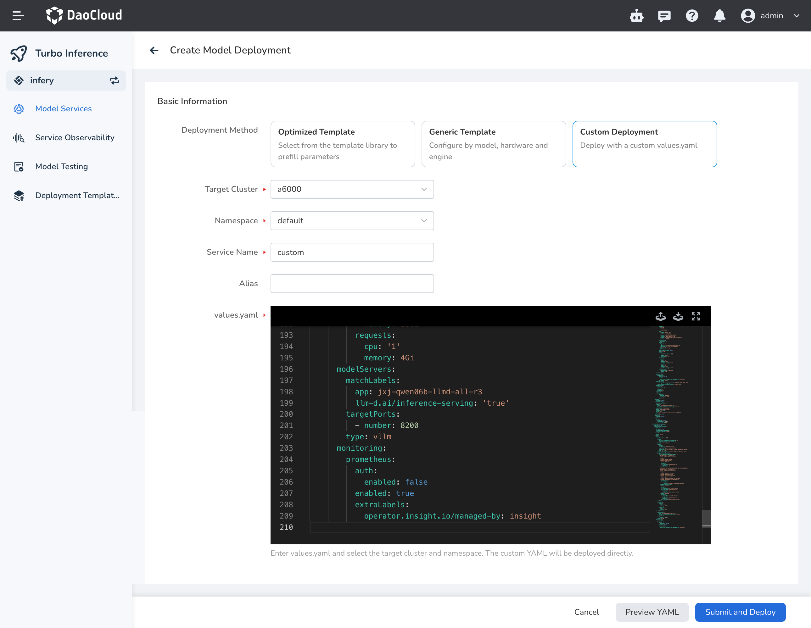

---
hide:
  - toc
---

# Custom Deployment

Custom deployment is suitable for scenarios where you need full control over the deployment configuration: enter a `values.yaml` that matches the platform Helm Chart to directly declare the orchestration framework, service roles, and inference parameters, and the platform deploys exactly as defined in that YAML. It suits automated operations (GitOps, CI pipelines) or scenarios where service configurations need to be managed as code.

## Prerequisites

You have completed [deployment preparation](prerequisites.md) and confirmed that:

- You have the operation permissions for the target cluster and namespace.
- The `values.yaml` you use matches the structure of the Helm Chart of the current platform version.
- Model weights are stored in a PVC in the target namespace, corresponding to `modelArtifacts.uri` in the YAML.

## Steps

1. Navigate to **Turbo Inference** > **Model Services** in the left navigation bar and click **New Deployment**.

2. Select **Custom Deployment** as the deployment method (deploy with a custom `values.yaml`).

3. Select the **Target Cluster** and **Namespace**, and enter the **Service Name**. The **Alias** is optional.

4. Edit **values.yaml**. See the [values.yaml example](#custom-values-example).

    

    Enter the `values.yaml` and select the target cluster and namespace. The custom YAML will be deployed directly.

5. Click **Preview YAML**, verify the service configuration, and click **Submit and Deploy**.

6. **Verify the service**.

    Return to the **Model Services** list and confirm that the service status is **Available** and the resource running status is **Running**. For page locations and status examples, see [service verification steps of the generic template](generic-template.md#verify-service).

## Key Configuration Notes

The following example uses the llm-d orchestration framework to deploy the Qwen3-0.6B model (vLLM engine, PD Aggregated, single A800 GPU). The top-level configuration sections and key configuration items of the YAML are as follows:

| Top-level Section | Purpose |
| --- | --- |
| `dynamo` | Switch for the Dynamo orchestration framework. In the example, `enabled: false` means Dynamo is not enabled. |
| `llm-d-infra` | llm-d infrastructure components (inference gateway). In the example, `enabled: true`. |
| `llm-d-modelservice` | The inference service itself: service roles, model mounting, parallelism strategies, and routing configuration. |
| `llm-d-router-gateway` | llm-d routing and gateway: request entry, EndpointPicker scheduling configuration, and monitoring. |

| Configuration Item | Description |
| --- | --- |
| `accelerator` | Accelerator type `type` and the corresponding resource name, e.g. `nvidia` maps to `nvidia.com/gpu`; domestic accelerator cards map to entries such as `huawei` and `intel-gaudi`. |
| `decode` / `prefill` / `encode` | Service roles; `create` controls whether the role is deployed. In the example, only `decode` is enabled, which means PD Aggregated mode; for PD disaggregation, enable `prefill` as well. |
| `containers.args` | Inference engine startup parameters, such as `--tensor-parallel-size`, `--max-model-len`, `--gpu-memory-utilization`, etc. |
| `containers.image` | `registry` / `repository` / `tag` of the inference image; update them together when using a custom image. |
| `modelArtifacts` | Model source: `uri: pvc://<PVC name>/` specifies the PVC where the weights reside, `mountPath` is the mount path inside the container, and `name` is the model access name. |
| `nodeSelector` | Select nodes by GPU model and vendor, e.g. `node.kpanda.io/gpu-product`. |
| `parallelism` | Parallelism strategy: `tensor` (TP), `data` (DP), `workers`. The values must match the number of GPUs requested for the role. |
| `resources` | CPU, memory, and GPU requests and limits for each role. |
| `routing` | Service ports and routing proxy. After `proxy.enabled` is turned on, `routing-proxy` coordinates request handoff between prefill and decode; required for PD disaggregation. |
| `pluginsCustomConfig` | llm-d EndpointPicker scheduling plugin configuration. The example includes the default scheduling configuration and the `pd-config.yaml` for PD disaggregation; choose based on the actual inference mode. |

The configuration notes are consistent with the [Generic Template](generic-template.md):

- Check that `parallelism` matches the total number of GPUs requested for the role; enabling parallelism options does not automatically increase the requested GPU resources.
- Check the values and formats of startup parameters against the engine version in the actual image, and verify the generated configuration in the YAML preview.
- The initial model load may take a long time. Reserve enough time for the startup check.

## Full values.yaml Example {:#custom-values-example}

<details>
<summary>Expand to view the full values.yaml example (llm-d, PD Aggregated, Qwen3-0.6B)</summary>

```yaml title="values.yaml"
dynamo:
  enabled: false
extraObjects: []
llm-d-infra:
  enabled: true
  llm-d-infra:
    gateway:
      fullnameOverride: ''
      gatewayClassName: istio
      gatewayParameters:
        replicas: 2
      nameOverride: inference-gateway
llm-d-modelservice:
  enabled: true
  llm-d-modelservice:
    accelerator:
      dra: false
      resources:
        amd: amd.com/gpu
        google: google.com/tpu
        hami: nvidia.com/vgpu
        huawei: huawei.com/npu
        intel-gaudi: habana.ai/gaudi
        intel-i915: gpu.intel.com/i915
        intel-xe: gpu.intel.com/xe
        nvidia: nvidia.com/gpu
      type: nvidia
    decode:
      containers:
        - args:
            - --tensor-parallel-size
            - '1'
            - --data-parallel-size
            - '1'
            - --served-model-name
            - Qwen/Qwen3-0.6B
            - --port
            - '8200'
            - --dtype
            - bfloat16
            - --gpu-memory-utilization
            - '0.3'
            - --max-model-len
            - '4096'
            - --max-num-batched-tokens
            - '4096'
            - --max-num-seqs
            - '8'
          command:
            - vllm
            - serve
            - /mnt/data
          env:
            - name: MODEL_PATH
              value: /mnt/data
            - name: ACCESS_MODEL_NAME
              value: Qwen/Qwen3-0.6B
            - name: VLLM_ENGINE_READY_TIMEOUT_S
              value: '1200'
          extraConfig:
            envFrom: []
          image:
            digest: ''
            registry: release-ci.daocloud.io
            repository: vllm/vllm-openai
            tag: v0.27.1
          modelCommand: custom
          mountModelVolume: true
          name: vllm
          ports:
            - containerPort: 8200
              name: http
              protocol: TCP
          resources:
            limits:
              cpu: '2'
              memory: 8Gi
              nvidia.com/gpu: '1'
            requests:
              cpu: '1'
              memory: 4Gi
              nvidia.com/gpu: '1'
          volumeMounts:
            - mountPath: /dev/shm
              name: shm
      create: true
      monitoring:
        podmonitor:
          enabled: true
          labels:
            operator.insight.io/managed-by: insight
          portName: http
      nodeSelector:
        node.kpanda.io/gpu-product: NVIDIA-A800-80GB-PCIe
        node.kpanda.io/gpu-vendor: Nvidia-GPU
      parallelism:
        data: 1
        dataLocal: 1
        tensor: 1
        workers: 1
      replicas: 1
      volumes:
        - emptyDir:
            medium: Memory
            sizeLimit: 16Gi
          name: shm
    encode:
      create: false
    modelArtifacts:
      authSecretName: ''
      labels:
        app: jxj-qwen06b-llmd-all-r3
        llm-d.ai/inference-serving: 'true'
      mountPath: /mnt/data
      name: Qwen/Qwen3-0.6B
      readOnly: true
      size: 5Mi
      uri: pvc://inferx-modelcache-qwen3-0-6b/
    multinode: true
    prefill:
      create: false
    routing:
      proxy:
        enabled: false
        targetPort: 8200
      servicePort: 8000
llm-d-router-gateway:
  enabled: true
  llm-d-router-gateway:
    httpRoute:
      create: true
      inferenceGatewayName: ''
      requestTimeout: 1800s
    provider:
      name: istio
    router:
      epp:
        extProcPort: 9002
        flags:
          metrics-staleness-threshold: 5s
          refresh-metrics-interval: 1s
        haMode: all-active
        image:
          digest: ''
          pullPolicy: IfNotPresent
          registry: ghcr.m.daocloud.io
          repository: llm-d/llm-d-router-endpoint-picker
          tag: v1.0.0
        pluginsConfigFile: inferx-default-plugins.yaml
        pluginsCustomConfig:
          inferx-default-plugins.yaml: |
            apiVersion: llm-d.ai/v1
            kind: EndpointPickerConfig
            plugins:
            - type: queue-scorer
            schedulingProfiles:
            - name: default
              plugins:
              - pluginRef: queue-scorer
                weight: 1.0
          pd-config.yaml: |
            # ALWAYS DO PD IN THIS EXAMPLE (THRESHOLD 0)
            apiVersion: llm-d.ai/v1
            kind: EndpointPickerConfig
            plugins:
            - type: prefill-filter
            - type: decode-filter
            - type: max-score-picker
            - type: queue-scorer
            - type: always-disagg-pd-decider
            - type: disagg-profile-handler
              parameters:
                deciders:
                  prefill: always-disagg-pd-decider
            schedulingProfiles:
            - name: prefill
              plugins:
              - pluginRef: prefill-filter
              - pluginRef: queue-scorer
                weight: 1.0
              - pluginRef: max-score-picker
            - name: decode
              plugins:
              - pluginRef: decode-filter
              - pluginRef: queue-scorer
                weight: 1.0
              - pluginRef: max-score-picker
        replicas: 1
        resources:
          limits:
            cpu: '4'
            memory: 10Gi
          requests:
            cpu: '1'
            memory: 4Gi
      modelServers:
        matchLabels:
          app: jxj-qwen06b-llmd-all-r3
          llm-d.ai/inference-serving: 'true'
        targetPorts:
          - number: 8200
        type: vllm
      monitoring:
        prometheus:
          auth:
            enabled: false
          enabled: true
          extraLabels:
            operator.insight.io/managed-by: insight
```

</details>
