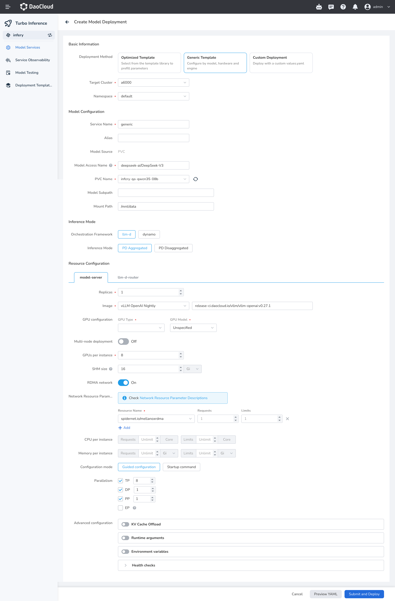
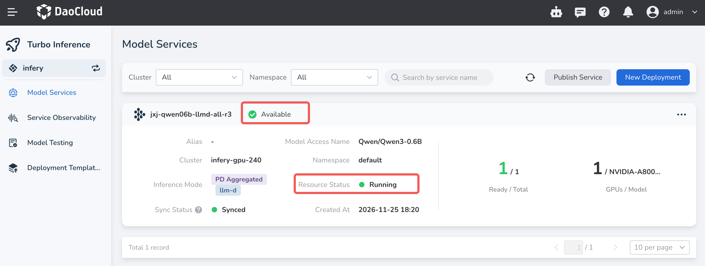
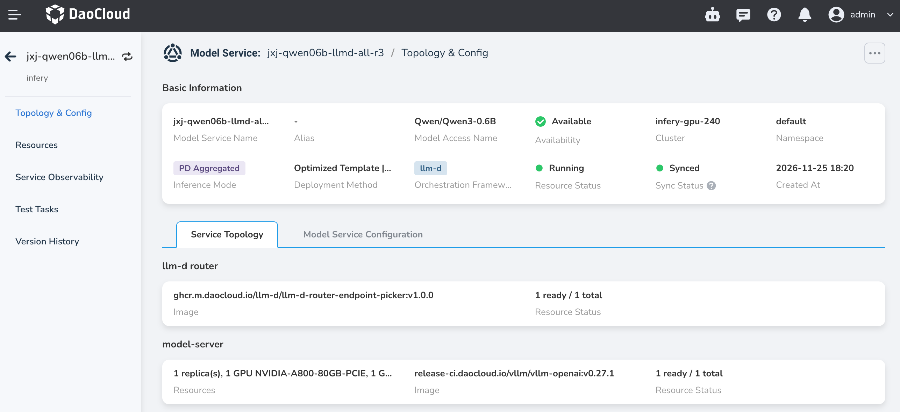
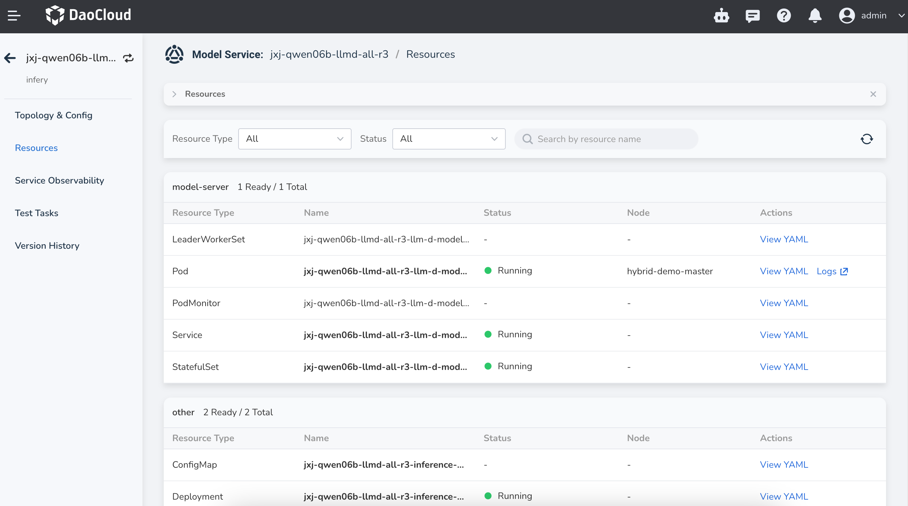
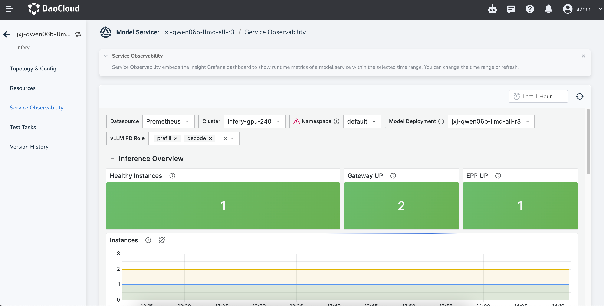

---
hide:
  - toc
---

# Deploy a Model Service with the Generic Template

The generic template supports configuring the model, orchestration framework, inference mode, and compute resources through a form. It is suitable for scenarios where you configure resources based on your actual model and hardware.

## Prerequisites

You have completed [deployment preparation](prerequisites.md) and confirmed that:

- The system components required by Turbo Inference are installed in the target cluster.
- GPU, CPU, memory, and namespace quotas meet the deployment requirements.
- Model weights are stored in a PVC in the target namespace.
- Target nodes can pull an inference image that supports the target model and hardware.
- When using multi-node deployment or PD disaggregation, network and storage conditions meet the deployment plan requirements.

## Steps

1. Navigate to **Turbo Inference** > **Model Services** in the left navigation bar and click **New Deployment**.

2. Select **Generic Template** as the deployment method.

    <!--  English screenshot pending -->

    If you already have a similar optimized template, you can also select that template first and click **Copy Current Template Parameters to Generic Template** to continue configuring based on the pre-filled parameters.

3. Select the **Target Cluster** and **Namespace**. The target cluster should have the required resources, and the namespace should be the same namespace where the model weight PVC resides.

4. Fill in the model information.

    | Parameter | Description |
    | --- | --- |
    | Service Name | Enter the name of this model service, used to identify the service instance in the platform. |
    | Alias | Optional. Enter an easily recognizable service description. |
    | Model Source | Select PVC. |
    | Model Access Name | Enter the model ID used when calling the API. It is recommended to keep it consistent with the official model name. |
    | PVC Name | Select the PVC that stores the model weights; after creating a new PVC, click the refresh button to update the list. |
    | Model Subpath | Enter the actual model directory within the PVC; leave empty if the weights are in the root directory. |
    | Mount Path | Use the path displayed on the page by default: /mnt/data. |

5. In the **Inference Mode** area, select the **orchestration framework** and **inference mode**. Choose llm-d or Dynamo based on the installed components and deployment plan. **PD Aggregated** handles prefill and decode in the same instance; **PD Disaggregated** configures separate prefill and decode instances.

    | Orchestration Framework | Inference Mode | Service Roles to Configure |
    | --- | --- | --- |
    | llm-d | PD Aggregated | `model-server` handles prefill and decode. `llm-d-router` schedules inference requests. |
    | llm-d | PD Disaggregated | `prefill` processes input and generates the KV Cache; `decode` generates output tokens step by step. `routing-proxy` is deployed with `decode` and coordinates request handoff between the two stages. `llm-d-router` schedules inference requests. |
    | Dynamo | PD Aggregated | `Worker Pool` handles prefill and decode. `frontend` provides the request entry point, distributes requests, and returns inference results. |
    | Dynamo | PD Disaggregated | `prefill` processes input and generates the KV Cache; `decode` generates output tokens step by step. `frontend` provides the request entry point, coordinates prefill and decode, and returns inference results. |

6. Switch between role tabs in **Resource Configuration** and complete the configuration for each role. Configuration fields vary by role and task type; refer to the actual page display.

    The configuration of roles that perform inference tasks is complex and directly affects service performance and stability. Check each parameter carefully.

    

    | Parameter | Description |
    | --- | --- |
    | Replicas | Configure the number of resource replicas for the current role. |
    | Image | Select a preset image or enter a custom image address. Check the compatibility between the image version and the deployment plan. |
    | GPU Type and Model | Select based on the actual hardware and deployment plan. |
    | Multi-mode Deployment | Enable when an inference instance needs to run across nodes, and configure the number of nodes and GPUs per instance (per server). |
    | GPUs per Instance | Configure the number of GPUs used by one compute instance. If multi-node deployment is enabled, enter the number of GPUs per server (per instance). |
    | SHM Size | Set the capacity limit of shared memory within the container, used for inter-process communication of inference processes. |
    | RDMA Network | Enable according to the deployment plan; after enabling, fill in the network resource name with its requests and limits (see the network resource parameter descriptions on the page). |
    | CPU / Memory per Instance | Configure the requests and limits for CPU and memory. Set them according to the actual usage of each role during model loading and under the target workload, and check cluster and namespace quotas. |

7. Configure inference parameters for roles that perform inference tasks. You can choose **Guided configuration** or **Startup command**.

    === "Guided configuration"

        Configure parallelism strategies and related parameters through a form.

        <!--  English screenshot pending -->

        | Parameter | Description |
        | --- | --- |
        | TP | Tensor parallelism, which splits model computation across multiple devices. |
        | DP | Data parallelism, which configures compute groups that process requests in parallel. |
        | PP | Pipeline parallelism, which splits the model into stages. |
        | EP | Expert parallelism, applicable to MoE models and engines that support it. EP parallelism = TP × DP |

        | Parameter | Description |
        | --- | --- |
        | KV Cache Offload | When you need KV Cache offload, expand this option and enable it, then enter the actual Redis instance URL and the local cache capacity per GPU. |
        | Runtime arguments | Fill in required inference runtime parameters one by one, such as `--max-model-len` and `--kv-cache-dtype`. |

        **Inference Parameter Checklist**

        - When configuring parallelism strategies, check the parallelism strategy and GPU allocation for each role. Enabling parallelism options does not automatically increase the requested GPU resources. For each replica configured with TP, DP, and PP parallelism strategies, check whether `TP × DP × PP` matches the total number of GPUs configured for that replica. In multi-node deployment, the total is calculated as GPUs per instance multiplied by the number of nodes.
        - **KV Cache Offload** uses the platform's own KV Cache offload solution. Before enabling it, confirm that inference instances can access the configured Redis address. The local cache capacity per GPU multiplied by the number of GPUs per instance should be smaller than the memory per instance, leaving enough space for inference processes.
        - When filling in runtime parameters, check the supported parameters, values, and formats against the engine version in the actual image, and verify the generated parameters in the YAML preview.

    === "Startup command"

        Enter the complete startup method supported by the selected inference framework and engine version.

        <!--  English screenshot pending -->

    Both configuration methods support the following options as needed.

    | Parameter | Description |
    | --- | --- |
    | Environment Variables | Add environment variables as required by the image, referencing Secret, ConfigMap, and other resources. |
    | Health Checks | Configure liveness, readiness, and startup checks as needed. Check the check method, port, path, period, and timeout. |

    The initial model load may take a long time. Reserve enough time for the startup check to avoid repeated restarts during loading.

8. Click **Preview YAML**, verify the service configuration, and click **Submit and Deploy**.

9. **Verify the service**. Return to the **Model Services** list and confirm that the new service status is **Available** and the resource running status is **Running**.

    === "List Status"

        

    === "Topology & Config"

        Click the service card to view details. In **Topology & Config**, check the basic information and the image, resources, and resource status of each role.

        

    === "Resources"

        View the resources and running status of each role on the **Resources** page. If deployment is abnormal, click **Logs** in the **Actions** column of the corresponding Pod row.

        

    === "Service Observability"

        After the service is running, view healthy instances, Gateway UP / EPP UP status, and instance trends in **Service Observability**, which embeds the Insight Grafana dashboard.

        
