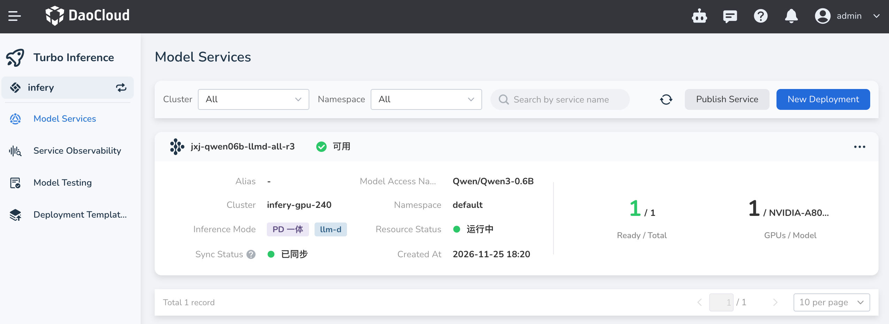

---
hide:
  - toc
---

# Model Services

Model Services are the core use case of Turbo Inference: they combine model weights, an inference engine, and GPU resources, and deploy them in a Kubernetes cluster as an online inference service that exposes APIs. This document introduces the basic concepts and deployment value of model services, and provides overall guidance on deployment paths.

## What is a Model Service

A model service is an inference service deployed in a specified cluster and namespace: organized by model, created from deployment templates or a custom `values.yaml`, and exposing model access capabilities externally. A model service consists of one or more **service roles** that work together to complete the full workflow from receiving requests to returning inference results:

- **Inference role**: loads model weights and performs inference computation such as prefill and decode. It is the primary consumer of GPU resources.
- **Routing role**: such as `llm-d-router` and `frontend`, provides a unified request entry point, distributes requests, connects inference stages, and returns results.

During deployment, the platform mounts model weights from a PVC to inference instances and runs the selected inference engine (such as vLLM) to build the service. Once the service is ready, call the inference API through the **model access name** entered during deployment, for integration with model serving entry points such as Knoway and Hydra, or business applications such as agents and RAG.

On the **Model Services** list page, each service is displayed as a card with key information such as alias, cluster and namespace, inference mode, resource running status, and GPU count and model:

The platform currently supports two high-performance orchestration frameworks and their inference modes, which can be selected by scenario during deployment:

| Orchestration Framework | Inference Mode | Applicable Scenario |
| --- | --- | --- |
| llm-d or Dynamo | PD Aggregated | Prefill and decode are handled by the same instance. The architecture is simple and suitable for small- and medium-scale deployments. |
| llm-d or Dynamo | PD Disaggregated | Prefill and decode are split into separate roles that scale independently, suitable for long-context and high-concurrency scenarios. |

## Why Deploy a Model Service

Holding model weights alone does not provide inference capabilities externally; the weights must be turned into an online service:

| Reason | Description |
| --- | --- |
| Weights require an inference engine to run | Model weights are static files. Only when loaded by an inference engine with GPU computing resources can they respond to inference requests. |
| Production scenarios demand high performance and stability | Barely started inference processes struggle with high-concurrency and long-context workloads. The platform optimizes throughput and latency through PD disaggregation, KV Cache offload, multi-node multi-GPU deployment, and other architectural optimizations, and continuously ensures service quality through service observability. |
| Operational complexity should be abstracted by the platform | Multi-role orchestration, GPU scheduling, RDMA networking, and parallelism strategies (TP/DP/PP/EP) have a high barrier in native Kubernetes. The platform productizes these configurations through templates and forms, reducing deployment and maintenance costs. |
| Business applications need a standardized access method | Once ready, a model service can be uniformly accessed and managed, avoiding resource waste and inconsistent practices caused by business teams building their own inference environments. |

## Deployment Path

Deploying a model service usually involves the following steps:

1. **Complete [deployment preparation](prerequisites.md)**: confirm permissions, cluster components, GPU resources, and inference images, and store model weights in a PVC.
2. **Choose a deployment method**: navigate to **Turbo Inference** > **Model Services** in the left navigation bar, click **New Deployment**, then choose by scenario:

    - [Optimized Template](optimized-template.md): pre-configured templates for specific combinations of model, GPU, and inference engine. Templates marked **Production Ready** have been validated in real environments and are suitable for quick deployment.
    - [Generic Template](generic-template.md): configure resources and inference parameters yourself based on the actual model, hardware, and inference engine, suitable for scenarios without a fully matching template.
    - [Custom Deployment](custom.md): deploy with a `values.yaml` that matches the platform Helm Chart, suitable for automated operations scenarios.

3. **Verify the service**: return to the Model Services list, confirm the service status is **Available** and the resource running status is **Running**; click the service card to view details, check each role in **Topology & Config**, view resource readiness on the **Resources** page, and use **Service Observability** to view healthy instances and instance trends.

Both templates use the same resource configuration and inference parameter conventions; an optimized template is essentially a generic template with these parameters pre-filled. When no template fully matches, copy the parameters of a similar template into the generic template, adjust them, and deploy.
