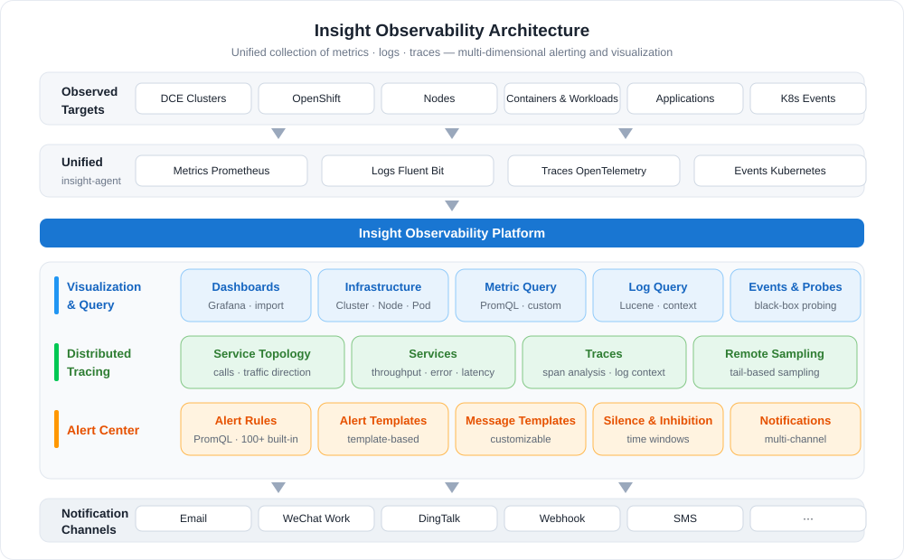
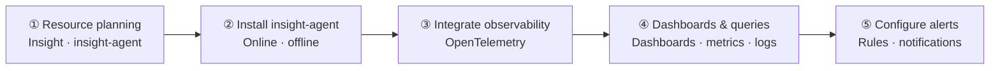

# What is Insight

Insight is a next-generation, cloud native observability platform that focuses on application analysis.
Its out-of-the-box real-time resource monitoring, metrics, logs, events, and other data assist enterprises
in analyzing application status. Furthermore, it is compatible with popular open-source components,
providing alerting, multi-dimensional data visualization, fault locating, and one-click monitoring and diagnosis.

Insight implements unified collection of metrics, logs, and traces, supports multi-dimensional alerting
on metrics and logs, and provides a concise and clear visual management interface.

## Key Capabilities

- :material-monitor-dashboard:{ .lg .middle } __Dashboards__

    ---

    Built-in dashboards based on native Grafana covering platform components, cluster resources, and core components, with support for importing custom templates.

    [:arrow_forward: View dashboards](../user-guide/dashboard/dashboard.md)

- :material-server:{ .lg .middle } __Infrastructure Monitoring__

    ---

    Centralized multi-cluster observability across clusters, nodes, namespaces, and containers, with event query and black-box probing.

    [:arrow_forward: Cluster monitoring](../user-guide/infra/cluster.md)

- :material-chart-line:{ .lg .middle } __Metric & Log Query__

    ---

    Metrics support basic and advanced PromQL queries; logs support keyword search, Lucene syntax, context viewing, and download.

    [:arrow_forward: Metric query](../user-guide/data-query/metric.md)

- :material-transit-connection-variant:{ .lg .middle } __Distributed Tracing__

    ---

    Traces are collected through OpenTelemetry, providing service topology, service lists, and trace analysis for rapid fault locating.

    [:arrow_forward: View traces](../user-guide/trace/trace.md)

- :material-bell-outline:{ .lg .middle } __Alert Center__

    ---

    Over 100 built-in alert rules, custom PromQL rules, message templates, silence and inhibition, with notifications via email, WeChat Work, DingTalk, and more.

    [:arrow_forward: Alert center](../user-guide/alert-center/index.md)

- :material-cog-outline:{ .lg .middle } __Collection & System Config__

    ---

    Manage insight-agent and metric/log collection tasks, and customize the retention duration of metrics, logs, and traces.

    [:arrow_forward: Log collection and query](../user-guide/collection-manag/collection-manag.md)

## Workflow

Using Insight usually involves two stages: **deployment and integration** followed by **observation and alerting**. Administrators plan resources and install insight-agent; business users then integrate application observability, view dashboards and query data, and configure alerts to detect anomalies in time.

| Step | Role | Description |
| ---- | ---- | ----------- |
| ① [Resource planning](../quickstart/res-plan/index.md) | Platform Administrator | Evaluate the node and storage resources required by Insight and insight-agent |
| ② [Install insight-agent](../quickstart/install/install-agent.md) | Platform Administrator | Install the collection components online or offline on observed clusters, and upgrade as needed |
| ③ [Integrate observability](../quickstart/otel/otel.md) | Business User | Collect traces and metrics through OpenTelemetry (non-intrusive Operator or SDK) |
| ④ [Dashboards & queries](../user-guide/dashboard/dashboard.md) | Business User | Understand application and cluster status through dashboards, metric and log queries |
| ⑤ [Configure alerts](../user-guide/alert-center/alert-policy.md) | Platform Administrator | Create alert rules and notification configs to detect anomalies in time |

## Quick Start

  <a class="insight-path-step" style="--path-c:#2196f3" href="../quickstart/res-plan/">
    1
    Resource planning
    Evaluate node and storage resources
    Go →
  </a>
  <a class="insight-path-step" style="--path-c:#00acc1" href="../quickstart/install/install-agent/">
    2
    Install insight-agent
    Online · offline installation
    Go →
  </a>
  <a class="insight-path-step" style="--path-c:#43a047" href="../quickstart/otel/otel/">
    3
    Integrate observability
    Non-intrusive OpenTelemetry
    Go →
  </a>
  <a class="insight-path-step" style="--path-c:#fb8c00" href="../user-guide/dashboard/dashboard/">
    4
    View dashboards
    Metrics · logs · traces
    Go →
  </a>

## Basic concepts

The basic concepts related to observability (Insight) are as follows.

| # | Terms | Definitions |
| - | ----- | ---------- |
| 1 | Target | The monitored object; the system will regularly initiate capture tasks to the monitoring point to obtain metrics |
| 2 | Metric | Use the [open-metric](https://openmetrics.io/) format description to measure the degree of a certain attribute in a software or hardware system |
| 3 | Recording Rule | A named PromQL expression, which is a new metric obtained by calculating multiple metrics to describe a more complete and complex system state |
| 4 | Dashboard | Dashboard is a form of visual management, that is, the performance of data, intelligence and other conditions at a glance. It displays information through various visual perceptions with intuitive images and appropriate colors. Display the real-time situation of the platform and all performance metrics in DCE through visual graphics. |
| 6 | Service Discovery | A service discovery configuration for Kubernetes environment, used to batch and automatically access monitoring points on Kubernetes |
| 7 | Exporter | A service that can provide metrics, often understood as a monitoring object |
| 8 | Rule | A PromQL expression whose return value is a Boolean value, which describes whether the metric or custom metric is within the threshold range, and if not, an alert event will be generated |
| 9 | Alert | The record information when the alert rule is triggered, which records the alert rule, trigger time, and current system status; at the same time, it will trigger the corresponding action, such as sending an email |
| 10 | Notification | The alert event information sent by the system to the user through e-mail or other channels |
| 11 | PromQL | Query statements supported by the Prometheus system |

## More Resources

- :material-format-list-bulleted:{ .lg .middle } __Feature List__

    ---

    A complete list of Insight features across dashboards, infrastructure, metrics and logs, tracing, and the alert center.

    [:arrow_forward: View the feature list](features.md)

- :material-map-outline:{ .lg .middle } __Use Cases__

    ---

    Learn about unified multi-cluster data collection and observability, rapid fault locating and troubleshooting, and other typical use cases.

    [:arrow_forward: View use cases](scenarios.md)

- :material-star-outline:{ .lg .middle } __Benefits__

    ---

    Learn about the advantages of Insight in unified collection, out-of-the-box experience, and ecosystem compatibility.

    [:arrow_forward: View benefits](benefits.md)

- :material-shield-account-outline:{ .lg .middle } __Permissions__

    ---

    Learn about the user roles and permissions required for each Insight feature.

    [:arrow_forward: View permissions](permission.md)

[Download Center](https://docs.daocloud.io/en/download/){ .md-button .md-button--primary }
[Learn about d.run Token Factory](https://docs.daocloud.io/en/tf/){ .md-button .md-button--primary }
[Learn about d.run AI OS](https://docs.daocloud.io/en/drun/){ .md-button .md-button--primary }
[View the Insight User Manual (PDF)](https://harbor-test2.cn-sh2.ufileos.com/docs/download/docs/insight.pdf){ .md-button .md-button--primary }
