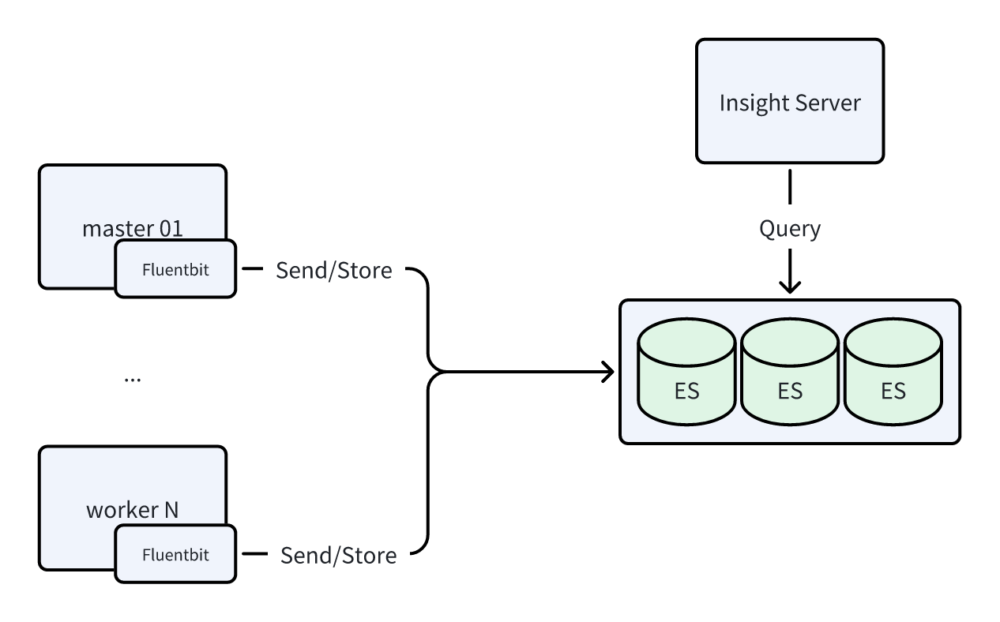
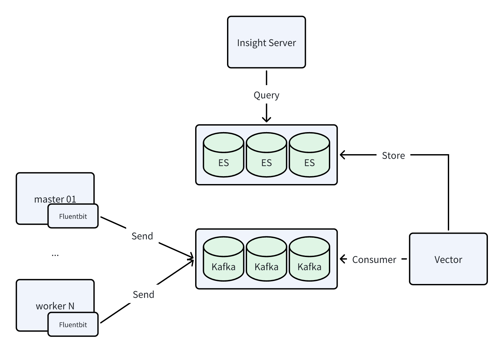
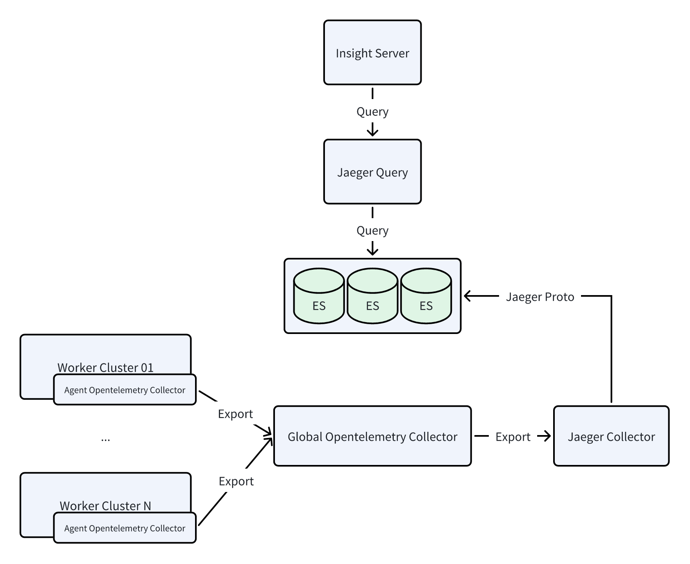
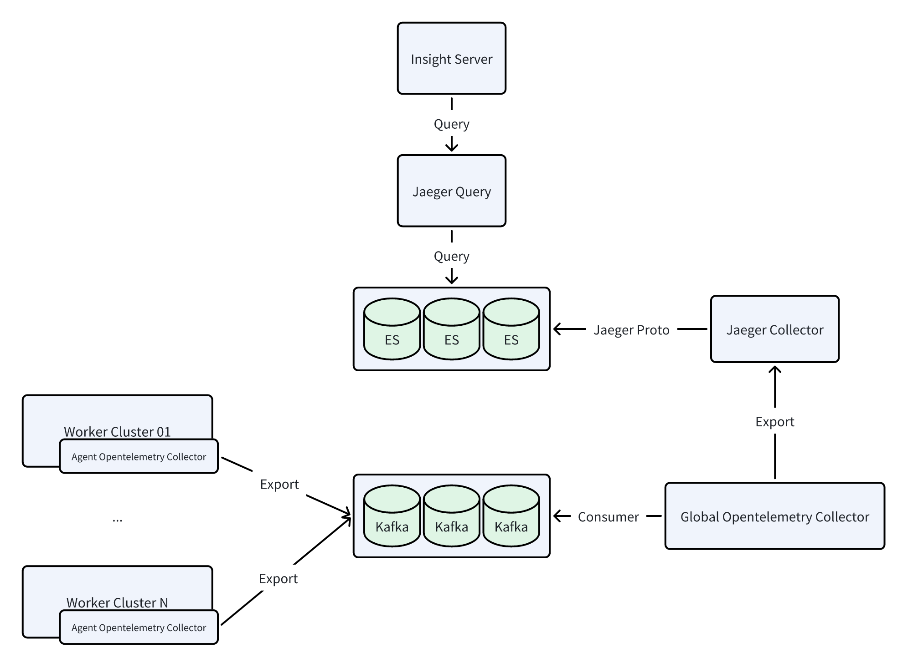

# Enable Big Log and Big Trace Modes

The Insight Module supports switching log to **Big Log** mode and trace to **Big Trace** mode, in order to 
enhance data writing capabilities in large-scale environments. 

This page introduces following methods for enabling these modes:

- Enable or upgrade to Big Log and Big Trace modes [through the installer](#enabling-via-installer) (controlled by the same parameter value in `manifest.yaml`)
- Manually enable Big Log and Big Trace modes [through Helm commands](#enabling-via-helm-commands)

## Logs

This section explains the differences between the normal log mode and the Big Log mode.

### Log Mode

Components: Fluentbit + Elasticsearch

This mode is referred to as the ES mode, and the data flow diagram is shown below:



### Big Log Mode

Components: Fluentbit + **Kafka** + **Vector** + Elasticsearch

This mode is referred to as the Kafka mode, and the data flow diagram is shown below:



## Traces

This section explains the differences between the normal trace mode and the Big Trace mode.

### Trace (OTLP) Mode

This mode is referred to as the OTLP mode.
Note: The trace architecture has been adjusted since version 0.38.x. The data flow diagrams are shown below:

=== "Versions before 0.38.x"

    Components: Agent opentelemetry-collector + Global opentelemetry-collector + Jaeger-collector + Elasticsearch
    

=== "Versions 0.38.x and later"

    Components: Agent opentelemetry-collector + Global opentelemetry-collector + Elasticsearch
    <!--screenshots-->

### Big Trace Mode

This mode is referred to as the Kafka mode.

Note: The trace architecture has been adjusted since version 0.38.x. The data flow diagrams are shown below:

=== "Versions before 0.38.x"

    Components: Agent opentelemetry-collector + Kafka + Global opentelemetry-collector + Jaeger-collector + Elasticsearch
    

=== "Versions 0.38.x and later"

    Components: Agent opentelemetry-collector + Kafka + Global opentelemetry-collector + Elasticsearch
    <!--screenshots-->

## Enabling via Installer

When deploying/upgrading DCE using the installer, the `manifest.yaml` file includes the `infrastructures.kafka` field. 
To enable observable Big Log and Big Trace modes, Kafka must be activated:

```yaml title="manifest.yaml"
apiVersion: manifest.daocloud.io/v1alpha1
kind: DCEManifest
...
infrastructures:
  ...
  kafka:
    enable: true # Default is false
    cpuLimit: 1
    memLimit: 2Gi
    pvcSize: 15Gi
```

### Enable

When using a `manifest.yaml` that enables `kafka` during installation, Kafka middleware will be installed by default, 
and Big Log and Big Trace modes will be enabled automatically. The installation command is:

```bash
./dce5-installer cluster-create -c clusterConfig.yaml -m manifest.yaml
```

### Upgrade

The upgrade also involves modifying the `kafka` field. However, note that since the old environment was installed 
with `kafka: false`, Kafka is not present in the environment. Therefore, you need to specify the upgrade 
for `middleware` to install Kafka middleware simultaneously. The upgrade command is:

```bash
./dce5-installer cluster-create -c clusterConfig.yaml -m manifest.yaml -u gproduct,middleware
```

!!! note

    After the upgrade is complete, you need to manually restart the following components:
    
    - insight-agent-fluent-bit
    - insight-agent-opentelemetry-collector
    - insight-opentelemetry-collector

## Enabling via Helm Commands

Prerequisites: Ensure that there is a **usable Kafka** and that the address is accessible.

Use the following commands to retrieve the values of the old versions of Insight and insight-agent (it's recommended to back them up):

```bash
helm get values insight -n insight-system -o yaml > insight.yaml
helm get values insight-agent -n insight-system -o yaml > insight-agent.yaml
```

### Enabling Big Log

There are several ways to enable or upgrade to Big Log mode:

=== "Upgrade via the Container Management UI"

    1. First, modify the **Insight** Helm app:

        In the **kpanda-global-cluster** management cluster, switch to **Helm Apps** from the left navigation bar, and select and update the **insight** app.

        <!--screenshots-->

        Fill in the Kafka-related configuration and click to confirm the update.

    2. Update the **Insight-Agent** Helm app in the worker cluster:

        In the Container Management module, find the corresponding worker cluster, select **Helm Apps** from the left navigation bar, and find and update **insight-agent**.

        In **Logging Settings**, select **kafka** for **output** and fill in the correct **brokers** address.

        <!--screenshots-->

    Note that after the upgrade is complete, you need to manually restart the **insight-agent-fluent-bit** component.

=== "Use `--set` in the `helm upgrade` command"

    First, run the following Insight upgrade command, ensuring the Kafka brokers address is correct:

    ```bash
    helm upgrade insight insight-release/insight \
      -n insight-system \
      -f ./insight.yaml \
      --set global.kafka.brokers="10.6.216.111:30592" \
      --set global.kafka.enabled=true \
      --set vector.enabled=true \
      --version 0.30.1
    ```

    Then, run the following insight-agent upgrade command, ensuring the Kafka brokers address is correct:

    ```bash
    helm upgrade insight-agent insight-release/insight-agent \
      -n insight-system \
      -f ./insight-agent.yaml \
      --set global.exporters.logging.kafka.brokers="10.6.216.111:30592" \
      --set global.exporters.logging.output=kafka \
      --version 0.30.1
    ```

=== "Modify YAML and run helm upgrade"

    Follow these steps to modify the YAML and then run the `helm upgrade` command:

    1. Modify `insight.yaml`

        ```yaml title="insight.yaml"
        global:
          ...
          kafka:
            brokers: 10.6.216.111:30592
            enabled: true
        ...
        vector:
          enabled: true
        ```

    1. Upgrade the Insight component:

        ```bash
        helm upgrade insight insight-release/insight \
          -n insight-system \
          -f ./insight.yaml \
          --version 0.30.1
        ```

    1. Modify `insight-agent.yaml`

        ```yaml title="insight-agent.yaml"
        global:
          ...
          exporters:
            ...
            logging:
              ...
              kafka:
                brokers: 10.6.216.111:30592
              output: kafka
        ```

    1. Upgrade the insight-agent:

        ```bash
        helm upgrade insight-agent insight-release/insight-agent \
          -n insight-system \
          -f ./insight-agent.yaml \
          --version 0.30.1
        ```


### Enabling Big Trace

There are several ways to enable or upgrade to Big Trace mode:

=== "Upgrade via the Container Management UI"

    1. First, modify the **Insight** Helm app:

        In the **kpanda-global-cluster** management cluster, switch to **Helm Apps** from the left navigation bar, and select and update the **insight** app.

        <!--screenshots-->

        Fill in the Kafka-related configuration and click to confirm the update.

    2. Update the **Insight-Agent** Helm app in the worker cluster:

        In the Container Management module, find the corresponding worker cluster, select **Helm Apps** from the left navigation bar, and find and update **insight-agent**.

        In **Trace Settings**, select **kafka** for **output** and fill in the correct **brokers** address.

        <!--screenshots-->

    Note that after the upgrade is complete, you need to manually restart the **insight-agent-opentelemetry-collector** and **insight-opentelemetry-collector** component.

=== "Using --set in the `helm upgrade` command"

    First, run the following Insight upgrade command, ensuring the Kafka brokers address is correct:

    ```bash
    helm upgrade insight insight-release/insight \
      -n insight-system \
      -f ./insight.yaml \
      --set global.kafka.brokers="10.6.216.111:30592" \
      --set global.kafka.enabled=true \
      --set global.tracing.kafkaReceiver.enabled=true \
      --version 0.30.1
    ```

    Then, run the following insight-agent upgrade command, ensuring the Kafka brokers address is correct:

    ```bash
    helm upgrade insight-agent insight-release/insight-agent \
      -n insight-system \
      -f ./insight-agent.yaml \
      --set global.exporters.trace.kafka.brokers="10.6.216.111:30592" \
      --set global.exporters.trace.output=kafka \
      --version 0.30.1
    ```

=== "Modify YAML and run helm upgrade"

    Follow these steps to modify the YAML and then run the `helm upgrade` command:

    1. Modify `insight.yaml`

        ```yaml title="insight.yaml"
        global:
          ...
          kafka:
            brokers: 10.6.216.111:30592
            enabled: true
        ...
        tracing:
          ...
          kafkaReceiver:
            enabled: true
        ```

    1. Upgrade the Insight component:

        ```bash
        helm upgrade insight insight-release/insight \
          -n insight-system \
          -f ./insight.yaml \
          --version 0.30.1
        ```

    1. Modify `insight-agent.yaml`

        ```yaml title="insight-agent.yaml"
        global:
          ...
          exporters:
            ...
            trace:
              ...
              kafka:
                brokers: 10.6.216.111:30592
              output: kafka
        ```

    1. Upgrade the insight-agent:

        ```bash
        helm upgrade insight-agent insight-release/insight-agent \
          -n insight-system \
          -f ./insight-agent.yaml \
          --version 0.30.1
        ```

## How to Consume Logs and Trace Data in Kafka?

For the specific process, refer to [Using Kafka and Elasticsearch for Large-Scale Log Processing](../../best-practice/insight-kafka.md).

When using the Kafka mode, Insight currently collects four types of data to Kafka: logs, Kube audit, Kube events, and traces. The following are the Kafka Topic names corresponding to each data type:

| Type | Topic Name | Format |
| ---- | ---------- | ------ |
| Logs | Default: insight-logs | JSON |
| Kube Events | Default: insight-event | JSON |
| Kube Audit | Default: insight-kube-audit | JSON |
| Traces | Default: insight-otlp-spans | Protobuf |

The following are sample data of each type in the Kafka Topic:

### Logs

```json
{
    "@timestamp": 1764739584.504833,
    "kubernetes": {
        "container_name": "ebpf-instrument",
        "container_image": "i.sanxian.tech/open-telemetry/opentelemetry-ebpf-instrumentation/ebpf-instrument:v0.1.0",
        "namespace_name": "otel-ebpf-inst",
        "pod_name": "my-opentelemetry-ebpf-instrumentation-zgmkl",
        "pod_ip": "10.233.110.39"
    },
    "_p": "F",
    "time": "2025-12-03T05:26:24.504832869Z",
    "log": "time=2025-12-03T05:26:24.504Z level=INFO msg=\"failed to upload metrics: failed to send metrics to http://insight-agent-opentelemetry-collector.insight-system.svc.cluster.local:4318/v1/metrics: 404 Not Found (body: 404 page not found)\"",
    "tag": "kube.containers",
    "cluster_uuid": "c1ff703c-dc97-44d3-917a-23588b7882cb",
    "cluster_name": "insight-dev"
}
```

### Kube Events

```json
{
    "resourceLogs": [
        {
            "resource": {},
            "scopeLogs": [
                {
                    "scope": {
                        "name": "github.com/open-telemetry/opentelemetry-collector-contrib/receiver/k8sobjectsreceiver",
                        "version": "0.137.0-dev"
                    },
                    "logRecords": [
                        {
                            "observedTimeUnixNano": "1764736302355133267",
                            "body": {
                                "stringValue": "{\"@timestamp\":\"2025-12-03T04:31:42.355133267Z\",\"apiVersion\":\"v1\",\"cluster_name\":\"kpanda-global-cluster\",\"cluster_uuid\":\"a32bf78c-48e6-46a0-9618-a00c235de31e\",\"count\":601,\"eventTime\":null,\"firstTimestamp\":\"2025-12-01T02:31:31Z\",\"involvedObject\":{\"apiVersion\":\"hwameistor.io/v1alpha1\",\"kind\":\"LocalDiskNode\",\"name\":\"cluster-bm-master1\",\"resourceVersion\":\"152713502\",\"uid\":\"29461f1d-cd47-4962-80ba-a7ce9eb24dd9\"},\"kind\":\"Event\",\"lastTimestamp\":\"2025-12-03T04:31:42Z\",\"message\":\"Insufficient storage capacity\",\"metadata\":{\"creationTimestamp\":\"2025-12-01T02:31:31Z\",\"name\":\"cluster-bm-master1.187cf69935559781\",\"namespace\":\"default\",\"resourceVersion\":\"155466075\",\"uid\":\"2558a5c9-ecce-4e07-b930-37195f77326b\"},\"reason\":\"StorageUnAvailable\",\"reportingComponent\":\"\",\"reportingInstance\":\"\",\"source\":{\"component\":\"localdiskmanager/cluster-bm-master1\"},\"time\":\"2025-12-03T04:31:42.355133267Z\",\"type\":\"Warning\"}"
                            }
                        }
                    ]
                }
            ]
        }
    ]
}
```

### Kube Audit

```json
{
    "@timestamp": 1764730101.93227,
    "cluster_uuid": "a32bf78c-48e6-46a0-9618-a00c235de31e", 
    "cluster_name": "kpanda-global-cluster",
    "log": "{\"kind\":\"Event\",\"apiVersion\":\"audit.k8s.io/v1\",\"level\":\"RequestResponse\",\"auditID\":\"b2b57298-3ca4-4acf-b182-8e81abb84d1c\",\"stage\":\"ResponseStarted\",\"requestURI\":\"/api/v1/namespaces/insight-system/pods/prometheus-insight-agent-kube-prometh-prometheus-0/portforward\",\"verb\":\"create\",\"user\":{\"username\":\"admin\",\"groups\":[\"system:authenticated\"]},\"sourceIPs\":[\"127.0.0.1\",\"10.64.0.247\"],\"userAgent\":\"kubectl/v1.27.16 (darwin/arm64) kubernetes/cbb86e0\",\"objectRef\":{\"resource\":\"pods\",\"namespace\":\"insight-system\",\"name\":\"prometheus-insight-agent-kube-prometh-prometheus-0\",\"apiVersion\":\"v1\",\"subresource\":\"portforward\"},\"responseStatus\":{\"metadata\":{},\"code\":101},\"requestReceivedTimestamp\":\"2025-12-03T02:41:53.616485Z\",\"stageTimestamp\":\"2025-12-03T02:41:53.646835Z\",\"annotations\":{\"authorization.k8s.io/decision\":\"allow\",\"authorization.k8s.io/reason\":\"RBAC: allowed by ClusterRoleBinding \\\"kpanda-user-admin-admin\\\" of ClusterRole \\\"role-template-cluster-admin\\\" to User \\\"admin\\\"\"}}"
}
```

### Traces

Refer to [OTLP Trace Protobuf](https://github.com/open-telemetry/opentelemetry-proto/blob/main/opentelemetry/proto/trace/v1/trace.proto)
