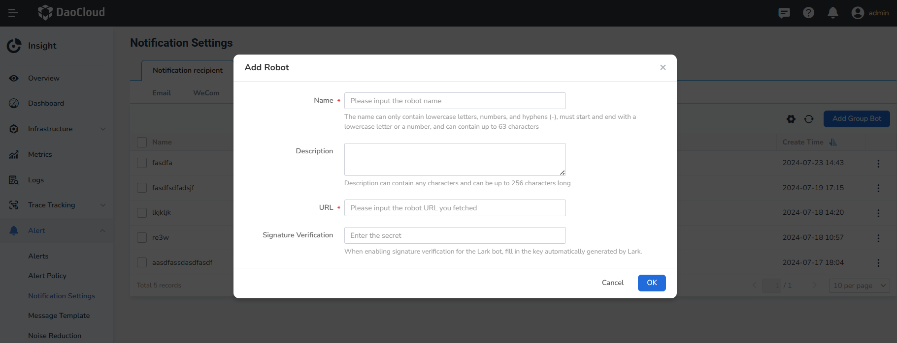
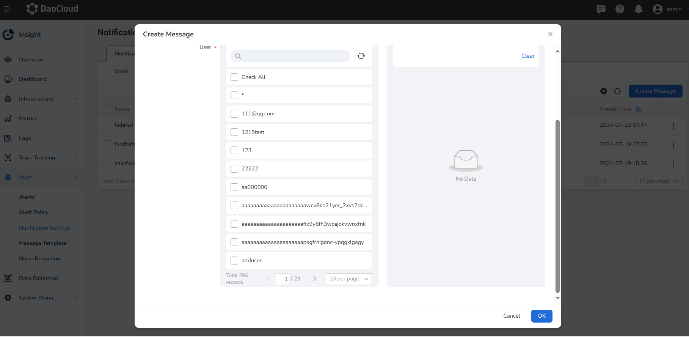

# Notification Settings

On the __Notification Settings__ page, you can configure how to send messages to users through email, WeCom, DingTalk, Webhook, and SMS.

## Email Group

1. After entering __Insight__, click __Alert Center__ -> __Notification Settings__ in the left navigation bar. By default, the email notification object is selected.

    

2. Click __Add email group__ and add one or more email addresses.

    

3. After the configuration is complete, the notification list will automatically return. Click __┇__ on the right side of the list to edit or delete the email group.

## WeCom

1. In the left navigation bar, click __Alert Center__ -> __Notification Settings__ -> __WeCom__.

    

    For the URL of the WeCom group robot, please refer to the [official document of WeCom: How to use group robots](https://developer.work.weixin.qq.com/document/path/91770).

2. Click __Add Group Robot__ and add one or more group robots.

    

3. After the configuration is complete, the notification list will automatically return. Click __┇__ on the right side of the list, select __Send Test Information__, and you can also edit or delete the group robot.

## DingTalk

1. In the left navigation bar, click __Alert Center__ -> __Notification Settings__ -> __DingTalk__. Click __Add Group Robot__ and add one or more group robots.

    

    For the URL of the DingTalk group robot, please refer to the [official document of DingTalk: Custom Robot Access](https://open.dingtalk.com/document/robots/custom-robot-access).

    !!! note

        The signature method is a two-way security authentication between the DingTalk robot and the developer. If signature verification is enabled when creating the DingTalk robot, you need to enter the key generated by DingTalk here.
        Refer to [DingTalk Custom Robot Security Settings](https://open.dingtalk.com/document/robots/customize-robot-security-settings).

1. After the configuration is complete, the notification list will automatically return. Click __┇__ on the right side of the list, select __Send Test Information__, and you can also edit or delete the group robot.

## Lark

1. In the left navigation bar, click __Alert Center__ -> __Notification Settings__ -> __Lark__. Click __Add Group Bot__ and add one or more group bots.

    

    !!! note

        When signature verification is enabled for the Lark group bot, you need to fill in the corresponding signature key when adding a Lark notification. Please refer to the [Customizing Bot User Guide](https://open.feishu.cn/document/ukTMukTMukTM/ucTM5YjL3ETO24yNxkjN?lang=zh-CN).

2. After configuration, you will be automatically redirected to the list page. Click __┇__ on the right side of the list and select __Send Test Message__. You can edit or delete group bots.

## Webhook

1. In the left navigation bar, click __Alert Center__ -> __Notification Settings__ -> __Webhook__.

    

    For the Webhook URL and more configuration methods, please refer to the [webhook document](https://github.com/webhooksite/webhook.site).

2. Click __New Webhook__ and add one or more Webhooks.

    

    `HTTP Headers`: Optional. Set request headers. You can add multiple Headers.

    !!! note

        For the Webhook URL and more configuration methods, please refer to the [webhook document](https://github.com/webhooksite/webhook.site).

3. After the configuration is complete, the notification list will automatically return. Click __┇__ on the right side of the list, select __Send Test Information__, and you can also edit or delete the Webhook.

## Message

!!! note

    Alert messages are sent to the personal message sector. Click the 🔔 icon at the top to view the notification messages.

1. In the left navigation bar, click __Alert Center__ -> __Notification Settings__ -> __Message__, and click Create.

    - Message notifications allow adding multiple users.

    

2. After configuration, you will be automatically redirected to the message notification list. Click __┇__ on the right side of the list and select __Send Test Message__.

## SMS Group

1. In the left navigation bar, click __Alert Center__ -> __Notification Settings__ -> __SMS__. Click __Add SMS Group__ and add one or more SMS groups.

    

2. Enter the name, the object receiving the message, phone number, and notification server in the pop-up window.

    

    The notification server needs to be created in advance under __Notification Settings__ -> __Notification Server__. Currently, two cloud servers, Alibaba Cloud and Tencent Cloud, are supported. Please refer to your own cloud server information for the specific configuration parameters.

    

3. After the SMS group is successfully added, the notification list will automatically return. Click __┇__ on the right side of the list to edit or delete the SMS group.
