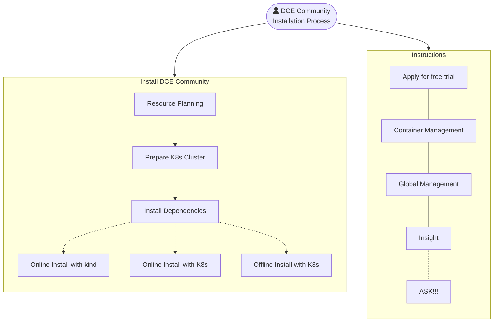
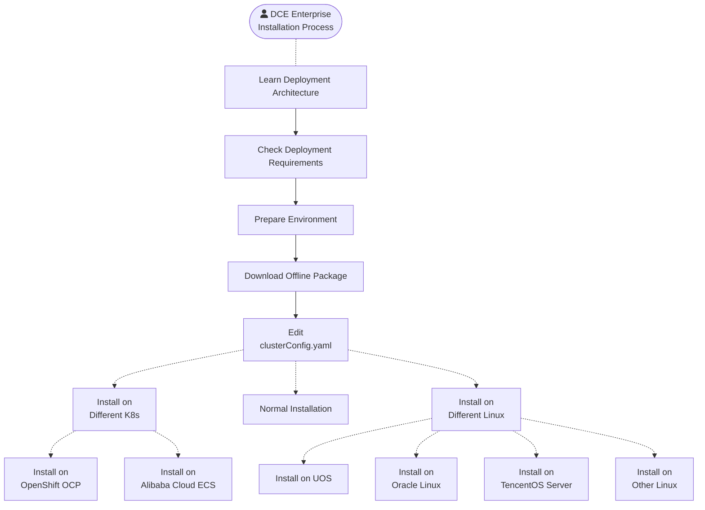

# Overview

DCE has two versions: DCE Community and DCE Enterprise.

- DCE Community includes Container Management, Global Management, and Insight modules,
  which can be used for free permanently.

- DCE Enterprise can be purchased on demand with advanced modules such as Service Mesh,
  Microservice Engine, Multicloud Management, Data Middleware, Container Registry,
  Cloud Edge Collaboration, and Containerized VM on the basis of DCE Community.
  It has more comprehensive features and applicable to a variety of production environments.

<table>
  <thead>
    <tr>
      <th>Releases</th>
      <th>Modules</th>
      <th>Description</th>
    </tr>
  </thead>
  <tbody>
    <tr>
      <td>DCE Community</td>
      <td>
        <ul>
          <li><a href="../ghippo/intro/">Global Management</a></li>
          <li><a href="../kpanda/intro/">Container Management</a></li>
          <li><a href="../insight/intro/">Insight</a></li>
        </ul>
      </td>
      <td>
        <a href="../dce/license0/">Permanently free license</a>, the 3 modules will receive continuous updates, and you can <a href="https://docs.daocloud.io/en/download/#download-modules">download offline packages for sub-modules</a> anytime.
      </td>
    </tr>
    <tr>
      <td>DCE Enterprise</td>
      <td> 
On top of DCE Community, more modules are added:

        <ul>
          <li><a href="../amamba/intro/">Workbench</a></li>
          <li><a href="../kairship/intro/">Multicloud Management</a></li>
          <li><a href="../skoala/intro/">Microservice Engine</a></li>
          <li><a href="../mspider/intro/">Service Mesh</a></li>
          <li><a href="../middleware/">Middleware</a></li>
          <li><a href="../kangaroo/intro/">Container Registry</a></li>
          <li><a href="../kant/intro/">Cloud Edge Collaboration</a></li>
          <li><a href="../virtnest/intro/">Containerized VM</a></li>
          <li><a href="../topohub/intro/">Device Management</a></li>
          <li><a href="../network/intro/">Networking</a></li>
          <li><a href="../storage/hwameistor/intro/">HwameiStor</a></li>
        </ul>
      </td>
      <td>
        Contact us for licensing: email info@daocloud.io or call 400 002 6898. You can freely combine the modules as needed, and <a href="https://docs.daocloud.io/en/download/#download-modules">download offline packages for sub-modules</a> anytime.
      </td>
    </tr>
  </tbody>
</table>

## Install DCE Community

The installation process of DCE Community is as follows:

## Install DCE Enterprise

The installation process of DCE Enterprise is as follows:

## Contact us

The installation guide may change. Please bookmark this page and follow the update information.

- If you have any installation or usage problems, please
  [give us a feedback](https://github.com/DaoCloud/DaoCloud-docs/issues).

- Scan the QR code and communicate with developers freely:

    

[Download Center](https://docs.daocloud.io/en/download/){ .md-button }
[Learn about d.run Token Factory](https://docs.daocloud.io/en/tf/){ .md-button }
[Learn about d.run AI OS](https://docs.daocloud.io/en/drun/){ .md-button }
