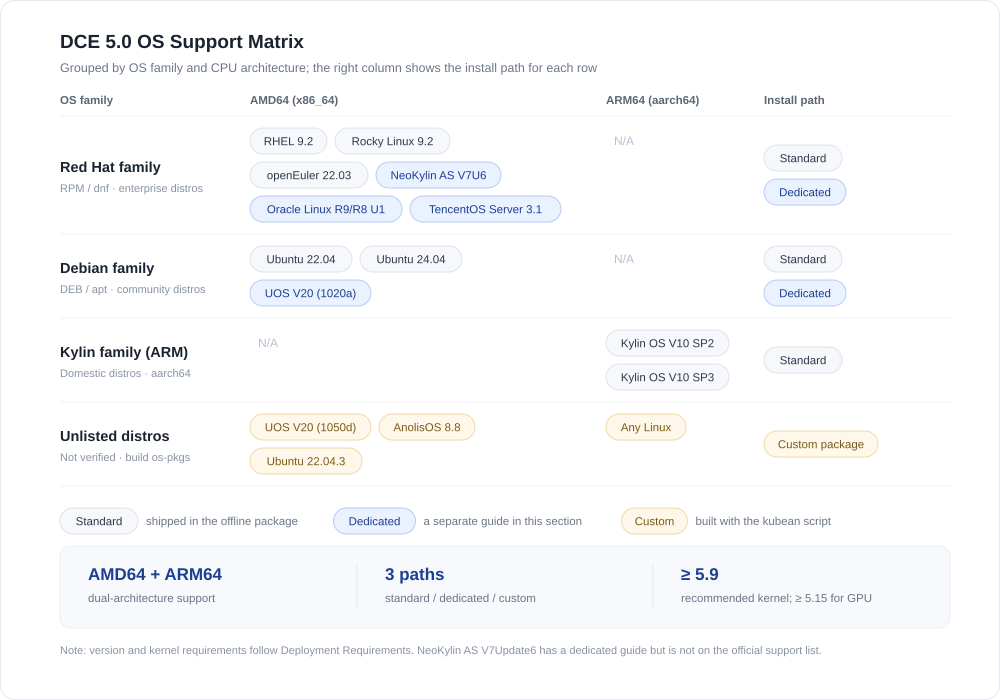
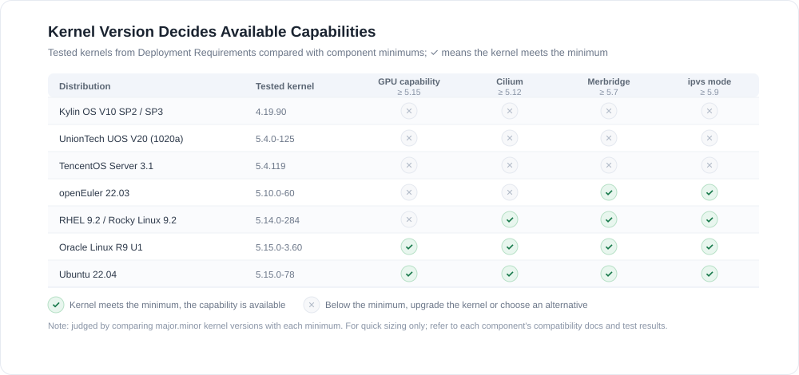

# Supported Operating Systems

DCE 5.0 is deployed with `dce5-installer`. The installer itself only needs basic capabilities such as the Linux kernel, container runtime, and SSH access;
what actually differs between distributions is the **offline OS package (os-pkgs)**.
Support therefore falls into three categories: standard installation covered by the offline package, distributions that need dedicated steps,
and distributions for which you build the OS package yourself.

This page summarizes the operating systems that DCE supports and the installation path for each of them.

!!! tip "Read this first"

    - The complete support list, together with kernel, hardware, network, and port requirements, is maintained in [Deployment Requirements](../commercial/deploy-requirements.md). This page is a summary and index only.
    - A distribution that is not on the list is not necessarily unusable. Build an OS package as described in [Deploy on Other Linux Distributions](otherlinux.md).

## Support Matrix

The figure below lists supported distributions by OS family and CPU architecture, with the matching installation path on the right.

The three installation paths:

- **Standard**: os-pkgs are shipped with the offline package. Follow the enterprise flow in [Installation Overview](../index.md).
- **Dedicated**: the installer needs extra preparation such as an ISO or additional prerequisites. Each case has its own page, see [Dedicated Installation Guides](#dedicated-installation-guides).
- **Custom**: the distribution is not on the official list. Build the os-pkgs with the kubean script first.

## Officially Supported Systems

The table below is taken from [Deployment Requirements](../commercial/deploy-requirements.md), which is the authoritative list of verified distributions.
The kernel column shows the version used by the test team and is a selection reference only.

| Architecture | OS | Tested kernel | Install path |
| ------------ | -- | ------------- | ------------ |
| AMD64 | Red Hat Enterprise Linux 9.2 | 5.14.0-284.11.1.el9_2.x86_64 | Standard |
| AMD64 | Rocky Linux 9.2 | 5.14.0-284.11.1.el9_2.x86_64 | Standard |
| AMD64 | Ubuntu 22.04 | 5.15.0-78-generic | Standard |
| AMD64 | Ubuntu 24.04 | / | Standard |
| AMD64 | openEuler 22.03 | 5.10.0-60.18.0.50.oe2203.x86_64 | Standard |
| AMD64 | UnionTech UOS V20 (1020a) | 5.4.0-125-generic | [Dedicated](uos-v20-install-dce5.0.md) |
| AMD64 | Oracle Linux R9/R8 U1 | 5.15.0-3.60.5.1.el9uek.x86_64 | [Dedicated](oracleLinux-install-dce5.0.md) |
| AMD64 | TencentOS Server 3.1 | 5.4.119-19.0009.14 | [Dedicated](TencentOS-install-dce5.0.md) |
| AMD64 | NeoKylin Linux Advanced Server V7Update6 | / | [Dedicated](neokylin-install-dce5.0.md) |
| ARM64 | Kylin OS V10 SP2 | 4.19.90-24.4.v2101.ky10.aarch64 | Standard |
| ARM64 | Kylin OS V10 SP3 | 4.19.90-89.11.v2401.ky10.aarch64 | Standard |

!!! note "About this table"

    - The kernels listed above are the versions used by the test team, not hard minimums. See [Kernel Requirements](#kernel-requirements) for the actual minimums.
    - CentOS 7 reached end of support on June 30, 2024. Replace it with a distribution that is still maintained, such as Rocky Linux 9.2 or Ubuntu 22.04.
    - On ARM64, only Kylin OS V10 SP2/SP3 are on the official list. Evaluate other ARM64 distributions through the custom OS package path.

## Dedicated Installation Guides

The following distributions require additional preparation. Follow the corresponding page:

-   :material-server:{ .lg .middle } __UnionTech UOS V20 (1020a)__

    ---

    Debian family, supported by installer **v0.6.0** and later. Install `python3.6` on the bootstrap node and build the os-pkgs from the ISO.

    [:octicons-arrow-right-24: Deploy on UOS V20](uos-v20-install-dce5.0.md)

-   :material-database:{ .lg .middle } __Oracle Linux R9/R8 U1__

    ---

    Red Hat family, supported by installer **v0.8.0** and later. Download the official osPackage archive for each of R9 and R8.

    [:octicons-arrow-right-24: Deploy on Oracle Linux](oracleLinux-install-dce5.0.md)

-   :material-cloud-outline:{ .lg .middle } __TencentOS Server 3.1__

    ---

    Red Hat family, supported by installer **v0.9.0** and later. Download the `os-pkgs-tencent31` offline package.

    [:octicons-arrow-right-24: Deploy on TencentOS](TencentOS-install-dce5.0.md)

-   :material-shield-check:{ .lg .middle } __NeoKylin AS V7Update6__

    ---

    Red Hat family. Nodes need `iptables` and `iproute` preinstalled. The page gives the matching offline rpm commands.

    [:octicons-arrow-right-24: Deploy on NeoKylin](neokylin-install-dce5.0.md)

-   :material-laptop:{ .lg .middle } __Other Linux Distributions__

    ---

    Distributions outside the official list. Build an OS package with the kubean script, then install. Verified: UOS V20 (1050d), AnolisOS 8.8 GA, Ubuntu 22.04.3.

    [:octicons-arrow-right-24: Deploy on other Linux](otherlinux.md)

## Kernel Requirements

Whether an operating system can use a given capability often depends on its kernel version rather than on the distribution name.
The figure below puts the tested kernel of each distribution next to the component minimums.

| Component/Feature | Kernel requirement |
| ----------------- | ------------------ |
| Container management GPU capability | ≥ 5.15 |
| Cilium | ≥ 5.12 |
| Merbridge | ≥ 5.7 |
| KubeVirt | > 4.11 |
| HwameiStor DRBD | See [DRBD supported kernels](../../storage/hwameistor/intro/drbd-support.md) |

!!! warning "Kernel considerations"

    - On kernels earlier than 5.9, `kube-proxy` in `ipvs` mode may occasionally add about one second of latency when a Service is accessed from inside the cluster,
      or fail to reach a Service after the backend workload is upgraded. See Kubernetes [Issue #81775](https://github.com/kubernetes/kubernetes/issues/81775).
      Upgrade the kernel to 5.9 or later, switch `kube-proxy` to `iptables` mode, or tune
      `net.ipv4.vs.conntrack`, `net.ipv4.vs.conn_reuse_mode`, and `net.ipv4.vs.expire_nodest_conn`.
    - Ubuntu upgrades the kernel automatically and may reboot as a result. If your software depends on a specific kernel version,
      disable unattended upgrades to avoid compatibility issues.

## Choosing a Distribution

- **You need GPU capability**: prefer Ubuntu 22.04 or Oracle Linux R9 U1, both tested on a 5.15 kernel. On RHEL 9.2, Rocky Linux 9.2, and openEuler 22.03, upgrade the kernel to 5.15 or later first.
- **Xinchuang (domestic) requirements**: on AMD64 use UnionTech UOS V20 (1020a) or NeoKylin AS V7Update6; on ARM64 only Kylin OS V10 SP2/SP3 are on the list.
- **Existing distributions**: UOS V20 (1050d), AnolisOS 8.8 GA, and Ubuntu 22.04.3 are verified, but they need a custom OS package as described in [Deploy on Other Linux Distributions](otherlinux.md).
- **Older kernels (4.19 / 5.4)**: basic deployment works, but Cilium, Merbridge, and GPU capability are limited. Plan a kernel upgrade in advance.

## See Also

- [Deployment Architecture](../commercial/deploy-arch.md): confirm the deployment mode first
- [Deployment Requirements](../commercial/deploy-requirements.md): complete hardware, network, port, and kernel requirements
- [Preparation](../commercial/prepare.md): machine resources and pre-deployment checks
- [Installation Overview](../index.md): installation flow for the Community and Enterprise editions
- [Create Cluster with Non-supported OS](../../kpanda/best-practice/use-otherlinux-create-custer.md): how clusters handle distributions outside the list

[Download Center](https://docs.daocloud.io/en/download/){ .md-button .md-button--primary }
[Learn about d.run Token Factory](https://docs.daocloud.io/en/tf/){ .md-button .md-button--primary }
[Learn about d.run AI OS](https://docs.daocloud.io/en/drun/){ .md-button .md-button--primary }
