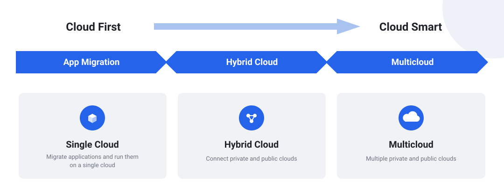
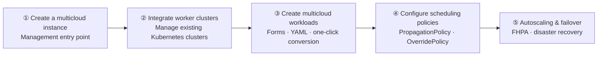

---
hide:
  - toc
---

# Multicloud Management

Multicloud Management (Kairship) is an application-centric, out-of-the-box orchestration platform
for multicloud applications. It enables centralized management of multicloud and hybrid-cloud
environments, providing cross-cloud application deployment, release, and operations capabilities.
It supports application autoscaling based on cluster resources to achieve global load balancing,
and offers failover capabilities that thoroughly address disaster recovery for multicloud applications.
Developers can use multiple clouds as if they were a single Kubernetes cluster: it is compatible
with native Kubernetes APIs, upgrades from single-cluster to multi-cluster with zero modification,
and seamlessly integrates with the existing single-cluster toolchain ecosystem.

## Key Capabilities

- :material-cloud-plus-outline:{ .lg .middle } __Multicloud Application Deployment__

    ---

    Define multi-cluster scheduling requirements with the PropagationPolicy deployment policy, supporting 1:N policy mapping and default policies to distribute workloads across clouds.

    [:arrow_forward: Configure deployment policies](../policy/propagation.md)

- :material-swap-horizontal:{ .lg .middle } __One-Click Conversion__

    ---

    Convert single-cloud workloads to multicloud workloads with one click, migrating existing applications with zero modification.

    [:arrow_forward: One-click conversion](../workload/promote.md)

- :material-tune:{ .lg .middle } __Differentiated Configuration__

    ---

    Automatically generate differentiated configurations for different clusters with OverridePolicy, such as adapting image registry addresses by region or storage classes by cloud vendor.

    [:arrow_forward: Configure override policies](../policy/override.md)

- :material-chart-line:{ .lg .middle } __Global Autoscaling__

    ---

    Scale applications based on cluster resources, with cross-cluster FHPA autoscaling support for global load balancing.

    [:arrow_forward: Cross-cluster autoscaling](../best-practice/fhpa.md)

- :material-cloud-sync-outline:{ .lg .middle } __Failure Recovery__

    ---

    Built-in policy sets for multiple scenarios — two cities and three centers, dual-active within a city, and cross-region disaster recovery — with failover to solve multicloud application disaster recovery.

    [:arrow_forward: Failover](../failover/failover.md)

- :material-cube-outline:{ .lg .middle } __Multicloud Resource Management__

    ---

    Centrally manage multicloud workloads and resources such as ConfigMap, Secret, Service, and Ingress, with support for multicloud custom resources (CRDs).

    [:arrow_forward: Create multicloud workloads](../workload/deployment.md)

## Workflow

Using multicloud management typically involves two phases, **environment preparation** and **application governance**: administrators first create a multicloud instance and integrate worker clusters, then business users create multicloud workloads, configure scheduling policies, and keep applications running stably with autoscaling and failover.

| Step | Role | Description |
| --- | --- | --- |
| ① [Create a multicloud instance](../instance/add.md) | Platform administrator | Create a multicloud instance as the management entry point for multicloud resources and policies |
| ② [Manage worker clusters](../cluster.md) | Platform administrator | Integrate or register member clusters for unified multicloud scheduling |
| ③ [Create multicloud workloads](../workload/deployment.md) | Business user | Create multicloud Deployments via forms or YAML, or [convert](../workload/promote.md) single-cloud applications with one click |
| ④ Configure [deployment policies](../policy/propagation.md) and [override policies](../policy/override.md) | Business user | Define multi-cluster scheduling requirements and generate differentiated configurations per cluster as needed |
| ⑤ [Failover](../failover/failover.md) and [cross-cluster autoscaling](../best-practice/fhpa.md) | Platform administrator | Configure FHPA to handle load fluctuations and use failover to ensure business continuity |

## Basic Concepts

| Concept | Description |
| ------- | ----------- |
| **Resource Template** | The multicloud management software uses Kubernetes native APIs to define federated resource templates, enabling seamless integration with existing Kubernetes tooling. |
| **Deployment Policy** | The multicloud management software provides an independent `PropagationPolicy` API to define multi-cluster scheduling requirements. |
| | - Supports a **1:N policy mapping mechanism**, allowing users to avoid specifying scheduling constraints every time a federated application is created. |
| | - With the **default policy**, users can interact directly with the Kubernetes API. |
| **Differentiation Policy** | The multicloud management software provides an `OverridePolicy` API to automatically generate independent configurations for different clusters. |
| | - Automatically configures different image registry addresses based on the region of the member cluster. |
| | - Uses different storage classes according to cloud vendors of the clusters. |

## Product Advantages

Empowering developers to use **multicloud as if it were a single Kubernetes cluster**, multicloud management offers the following advantages:

| Advantage | Description |
| --------- | ----------- |
| Compatible with Kubernetes native API | Upgrade from single-cluster to multi-cluster with zero modification. |
| Seamless integration with the Kubernetes toolchain ecosystem | Freedom from vendor lock-in: multicloud platform support, automatic allocation, and flexible migration; no dependency on commercial vendor products. |
| Rich multi-cluster scheduling | Cluster affinity scheduling for high-availability multi-cluster deployments with fine granularity; supports multiple regions, availability zones, clusters, and vendors. |
| Open and neutral | Jointly initiated by organizations from internet, finance, manufacturing, telecommunications, and cloud industries; out-of-the-box built-in policy sets for multiple scenarios — dual-active across cities, two-city three-center DR, and cross-region disaster recovery. |
| Centralized management | No need to worry about cluster location; supports public cloud, private cloud, and edge clusters. |

## Quick Start

  <a class="kairship-path-step" style="--path-c:#2196f3" href="../instance/add/">
    1
    Create an instance
    Management entry point
    Go →
  </a>
  <a class="kairship-path-step" style="--path-c:#00acc1" href="../cluster/">
    2
    Integrate clusters
    Manage existing Kubernetes clusters
    Go →
  </a>
  <a class="kairship-path-step" style="--path-c:#43a047" href="../workload/deployment/">
    3
    Create workloads
    Forms · YAML · one-click conversion
    Go →
  </a>
  <a class="kairship-path-step" style="--path-c:#fb8c00" href="../policy/propagation/">
    4
    Configure policies
    PropagationPolicy · OverridePolicy
    Go →
  </a>
  <a class="kairship-path-step" style="--path-c:#8e24aa" href="../failover/failover/">
    5
    Scaling & DR
    FHPA · failover
    Go →
  </a>

## More Resources

- :material-format-list-bulleted:{ .lg .middle } __Features__

    ---

    A complete list of multicloud management capabilities, from one-click conversion and scheduling policies to global load balancing and failover.

    [:arrow_forward: View features](features.md)

- :material-play-circle-outline:{ .lg .middle } __Demo Video__

    ---

    Watch a demo of converting a single-cloud application to a multicloud application with one click.

    [:arrow_forward: Watch the demo](../../videos/use-cases.md#one-click-conversion-to-multicloud)

- :material-chat-question-outline:{ .lg .middle } __FAQ__

    ---

    Common questions and solutions related to multicloud instances, workloads, and policy configuration.

    [:arrow_forward: View FAQ](faq.md)

[Download Center](https://docs.daocloud.io/en/download/){ .md-button }
[Learn about d.run Token Factory](https://docs.daocloud.io/en/tf/){ .md-button }
[Learn about d.run AI OS](https://docs.daocloud.io/en/drun/){ .md-button }
[View the Multicloud Management User Guide (PDF)](https://harbor-test2.cn-sh2.ufileos.com/docs/download/docs/kairship.pdf){ .md-button }
