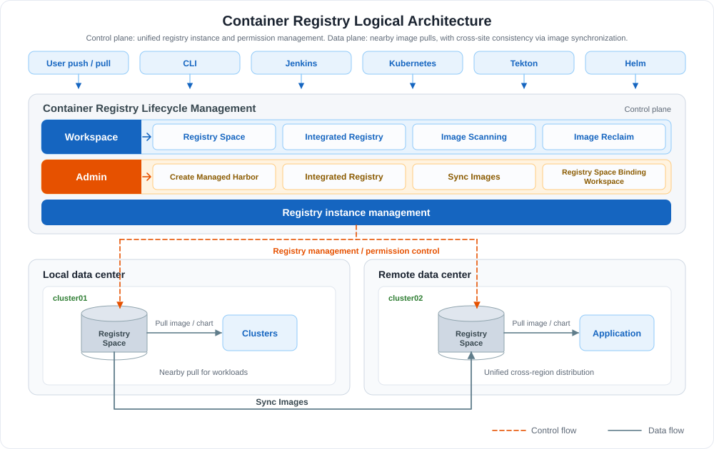

# What is a Container Registry

Kangaroo (container registry) is a cloud native image hosting service that supports deploying registry instances to any cloud native infrastructure and integrating existing Harbor Registry, Docker Registry, and JFrog Registry.
By binding private registry spaces to workspaces (tenants), image assets can be allocated in isolation to one or more workspaces, or a registry space can be exposed to all Kubernetes namespaces in a cluster; together with the "Select Image" capability of [Container Management](../../kpanda/intro/index.md), applications can be deployed quickly.

## Product Logic Architecture

The architecture consists of a control plane and a data plane:

| Plane | Role/Component | Responsibility | In the diagram |
| --- | --- | --- | --- |
| **Control plane** | Workspace | Uses Registry Space, Integrated Registry, Image Scanning, and Image Reclaim | Blue group |
| **Control plane** | Admin | Creates managed Harbor, integrates registries, configures image synchronization, and binds registry spaces to workspaces | Orange group |
| **Control plane** | Registry instance management | Centrally manages registry instances across data centers and delivers registry management and permission control policies to local and remote clusters | Orange dashed line |
| **Data plane** | Clusters | Pull `image / chart` from the registry in their data center and deploy applications | Gray solid line |
| **Data plane** | Sync Images | Keeps artifacts consistent between the registries in both data centers | Gray solid line |

## Key Capabilities

The container registry is a shared image hosting module across product lines, covering the full chain of registry instances, image assets, and application delivery:

-   :material-cog-outline:{ .lg .middle } __Full Lifecycle Management__

    ---

    Provides full lifecycle management of the container registry through managed Harbor, including creating, editing, and deleting registry instances, with unified management of multiple instances.

    [:arrow_forward: Managed Harbor](../managed/intro.md)

-   :material-transit-connection-variant:{ .lg .middle } __Integrated External Registries__

    ---

    Allows administrators to integrate external registries and allocate registry spaces to one or more workspaces (tenants); workspaces can also integrate external container registries independently.

    [:arrow_forward: Integrated Registry (Admin)](../integrate/integrate-admin/integrate-admin.md)

-   :material-security:{ .lg .middle } __Image Scanning__

    ---

    Supports image scanning to identify security risks in images; image security scanning can also be enabled in offline environments.

    [:arrow_forward: Image Scanning](../space/scan.md)

-   :material-send-outline:{ .lg .middle } __Convenient Application Deployment__

    ---

    Works with the Container Management module to select images quickly through the "Select Image" feature and complete application deployment.

    [:arrow_forward: Learn about Container Management](../../kpanda/intro/index.md)

-   :material-autorenew:{ .lg .middle } __Image Synchronization__

    ---

    Supports both manual and scheduled synchronization: images can be synchronized to a target repository, or from a target repository to the local repository.

    [:arrow_forward: Configure Image Synchronization](../integrate/integrate-admin/sync.md)

-   :material-cube-outline:{ .lg .middle } __Image Reclaim__

    ---

    Supports image retention rules that move matching images to the recycle bin manually or on a schedule to control repository capacity.

    [:arrow_forward: Image Reclaim](../space/reclaim.md)

## Next Steps

Choose the documentation to read next based on your role or task:

-   :material-run-fast:{ .lg .middle } __Quick Start__

    ---

    - [Manage External Registry](../quickstart/registry-in-one.md)
    - [Push Image](../quickstart/push.md)
    - [Admin Guide](../quickstart/admin-registry.md)

-   :material-connection:{ .lg .middle } __Registry Integration and Registry Space__

    ---

    - [Integrated Registry (Admin)](../integrate/integrate-admin/integrate-admin.md)
    - [Integrated Registry (Workspace)](../integrate/integrate-ws.md)
    - [Registry Space](../space/index.md)

-   :material-database-outline:{ .lg .middle } __Managed Harbor__

    ---

    - [Managed Harbor](../managed/intro.md)
    - [Create Harbor Instance](../managed/harbor.md)
    - [Registry Capacity Resource Planning](../best-practice/capacity-planning.md)

[Download Center](https://docs.daocloud.io/en/download/){ .md-button }
[Learn about d.run Token Factory](https://docs.daocloud.io/en/tf/){ .md-button }
[Learn about d.run AI OS](https://docs.daocloud.io/en/drun/){ .md-button }
[View the Container Registry User Manual (PDF)](https://harbor-test2.cn-sh2.ufileos.com/docs/download/docs/kangaroo.pdf){ .md-button }
