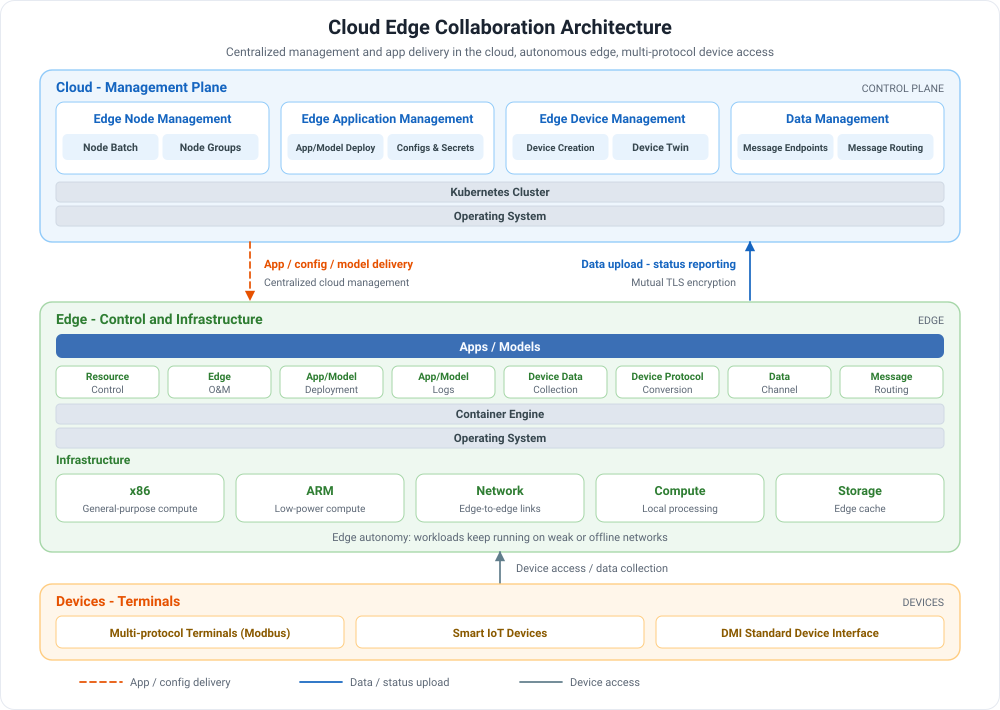

# What is Cloud Edge Collaboration

The number of IoT access nodes is growing explosively, and centralized cloud computing can no longer meet the requirements for transmitting and processing massive volumes of data in real time. Cloud Edge Collaboration (Kant) extends cloud-native capabilities to the edge with an integrated device-edge-cloud architecture, moving data processing, business applications, and AI models down to the edge for execution. The cloud manages edge nodes, applications, and devices centrally; the edge keeps running autonomously on weak or offline networks; and the device side supports multi-protocol terminal access. This addresses response latency, data privacy, and maintenance convenience in industrial Internet, smart factories, smart parks, smart retail, and similar scenarios.

## Product Architecture

The architecture consists of three layers, from top to bottom: cloud, edge, and devices.

| Layer | Component | Responsibility | In the diagram |
| --- | --- | --- | --- |
| **Cloud** | Management plane | Centrally manages edge nodes, delivers applications and models, manages device twins, and configures message endpoints and routes | Blue area |
| **Cloud** | Kubernetes cluster / operating system | Hosts the cloud control plane, delivers applications, configurations, and models to the edge, and receives data and status reports | Blue bars, orange dashed line |
| **Edge** | Applications / models, edge control | Runs containerized applications and models; provides resource control, edge O&M, device data collection and protocol conversion, and data channels | Green area |
| **Edge** | Container engine, operating system, infrastructure | Runs on x86, ARM, and network, compute, and storage resources; keeps workloads running on weak or offline networks | Green base |
| **Devices** | Multi-protocol terminals and smart IoT devices | Connect to edge nodes through protocols such as Modbus and the DMI standard interface; collect and report data nearby | Orange area, gray arrows |

## Key Capabilities

Cloud Edge Collaboration provides a complete set of capabilities around edge nodes, applications and models, end devices, and data collaboration:

-   :material-server-network:{ .lg .middle } __Edge Node Management__

    ---

    Supports onboarding a vast number of edge nodes with token- or certificate-based management, and enables unified management, monitoring, and operation of nodes and node groups from the cloud.

    [:arrow_forward: Overview of Edge Nodes](../user-guide/node/index.md)

-   :material-cube-outline:{ .lg .middle } __Edge Applications and Models__

    ---

    Packages applications or models as container images and deploys them to edge nodes quickly; provides runtime data, events, and logs, as well as CPU / GPU scheduling.

    [:arrow_forward: Overview of Edge Applications](../user-guide/edge-app/index.md)

-   :material-developer-board:{ .lg .middle } __End Device Access__

    ---

    Supports terminal access over multiple protocols such as Modbus, connects device capabilities through the standard DMI, and manages devices and device twins centrally from the cloud.

    [:arrow_forward: End Device Overview](../user-guide/device/index.md)

-   :material-transit-connection-variant:{ .lg .middle } __Edge-Cloud Message Routing__

    ---

    Configures message routing rules to forward edge messages by path to REST, EventBus, ServiceBus, and other endpoints; supports bidirectional cloud-edge transfer of unstructured data such as images and videos.

    [:arrow_forward: Edge-Cloud Messages](../user-guide/route/index.md)

-   :material-lan:{ .lg .middle } __Edge Mesh__

    ---

    Implements a closed loop of edge business traffic through service discovery and traffic proxy, solving edge-to-edge communication problems in edge scenarios.

    [:arrow_forward: Edge Mesh Overview](../user-guide/edge-network/index.md)

-   :material-shield-check-outline:{ .lg .middle } __Edge Autonomy and Security__

    ---

    Edge nodes remain self-managing on weak or offline networks; provides platform, folder, and workspace-level permissions, mutual cloud-edge TLS encryption, and audit logs.

    [:arrow_forward: Product Advantages](benefits.md)

## Learning Path

Follow these steps in order to go from creating an edge unit to enabling cloud-edge data transfer:

  <a class="kant-path-step" style="--path-c:#2196f3" href="../user-guide/edge-unit/create-internal-unit/">
    1
    Create Edge Unit
    Create an internal edge unit
    Go →
  </a>
  <a class="kant-path-step" style="--path-c:#00acc1" href="../user-guide/node/access-guide/">
    2
    Onboard Node
    Register a node with a token or certificate
    Go →
  </a>
  <a class="kant-path-step" style="--path-c:#43a047" href="../user-guide/edge-app/create-app/">
    3
    Deploy App
    Run an app or model on edge nodes
    Go →
  </a>
  <a class="kant-path-step" style="--path-c:#fb8c00" href="../user-guide/device/create-device-model/">
    4
    Connect Devices
    Define device models, add devices and set routes
    Go →
  </a>

[Download Center](https://docs.daocloud.io/en/download/){ .md-button }
[Learn about d.run Token Factory](https://docs.daocloud.io/en/tf/){ .md-button }
[Learn about d.run AI OS](https://docs.daocloud.io/en/drun/){ .md-button }
[View User Manual (PDF)](https://harbor-test2.cn-sh2.ufileos.com/docs/download/docs/kant.pdf){ .md-button }
