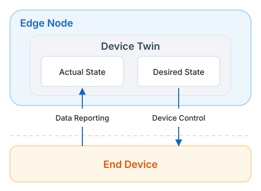

---
hide:
  - toc
---

# End Device Overview

An end device is the layer closest to the physical world in the device-edge-cloud architecture of Cloud Edge Collaboration. It can range from sensors and controllers to smart cameras or industrial computers. End devices connect to edge nodes over protocols such as Modbus and are then managed centrally from the cloud. The platform uses a **device model** to describe the information a device exposes and a **device twin** to record its live state; together they form the cloud-side digital view of the device.

## Key Concepts

| Concept | Description |
| --- | --- |
| **End Device** | A physical device connected to an edge node, accessible over protocols such as Modbus. Once connected, it can be managed centrally from the cloud, including its basic information, twin attributes, labels, and access settings. See [Create End Device](./create-device.md). |
| **Device Model** | A digital representation of an end device in the cloud. It abstracts the common characteristics of a device type into a data model, using attributes to define the device and the information it can provide externally. See [Create Device Model](./create-device-model.md). |
| **Device Twin** | The dynamic data of an end device (twin attributes). It records both the **desired value** set by applications and the **actual value** reported by the device, such as the on/off status of a light. See [Manage End Device](./manage-device.md). |

## How Device Twin Works

A device twin has the same characteristics as the physical device and acts as the intermediary between the device and applications: commands sent by an application first reach the device twin and update its desired state, while the device reports its actual state in real time; the twin records both values.

| Action | Direction | Effect |
| --- | --- | --- |
| **Data Reporting** | End device → Edge node (actual state) | The device writes its live state into the actual value of the device twin for applications on the edge node to read. |
| **Device Control** | Edge node (desired state) → End device | An application changes the desired value of the device twin, which the edge node sends down to the device to change its state. |
| **State Synchronization** | Device offline → Back online | When the device comes back online, it resynchronizes from the state kept in the device twin without being reconfigured. |

In the Cloud Edge Collaboration module, an end device can be created and associated with an edge node. Once associated, the twin attribute information of the device is stored on the edge node. Applications running on the edge node can read the actual values of the twin attributes and modify the desired values to change the device's state.

## Workflow

The typical steps for managing and controlling end devices are as follows:

-   :one: __[Create Device Model](./create-device-model.md)__

    ---

    Abstract the common characteristics of a device type and use attributes to define the data the device provides.

-   :two: __[Create End Device](./create-device.md)__

    ---

    Create a device instance in an edge unit and fill in its basic information and access settings.

-   :three: __Associate with an Edge Node__

    ---

    Bind the device to an edge node. The edge node then stores the device's twin attributes, and the device starts reporting state and receiving commands.

-   :four: __[Manage and Monitor](./manage-device.md)__

    ---

    Edit basic information, twin attributes, labels, and access settings, and monitor device status.

[Download Center](https://docs.daocloud.io/en/download/){ .md-button }
[Learn about d.run Token Factory](https://docs.daocloud.io/en/tf/){ .md-button }
[Learn about d.run AI OS](https://docs.daocloud.io/en/drun/){ .md-button }
