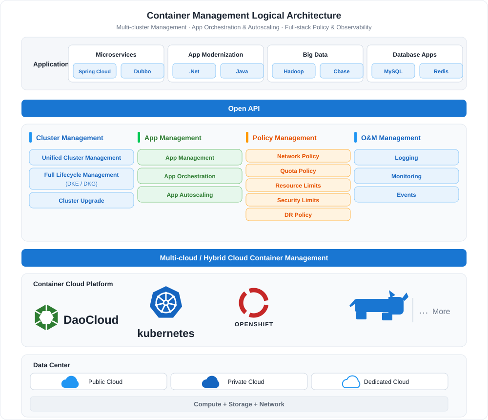
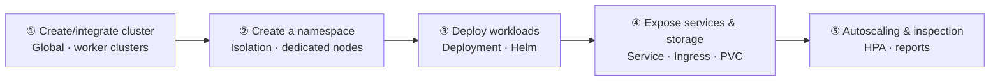

---
hide:
  - toc
---

# Container Management

Container management is a containerization management module for cloud native applications
built on Kubernetes. Based on a native multi-cluster architecture,
it decouples the underlying infrastructure to achieve unified management across multiple clouds and clusters.
This greatly simplifies the process of migrating enterprise applications to the cloud and reduces
operational and manpower costs. With container management, you can easily create Kubernetes clusters
and quickly build an enterprise-grade container cloud management platform.

## Key Capabilities

- :material-server:{ .lg .middle } __Cluster Management__

    ---

    Supports four cluster types — global service cluster, management cluster, worker cluster, and integrated cluster — covering creation, integration, upgrade, roles and status, and runtime selection.

    [:arrow_forward: Create a cluster](../user-guide/clusters/create-cluster.md)

- :fontawesome-brands-node:{ .lg .middle } __Nodes & Namespaces__

    ---

    Node scheduling, labels and annotations, taint management, scale-out/in, and availability checks; namespace isolation, dedicated nodes, and Pod security policies.

    [:arrow_forward: Node scheduling](../user-guide/nodes/schedule.md)

- :octicons-tasklist-16:{ .lg .middle } __Workloads & Autoscaling__

    ---

    Create Deployments, StatefulSets, DaemonSets, and Jobs/CronJobs, and scale workloads automatically with HPA and VPA policies.

    [:arrow_forward: Create a Deployment](../user-guide/workloads/create-deployment.md)

- :simple-helm:{ .lg .middle } __Helm Apps__

    ---

    Hundreds of Helm charts for one-click deployment, with app and repository management to bring business applications online quickly.

    [:arrow_forward: Browse Helm charts](../user-guide/helm/README.md)

- :material-dot-net:{ .lg .middle } __Networking & Storage__

    ---

    Manage traffic and routing with Services, Ingresses, and NetworkPolicies; native CSI support for dynamic provisioning, volume snapshots, and cloning.

    [:arrow_forward: Services](../user-guide/network/create-services.md)

- :material-security:{ .lg .middle } __Security & Inspection__

    ---

    Compliance, permission, and vulnerability scans for nodes and clusters; cluster inspection checks the overall health status automatically or on demand.

    [:arrow_forward: Create an inspection](../user-guide/inspect/config.md)

## Workflow

Using container management typically involves two stages: **platform preparation** and **running applications**. Administrators first create or integrate clusters and plan namespaces; business users then deploy workloads and expose services, with autoscaling and inspection keeping applications healthy over time.

| Step | Role | Description |
| ---- | ---- | ----------- |
| ① [Create/integrate a cluster](../user-guide/clusters/create-cluster.md) | Platform Administrator | Create global service, management, and worker clusters, or integrate existing Kubernetes clusters |
| ② [Create a namespace](../user-guide/namespaces/createns.md) | Platform Administrator | Define resource isolation boundaries, with dedicated nodes and Pod security policies |
| ③ [Deploy workloads](../user-guide/workloads/create-deployment.md) | Business User | Deploy Deployments, StatefulSets, and more from images or Helm charts |
| ④ [Expose services](../user-guide/network/create-services.md) and [mount storage](../user-guide/storage/pvc.md) | Business User | Create Services / Ingresses to expose applications, and mount persistent storage through PVCs |
| ⑤ [Autoscaling & inspection](../user-guide/scale/create-hpa.md) | Platform Administrator | Configure HPA/VPA for load fluctuations, and run periodic inspections for cluster health |

## Quick Start

  <a class="kpanda-path-step" style="--path-c:#2196f3" href="../user-guide/clusters/create-cluster/">
    1
    Create a cluster
    Create or integrate Kubernetes clusters
    Go →
  </a>
  <a class="kpanda-path-step" style="--path-c:#00acc1" href="../user-guide/namespaces/createns/">
    2
    Create a namespace
    Isolation · dedicated nodes
    Go →
  </a>
  <a class="kpanda-path-step" style="--path-c:#43a047" href="../user-guide/workloads/create-deployment/">
    3
    Deploy workloads
    Deployments · Helm charts
    Go →
  </a>
  <a class="kpanda-path-step" style="--path-c:#fb8c00" href="../user-guide/network/create-services/">
    4
    Expose services
    Services · Ingresses · PVCs
    Go →
  </a>
  <a class="kpanda-path-step" style="--path-c:#8e24aa" href="../user-guide/scale/create-hpa/">
    5
    Autoscaling
    HPA · VPA policies
    Go →
  </a>

## More Resources

- :material-format-list-bulleted:{ .lg .middle } __Features__

    ---

    A complete list of container management features across clusters, nodes, workloads, networking and storage, security, and inspection.

    [:arrow_forward: View features](features.md)

- :material-map-outline:{ .lg .middle } __Scenarios__

    ---

    Best practices for multi-cluster management, application delivery, hybrid cloud, and more.

    [:arrow_forward: View scenarios](scenarios.md)

- :material-chat-question-outline:{ .lg .middle } __FAQ__

    ---

    Common questions and solutions about cluster creation, workload operation, and networking and storage.

    [:arrow_forward: View the FAQ](faq.md)

[Download Center](https://docs.daocloud.io/en/download/){ .md-button }
[Learn about d.run Token Factory](https://docs.daocloud.io/en/tf/){ .md-button }
[Learn about d.run AI OS](https://docs.daocloud.io/en/drun/){ .md-button }
[View User Manual (PDF)](https://harbor-test2.cn-sh2.ufileos.com/docs/download/docs/kpanda.pdf){ .md-button }
