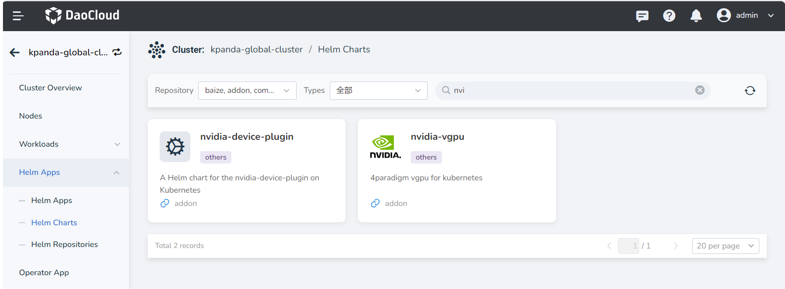
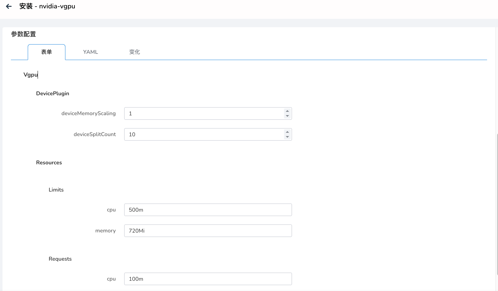

# Installing NVIDIA vGPU Addon

To virtualize a single NVIDIA GPU into multiple virtual GPUs and allocate them to different virtual machines or users, you can use NVIDIA's vGPU capability.
This section explains how to install the vGPU plugin in the DCE platform, which is a prerequisite for using NVIDIA vGPU capability.

## Prerequisites

- Refer to the [GPU Support Matrix](../../gpu_matrix.md) to confirm that the nodes in the cluster have GPUs of the corresponding models.
- The current cluster has deployed NVIDIA drivers through the Operator. For specific instructions, refer to [Offline Installation of GPU Operator](../install_nvidia_driver_of_operator.md).

## Procedure

1. Path: __Container Management__ -> __Cluster Management__ -> Click the target cluster -> __Helm Apps__ -> __Helm Charts__ -> Search for __nvidia-vgpu__ .

    

2. During the installation of vGPU, several basic modification parameters are provided. If you need to modify advanced parameters, click the YAML column to make changes:

    - __deviceCoreScaling__ : NVIDIA device core scaling factor, with a default value of 1. It can be greater than 1 (enabling virtual compute, experimental feature). If we configure the __devicePlugin.deviceCoreScaling__ parameter as S, in a Kubernetes cluster where we have deployed our device plugin, the vGPUs assigned from this GPU will have a total of __S * 100%__ of the compute power.

    - __deviceMemoryScaling__ : NVIDIA device memory scaling factor, the input value must be an integer, with a default value of 1. It can be greater than 1 (enabling virtual memory, experimental feature). For an NVIDIA GPU with a memory size of M, if we configure the __devicePlugin.deviceMemoryScaling__ parameter as S, in a Kubernetes cluster where we have deployed our device plugin, the vGPUs assigned from this GPU will have a total memory of __S * M__ .

    - __deviceSplitCount__ : An integer type, with a default value of 10. Number of GPU splits, each GPU cannot be assigned more tasks than its configuration count. If configured as N, each GPU can have up to N tasks simultaneously.

    - __Resources__ : Represents the resource usage of the vgpu-device-plugin and vgpu-schedule pods.

    - __ServiceMonitor__ : Disabled by default. After it is enabled, you can view the vGPU monitoring metrics in the Insight module. Make sure that insight-agent is installed and running before enabling it; otherwise, the installation of the NVIDIA vGPU Addon fails.

    

3. After a successful installation, you will see two types of pods in the specified namespace, indicating that the NVIDIA vGPU plugin has been successfully installed:

      

4. Then, click __Nodes__ in the left navigation bar, find the target node, click __GPU Mode Switch__ , and switch it to the vGPU mode.

    !!! note

        The NVIDIA vGPU capability supports node-level GPU mode switching (full card/vGPU/MIG mode) to meet the requirements of different workloads for different GPU modes in the same cluster.

    

    After you click __OK__ , the node status changes to __Switching GPU Mode__ . Wait until the switch is complete, that is, the hami-nvidia-vgpu-device-plugin pod of the vGPU starts. After that, the status changes to __Nvidia-vGPU__ .

    

    

5. After the GPU mode of the node is switched successfully, you can [deploy applications using vGPU resources](vgpu_user.md). Note that the switching takes a while, so deploy applications only after the node labels are displayed correctly.

## Upgrade Notes

### Upgrade from v2.6.1+1 to v2.7.1+1

> `+1` refers to the first build of a specific version. For example, `2.6.1+1` indicates the first packaged build of version `v2.6.1`.

Before upgrading the NVIDIA vGPU Addon from v2.6.1+1 to v2.7.1+1, you need to delete the `nvidia-vgpu-hami-scheduler`
clusterrolebinding resource. Run the relevant operation in the console.

```shell
kubectl delete clusterrolebinding nvidia-vgpu-hami-scheduler
```

### Upgrade from v2.0.0 to v2.0.0+1

NVIDIA vGPU Addon does not support upgrading directly from the older v2.0.0 to the
latest v2.0.0+1; To upgrade, please uninstall the older version and then reinstall the latest version.
