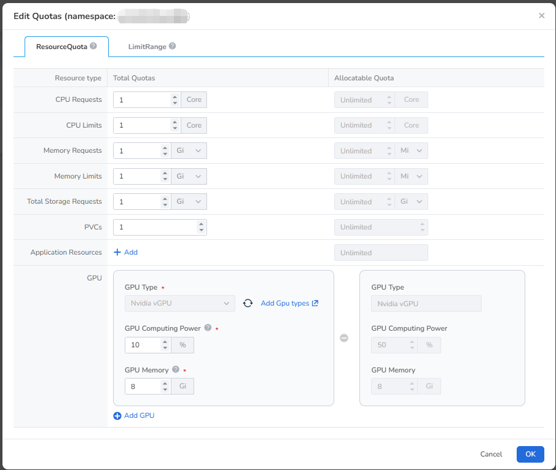

# GPU Quota Management

This section describes how to use vGPU capabilities on the DCE platform.

## Prerequisites

The corresponding GPU driver (NVIDIA GPU, NVIDIA MIG, Days, Ascend) has been deployed on the current cluster either through an Operator or manually.

## Procedure

Follow these steps to manage GPU quotas in DCE:

1. Go to Namespaces and click __Quota Management__ to configure the GPU resources that can be used by a specific namespace.

    

2. The GPU types supported by namespace quota management are: NVIDIA vGPU, NVIDIA MIG, Iluvatar, and Huawei Ascend.

3. **NVIDIA vGPU Quota Management**: Configure the available quota. After you save the settings, the
   system creates or updates a `ResourceQuota` CR:

    - **GPU Computing Power** (`nvidia.com/gpucores`): The total GPU computing power that the namespace
      can allocate. It is the sum across multiple GPUs and can therefore exceed 100%.
    - **GPU Memory** (`nvidia.com/gpumem`): The total GPU memory that the namespace can allocate. It is
      the sum of GPU memory across multiple GPUs.

    

    !!! note

        A separate physical GPU count is no longer required in the new quota model.

4. A namespace GPU quota is allocated from the workspace shared-resource quota:

    - **Allocated** is the sum of quotas assigned from the workspace to its namespaces, not real-time GPU usage.
    - **Remaining = Quota - Allocated**.
    - The sum of all namespace quotas cannot exceed the workspace shared-resource quota. Otherwise, the
      namespace cannot be bound to the workspace.
