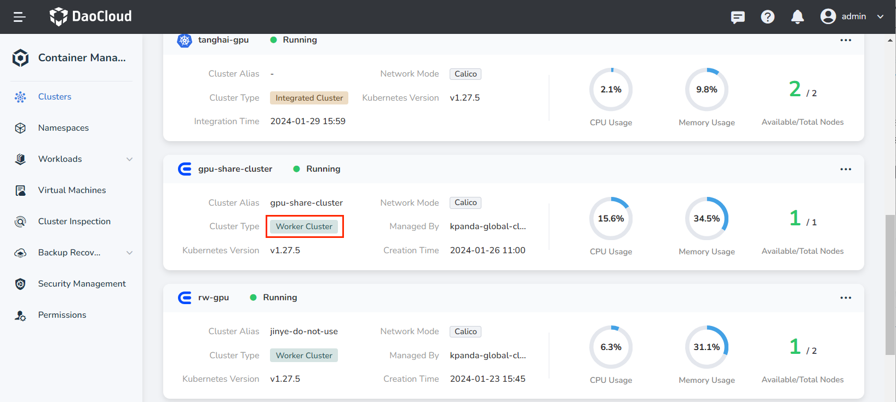
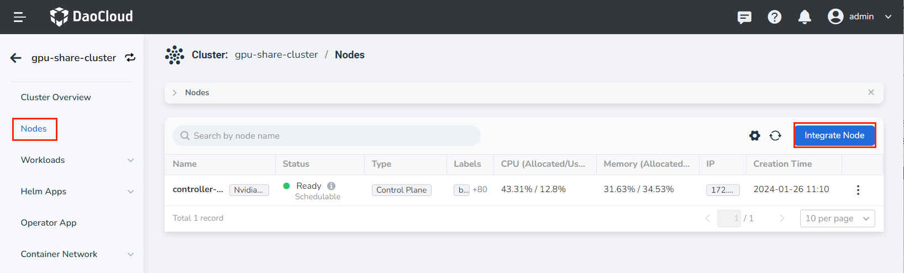
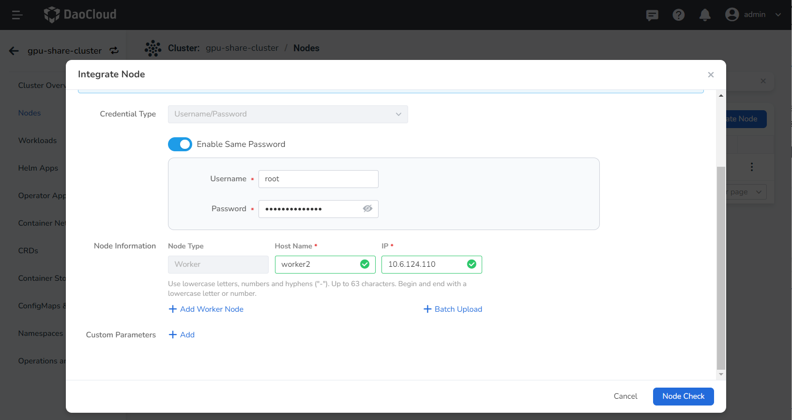

# Cluster Node Expansion

As the number of business applications continues to grow, the resources of the cluster become increasingly tight. At this point, you can expand the cluster nodes based on kubean. After the expansion, applications can run on the newly added nodes, alleviating resource pressure.

Only clusters [created through the container management module](../clusters/create-cluster.md) support node autoscaling. Clusters accessed from the outside do not support this operation. This article mainly introduces the expansion of **worker nodes** in the same architecture work cluster. If you need to add control nodes or heterogeneous work nodes to the cluster, refer to: [Expanding the control node of the work cluster](../../best-practice/add-master-node.md), [Adding heterogeneous nodes to the work cluster](../../best-practice/multi-arch.md), [Expanding the worker node of the global service cluster](../../best-practice/add-worker-node-on-global.md).

1. On the __Clusters__ page, click the name of the target cluster.

    If the __Cluster Type__ contains the label __Integrated Cluster__, it means that the cluster does not support node autoscaling.

    

2. Click __Nodes__ in the left navigation bar, and then click __Integrate Node__ in the upper right corner of the page.

    

3. Fill in the basic information of the nodes to be integrated, then click __Node Check__ at the bottom of the page. After the check passes, click __Next__. If the check fails, update the __Node Info__ and run the check again.

    - Authentication: choose whether to access nodes with a username/password or a public/private key pair.

        > To access nodes with a key pair, you need to configure the SSH key of the nodes in advance. Refer to [Authenticate Nodes with an SSH Key](../nodes/node-authentication.md).

    - Use a unified password: when enabled, all nodes in the cluster share the same access password, and you need to enter it below. When disabled, you can set a separate username and password for each node.
    - Node Info: enter the hostname, IP address, username, and password.
    - Batch Upload: download the provided CSV template (with the fields hostname, IP address, username, password, and node role), fill in the information of the nodes to be integrated, and upload it. The new nodes will be appended to the end of the list automatically.

    

4. Fill in the parameter settings and click __OK__.

    - __kubelet_max_pods__: sets the maximum number of Pods per node. The default is 110.
    - __override_system_hostname__: resets the hostname to the name generated by the system. It is recommended to keep this option disabled.
    - __Insecure_registries__: private registry configuration. When you use a private registry, fill in its address here to bypass certificate verification performed by the container engine, so that images can be pulled without certificate errors.
    - __os_package_repos__: the repository address of the operating system packages. Fill it in according to your actual environment.
    - __enable_node_sysctl_tuning__: node kernel parameter tuning, which improves the stability, reliability, security, and performance of the system by adjusting kernel parameters.

    

!!! note

    Accessing the node takes about 20 minutes, please be patient.

## References

- [Scaling Controller Nodes in a Worker Cluster](../../best-practice/add-master-node.md)
- [How to Add Heterogeneous Nodes to a Worker Cluster](../../best-practice/multi-arch.md)
- [Scaling the Worker Nodes of the Global Service Cluster](../../best-practice/add-worker-node-on-global.md)
- [Replace the first master node of the worker cluster](../../best-practice/replace-first-master-node.md)
