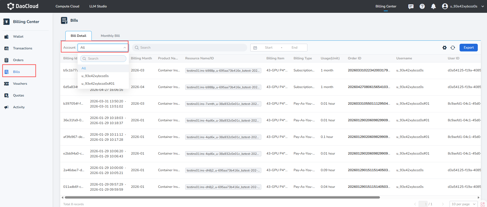

---
hide:
  - toc
---

# Bills

**Bills** provides multi-dimensional expense statistics and detail queries for users, helping enterprises fully understand their consumption and optimize financial management.
Currently, the following are supported:

- **Bill Details** records the detailed consumption information of each purchase made by a user, covering the specific usage and corresponding cost of each resource,
  which differs from [Transactions](./transactions.md) that focuses on balance changes of the [account wallet](./index.md).
- **Monthly Bills** summarizes the overall consumption of a user by month, and shows detailed consumption statistics by region, product, and account,
  helping users quickly understand cost trends and facilitating budget planning and expense analysis.

## Bill Details

**Bill Details** allows users to view per-transaction billing records of all resources on the platform, providing information such as bill ID, product name, billing type, order ID, and original price. Users can perform precise queries by account scope, table field, and time range, and can export bill details by filter criteria, which facilitates financial reconciliation and cost management.

Primary accounts can view bills of the primary account and its sub-accounts in Bill Details, and filter them with the **Account** drop-down list.

{width=900px}

After a sub-account signs in, Bill Details shows only the bills generated by the currently signed-in sub-account. Monthly Bills are visible and available to primary accounts only.

### Fields in Bill Details

Go to the **Bills** page and click **Bill Details** to view the list of bills on the current platform.

| Field | Description |
| --- | --- |
| Bill ID | A unique identifier for each bill record |
| Billing Cycle | Indicates the time range for the settlement of this bill |
| Billing Month | Indicates the month range to which the bill belongs |
| Product Name | The name of the product involved in the bill |
| Resource Name/ID | The name or unique identifier of the specific resource related to the consumption |
| Billing Item | The resource specification or usage item corresponding to this charge |
| Billing Type | The billing mode of the resource, such as annual/monthly subscription or pay-as-you-go |
| Usage (Unit) | The actual usage of the resource, displayed in the unit of the resource, such as hours, GB, and so on |
| Order ID | The order ID associated with this bill, making it easier to trace the specific source of consumption |
| Username / User ID | The user information that triggered this resource consumption |
| Original Price | The cost of the resource before any discounts or promotions are deducted |
| Voucher Deduction | The amount deducted by vouchers in this bill |
| Cash Amount | The actual cash amount paid by the account, that is, the amount payable after discounts are deducted |

### Multi-criteria Filtering

- Filter by account scope: Click the **Account** drop-down list to select `All`, `Primary Account`, `Sub-account A`, `Sub-account B`, and so on for filtering.

- Filter by list field: Bills can be searched by `Bill ID`, `Order ID`, `Resource ID`, `Product Name`, and `Billing Type`. Primary accounts can select primary-account or sub-account bills through the **Account** drop-down list, while sub-accounts can only view bills of the currently signed-in account.

- Filter by time range: Click the date picker to query bill records within a specified time range.

### Export Bill Details

- Click the **Export** button to filter by `account scope`, `product name`, and `time range`.

    

- The exported data contains all bill detail records that match the filter criteria.

## Monthly Bills

Monthly Bills are visible and available to primary accounts only. They provide monthly aggregated consumption statistics and support breakdown and export by region, product, and account, helping users understand the cost structure from the perspective of billing periods.

### Fields in Monthly Bills

Go to the **Bills** page and click **Monthly Bills** to view the monthly bill list. The list shows the consumption of the account for each month by billing period, and you can click the time box to select a **Billing Month**.

| Field | Description |
| --- | --- |
| Billing Month | The monthly consumption period |
| Original Price | The total cost before discounts are deducted |
| Voucher Deduction | The total amount deducted by vouchers in this billing period |
| Cash Payment | The amount actually paid after discounts are deducted |
| Details | Click to view multi-dimensional statistics for this billing period |

### Monthly Bill Details

Click the **Details** icon to view expense details in three dimensions for the billing period.

- By region: Shows the cost breakdown by the region where the resource is located, with fields including `Billing Month`, `Region`, `Original Price`, `Voucher Deduction`, and `Cash Payment`.

- By product: Breaks down the bill amount by product type. Fields include `Billing Month`, `Product Name`, `Expense Type`, `Original Price`, `Voucher Deduction`, and `Cash Payment`.

- By account: Shows the expense distribution by account. Fields include `Billing Month`, `Username/ID`, `Original Price`, `Voucher Deduction`, and `Cash Payment`.

Monthly Bills and their details are available to primary accounts only. When statistics are broken down by account, you can view the consumption amount of each sub-account, and the statistics should be consistent with the bill amount of the corresponding account in that billing period.

### Export Monthly Bills

- Click the **Export** button in the upper right corner of the page, which supports filtering data by `time range`.

- The exported data consists of the bill detail records that match the filter criteria.

- The exported data is counted separately by region, product, and account.

## More Information

- Learn about [Billing Rules](./pricing-rules.md)
- Learn about [Refund Notes](./refunds.md)
