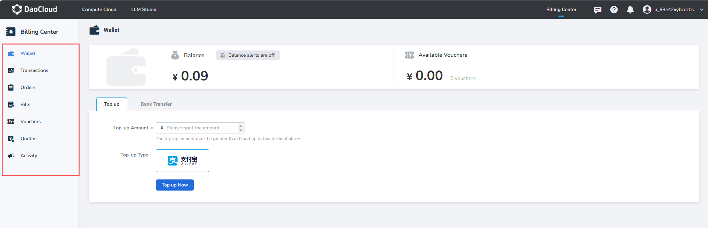
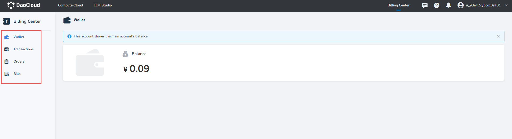
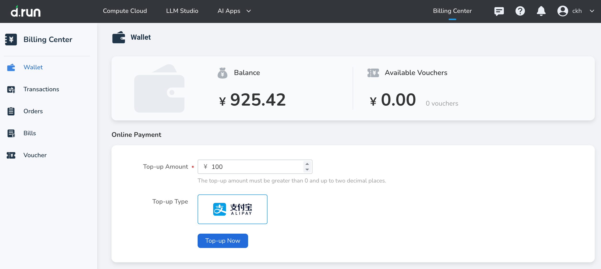

---
hide:
  - toc
---

# Wallet

The Wallet is the fund account of a user on the d.run platform, where users can top up, view the cash balance, and view vouchers. The wallet balance can be used directly to purchase platform services. Users can also view top-up and payment records in [Transactions](./transactions.md) as needed, achieving clear and traceable fund usage.

After signing in, a primary account can enter the Wallet page to top up and view balance, voucher, and other information.

{width=900px}

If the primary account has not set a quota for the sub-account, the sub-account can enter the Wallet page after signing in and view the balance shared with the primary account.

{width=900px}

## Top-up Methods

Currently, **Online Top-up** and **Offline Remittance** are supported.

!!! note

    1. The top-up amount can only be invoiced after it has been consumed.
    2. If you need an invoice, please contact customer service on the official website.

=== "Online Top-up"

    !!! note

        For compliance requirements, you must complete real-name verification before topping up online!

    1. Go to **Wallet**, click **Online Top-up**, enter the top-up amount, and select a payment method.

    2. Click the **Top-up Now** button to be redirected to a third-party payment channel to complete the payment.

        {width=900px}

    3. After the top-up is completed, view the total balance of the current account in **Cash Balance**, and you can view the top-up record in [Transactions](./transactions.md).

=== "Offline Remittance"

    !!! note

        When transferring or remitting funds, be sure to include your **company name** and **account name / registered email address** in the remarks, so that we can verify and credit the payment manually as quickly as possible.

    1. Go to **Wallet** and click **Offline Remittance** to obtain the official receiving account information.

    2. Complete the offline transfer following your bank's process, and keep the bank receipt.

    3. **Crediting method (choose one):**
        * **Manual verification:** Contact customer service and submit the bank receipt and account information, and backend staff will credit the balance manually.
        * **Self-service crediting via API:** Users with development capabilities can refer to the "Self-service Crediting via API" tab and call the API to submit a crediting request.

    4. After verification or a successful API call, the transferred amount is added to your **Cash Balance**.

=== "Self-service Crediting via API (Developers)"

    1. Obtain an authentication token: sign in to the platform with an account that has the `Expense Center - Corporate Transfer - Create` permission, and obtain the `Authorization` token from the browser console.

    2. Send the crediting request: run the following request through the command line or an API tool. Be sure to verify the parameters, as **once submitted, the request cannot be rolled back through the API**.

    ```bash
    curl --location 'https://console.d.run/apis/leopard.io/v1alpha1/wallet/corporate-transfer/recharge' \
    --header "Authorization: Bearer <YOUR_TOKEN>" \
    --header 'Content-Type: application/json' \
    --data '{
        "user_id" : "b6e793e4-bb3f-4cd9-8d0d-4849041bccf1",
        "amount" : "5000000",
        "serial_number" : "32861934",
        "message" : "corporate transfer remark",
        "payment_source_info" : {
            "account_name" : "payer account name",
            "bank_account" : "payer bank account",
            "bank_name" : "payer bank name"
        }
    }'
    ```

    Parameter description:

    | Parameter | Required | Description |
    | :--- | :--- | :--- |
    | `user_id` | Yes | The unique ID of the user to be topped up |
    | `amount` | Yes | Top-up amount, **in cents** (for example, 5000000 means 50,000 CNY) |
    | `serial_number` | Yes | Bank transaction serial number (used for unique verification) |
    | `message` | No | Transaction remark |
    | `payment_source_info` | Yes | **Payer object**, which contains the following fields: |
    | ∟ `account_name` | Yes | Name of the payer's bank account |
    | ∟ `bank_account` | Yes | Payer's bank account number |
    | ∟ `bank_name` | Yes | Name of the payer's bank |

    After the request succeeds, you can view the record in [Transactions](./transactions.md).

## Balance Alerts

1. Click **Balance Alert Off** next to **Cash Balance** (off by default) to enable it.

     {width=900px}

2. In the dialog box, enable the alert and set a threshold. When the balance falls below the specified amount, the system sends an SMS message to the bound phone number.

     {width=900px}
