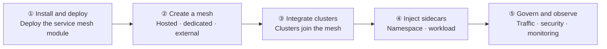

# Service Mesh

Service mesh is the next generation service mesh for cloud native applications, built on
the open-source technology of Istio. It provides a complete non-intrusive microservices
governance solution to unify the governance of complex multicloud and multicluster
environments, offering service traffic governance, security governance, service traffic
monitoring, and traditional microservices (SpringCloud, Dubbo) capabilities as infrastructure.

DCE's service mesh is compatible with the native Istio open-source service mesh and provides
native Istio access management capabilities. At a higher level, a service mesh helps reduce the
complexity of service governance and alleviate the pressure on development and operations teams.
The service mesh seamlessly integrates with the [container management](../../kpanda/intro/index.md)
platform and serves as infrastructure support for the [microservice engine](../../skoala/intro/index.md),
enabling unified management of various microservice systems through a single platform.

## Key Capabilities

- :material-lan:{ .lg .middle } __Mesh Creation and Management__

    ---

    Supports hosted, dedicated, and external mesh modes, covering mesh creation, deletion, and capacity management, with an operations-free managed control plane.

    [:arrow_forward: Create a mesh](../user-guide/service-mesh/index.md)

- :material-swap-horizontal:{ .lg .middle } __Traffic Governance__

    ---

    Configure weighted, content-based, and TCP/IP routing policies with virtual services, destination rules, and gateway rules for dynamic intelligent routing and elastic traffic management.

    [:arrow_forward: Traffic governance](../user-guide/traffic-governance/README.md)

- :material-chart-line:{ .lg .middle } __Traffic Monitoring__

    ---

    Visually displays link information, abnormal service responses, and excessively long response latency, with traffic topology for faster problem localization.

    [:arrow_forward: Traffic monitoring](../user-guide/traffic-monitor/README.md)

- :material-shield-check:{ .lg .middle } __Security Governance__

    ---

    Provides peer authentication, request authentication, and authorization policies to secure service-to-service communication with mTLS.

    [:arrow_forward: Security governance](../user-guide/security/README.md)

- :material-car-outline:{ .lg .middle } __Sidecar Management__

    ---

    Inject sidecars by namespace or workload, with sidecar resource optimization, traffic passthrough, and log level adjustment.

    [:arrow_forward: Sidecar management](../user-guide/sidecar-management/ns-sidecar.md)

- :material-gate:{ .lg .middle } __Mesh Gateway__

    ---

    Create and manage mesh gateway instances to provide a unified north-south traffic entry for services in the mesh.

    [:arrow_forward: Create a gateway instance](../user-guide/gateway-instance/create.md)

## Workflow

Using the service mesh typically involves two phases, **deployment and integration** followed by **governance and observation**: administrators deploy the module, create a mesh, and integrate clusters; business users then inject sidecars and start using traffic governance, security governance, and traffic monitoring capabilities.

| Step | Role | Description |
| --- | --- | --- |
| ① [Install and deploy](../install/install.md) | Platform administrator | Deploy the service mesh module in the DCE cluster |
| ② [Create a mesh](../user-guide/service-mesh/index.md) | Platform administrator | Create a mesh in hosted, dedicated, or external mode |
| ③ [Integrate clusters](../user-guide/cluster-management/join-clus.md) | Platform administrator | Add one or more clusters to the mesh for unified management |
| ④ [Inject sidecars](../user-guide/sidecar-management/ns-sidecar.md) | Business user | Inject sidecar proxies by namespace or workload |
| ⑤ [Traffic governance](../user-guide/traffic-governance/README.md) and [traffic monitoring](../user-guide/traffic-monitor/README.md) | Business user | Configure routing and security policies, and monitor service status in real time |

## Product Advantages

DCE's service mesh has the following advantages compared to other products:

| Advantage | Description |
| --------- | ----------- |
| Simple and easy to use | No need to modify any business code or manually install proxies — just enable the service mesh feature to experience non-intrusive service governance |
| Policy-based intelligent routing and elastic traffic management | Weighted, content-based, and TCP/IP routing rules; HTTP session persistence; rate limiting and outlier detection; network connection management; service authentication, authorization, and auditing |
| Graphical application panoramic topology | Visualized monitoring of link information, abnormal service responses, and long response latency, with invocation chain information for faster problem localization |
| Enhanced performance and reliability | Control plane and data plane are hardened and performance-optimized on top of the community version |
| Multi-cloud, multi-cluster, and multi-infrastructure | Operations-free managed control plane with unified governance, security, and monitoring; unified service discovery and management for containers, VMs, and other infrastructures |
| Protocol extension | Supports the Dubbo protocol |
| Traditional SDK integration | Applications built with Spring Cloud, Dubbo, and other traditional microservice SDKs can be migrated to the cloud native mesh environment without extensive code modification |

## Quick Start

  <a class="mspider-path-step" style="--path-c:#2196f3" href="../install/install/">
    1
    Install and deploy
    Deploy the service mesh module
    Go →
  </a>
  <a class="mspider-path-step" style="--path-c:#00acc1" href="../user-guide/service-mesh/">
    2
    Create a mesh
    Hosted · dedicated · external
    Go →
  </a>
  <a class="mspider-path-step" style="--path-c:#43a047" href="../user-guide/cluster-management/join-clus/">
    3
    Integrate clusters
    Clusters join the mesh
    Go →
  </a>
  <a class="mspider-path-step" style="--path-c:#fb8c00" href="../user-guide/sidecar-management/ns-sidecar/">
    4
    Inject sidecars
    Namespace · workload
    Go →
  </a>
  <a class="mspider-path-step" style="--path-c:#8e24aa" href="../user-guide/traffic-governance/">
    5
    Govern and observe
    Traffic · security · monitoring
    Go →
  </a>

## More Resources

- :material-format-list-bulleted:{ .lg .middle } __Features__

    ---

    A complete list of service mesh capabilities, from mesh management and traffic governance to security and monitoring.

    [:arrow_forward: View features](features.md)

- :material-map-outline:{ .lg .middle } __Architecture__

    ---

    Understand the overall architecture of the service mesh, its control plane components, and system namespaces.

    [:arrow_forward: View architecture](comp-archi-ui/index.md)

- :material-chat-question-outline:{ .lg .middle } __FAQ__

    ---

    Common questions and solutions related to service mesh usage.

    [:arrow_forward: View FAQ](faq.md)

- :material-bug-outline:{ .lg .middle } __Troubleshooting__

    ---

    A continuously updated troubleshooting handbook covering mesh creation, cluster integration, sidecar issues, and more.

    [:arrow_forward: View troubleshooting](../troubleshoot/index.md)

[Download Center](https://docs.daocloud.io/en/download/){ .md-button }
[Learn about d.run Token Factory](https://docs.daocloud.io/en/tf/){ .md-button }
[Learn about d.run AI OS](https://docs.daocloud.io/en/drun/){ .md-button }
[View the Service Mesh User Guide (PDF)](https://harbor-test2.cn-sh2.ufileos.com/docs/download/docs/mspider.pdf){ .md-button }
