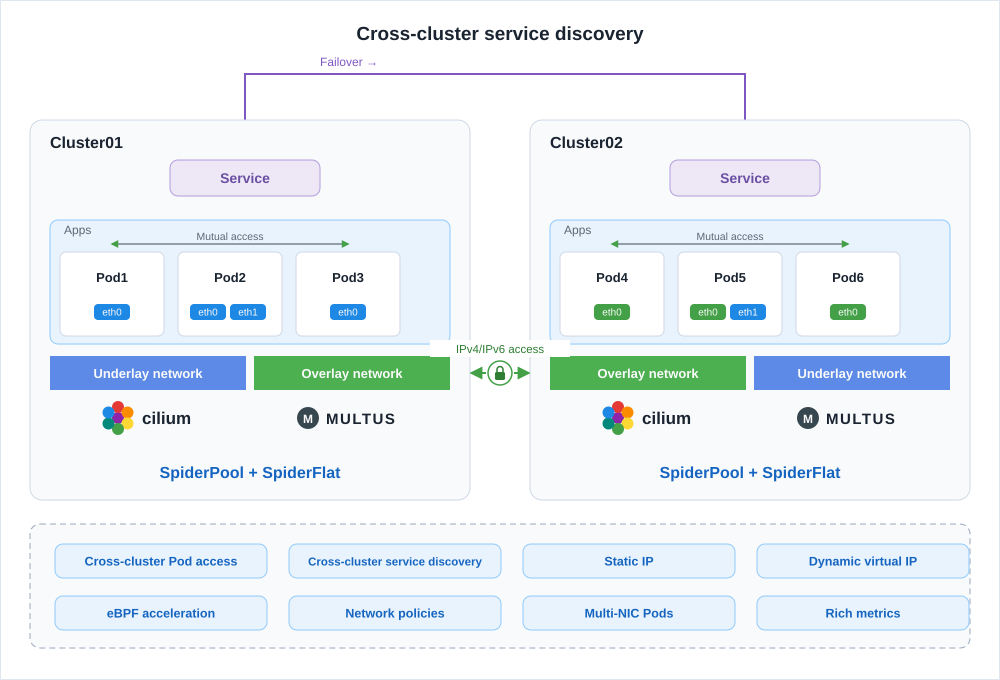
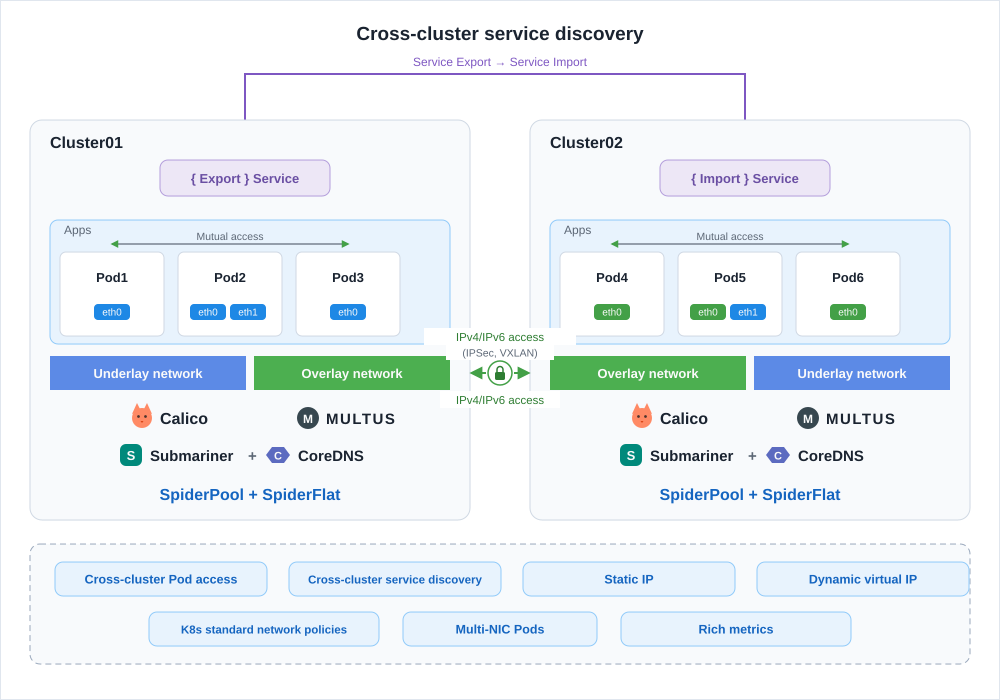

---
hide:
  - toc
MTPE: windsonsea
date: 2024-10-10
---

# Network Portfolio Solutions

Based on open source projects, Cloud Native Networking provides not only single CNI network support, but also multiple CNI portfolio solutions.

-   :material-lan:{ .lg .middle } __Cilium portfolio__

    ---

    For high kernel versions (4.19.57+). An eBPF-accelerated Overlay network combined with an Underlay network delivers cross-cloud and cross-cluster connectivity.

    [:arrow_forward: View the solution](#cilium-macvlanipvlansr-iov-spiderpool-multus)

-   :material-server-network:{ .lg .middle } __Calico portfolio__

    ---

    For low kernel versions. An iptables-based Overlay network with an Underlay network, and Submariner bridges the two clusters.

    [:arrow_forward: View the solution](#calico-macvlanipvlansr-iov-spiderpool-multus)

-   :material-chip:{ .lg .middle } __AI/RDMA quick start__

    ---

    Building an AI or HPC cluster? Start from the RDMA network solutions.

    [:arrow_forward: Read the solutions](#airdma-quick-start)

## Cilium + Macvlan/Ipvlan/SR-IOV + SpiderPool + Multus

This solution applies to Linux with a high kernel version (4.19.57+).
Multus is the scheduling core that combines multiple CNIs: Cilium provides an eBPF-accelerated Overlay network, Macvlan / SR-IOV / IPvlan provides the Underlay network, and SpiderPool manages IP allocation and recycling for the Underlay network. Together they deliver connectivity across clouds and clusters, and different IP pools serve different application scenarios.

The following diagram shows the architecture:

The roles and applicability of each component are as follows:

| Component | Role | Required? | Description |
| --- | --- | --- | --- |
| Multus | Scheduling core | Optional | Allocates IPs from multiple CNIs to Pods, supporting polymorphic network communication and cross-CNI Pod communication within a cluster. Skip it if the application does not require multiple Pod NICs or different network modes |
| SpiderPool | Underlay IPAM | Optional | Provides fine-grained IP management and flexible IP planning and allocation. Skip it if no Underlay CNI is used in your scenario |
| Cilium | Overlay CNI | Required | Uses eBPF kernel acceleration to provide a high-performance Overlay network, cross-cluster Pod and Service communication, flexible fine-grained network policies, and rich traffic observation |
| Macvlan / SR-IOV / IPvlan | Underlay CNI | Optional | Provides external access IPs for Pods and enables Layer 2 external communication. Combined with the Cilium dynamic virtual network, it reduces network O&M effort and saves IP resources. Skip it if there is no external access requirement |

## Calico + Macvlan/Ipvlan/SR-IOV + SpiderPool + Multus

This solution applies to Linux with a low kernel version, and suits environments that need cross-cluster connectivity, multiple CNIs, and similar requirements.
Multus is likewise the scheduling core that combines multiple CNIs: Calico provides an iptables-based Overlay network, Macvlan / SR-IOV / IPvlan provides the Underlay network, SpiderPool manages IPs for the Underlay network, and Submariner with CoreDNS handles cross-cluster communication and service discovery.

The following diagram shows the architecture:

The roles and applicability of each component are as follows:

| Component | Role | Required? | Description |
| --- | --- | --- | --- |
| Multus | Scheduling core | Optional | Allocates IPs from multiple CNIs to Pods, supporting polymorphic network communication and cross-CNI Pod communication within a cluster. Skip it if the application does not require multiple Pod NICs or different network modes |
| SpiderPool | Underlay IPAM | Optional | Provides fine-grained IP management and flexible IP planning and allocation. Skip it if no Underlay CNI is used in your scenario |
| Calico | Overlay CNI | Required | Provides an iptables-based Overlay network and supports standard Kubernetes network policies |
| Macvlan / SR-IOV / IPvlan | Underlay CNI | Optional | Provides external access IPs for Pods and enables Layer 2 external communication. Combined with the Calico dynamic virtual network, it reduces network O&M effort and saves IP resources. Skip it if there is no external access requirement |
| Submariner + CoreDNS | Cross-cluster networking | Optional | Submariner connects Pods across clusters, and CoreDNS provides cross-cluster service discovery. Install them as needed |

## AI/RDMA quick start

If you are building an AI cluster or a high-performance computing (HPC) cluster, read the [AI/RDMA network solutions overview](../modules/spiderpool/install/ai-rdma.md) first for a comparison and selection guide, then choose a deployment according to your scenario:

-   :material-share-variant:{ .lg .middle } __Shared RDMA (Macvlan/IPvlan)__

    ---

    Multiple Pods share RDMA devices (RoCE protocol) with high resource utilization, which is cost-effective and quick to deploy for general use cases.

    [:arrow_forward: Get started](../modules/spiderpool/install/rdma-macvlan.md)

-   :material-connection:{ .lg .middle } __Dedicated RDMA (SR-IOV RoCE)__

    ---

    Dedicate a RoCE NIC through SR-IOV for the best performance and isolation, suiting high-performance training and inference scenarios.

    [:arrow_forward: Get started](../modules/spiderpool/install/rdma-sriov-roce.md)

-   :material-developer-board:{ .lg .middle } __Dedicated RDMA (SR-IOV InfiniBand)__

    ---

    Dedicate an InfiniBand NIC through SR-IOV for InfiniBand Fabric environments.

    [:arrow_forward: Get started](../modules/spiderpool/install/rdma-sriov-ib.md)

[Download Center](https://docs.daocloud.io/en/download/){ .md-button }
[Learn about d.run Token Factory](https://docs.daocloud.io/en/tf/){ .md-button }
[Learn about d.run AI OS](https://docs.daocloud.io/en/drun/){ .md-button }
[View the Network User Manual (PDF)](https://harbor-test2.cn-sh2.ufileos.com/docs/download/docs/network.pdf){ .md-button }
