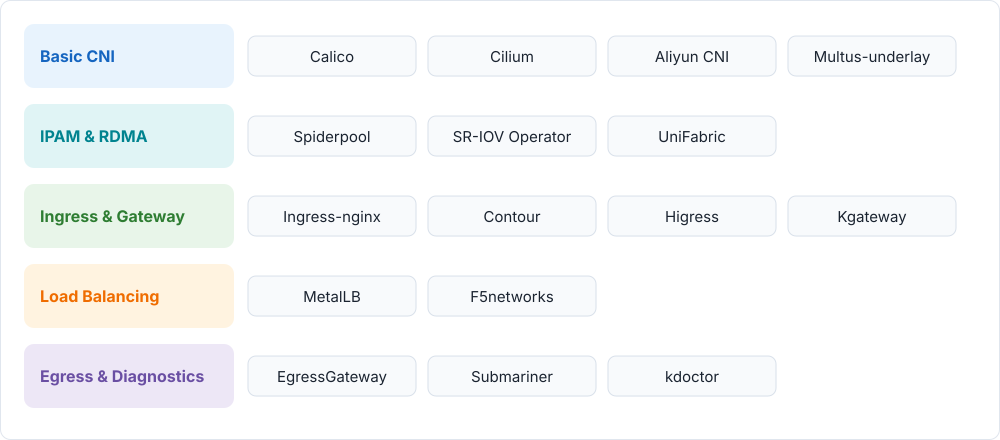

---
hide:
  - toc
---

# Network Components

The network solution provided by DaoCloud is an optimized combination of current mainstream
open source network components, which can meet the needs of various complex cases.
This page organizes all 16 components under `network/modules/` into five groups.
Each component can be installed independently or combined with others on demand.

## Component List

### Basic CNI {: #basic-cni }

| Component | Description |
| --- | --- |
| [Calico](calico/index.md) | Virtual Router implemented based on Linux kernel technology to complete data plane forwarding. |
| [Cilium](cilium/index.md) | Network solution based on eBPF kernel |
| [Aliyun CNI](aliyun-terway/index.md) | CNI plugin running on Alibaba Cloud, providing stable and high-performance support for advanced features such as Kubernetes network policy and flow control. |
| [Multus-underlay](multus-underlay/index.md) | Multi-NIC solution based on Multus with Macvlan + SR-IOV CNI. |

### IPAM & RDMA {: #ipam-rdma }

| Component | Description |
| --- | --- |
| [Spiderpool](spiderpool/index.md) | Automatically manage IP resources |
| [SR-IOV Network Operator](sriov-network-operator/index.md) | Integrates sriov-cni and sriov-device-plugin to configure SR-IOV NICs through CRDs. |
| [UniFabric](unifabric/index.md) | Discovers RDMA network topology, publishes it as Kubernetes custom resources, and provides node-level RDMA metrics. |

### Ingress & Gateway {: #ingress-gateway }

| Component | Description |
| --- | --- |
| [Ingress-nginx](ingress-nginx/index.md) | Ingress controller hosted by the Kubernetes community, using nginx as a reverse proxy and load balancer. |
| [Contour](contour/index.md) | An open source Kubernetes Ingress controller that uses Envoy as the data plane. |
| [Higress](higress/index.md) | A cloud-native API gateway built on Envoy that follows the Kubernetes Gateway API standard and is compatible with Ingress. |
| [Kgateway](kgateway/index.md) | A high-performance, cloud-native API gateway built on Envoy with deep Kubernetes Gateway API integration. |

### Load Balancing {: #load-balancing }

| Component | Description |
| --- | --- |
| [MetalLB](metallb/index.md) | Kubernetes load balancer solution for Bare Metal. |
| [f5networks](f5networks/index.md) | Fully control the F5 devices, synchronize the service and ingress configurations in the cluster to the F5 hardware devices, and realize the load balancing of the northbound ingress of the cluster. |

### Egress & Diagnostics {: #egress-diagnostics }

| Component | Description |
| --- | --- |
| [EgressGateway](egressgateway/index.md) | An open-source egress gateway that provides fixed Egress IPs for tenant- or cluster-level workloads. |
| [Submariner](submariner/index.md) | Cross-cluster network communication solution. |
| [kdoctor](kdoctor/index.md) | A Kubernetes data plane testing component based on active stress injection for functional and performance checks. |

!!! note

    All the above components such as CNI and Ingress can be installed on demand. Refer to each component's documentation for installation steps, version requirements, and combination guidance.

[Download Center](https://docs.daocloud.io/en/download/){ .md-button }
[Learn about d.run Token Factory](https://docs.daocloud.io/en/tf/){ .md-button }
[Learn about d.run AI OS](https://docs.daocloud.io/en/drun/){ .md-button }
