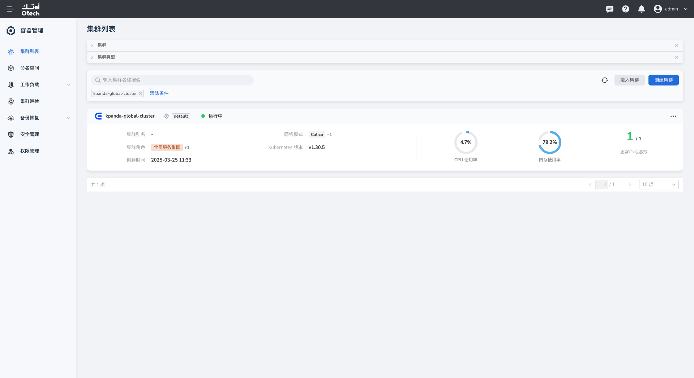
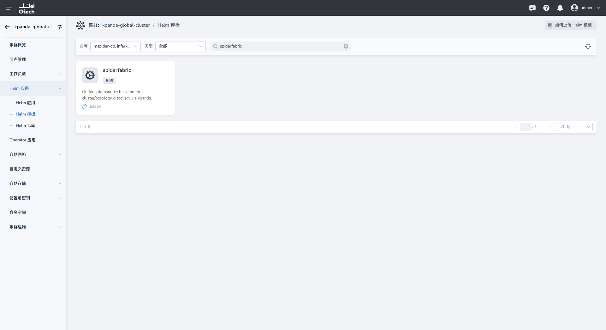
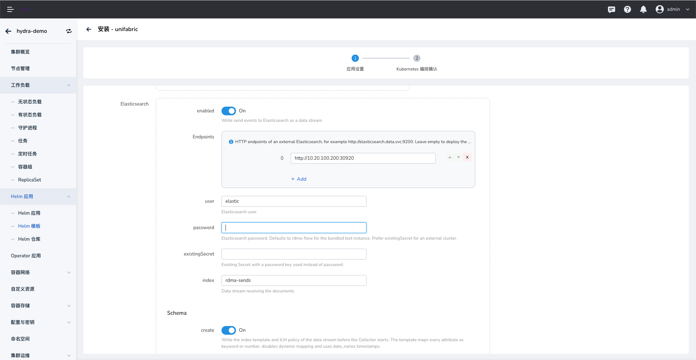
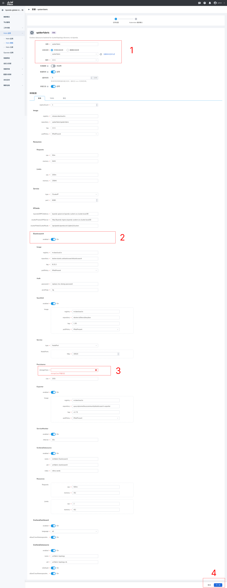

# Install Spiderfabric on the Global Cluster

Install Spiderfabric on the global cluster to provide the Grafana data source backend for cluster topology discovery. The installation also applies a `GrafanaDashboard` resource. The following steps use DCE Helm templates.

## Prerequisites

- The global cluster is connected to DCE, and your account can install Helm applications.
- The Spiderfabric template is available in a Helm template repository.
- A storage class is available for Spiderfabric. The `storageClass` field is required for persistence.

## Procedure

1. Open the global cluster from the cluster list. The cluster name depends on your environment.

    

2. Select **Helm Apps > Helm Templates** from the left navigation, search for `spiderfabric`, and select the chart.

    

3. Configure the application details. Keep or change the application name and namespace according to your conventions, then select an available chart version. Version `1.0.1` in the screenshot is an example only.

4. Configure the chart values.

    - Under **Persistence**, enter the prepared `storageClass` and set the storage capacity according to your data retention requirements. This field cannot be empty.
    - Enable Elasticsearch only if you plan to use eBPF Flow. Otherwise, leave it disabled. If enabled with an external Elasticsearch cluster, enter an endpoint reachable from the cluster and its authentication details. Do not use the example credentials shown in the screenshot.
    - Check that the image registry and resource requests and limits are appropriate for your environment.

    

    

5. Select **Next** and review the Kubernetes manifests. Submit the installation after confirming the configuration.

    

## Verify the Installation

In the global cluster's **Helm Apps** list, confirm that the Spiderfabric application was deployed successfully. If deployment fails, review the Helm task details. On Grafana's **Dashboards** page, confirm that the `spiderfabric-zh` or `spiderfabric-en` folder is present.