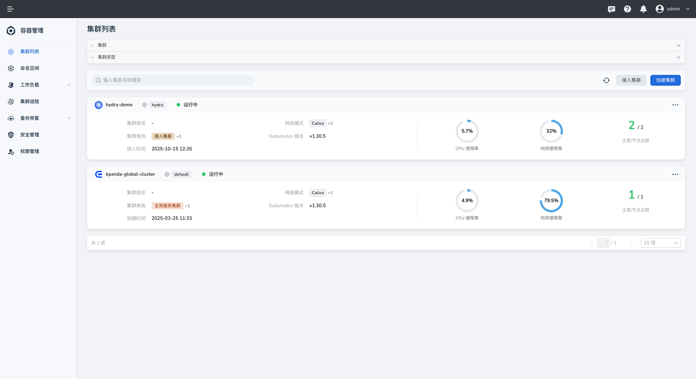
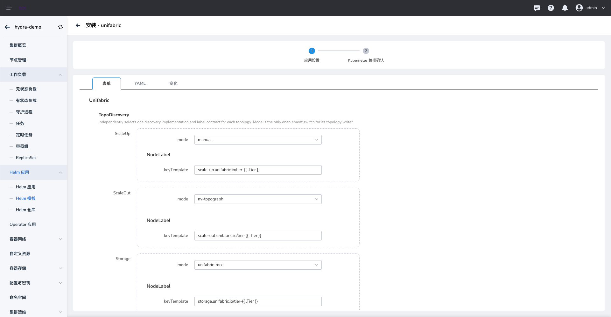

# Install Unifabric on a Worker Cluster

After installing Spiderfabric on the global cluster, install Unifabric on each worker cluster where RDMA network information must be collected. The following steps use DCE Helm templates.

## Prerequisites

- The target worker cluster is connected to DCE, and your account can install Helm applications.
- Spiderfabric is installed on the global cluster.
- Nodes from which RDMA information must be collected have RDMA network capability.

## Procedure

1. Open the worker cluster where you want to install Unifabric.

    

2. Select **Helm Apps > Helm Templates** from the left navigation, search for `unifabric`, and select the chart.

    

3. Configure the application details and select an available chart version. Version `0.4.2` in the screenshot is an example only.

4. Configure the chart values for your network environment.

    - Under **TopoDiscovery**, configure the discovery modes for ScaleUp, ScaleOut, and Storage. The screenshot shows `manual`, `nv-topograph`, and `unifabric-roce` as examples. Select modes that match your topology discovery setup.
    - Enable **EbpfFlow** to collect RDMA Flow metrics. This feature requires Linux kernel 5.8 or later with BPF ring buffer and uprobe support.
    - **FlowEvents** emits per-flow events, send-size metrics, and OTLP rows. Enable it only when per-send details are required. Cumulative bytes, WR, and QP Flow metrics remain available when it is disabled.
    - Configure Elasticsearch as needed. If you use an external Elasticsearch cluster, enter an endpoint reachable from the worker cluster and its authentication details. You can also use an existing Secret as supported by the chart.
    - Review the remaining values, especially image registries, resource settings, and component enablement.

    

    

5. Select **Next** and review the generated YAML on the Kubernetes manifest confirmation page. Confirm the target cluster, namespace, and values before submitting the installation.

    

## Verify the Installation

In the target worker cluster's **Helm Apps** list, confirm that the Unifabric application was deployed successfully. You can also check the Pod status in the namespace shown in the installation form:

```bash
kubectl get pods -n <namespace>
```

Replace `<namespace>` with the namespace selected during installation. Confirm that the Unifabric Controller and node Agents are ready.