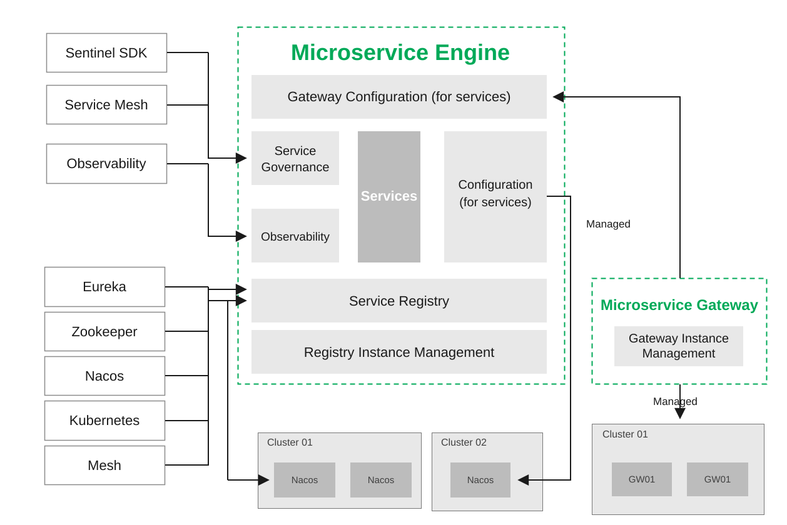

# Microservice Engine

DaoCloud Microservice Engine is a one-stop microservice management platform for mainstream microservice ecosystems
in the industry. It mainly provides two dimensions of functionalities: Microservice Governance Center and
Microservice Gateway. It covers various management scenarios throughout the microservice lifecycle, including
service registration and discovery, configuration management, traffic governance, service-level tracing, API management,
domain management, monitoring, and alerting. The Microservice Engine has strong compatibility and can seamlessly
integrate with other components of DaoCloud. It also perfectly supports open-source ecosystems such as Spring Cloud
and Dubbo, helping you to build your own microservice system using open-source microservice technologies more conveniently.

## Product Panorama

  

    
Gateway

    

      <a class="tf-arch-card tf-arch-card--model" href="../gateway/">
        Gateway Management
        Lifecycle management of gateway instances
      </a>
      <a class="tf-arch-card tf-arch-card--model" href="../gateway/api/">
        API Management
        API policies and secure authentication
      </a>
      <a class="tf-arch-card tf-arch-card--model" href="../gateway/domain/">
        Domain Management
        Domain and policy configuration
      </a>
      <a class="tf-arch-card tf-arch-card--model" href="../gateway/alert/">
        Monitoring and Alerting
        Resource and service metrics
      </a>
    

  

  
▲

  

    
Cloud Native

    

      <a class="tf-arch-card tf-arch-card--compute" href="../cloud-ms/traffic-control/">
        Traffic Governance
        Mesh and Istio traffic governance
      </a>
      <a class="tf-arch-card tf-arch-card--compute" href="../cloud-ms/lane/">
        Traffic Lane
        End-to-end canary release
      </a>
      <a class="tf-arch-card tf-arch-card--compute" href="../standard/monitor/">
        Sentinel Monitoring
        Observing flow control rules
      </a>
    

  

  
▲

  

    
Traditional

    

      <a class="tf-arch-card tf-arch-card--compute" href="../trad-ms/hosted/">
        Registry and Config Center
        Hosted Nacos and configuration
      </a>
      <a class="tf-arch-card tf-arch-card--compute" href="../trad-ms/integrated/">
        Integrated Registry
        Eureka / ZooKeeper / Nacos / Consul
      </a>
      <a class="tf-arch-card tf-arch-card--compute" href="../standard/sentinel/">
        Integrate with Sentinel
        Flow control, circuit breaking, hotspots
      </a>
    

  

  
▲

  

    
Shared Capabilities

    

      <a class="tf-arch-card tf-arch-card--ops" href="../plugins/intro/">
        Plugin Center
        Wasm plugins with one-click toggle
      </a>
      <a class="tf-arch-card tf-arch-card--ops" href="features/">
        Features
        Complete feature list
      </a>
      <a class="tf-arch-card tf-arch-card--ops" href="scenarios/">
        Use Cases
        Typical scenarios and benefits
      </a>
    

  

## Product Architecture

## Documentation Navigation

-   :material-run-fast:{ .lg .middle } __Quick Start__

    ---

    - [Manage Components of Microservice Engine](../quickstart/skoala.md)
    - [Initialize Component of Microservice Engine Cluster](../quickstart/skoala-init.md)
    - [Select Workspace](../quickstart/select-workspace.md)
    - [Troubleshoot skoala-init](../troubleshoot/auth-server.md)

-   :material-connection:{ .lg .middle } __Service Integration Specification__

    ---

    - [Integrate with Sentinel](../standard/sentinel.md)
    - [Integrate with Nacos SDK](../standard/nacos.md)
    - [Integrate with Sentinel Monitoring](../standard/monitor.md)
    - [Integrate with Sentinel Cluster Flow Control](../standard/flow-control.md)

-   :fontawesome-solid-cubes-stacked:{ .lg .middle } __Best Practices__

    ---

    - [Experience Microservice Governance with Sample Applications](../best-practice/use-skoala-01.md)
    - [Using JWT Plugin in Cloud-Native Microservices](../best-practice/plugins/jwt.md)
    - [Integrate Microservice Gateway with Authentication Server](../best-practice/auth-server.md)
    - [Gateway API Policy](../best-practice/gateway02.md)

-   :material-engine:{ .lg .middle } __Cloud Native Microservices__

    ---

    - [Import/Remove Services](../cloud-ms/traffic-control.md)
    - [Traffic Governance](../cloud-ms/traffic-control.md)
    - [Nacos Stress Testing Report](../tests/nacos-stress-test.md)

-   :material-gate:{ .lg .middle } __Cloud Native Gateway__

    ---

    - [Gateway Management](../gateway/index.md)
    - [API Management](../gateway/api/index.md)
    - [Service Integration](../gateway/service/manual-integrate.md)
    - [Monitoring and Alerting](../gateway/alert.md)
    - [Domain Management](../gateway/domain/index.md)
    - [Gateway Stress Testing Report](../tests/gateway-stress-test.md)

-   :simple-legacygames:{ .lg .middle } __Traditional Microservices__

    ---

    - [Hosted Registration and Configuration Center](../trad-ms/hosted/index.md)
        - [Microservice List](../trad-ms/hosted/services/index.md)
        - [Microservice Configuration Management](../trad-ms/hosted/configs.md)
        - [Microservice Monitoring](../trad-ms/hosted/monitor/microservices.md)
    - [Integrated Registration Center](../trad-ms/integrated/index.md)
        - [Microservice Management](../trad-ms/integrated/manage-service.md)
        - [Service Tracing](../trad-ms/integrated/trace.md)

## Learning Path

  <a class="skoala-path-step" style="--path-c:#2196f3" href="../quickstart/skoala/">
    1
    Deploy the Engine
    Install Microservice Engine components
    Go →
  </a>
  <a class="skoala-path-step" style="--path-c:#00acc1" href="../quickstart/skoala-init/">
    2
    Initialize Components
    Install the skoala-init cluster component
    Go →
  </a>
  <a class="skoala-path-step" style="--path-c:#43a047" href="../quickstart/select-workspace/">
    3
    Select Workspace
    Define the management boundary
    Go →
  </a>
  <a class="skoala-path-step" style="--path-c:#fb8c00" href="../trad-ms/integrated/">
    4
    Integrate Microservices
    Connect registries and manage traditional and cloud-native microservices
    Go →
  </a>
  <a class="skoala-path-step" style="--path-c:#8e24aa" href="../cloud-ms/traffic-control/">
    5
    Govern Traffic
    Sentinel / Mesh for east-west traffic
    Go →
  </a>
  <a class="skoala-path-step" style="--path-c:#e53935" href="../gateway/">
    6
    Configure Gateway
    Create gateways, manage north-south APIs
    Go →
  </a>

[Download Center](https://docs.daocloud.io/en/download/){ .md-button }
[Learn about d.run Token Factory](https://docs.daocloud.io/en/tf/){ .md-button }
[Learn about d.run AI OS](https://docs.daocloud.io/en/drun/){ .md-button }
